# STOCKGUARD

STOCKGUARD is an inventory management and order reservation platform built with Java, Spring Boot, PostgreSQL, and React. It tracks stock across multiple warehouses, records inventory changes in an append-only transaction ledger, and manages reservations while protecting inventory consistency under concurrent operations.

---

## What STOCKGUARD Does

STOCKGUARD provides an operations command center for multi-facility inventory tracking:

* **Catalog and facility management:** Organizes products with normalized SKUs and warehouses with geographic locations and priority routing.
* **Stock movements:** Ingests inbound receipts and records cycle-count or shrinkage adjustments with mandatory reason codes.
* **Inter-facility transfers:** Moves inventory directly between warehouses within a single transaction, ensuring physical stock conservation ($\Delta \text{OnHand} = 0$).
* **Order reservations:** Holds inventory for customer orders with time-to-live (TTL) expiration, preventing overselling during checkout.
* **Mathematical reconciliation:** Compares materialized balance tables against historical ledger entries to detect and flag any accounting drift.
* **Spatial warehouse visualization:** Renders an interactive 3D model of warehouse racks, capacities, and item locations in the browser using WebGL and Three.js.

---

## Main Features

* **Append-only ledger:** Every balance change writes an immutable row to `inventory_ledger_entries`. Database triggers block `UPDATE`, `DELETE`, and `TRUNCATE` operations on ledger tables.
* **Deterministic lock ordering:** Multi-item write operations acquire row-level locks on inventory balances in ascending order (`product_id ASC, warehouse_id ASC`) to prevent deadlocks.
* **Two-phase reservations:** Orders allocate stock in an initial pending phase. A background worker periodically scans for expired reservations and restores stock to available inventory.
* **Mathematical reconciliation:** An on-demand and scheduled reconciliation engine compares live balances ($Available = OnHand - Reserved$) against cumulative sums from the transaction ledger.
* **Multi-tenant access control:** Supports four tenant roles (`ADMIN`, `MANAGER`, `OPERATOR`, `VIEWER`) across 23 permissions. Row locks prevent demoting or deactivating an organization's last administrator.
* **Cryptographic session tokens:** 15-minute HMAC-SHA256 JWT access tokens paired with rotating refresh tokens stored in `HttpOnly`, `SameSite=Strict` cookies.
* **3D warehouse visualizer:** Interactive browser canvas showing warehouse layout, rack utilization heatmaps, camera presets, and inventory flow simulations.
* **Public demonstration mode:** Optional read-only visitor mode (`demo.visitor@stockguard.dev`) with server-side mutation guards rejecting write requests.

---

## Architecture and Technology Stack

The application is structured as a modular monolith. Domain boundaries are organized into distinct modules within a single Spring Boot deployable artifact, sharing a single PostgreSQL database:

```
src/main/java/com/stockguard/
├── audit/           # Operational and security event logging
├── demo/            # Synthetic demonstration data generator and visitor mode
├── inventory/       # Stock balances, transactions, ledger entries, and reconciliation
├── order/           # Customer orders, status progression, and line items
├── organization/    # Tenants, memberships, and last-admin protections
├── product/         # Product catalog and normalized SKU indexing
├── reservation/     # Stock allocations and background expiration workers
├── security/        # JWT issuance, key rotation, session tracking, and RBAC
├── shared/          # Idempotency engine and common exceptions
├── transfer/        # Multi-item inter-warehouse inventory transfers
└── warehouse/       # Warehouse facilities, codes, and priority sorting
```

### Technology Stack
* **Backend:** Java 21, Spring Boot 4.1.2, Spring Security, Spring Data JPA, Spring JDBC (for row-level locking), Flyway, JJWT 0.12.6, Micrometer Prometheus.
* **Frontend:** React 19, TypeScript, Vite, Tailwind CSS v4, Three.js (WebGL 3D visualizer), Lucide React.
* **Database:** PostgreSQL 16 with separate schema migration (`stockguard_owner`) and runtime application (`stockguard_app`) roles.
* **Ingress & TLS:** Nginx reverse proxy providing TLS termination, static SPA hosting, and security headers.
* **Observability:** Prometheus metric scrapers polling `/actuator/prometheus` via HTTP Basic Auth.

---

## Important Engineering Decisions

Key Architecture Decision Records (ADRs) document the system design:

* **Modular monolith (ADR-001):** Avoids distributed transactions, network partitioning failure modes, and operational overhead of microservices while keeping domain logic cleanly separated.
* **PostgreSQL as authoritative source of truth (ADR-002):** Enforces data consistency using database check constraints, unique indexes, foreign keys, row-level locks, and trigger-enforced append-only tables rather than distributed caches.
* **Canonical lock ordering (ADR-003):** Ensures all operations touching multiple products or warehouses acquire locks in a globally consistent order (`product_id ASC, warehouse_id ASC`) to reduce deadlock risk.
* **Dual persistence with JPA and JDBC (ADR-008):** Uses Spring Data JPA for domain modeling and relationship mapping, combined with Spring JDBC for row-level locking (`SELECT ... FOR UPDATE`) and high-throughput batch operations.
* **Rotating refresh tokens and dynamic key registry (ADR-010):** Issues short-lived access tokens alongside rotating refresh tokens stored in secure cookies. Supports zero-downtime JWT signing key rotation with retiring verification keys.
* **Three-network Docker isolation (ADR-014):** In Compose deployments, containers communicate over three isolated bridge networks: public ingress (`nginx`), internal database (`postgres` and `app`), and monitoring (`prometheus` and `app`).

---

## Screenshots

Visual captures taken from the local isolated staging deployment (`https://localhost:8443`):

| View | Screenshot | Description |
|---|---|---|
| **3D Spatial Digital Twin** | 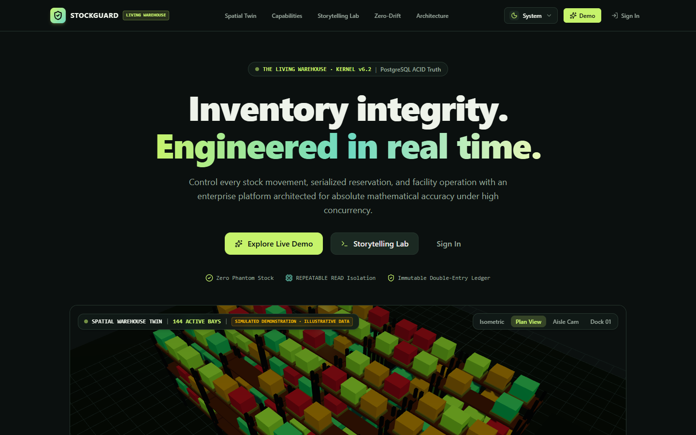 | WebGL rendering of warehouse racks, camera presets, and interactive simulation. |
| **Theme System (Light Mode)** | 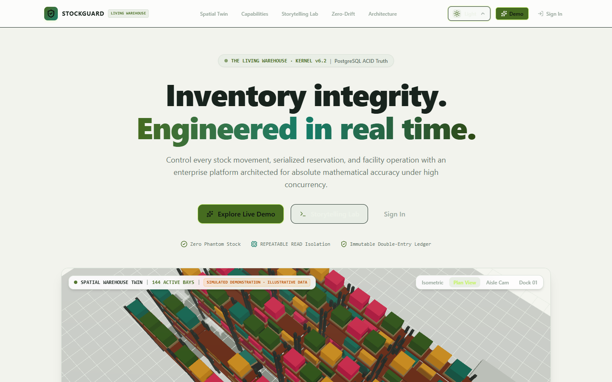 | Light and dark mode support with preserved WebGL context. |
| **Authentication & Errors** | 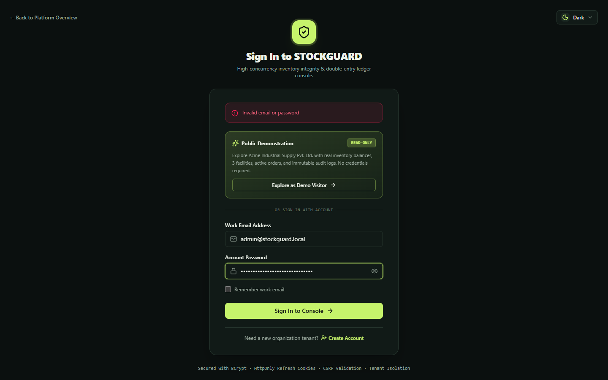 | Form validation, rate limiting, and server error handling. |
| **Command Center Dashboard** | 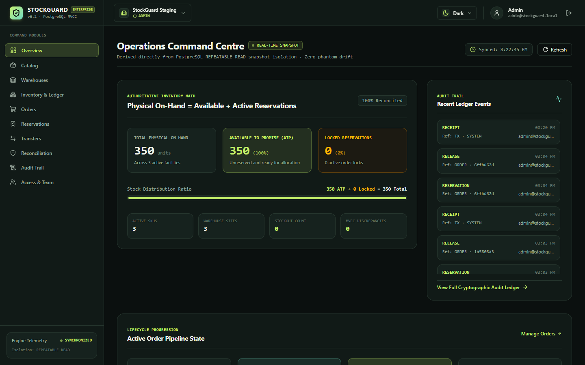 | KPI summary cards for inventory valuation, active reservations, and discrepancies. |
| **Product Catalog** | 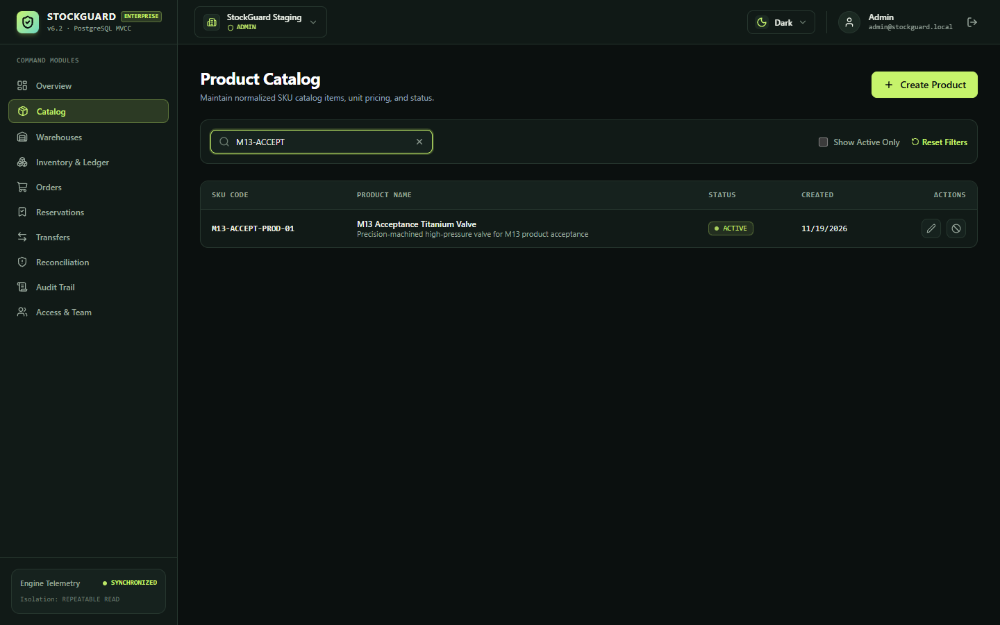 | Product listing with debounced SKU search and filtering. |
| **Warehouse Facilities** | 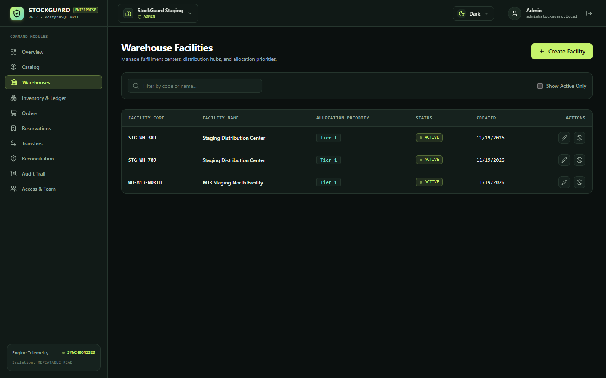 | Facility list ordered by dispatch priority. |
| **Balances & Ledger History** | 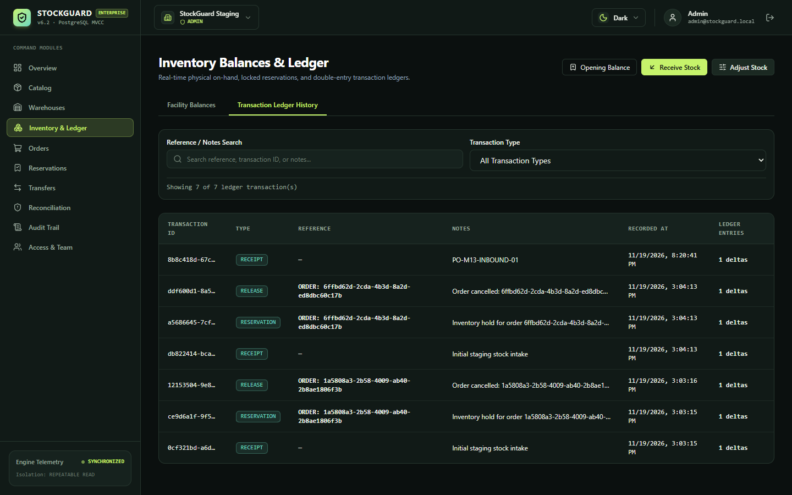 | Live inventory balances and tabbed double-entry ledger history. |
| **Order Lifecycle** | 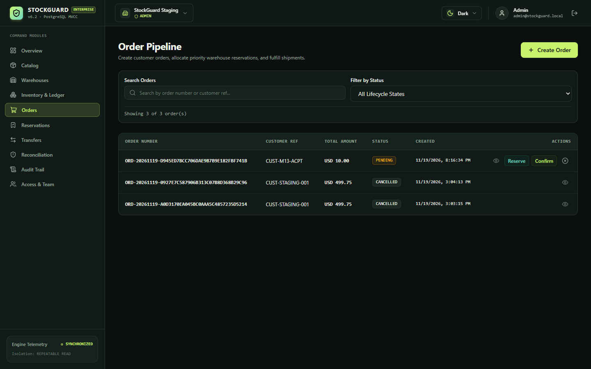 | Order creation, reservation status, and status progression. |
| **Inter-Warehouse Transfers** | 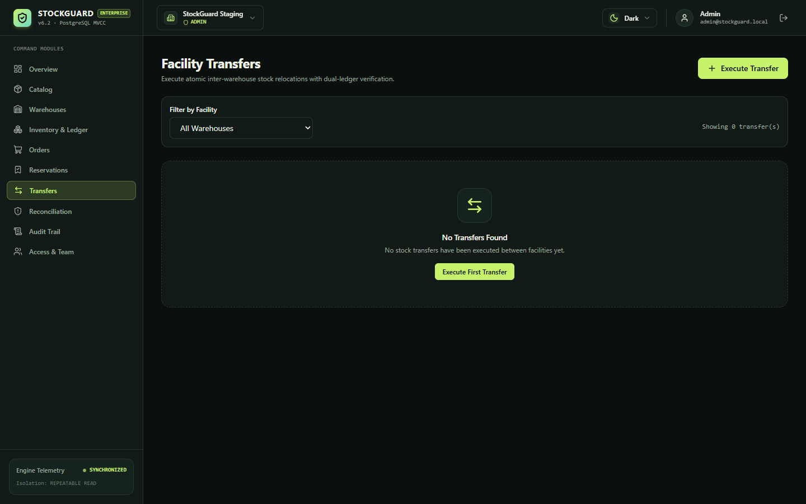 | Multi-item transfer modal with stock availability checks. |
| **Reconciliation Audit** | 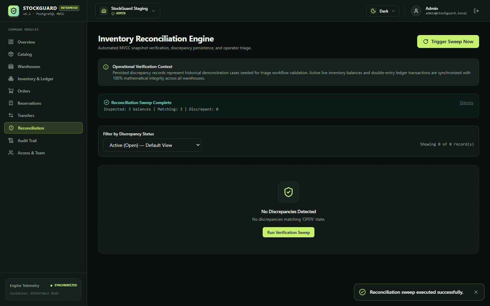 | On-demand MVCC sweep comparing balance rows with ledger sums. |
| **Audit Logs** | 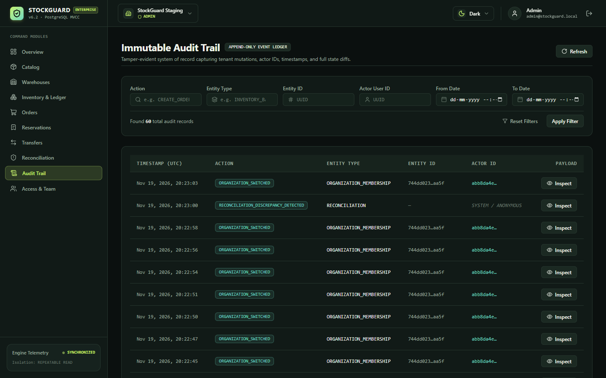 | Filterable log of operational and administrative actions. |
| **Team Governance** | 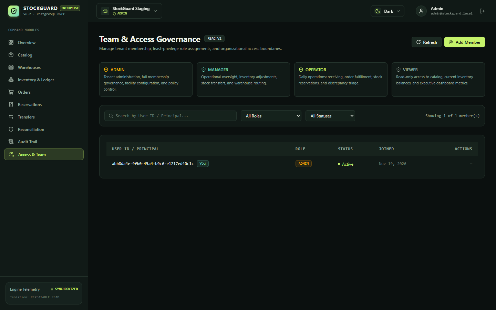 | Member list with role assignments and last-admin protection. |
| **Staging Demo Protection** | 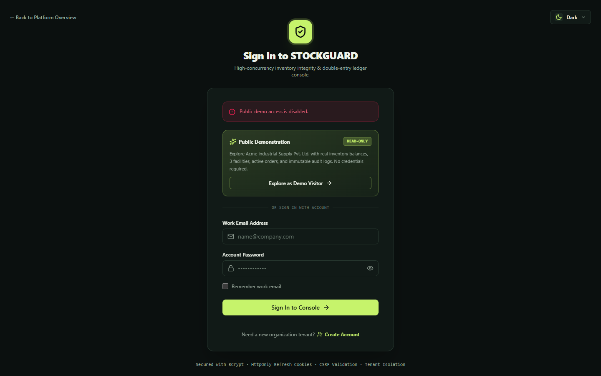 | Verification that demo login returns 403 Forbidden in staging. |
| **Public Portfolio Demo** | 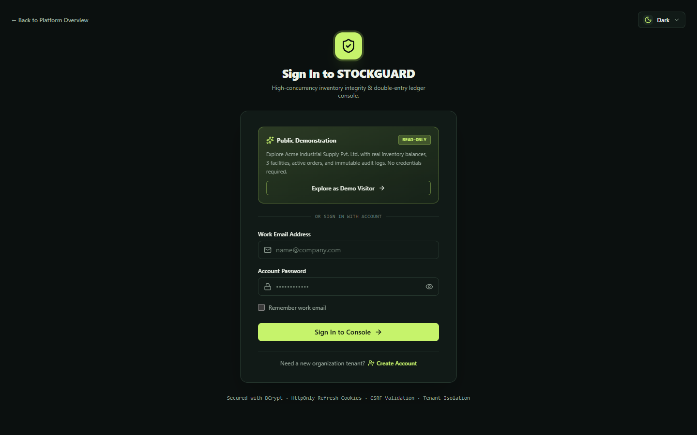 | Read-only visitor mode with viewer permissions and mutation guards. |
| **Tablet Viewport** | 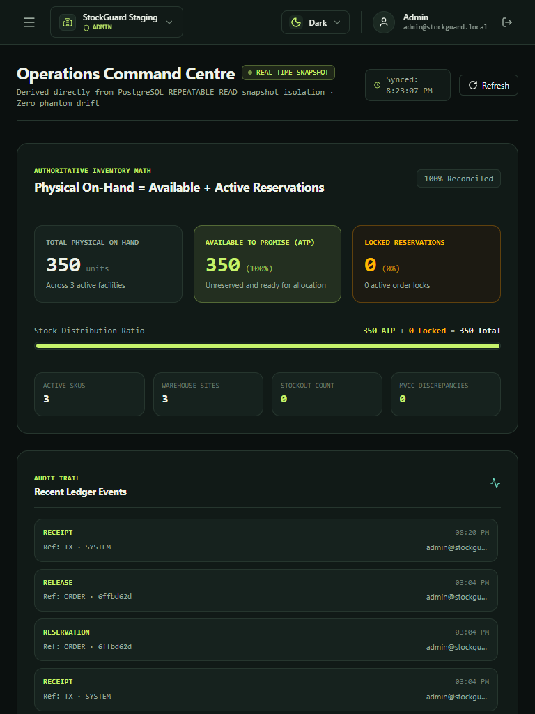 | Responsive dashboard layout on a 768x1024 tablet screen. |
| **Mobile Viewport** | 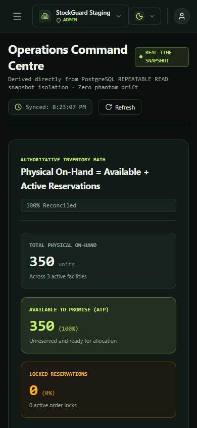 | Mobile navigation and single-column layout on a 390x844 mobile screen. |

---

## Local Setup and Development

### Prerequisites
* **Java 21** (JDK 21+)
* **Node.js 22+** and **npm**
* **Docker & Docker Compose**
* **Maven Wrapper** (included: `./mvnw` or `mvnw.cmd`)

### 1. Start Local Database
Start the PostgreSQL 16 container with dual-role initialization:
```bash
cd backend
docker compose up -d
```
The database starts on port `5433` (or configured `DB_PORT`) and executes `backend/init-db/01-init-roles.sh` to configure `stockguard_owner` and `stockguard_app`.

### 2. Run the Backend
```bash
cd backend
./mvnw spring-boot:run -Dspring-boot.run.profiles=dev
```
On Windows:
```cmd
cd backend
mvnw.cmd spring-boot:run -Dspring-boot.run.profiles=dev
```

### 3. Run the Frontend
```bash
cd frontend
npm install
npm run dev
```
The frontend launches at `http://localhost:5173` and proxies API requests to `http://localhost:8080`.

### Initial Administrator Bootstrap
On first startup, the backend initializes an administrator account if enabled.
To reset or synchronize the local administrator password during development:
```bash
# Linux / macOS
STOCKGUARD_BOOTSTRAP_ALLOW_PASSWORD_RESET=true ./mvnw spring-boot:run

# Windows PowerShell
$env:STOCKGUARD_BOOTSTRAP_ALLOW_PASSWORD_RESET="true"
.\mvnw.cmd spring-boot:run
```
*(Password reset is forbidden in production and disabled by default).*

---

## Staging and Production Deployment

STOCKGUARD supports three deployment modes:

| Dimension | Local Development | Isolated Staging | Production |
|---|---|---|---|
| **Target** | Local JVM + Node (`dev` profile) | `docker-compose.staging.yml` | `docker-compose.prod.yml` |
| **Compose Project** | `stockguard` | `stockguard-staging` | `stockguard` |
| **Ingress** | `localhost:5173` / `localhost:8080` | `https://localhost:8443` (HTTP `8088` redirects) | `https://your-domain.com:443` |
| **TLS** | Disabled | Self-signed with SAN (`localhost`, `127.0.0.1`) | CA-signed (Let's Encrypt or commercial CA) |
| **Database Port** | Host `5433` | Internal network only | Internal network only |
| **Demo Mode** | Enabled by default | Disabled (`403 Forbidden`) | Disabled |
| **Cookie Security** | `Secure=false`, `SameSite=Lax` | `Secure=true`, `SameSite=Strict` | `Secure=true`, `SameSite=Strict` |

### Running the Isolated Staging Stack
The staging Compose layer runs alongside existing host services without port conflicts:

```bash
# 1. Generate local staging TLS certificates
./scripts/generate-dev-certs.sh       # Linux / macOS
.\scripts\generate-dev-certs.ps1     # Windows PowerShell

# 2. Configure environment variables
cp .env.staging.example .env.staging

# 3. Launch isolated staging containers
docker compose -p stockguard-staging \
  -f docker-compose.prod.yml \
  -f docker-compose.staging.yml \
  --env-file .env.staging up -d --build
```
Access the application at `https://localhost:8443`. Port `8088` redirects to HTTPS.

### Production Deployment
Production requires valid domain certificates, strong generated secrets, and network isolation:

```bash
# 1. Populate production secrets
cp .env.example .env
# Set random secrets generated via: openssl rand -base64 32

# 2. Place signed certificates in nginx/ssl/
# (fullchain.pem and privkey.pem)

# 3. Launch the stack
docker compose -f docker-compose.prod.yml up -d --build
```

### Database Backup and Restore
* **Backup:** `scripts/backup-db.sh` or `scripts/backup-db.ps1` takes a logical snapshot using `pg_dump -Fc` and computes a SHA-256 checksum:
  ```bash
  ./scripts/backup-db.sh [CONTAINER_NAME] [OUTPUT_DIR]
  ```
* **Restore:** `scripts/restore-db.sh` or `scripts/restore-db.ps1` validates the container and archive before restoring into the target database:
  ```bash
  ./scripts/restore-db.sh [BACKUP_FILE] [CONTAINER_NAME]
  ```

---

## Testing

* **Backend test suite (JUnit 5 + Testcontainers):**
  Runs 520 tests covering unit tests, security filters, concurrent locking, and database migrations against PostgreSQL containers:
  ```bash
  cd backend
  ./mvnw clean verify
  ```
  *(On Windows, run `mvnw.cmd clean verify`).*

* **Frontend test suite (Vitest + React Testing Library):**
  Runs 40 unit and component tests:
  ```bash
  cd frontend
  npm test
  ```

* **Frontend production build:**
  Compiles TypeScript and bundles client assets with Vite:
  ```bash
  cd frontend
  npm run build
  ```

* **Browser acceptance tests (Puppeteer):**
  Runs automated end-to-end user journeys against a running staging instance:
  ```bash
  cd frontend
  node scripts/m13-browser-acceptance.mjs
  ```

---

## Security and Operational Notes

* **Dual database roles:** Flyway migrations run under `stockguard_owner` (DDL privileges). The application runs under `stockguard_app` (DML only: `SELECT`, `INSERT`, `UPDATE`, `DELETE`).
* **Session and cookie security:** Access tokens expire in 15 minutes. Refresh tokens are stored in `HttpOnly`, `SameSite=Strict`, `Secure` cookies with the `__Secure-` prefix in production and staging.
* **Scraper authentication:** Prometheus metrics (`/actuator/prometheus`) require HTTP Basic Auth credentials over an internal Docker network. The security filter returns fresh `UserDetails` instances per request to prevent Spring Security from wiping credentials in memory.
* **Audit trail:** Sensitive operations (logins, role changes, inventory adjustments, and reconciliation sweeps) record structured events in `audit_logs`.
* **Rate limiting:** Authentication endpoints restrict login attempts per IP to limit brute-force attempts.

---

## Current Limitations

* **Deadlock mitigation:** Canonical lock ordering (`product_id ASC, warehouse_id ASC`) prevents deadlocks within its lock domain. It does not eliminate deadlocks system-wide. Transient database failures are handled via application-level retries.
* **Single-instance PostgreSQL:** Designed for a single PostgreSQL primary. Does not currently support distributed partitioning or read replicas.
* **Staging certificates:** Local staging uses self-signed TLS certificates. Production requires certificates signed by a trusted certificate authority.
* **Demonstration mode:** Public demo mode is designed for portfolio walkthroughs and local evaluation. It is not an enterprise multi-tenant customer onboarding flow and is disabled by default in staging and production.

---

## Repository Structure

```
stockguard/
├── .github/
│   └── workflows/
│       └── ci.yml                    # GitHub Actions CI workflow
├── backend/
│   ├── Dockerfile                    # Multi-stage production container build (Java 21 Alpine)
│   ├── init-db/
│   │   └── 01-init-roles.sh          # PostgreSQL dual-role privilege initialization
│   ├── mvnw / mvnw.cmd / .mvn/       # Maven build wrapper
│   ├── pom.xml                       # Maven build descriptor (Java 21, Spring Boot 4.1.2)
│   └── src/                          # Application source and test suites
├── docs/                             # Architecture Decision Records (ADRs), database design, runbooks
│   ├── architecture/                 # System architecture overview & ADRs 001-014
│   ├── database/                     # Data dictionary, schema specification, transaction design
│   ├── deployment/                   # Runbooks, security checklist, and configuration
│   └── screenshots/                  # Verified product visual acceptance captures (M13)
│       └── m13/                      # High-resolution screenshots of 10 modules & viewports
├── frontend/
│   ├── Dockerfile                    # Multi-stage production container build (Vite + Nginx Alpine)
│   ├── entrypoint.sh                 # Fail-closed TLS verification entrypoint
│   ├── nginx.conf                    # Nginx reverse proxy, security headers & SPA routing
│   ├── package.json                  # React 19, Vite 8, Tailwind CSS v4, Three.js 0.187
│   ├── scripts/                      # Active browser test runners
│   │   └── m13-browser-acceptance.mjs # Browser acceptance suite
│   └── src/                          # React SPA, 3D Warehouse canvas, pages, components
├── nginx/
│   ├── README.md                     # Gateway architecture documentation
│   └── ssl/                          # Mount point for production TLS certificates
├── prometheus/
│   ├── alerts.yml                    # SLI alerting rules and Prometheus thresholds
│   ├── prometheus.env.example        # Environment variable template for Prometheus
│   └── prometheus.yml                # Scrape configuration for Spring Boot actuator metrics
├── scripts/
│   ├── backup-db.sh / .ps1           # Non-destructive database backup utility
│   ├── generate-dev-certs.sh / .ps1  # Development self-signed TLS cert generator
│   └── restore-db.sh / .ps1          # Database restore utility with safety pre-checks
├── .dockerignore                     # Docker build ignore specification
├── .env.example                      # Production environment variable template
├── .env.staging.example              # Staging environment variable template
├── .gitattributes                    # Line ending and binary attribute configuration
├── .gitignore                        # Git ignore specification
├── CODE_OF_CONDUCT.md                # Community standards and code of conduct
├── docker-compose.prod.yml           # Production multi-container topology (3-network isolation)
├── docker-compose.staging.yml        # Isolated staging multi-container topology overlay
├── LICENSE                           # MIT License
├── README.md                         # Primary project documentation
└── SECURITY.md                       # Security policy and vulnerability disclosure protocol
```

---

## License

STOCKGUARD is open-source software licensed under the [MIT License](LICENSE).

Copyright (c) 2026 Arnav Jagetiya.
