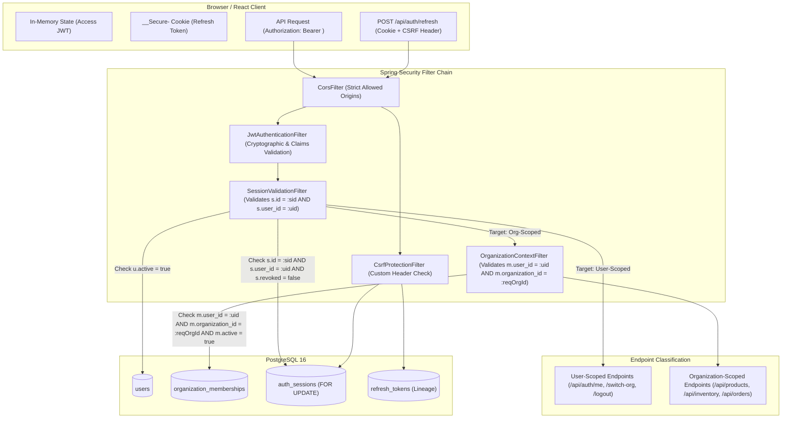

# ADR-010: Authentication and Session Management Architecture

| Field | Value |
|---|---|
| **Status** | Accepted (Final Technical Sign-off Revisions) |
| **Date** | 2026-11-12 |

> [!IMPORTANT]
> This architectural decision record formalizes the owner-approved authentication architecture, token lifecycle, and session security model for Milestone 3. It incorporates final technical sign-off corrections: multi-layered refresh-token deletion protection (trigger + deferrable foreign key + database privileges), explicit organization context resolution (no silent session fallbacks), accurate cross-site cookie deployment guidance (`SameSite=None; Secure` vs. `SameSite=Strict`), and a 6-case Testcontainers verification plan.

---

## Context

STOCKGUARD is a modular monolith powering high-concurrency inventory integrity and order reservations. In Milestone 2, the relational schema established global user identities (`users` with a nullable `password_hash` and boolean `active`) decoupled from tenant organizations (`organizations` and `organization_memberships`).

To transition from schema definition to active business operations, STOCKGUARD requires an authentication and session management architecture that satisfies the following core requirements:

1. **High-Concurrency Performance & Authoritative Verification:** Cryptographic access-token verification validates token integrity, while request-time database queries validate that the underlying session, user, and tenant membership remain active in PostgreSQL.
2. **Immediate Revocation Latency:** When an administrator deactivates a user, revokes an organization membership, or terminates a session, the revocation must take effect on the next authorization check after the relevant database transaction commits, rather than waiting for an access token to expire.
3. **Resilience Against Token Theft & Lineage Preservation:** Stolen refresh credentials must not grant indefinite access. The system must reliably detect and neutralize replay attacks when an intercepted token is reused, revoking the entire affected session family immediately. Full historical token lineage must be preserved during active sessions; individual token deletion (including unreferenced root tokens) must be prohibited.
4. **Browser Security & Transport Protection:** Refresh credentials must be protected against client-side script inspection (XSS). Access tokens are held in frontend memory, while refresh tokens are transported via `HttpOnly`, `Secure` cookies with `Path=/api/auth`. Operations utilizing cookie authentication must enforce explicit CSRF protections.
5. **Zero External Infrastructure Complexity:** In accordance with [ADR-001](ADR-001-modular-monolith.md) and [ADR-002](ADR-002-postgresql-source-of-truth.md), external caching layers (such as Redis) are prohibited for the MVP. All stateful security guarantees are backed authoritatively by PostgreSQL 16 ACID transactions.

---

## Decision

Adopt a **hybrid token architecture**: short-lived **JSON Web Token (JWT) access tokens** held in client memory paired with stateful, database-backed **opaque refresh token families with strict single-use rotation and reuse detection**, delivered via secure HTTP cookies.



---

### 1. Owner-Approved Authentication Decisions

* **Access Tokens:** Signed JSON Web Tokens (JWT) using HMAC-SHA256 (`HS256`).
* **Access Token Lifetime:** Strictly **15 minutes** (900 seconds) to minimize the exposure window of active credentials.
* **Access Token Transport:** Stored strictly in **frontend memory** (React state / closure); transmitted via HTTP `Authorization: Bearer <token>`. Never stored in `localStorage` or `sessionStorage`.
* **Refresh Sessions:** Database-backed session records in PostgreSQL (`auth_sessions`), anchored to the global user (`user_id`).
* **Refresh Token Format:** Cryptographically secure, opaque 256-bit random strings generated via `SecureRandom` (Base64URL-encoded, 43 characters).
* **Refresh Token Storage:** Strictly **hashed via SHA-256** prior to database persistence (`token_hash CHAR(64)`). Raw refresh tokens are never written to disk, logs, or database rows. Tokens cannot be reconstructed from their SHA-256 hashes.
* **Production Cookie Configuration (`__Secure-`):**
  * **Cookie Name:** `__Secure-stockguard_refresh`
  * **Path:** `/api/auth` (restricts cookie transmission exclusively to authentication endpoints)
  * **Secure:** `true` (enforces HTTPS)
  * **HttpOnly:** `true` (inaccessible to JavaScript, defending against XSS token exfiltration)
  * **Domain:** Omitted (host-only cookie per RFC 6265bis requirements)
  *(Note: The `__Host-` prefix was rejected because RFC 6265bis strictly mandates `Path=/` for `__Host-` cookies; combining `__Host-` with `Path=/api/auth` is rejected by compliant browsers. `__Secure-` provides the required cryptographic and path-scoping guarantees without path conflicts).*
* **Cross-Site vs. Same-Site Cookie Deployment Guidance:**
  * **Unified Same-Site Deployment (Strongly Preferred):**
    Where practical, deploy the frontend SPA and backend API under a unified same-site origin (e.g. `app.stockguard.com` and `api.stockguard.com`, or via a reverse proxy under `/api`). In this topology, set **`SameSite=Strict`**. This provides top-tier defense against CSRF and cross-site data leakage.
  * **Cross-Site Deployment (Distinct Registrable Domains):**
    If the frontend and backend are deployed across genuinely distinct registrar domains (e.g., `app.frontend-host.com` calling `api.backend-host.com`), `SameSite=Lax` is **insufficient** because browsers strictly withhold `SameSite=Lax` cookies on cross-site fetch/XHR `POST` requests.
    In cross-site environments, the cookie **must** declare **`SameSite=None; Secure`**, paired with:
    1. Mandatory Origin header validation against a strict whitelist;
    2. Strict CORS policy with `allowCredentials=true`; and
    3. Explicit anti-CSRF custom request header validation (`X-StockGuard-CSRF: 1`).
* **Local-Development Cookie Configuration:**
  * **Cookie Name:** `stockguard_refresh`
  * **Path:** `/api/auth`
  * **Secure:** `false` (permits local HTTP development without requiring self-signed TLS certs)
  * **HttpOnly:** `true`
  * **SameSite:** `Lax` (compatible with distinct local frontend/backend ports on `localhost`)
* **Strict Single-Use Token Rotation:** Every refresh request consumes the presented token and creates its replacement within a single database transaction. **There is no backend grace period.**
* **Password Hashing:** Spring Security's `BCryptPasswordEncoder` with an initial cost factor of **12**, to be calibrated to $\approx 200 - 300$ ms on target production hardware.
* **Public Registration:** **Prohibited.** Users and organization memberships are provisioned strictly by tenant administrators or system bootstrap.

---

### 2. Access Token (JWT) Specification & Request Validation

#### Token Claims Structure
* **Header:**
  * `alg`: `"HS256"`, `typ`: `"JWT"`, `kid`: `"sg-2026-v1"`.
* **Payload Claims:**
  * `sub`: User ID (`UUID` as string).
  * `iss`: Expected issuer (e.g., `"stockguard-platform"`).
  * `aud`: Expected audience (e.g., `"stockguard-api"`).
  * `iat`: Epoch seconds of token issuance.
  * `exp`: Epoch seconds of token expiration (`iat + 900`).
  * `jti`: Unique token identifier (`UUID`).
  * `email`: Normalized user email string.
  * `session_id`: Active database session ID (`UUID` as string) linking the token to its parent row in `auth_sessions`.

#### Request-Time Validation Flow & Dual Context Binding
For all protected requests, authorization does not rely on static claims. The security filter chain executes the following sequential checks:

1. **Cryptographic Validation:** Verify HMAC-SHA256 signature against the active or retiring key matching `kid`, assert `exp > currentTime`, and check `iss` and `aud`.
2. **Identity Extraction:** Extract `userId` (`sub`) and `sessionId` (`session_id`).
3. **Session & Identity Binding Validation:**
   Query `auth_sessions` and `users`:
   ```sql
   SELECT s.revoked, s.expires_at, u.active AS user_active
   FROM auth_sessions s
   JOIN users u ON s.user_id = u.id
   WHERE s.id = :sessionId
     AND s.user_id = :userId;
   ```
   *Assert:*
   - `s.id = :sessionId` and `s.user_id = :userId` (verifies token subject matches session owner).
   - `s.revoked = FALSE` and `s.expires_at > CURRENT_TIMESTAMP`. If revoked or expired, abort immediately with HTTP 401 Unauthorized (`SESSION_REVOKED` / `SESSION_EXPIRED`).
   - `u.user_active = TRUE`. If inactive, abort with HTTP 401 Unauthorized (`USER_INACTIVE`).
4. **Endpoint Branching & Explicit Organization Context:**
   * **A. User-Scoped Endpoints (No Organization Context Required):**
     Endpoints such as `GET /api/auth/me`, `POST /api/auth/switch-org`, and `POST /api/auth/logout` operate at the global user level. If Step 3 passes, dispatch directly to the controller.
   * **B. Organization-Scoped Endpoints (Mandatory Explicit Context):**
     Endpoints such as `/api/products/**`, `/api/inventory/**`, `/api/orders/**`, `/api/transfers/**`, and `/api/organizations/current/memberships/**` require tenant isolation.
     1. **Resolve `requestedOrgId`:** Extracted explicitly from the `X-Organization-Id` request header (or route parameter). There is **no silent fallback** to a session default. If the header is missing, the request is immediately rejected with HTTP `400 Bad Request` (`MISSING_ORGANIZATION_CONTEXT`).
     2. **Validate Membership in PostgreSQL:**
        ```sql
        SELECT m.role, m.active AS membership_active
        FROM organization_memberships m
        WHERE m.user_id = :userId
          AND m.organization_id = :requestedOrgId
          AND m.active = TRUE;
        ```
     3. If no matching active row exists: abort immediately with HTTP 403 Forbidden (`INSUFFICIENT_TENANT_MEMBERSHIP`).
     4. If valid: dynamically bind current `role` and derived permissions to `OrganizationContextHolder`.
5. **Fail-Closed Principle:** A database failure, network partition, or connection timeout must fail closed (deny access with HTTP 500 / 503). Under no circumstances may protected operations fail open.

#### Performance Target & Revocation Reality
* **Query Latency Target:** An indexed join on `(s.id, u.id, m.organization_id)` targets $< 1$ ms execution time on typical production PostgreSQL 16 hardware. This is an engineering performance target, not a verified benchmark.
* **Immediate Revocation:** Authorization revocation is effective on the next authorization check after the relevant database transaction commits.

---

### 3. Refresh Token Lineage, One-Way State Transition & Complete Integrity Architecture

#### The Vulnerability of Unrestricted UPDATE and Self-Referencing Foreign Keys
In a three-generation token family $T_1 \rightarrow T_2 \rightarrow T_3$:
- $T_1$ replaced by $T_2$ ($T_1$ references $T_2$).
- $T_2$ replaced by $T_3$ ($T_2$ references $T_3$).
- $T_3$ is active (unreplaced, `replaced_by_token_id IS NULL`).

Three critical relational integrity risks exist if schema defenses are incomplete:
1. **Root-Token Deletion Risk:** The self-referencing foreign key alone **does not prohibit deleting $T_1$** (the root token), because no token in the table references $T_1$. Deleting $T_1$ directly would destroy the initial replay-detection history without triggering a foreign key violation.
2. **Unrestricted UPDATE Tampering Risk:** If application code or a compromised runtime connection is granted unrestricted table-level `UPDATE`, it could rewrite historical token records, reset consumed tokens back to active, alter cryptographic token hashes, rewrite replacement pointers, or reassign tokens to different sessions. This would completely undermine refresh-token replay detection and rotation guarantees.
3. **Multiple Active Tokens per Session Risk:** Without an explicit partial uniqueness constraint, a session could accumulate multiple unconsumed tokens (`consumed_at IS NULL`) if concurrent rotation requests race or if application bugs fail to consume predecessors. This would violate the single-use token rotation invariant and break replay-detection determinism.

#### Active Refresh-Token Uniqueness: PostgreSQL Partial Unique Index
To guarantee that **at most one active refresh token exists per session** at any time, STOCKGUARD specifies a partial unique index:

```sql
CREATE UNIQUE INDEX uq_refresh_tokens_one_active_per_session
ON refresh_tokens (session_id)
WHERE consumed_at IS NULL;
```

* **Why This Index is Necessary:**
  In a single-use rotation architecture, a session family must possess at most one active refresh credential at any given instant. If a session ever had two active tokens, two separate clients (e.g. an attacker holding an intercepted token and a legitimate user) could refresh simultaneously in parallel without triggering reuse detection.
* **Why Application-Level Checks Alone Are Insufficient:**
  Application-level assertions (`SELECT COUNT(*) FROM refresh_tokens WHERE session_id = :sid AND consumed_at IS NULL`) are subject to race conditions under high concurrency or network retries. Two concurrent HTTP requests arriving in separate threads or database transactions can both observe zero unconsumed successors and both insert new active tokens. Even with row-level locking on `auth_sessions`, missed locks, connection pool quirks, or transaction isolation gaps can allow duplicate active tokens. The partial unique index provides a mathematical, physical guarantee enforced directly by PostgreSQL's B-tree index engine.
* **How It Prevents Multiple Active Tokens in the Same Session:**
  The index filters rows by predicate `WHERE consumed_at IS NULL`. Within this indexed subset, `session_id` is unique. Any attempt to insert or update a row where `session_id = :sid` and `consumed_at IS NULL` will fail if another active row already exists for `:sid`.
* **How PostgreSQL Enforces It Under Concurrent Inserts:**
  PostgreSQL checks uniqueness during B-tree insertion. If two concurrent transactions attempt to insert an active token for Session 1, the second transaction immediately violates the unique index and aborts with `SQLSTATE 23505` (`unique_violation`), guaranteeing that at most one active token is ever committed.
* **Atomic Rotation Behavior:**
  Rotation transactions atomically consume the predecessor and insert the successor within a single database transaction:
  1. `UPDATE refresh_tokens SET consumed_at = NOW(), replaced_by_token_id = :newChildId WHERE id = :oldParentId;`
     Because `consumed_at` is now `NOT NULL`, the predecessor row immediately drops out of the partial index filter (`WHERE consumed_at IS NULL`).
  2. `INSERT INTO refresh_tokens (session_id, token_hash, sequence_number, consumed_at, replaced_by_token_id, ...) VALUES (:sessionId, :hash, :seq, NULL, NULL, ...);`
     The successor row is inserted into the partial unique index as the sole active token for `:sessionId`.
  3. Transaction commits atomically. If any error occurs, the entire operation rolls back.

#### One-Way Token State Transition & Immutable Columns
STOCKGUARD enforces a strict, terminal state machine directly within PostgreSQL:
* **Terminal State Machine:**
  * **`ACTIVE`:** `consumed_at IS NULL AND replaced_by_token_id IS NULL`
  * **`CONSUMED`:** `consumed_at IS NOT NULL AND replaced_by_token_id IS NOT NULL`
  * A token transitions from `ACTIVE` to `CONSUMED` exactly once during a valid rotation exchange. A consumed token is **terminal** and must never return to `ACTIVE`.
* **Immutable Columns:**
  * `id`, `session_id`, `token_hash`, `sequence_number`, `created_at`, `expires_at`.
  * These fields are strictly immutable after `INSERT`.
* **Permanent Replacement Pointers:**
  * Once `replaced_by_token_id` and `consumed_at` are established during rotation, they must never be modified, overwritten, or cleared back to `NULL`.

#### Multi-Layered Deletion and Transition Protection Architecture
STOCKGUARD establishes five interlocking database-enforced controls:

1. **PostgreSQL UPDATE Trigger (Database-Enforced One-Way Transition):**
   ```sql
   CREATE OR REPLACE FUNCTION enforce_refresh_token_update_rules()
   RETURNS TRIGGER AS $$
   BEGIN
       -- 1. Immutable Columns Protection
       IF NEW.id <> OLD.id OR
          NEW.session_id <> OLD.session_id OR
          NEW.token_hash <> OLD.token_hash OR
          NEW.sequence_number <> OLD.sequence_number OR
          NEW.created_at <> OLD.created_at OR
          NEW.expires_at <> OLD.expires_at THEN
           RAISE EXCEPTION 'Updates to immutable columns of refresh_tokens (id, session_id, token_hash, sequence_number, created_at, expires_at) are prohibited.'
           USING ERRCODE = '55000';
       END IF;

       -- 2. Consumed Tokens are Terminal and Immutable
       IF OLD.consumed_at IS NOT NULL OR OLD.replaced_by_token_id IS NOT NULL THEN
           RAISE EXCEPTION 'Consumed refresh tokens are terminal and cannot be modified, reactivated, or re-pointed (token id: %).', OLD.id
           USING ERRCODE = '55000';
       END IF;

       -- 3. One-Way State Transition: ACTIVE -> CONSUMED
       IF NEW.consumed_at IS NULL OR NEW.replaced_by_token_id IS NULL THEN
           RAISE EXCEPTION 'Invalid transition: refresh tokens can only transition from ACTIVE to CONSUMED by setting both consumed_at and replaced_by_token_id.'
           USING ERRCODE = '55000';
       END IF;

       RETURN NEW;
   END;
   $$ LANGUAGE plpgsql;

   CREATE TRIGGER trg_refresh_tokens_enforce_one_way_transition
   BEFORE UPDATE ON refresh_tokens
   FOR EACH ROW
   EXECUTE FUNCTION enforce_refresh_token_update_rules();
   ```

2. **PostgreSQL Deletion-Prevention Trigger (Database-Enforced Lineage Protection):**
   ```sql
   CREATE OR REPLACE FUNCTION prevent_direct_refresh_token_delete()
   RETURNS TRIGGER AS $$
   BEGIN
       -- If the parent auth_sessions row still exists, this is an illegal direct deletion
       IF EXISTS (SELECT 1 FROM auth_sessions WHERE id = OLD.session_id) THEN
           RAISE EXCEPTION 'Direct deletion of refresh_token (id: %) is prohibited. Tokens are append-only and may only be purged via auth_sessions cleanup.', OLD.id
           USING ERRCODE = '55000';
       END IF;
       RETURN OLD;
   END;
   $$ LANGUAGE plpgsql;

   CREATE TRIGGER trg_refresh_tokens_prevent_direct_delete
   BEFORE DELETE ON refresh_tokens
   FOR EACH ROW
   EXECUTE FUNCTION prevent_direct_refresh_token_delete();
   ```

3. **Check Constraint Integrity:**
   ```sql
   CONSTRAINT chk_refresh_tokens_consumed_replacement CHECK (
       (consumed_at IS NULL AND replaced_by_token_id IS NULL) OR
       (consumed_at IS NOT NULL AND replaced_by_token_id IS NOT NULL)
   )
   ```

4. **Deferrable Same-Session Foreign Key (Database-Enforced):**
   ```sql
   CONSTRAINT fk_refresh_tokens_same_session_replacement
       FOREIGN KEY (session_id, replaced_by_token_id)
       REFERENCES refresh_tokens(session_id, id)
       ON DELETE NO ACTION DEFERRABLE INITIALLY DEFERRED
   ```

5. **Runtime Database Role Boundaries & Column-Level Privilege Restrictions:**
   STOCKGUARD enforces strict separation between the migration owner and runtime application user:
   * **Migration Owner Role (`stockguard_owner`):** Reserved exclusively for Flyway migrations and controlled schema administration. Owns all tables, sequences, functions, and triggers. Possesses full DDL rights. Never connected to live application services.
   * **Runtime Application Role (`stockguard_app`):** Dedicated non-owner runtime user for the Spring Boot connection pool:
     * Declared `WITH LOGIN NOSUPERUSER NOCREATEDB NOCREATEROLE NOINHERIT;`.
     * Does not inherit membership in `stockguard_owner` and cannot execute `SET ROLE stockguard_owner`.
     * Cannot disable or bypass triggers (no `session_replication_role` superuser privileges).
     * Has no DDL privileges (`NO DDL`).
     * Granted strictly least-privilege DML:
       ```sql
       REVOKE ALL ON refresh_tokens FROM stockguard_app;
       GRANT SELECT, INSERT ON refresh_tokens TO stockguard_app;
       GRANT UPDATE (consumed_at, replaced_by_token_id) ON refresh_tokens TO stockguard_app;
       GRANT SELECT, INSERT, UPDATE, DELETE ON auth_sessions TO stockguard_app;
       ```

```mermaid
sequenceDiagram
    autonumber
    actor Attacker as Attacker (Stolen Token T1)
    actor Client as Legitimate Client (Token T1)
    participant Server as StockGuard API
    participant DB as PostgreSQL 16

    Note over Client,Server: Client logs in. Session S1 created; Token T1 issued (consumed_at = NULL).
    Attacker->>Server: POST /api/auth/refresh (Cookie: T1)
    Server->>DB: Lock S1; Lock T1; verify T1 is unconsumed
    Server->>DB: Mark T1 consumed (consumed_at = NOW()); Insert T2; Link T1 -> T2
    Server-->>Attacker: Returns Access Token + Cookie: T2

    Note over Client,Server: Legitimate Client later attempts refresh using T1
    Client->>Server: POST /api/auth/refresh (Cookie: T1)
    Server->>DB: Lock S1; Lock T1; Query T1
    Note over Server,DB: Check: T1.consumed_at IS NOT NULL! REUSE DETECTED!
    Server->>DB: UPDATE auth_sessions SET revoked = TRUE, revocation_reason = 'REUSE_DETECTED'
    Server->>DB: INSERT audit_logs (SECURITY_ALERT_REFRESH_TOKEN_REUSE)
    Server-->>Client: HTTP 401 Unauthorized ("Token reuse detected; session family revoked")

    Note over Attacker,Server: Attacker later attempts refresh using T2
    Attacker->>Server: POST /api/auth/refresh (Cookie: T2)
    Server->>DB: Lock S1 -> S1.revoked == TRUE
    Server-->>Attacker: HTTP 401 Unauthorized ("Session revoked")
```

---

### 4. Planned PostgreSQL 16 Testcontainers Verification Specification

To ensure rigorous validation of relational integrity, the planned test suite in `RefreshTokenLineageIntegrityTest.java` comprises **19 integration test cases** architecturally separated into **four independent test groups**, isolating runtime-role privilege checks from database trigger and constraint evaluations.

> [!IMPORTANT]
> **Independent Testing Principle:**
> PostgreSQL evaluates SQL statement permissions (Layer 1) before executing triggers (Layer 2). If a query executed as `stockguard_app` attempts `DELETE FROM refresh_tokens`, PostgreSQL rejects it at Layer 1 with `SQLSTATE 42501` (`insufficient_privilege`). Execution never reaches the trigger.
> Therefore:
> - Privilege tests must run under `stockguard_app` to verify that unauthorized operations are blocked at the SQL privilege boundary (`SQLSTATE 42501`).
> - Trigger tests must run under a separate privileged test role (`stockguard_test_privileged`) with table-level permissions to verify that trigger logic fires and rejects violations (`SQLSTATE 55000`).
> Under no circumstances may a test suite claim a trigger was verified if a runtime privilege error prevented execution from reaching it.
>
> All test cases below represent the **planned verification suite** for Milestone 3 Phase 8; none have been executed during this design phase.

#### Part A: Active Refresh-Token Uniqueness & Atomic Rotation Tests (6 Cases)
1. **Insert One Active Token per Session (Succeeds):**
   - Seed session $S_1$. Insert token $T_1$ with `consumed_at = NULL`.
   - Assert: Row exists in `ACTIVE` state.
2. **Insert Duplicate Active Token in Same Session (Rejection):**
   - Attempt: Insert token $T_2$ for $S_1$ with `consumed_at = NULL`.
   - Assert: Rejected with `SQLSTATE 23505` (`unique_violation` targeting index `uq_refresh_tokens_one_active_per_session`).
3. **Insert Active Token for Distinct Session (Succeeds):**
   - Seed session $S_2$. Insert token $T_{s2}$ for $S_2$ with `consumed_at = NULL`.
   - Assert: Succeeds cleanly; index is partitioned per `session_id`.
4. **Atomic Token Rotation (Succeeds):**
   - In a single transaction: `UPDATE refresh_tokens SET consumed_at = NOW(), replaced_by_token_id = T2.id WHERE id = T1.id` followed by `INSERT INTO refresh_tokens (session_id, token_hash, sequence_number, consumed_at, replaced_by_token_id, ...) VALUES (S1.id, ..., NULL, NULL, ...)`.
   - Assert: Transaction commits cleanly; $T_1$ is `CONSUMED`, $T_2$ is `ACTIVE`.
5. **Concurrent Successor Issuance Race Condition (At Most One Succeeds):**
   - Two concurrent threads attempt rotation for $S_1$.
   - Assert: Exactly one transaction commits successor token; the competing transaction fails with `SQLSTATE 23505` (or serialization failure), guaranteeing no duplicate active tokens.
6. **Zero Duplicate Active Tokens Invariant:**
   - Query: `SELECT session_id, COUNT(*) FROM refresh_tokens WHERE consumed_at IS NULL GROUP BY session_id HAVING COUNT(*) > 1;`
   - Assert: Returns exactly `0` rows.

#### Part B: Runtime Role Privilege Boundary Tests (Role: `stockguard_app`, 5 Cases)
1. **Table-Level DELETE Privilege Revocation:**
   - Connect as `stockguard_app`. Attempt: `DELETE FROM refresh_tokens WHERE id = T1.id`.
   - Assert: Rejected with `SQLSTATE 42501` (permission denied for table `refresh_tokens`). Trigger is not evaluated.
2. **Column-Level UPDATE Restriction on Immutable Columns:**
   - Connect as `stockguard_app`. Attempt: `UPDATE refresh_tokens SET token_hash = '00...00' WHERE id = T1.id`.
   - Assert: Rejected with `SQLSTATE 42501` (permission denied for column `token_hash`).
   - Repeat for `session_id` and `sequence_number`; assert `SQLSTATE 42501`.
3. **Permitted One-Way Transition:**
   - Connect as `stockguard_app`. Execute: `UPDATE refresh_tokens SET consumed_at = NOW(), replaced_by_token_id = T2.id WHERE id = T1.id`.
   - Assert: Succeeds cleanly (column-level UPDATE granted on `consumed_at` and `replaced_by_token_id`).

#### Part C: Database Trigger & Constraint Integrity Tests (Role: `stockguard_test_privileged`, 6 Cases)
Connect as privileged test role possessing table-level permissions to directly test trigger logic:
1. **Direct Deletion of Root Token Rejection:**
   - Attempt: `DELETE FROM refresh_tokens WHERE id = T1.id` (while session $S_1$ exists).
   - Assert: Rejected with `SQLSTATE 55000` via trigger `prevent_direct_refresh_token_delete()`.
2. **Direct Deletion of Intermediate Token Rejection:**
   - Attempt: `DELETE FROM refresh_tokens WHERE id = T2.id` (while session $S_1$ exists).
   - Assert: Rejected with `SQLSTATE 55000` via trigger `prevent_direct_refresh_token_delete()`.
3. **Immutable Column UPDATE Rejection:**
   - Attempt: `UPDATE refresh_tokens SET token_hash = '00...00' WHERE id = T1.id`.
   - Assert: Rejected with `SQLSTATE 55000` via trigger `enforce_refresh_token_update_rules()`.
4. **Consumed Token Reactivation Rejection:**
   - Attempt: `UPDATE refresh_tokens SET consumed_at = NULL, replaced_by_token_id = NULL WHERE id = T1.id`.
   - Assert: Rejected with `SQLSTATE 55000` via trigger `enforce_refresh_token_update_rules()` (or `SQLSTATE 23514` via check constraint).
5. **Replacement Pointer Modification Rejection:**
   - Attempt: `UPDATE refresh_tokens SET replaced_by_token_id = T3.id WHERE id = T1.id`.
   - Assert: Rejected with `SQLSTATE 55000` via trigger `enforce_refresh_token_update_rules()`.
6. **Direct Deletion of Active Child in Multi-Generation Lineage (Case 16b):**
   - Attempt: `DELETE FROM refresh_tokens WHERE id = T3.id` in lineage $T_1 \rightarrow T_2 \rightarrow T_3$ (while session $S_1$ exists).
   - Assert: Rejected with `SQLSTATE 55000` via trigger `prevent_direct_refresh_token_delete()` (and cross-session replacement linkage rejected with `SQLSTATE 23503` via `fk_refresh_tokens_same_session_replacement`).

#### Part D: Cascading Complete Session Cleanup Tests (Role: `stockguard_test_privileged`, 2 Cases)
1. **Cascade Deletion of Entire Session Family:**
   - Execute: `DELETE FROM auth_sessions WHERE id = S1.id`.
   - Assert: Transaction commits cleanly; $S_1$ and all descendant tokens ($T_1, T_2, T_3$) are deleted cleanly.
2. **Zero-Orphan Verification:**
   - Query: `SELECT COUNT(*) FROM refresh_tokens WHERE session_id = S1.id`.
   - Assert: Exactly `0` rows remain.

---

### 5. Frontend Refresh Coordination & Failure Handling

1. **In-Flight Single-Flight Refresh:** An HTTP client interceptor queues concurrent 401 errors behind a single in-flight `POST /api/auth/refresh` promise.
2. **Web Locks API Automatic Release:** Tabs synchronize refresh attempts via `navigator.locks.request('stockguard_refresh_lock', async () => { ... })`. If a tab or worker crashes, the browser automatically releases the lock.
3. **BroadcastChannel (Non-Security Boundary):** Used strictly for client-side state synchronization, not security enforcement. The backend's strict rotation remains the authoritative security boundary.
4. **Recovery from Lost Responses:** If the client drops connection before receiving the response to a successful refresh, retrying with the old token triggers session revocation. The client clears local auth state, notifies the user, and redirects cleanly to `/login`.

---

## Consequences

### Benefits
* **Foolproof Lineage Protection:** The trigger prevents deletion of unreferenced root tokens ($T_1$), closing the replay-detection vulnerability of FK-only designs.
* **Explicit Tenant Boundary:** Mandatory `X-Organization-Id` eliminates silent fallback bugs and enables clean multi-tab multi-organization workflows.
* **Standard-Compliant Cookie Security:** Accurate guidance for same-site (`SameSite=Strict`) vs cross-site (`SameSite=None; Secure`) deployments.
* **Fail-Closed Security:** Outages or database validation errors result in immediate request denial.

### Risks and Trade-offs
* **Database Check per Request:** Validating active session and membership on protected requests incurs an expected query overhead (targeted at $< 1$ ms), accepted as necessary to eliminate stale-authorization vulnerabilities.
* **Strict Client Coordination:** React frontend must implement single-flight and cross-tab Web Locks to prevent concurrent refresh race conditions.
