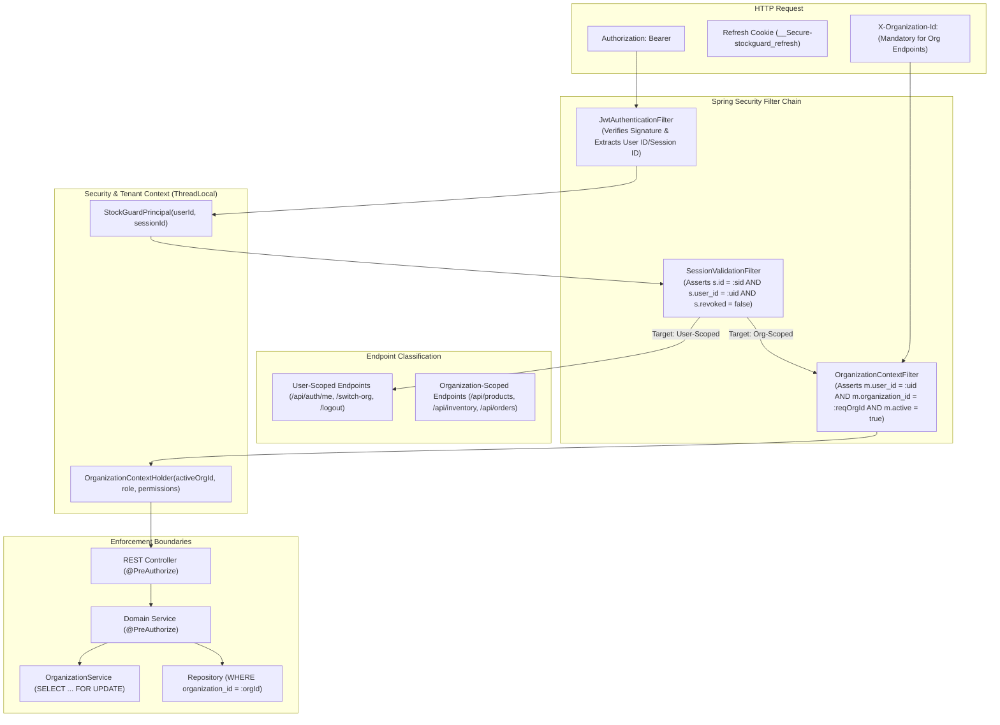

# ADR-011: Authorization and Organization Access Control Architecture

| Field | Value |
|---|---|
| **Status** | Accepted (Final Technical Sign-off Revisions) |
| **Date** | 2026-11-12 |

> [!IMPORTANT]
> This architectural decision record formalizes the owner-approved authorization model, role-permission mappings, and multi-tenant organization boundary enforcement for Milestone 3. It incorporates final technical sign-off corrections: explicit organization context requirements (no silent session fallbacks), clear organization switching semantics across concurrent tabs, dual-bound session and membership validation in PostgreSQL, and concurrency-safe last-admin protection.

---

## Context

STOCKGUARD is a multi-tenant inventory platform where physical entities, balance rows, ledger entries, and orders belong strictly to an owning organization (`organizations`).

In Milestone 2, the relational schema established strict relational multi-tenant isolation:
1. Every business entity declares `organization_id UUID NOT NULL`.
2. Multi-table foreign keys declare composite constraints: `(organization_id, referenced_id) REFERENCES parent_table(organization_id, id)`.
3. Users (`users`) exist globally and decouple from organizations, participating across multiple tenants through `organization_memberships(organization_id, user_id, role, active)`.

To ensure operational security, STOCKGUARD requires an authorization architecture that addresses:
1. **Multi-Organization Membership:** A single user identity may belong to multiple organizations (e.g., an Operator in Warehouse Org A, but a Viewer in Audit Org B). Permissions must be evaluated strictly within the active organization context.
2. **Explicit Organization Context (No Silent Fallbacks):** Organization-scoped endpoints must explicitly mandate tenant context via request headers or route parameters. The system must not silently fall back to an arbitrary session default.
3. **Dual-Bound Session & Identity Validation:** Tokens must be validated to ensure the authenticated caller matches the session owner, and that the session has not been revoked.
4. **Elimination of Stale-Authorization Vulnerabilities:** Embedding permissions and roles directly into access tokens creates a security vulnerability where a demoted or deactivated user retains privileges until the token expires. Authorization must derive from authoritative PostgreSQL database state.
5. **Tenant Boundary Spoofing:** A client request must never be permitted to access or mutate Tenant A's data using Tenant B's credentials or by merely passing a forged organization ID in a URL, header, or payload.
6. **Concurrent Tab Support:** Users working in multiple browser tabs simultaneously must be able to operate in different organizations without session clobbering.
7. **Concurrent Last-Admin Protection:** Administrative operations must guarantee that an organization is never left without an active administrator due to concurrent self-demotions or removals.

---

## Decision

Implement **tenant-bound Role-Based Access Control (RBAC)** enforced through Spring Security method-level security, request context extraction, dual-bound session and membership validation in PostgreSQL, and mandatory repository tenant filtering.



---

### 1. Owner-Approved Roles & Capability Matrix
The system recognizes exactly four standard roles within an organization membership:
* `ADMIN`: Full operational and administrative control within the tenant.
* `MANAGER`: Full catalog, warehouse, and inventory management; cannot manage users or memberships.
* `OPERATOR`: Operational execution (order fulfillment, stock adjustments, receipts, transfers); cannot manage catalog, facilities, or users.
* `VIEWER`: Read-only access to dashboards, reports, catalogs, and inventory balances.

#### Approved Permission Matrix
| Capability | ADMIN | MANAGER | OPERATOR | VIEWER |
|---|:---:|:---:|:---:|:---:|
| View dashboard and inventory | Yes | Yes | Yes | Yes |
| Manage users and memberships | **Yes** | No | No | No |
| Manage products and warehouses | **Yes** | **Yes** | No | No |
| Receive and adjust inventory | **Yes** | **Yes** | **Yes** | No |
| Create and execute transfers | **Yes** | **Yes** | **Yes** | No |
| Create and manage orders | **Yes** | **Yes** | **Yes** | No |
| Fulfill and cancel orders | **Yes** | **Yes** | **Yes** | No |
| View audit logs | **Yes** | **Yes** | No | No |

---

### 2. Granular Permission Mapping Convention
Roles map to explicit, granular permission strings following the `<domain>:<action>` convention:

* **Dashboard & Reporting:** `dashboard:view`, `reports:view`
* **Inventory:** `inventory:view`, `inventory:receive`, `inventory:adjust`, `inventory:reconcile`
* **Products:** `product:view`, `product:manage`
* **Warehouses:** `warehouse:view`, `warehouse:manage`
* **Transfers:** `transfer:view`, `transfer:execute`
* **Orders:** `order:view`, `order:create`, `order:confirm`, `order:fulfill`, `order:cancel`
* **Reservations:** `reservation:view`, `reservation:create`, `reservation:release`
* **Memberships & Users:** `membership:view`, `membership:manage`
* **Audit Logs:** `audit:view`

Every role inherits a deterministic set of `GrantedAuthority` strings based on this matrix.

---

### 3. Request-Time Validation Flow & Explicit Organization Context

#### Endpoint Classification
1. **User-Scoped Authenticated Endpoints (No Organization Context Required):**
   * Examples: `GET /api/auth/me`, `POST /api/auth/switch-org`, `POST /api/auth/logout`.
   * These operate across the user's global profile and active session. They do not require an organization context header or membership check.
2. **Organization-Scoped Endpoints (Mandatory Explicit Tenant Context):**
   * Examples: `/api/products/**`, `/api/inventory/**`, `/api/orders/**`, `/api/transfers/**`, `/api/organizations/current/memberships/**`, `/api/audit-logs`.
   * These enforce strict multi-tenant boundary checks.

#### Sequential Request-Validation Pipeline
For every protected request, the security filter chain executes:
1. **JWT Verification:** Validate signature against active/retiring key matching `kid`, assert `exp > NOW()`, and check `iss` and `aud`. Extract `userId` and `sessionId`.
2. **Session and User Status Validation:**
   Query `auth_sessions` and `users`:
   ```sql
   SELECT s.revoked, s.expires_at, u.active AS user_active
   FROM auth_sessions s
   JOIN users u ON s.user_id = u.id
   WHERE s.id = :sessionId
     AND s.user_id = :userId;
   ```
   *Assert:*
   - `auth_sessions.id = :sessionId` and `auth_sessions.user_id = :userId` (verifies session belongs to authenticated user).
   - `auth_sessions.revoked = FALSE` and `auth_sessions.expires_at > CURRENT_TIMESTAMP`. If revoked or expired, abort with HTTP 401 Unauthorized (`SESSION_REVOKED` / `SESSION_EXPIRED`).
   - `users.active = TRUE`. If inactive, abort with HTTP 401 Unauthorized (`USER_INACTIVE`).
3. **Explicit Organization Context Resolution (Organization-Scoped Endpoints Only):**
   * **Mandatory Header Requirement:** The client **must** supply `X-Organization-Id: <UUID>` (or a route parameter for membership management).
   * **No Silent Fallbacks:** The server does not fall back to an arbitrary session default. If the header is omitted on an organization-scoped endpoint, the request is immediately rejected with HTTP `400 Bad Request` (`MISSING_ORGANIZATION_CONTEXT`).
   * **PostgreSQL Membership Assertion:**
     ```sql
     SELECT m.role, m.active AS membership_active
     FROM organization_memberships m
     WHERE m.user_id = :userId
       AND m.organization_id = :requestedOrgId
       AND m.active = TRUE;
     ```
   * *Assert:*
     - Active membership exists for `:userId` in `:requestedOrgId`. If missing or `m.active = FALSE`, abort with HTTP 403 Forbidden (`INSUFFICIENT_TENANT_MEMBERSHIP`).
     - Dynamically load the authoritative `role` and granular permissions for `:requestedOrgId` into `OrganizationContextHolder`.
4. **Fail-Closed Principle:** A database failure, network partition, or connection timeout must fail closed (deny access with HTTP 500 / 503). Under no circumstances may protected operations fail open.

---

### 4. Organization Switching Semantics

In a multi-tenant platform where users belong to multiple organizations:
1. **Target Membership Validation:**
   When a user selects a different organization in the frontend, the client calls `POST /api/auth/switch-org` with body `{ "targetOrganizationId": "<UUID>" }`. The server validates that `organization_memberships` contains an active row where `user_id = :userId AND organization_id = :targetOrgId AND active = TRUE`.
2. **Session Persistence vs. Stateless Scope:**
   The persisted `auth_sessions` record represents the user's login session on that device. It is **not** mutated during organization switching. The session remains valid for the global user. The endpoint returns the validated tenant details: `{ "organizationId": "<UUID>", "role": "<role>", "permissions": [...] }`.
3. **Concurrent Tabs Handling:**
   Because tenant context is passed explicitly via the `X-Organization-Id` request header on each API call, **multiple browser tabs can operate concurrently in different organizations under the same login session without state collision** (e.g. Tab 1 manages Warehouse A with `X-Organization-Id: <OrgA>`, while Tab 2 monitors Audits in Org B with `X-Organization-Id: <OrgB>`). No server-side session variable is overwritten.
4. **Immediate Invalidation of Previous Context:**
   Because the server dynamically evaluates `organization_memberships` on every organization-scoped request, if an administrator deactivates a user's membership in Organization A, any subsequent request passing `X-Organization-Id: <OrgA>` is rejected with HTTP 403 Forbidden on the next authorization check after the transaction commits, regardless of active tab state.
5. **Rejection Semantics:**
   - Missing header: HTTP `400 Bad Request` (`MISSING_ORGANIZATION_CONTEXT`).
   - Malformed UUID: HTTP `400 Bad Request` (`INVALID_ORGANIZATION_CONTEXT`).
   - Inactive or non-member: HTTP `403 Forbidden` (`INSUFFICIENT_TENANT_MEMBERSHIP`).

---

### 5. Administrative Membership Operations & Concurrent Last-Admin Protection

Membership and user management within a tenant is strictly restricted to users holding the `ADMIN` role (`hasAuthority('membership:manage')`):
* `GET /api/organizations/current/memberships`: List all memberships.
* `POST /api/organizations/current/members`: Provision a user membership.
* `PUT /api/organizations/current/members/{userId}/role`: Update a user's role.
* `DELETE /api/organizations/current/members/{userId}`: Deactivate a membership (`active = FALSE`).

#### Concurrency-Safe Last-Admin Protection
To ensure that concurrent administrator mutations cannot race to leave an organization without an active administrator:
1. **Serialization via Row Lock:**
   The service acquires an exclusive row-level lock on the `organizations` record at the start of the transaction:
   ```sql
   SELECT id FROM organizations WHERE id = :orgId FOR UPDATE;
   ```
2. **Active Administrator Count:**
   Within the same transaction, count active administrators:
   ```sql
   SELECT COUNT(*)
   FROM organization_memberships
   WHERE organization_id = :orgId AND role = 'ADMIN' AND active = TRUE;
   ```
3. **Atomic Evaluation & Rejection:**
   If the target of a demotion, deactivation, or removal is currently an `ADMIN`, and the active administrator count is $\le 1$:
   * The transaction is aborted with an informative exception (`CANNOT_DEMOTE_SOLE_ADMIN`).
   * The API returns HTTP `400 Bad Request` or `409 Conflict`: *"Cannot demote or remove the sole remaining administrator for the organization."*
4. **Commit:**
   If count $> 1$, the membership mutation executes and the transaction commits atomically.
   Because concurrent admin operations serialize on the `organizations` row lock, races that could result in zero administrators are mathematically prevented.

---

### 6. Database Privilege Boundary: Dedicated Non-Owner Runtime Role

Multi-tenant access control and organizational boundary integrity are reinforced at the PostgreSQL privilege boundary:
1. **Separation of Roles:**
   - **Migration / Schema Owner (`stockguard_owner`):** Possesses full DDL rights and owns all tables, sequences, functions, and triggers. Reserved strictly for Flyway migrations and controlled schema administration. Never utilized by live application services.
   - **Runtime Application Role (`stockguard_app`):** The non-owner connection user for the Spring Boot connection pool:
     - Configured `WITH LOGIN NOSUPERUSER NOCREATEDB NOCREATEROLE NOINHERIT;`.
     - Has no membership in `stockguard_owner` and cannot execute `SET ROLE stockguard_owner`.
     - Cannot disable or bypass triggers (no `session_replication_role` superuser privileges).
     - Has NO DDL rights on schema `public` (`CANNOT CREATE`, `CANNOT ALTER`, `CANNOT DROP`).
2. **Append-Only & Transition Protections:**
   - Direct `DELETE` is revoked on append-only audit tables (`audit_logs`, `inventory_ledger_entries`) and session credentials (`refresh_tokens`).
   - Table-level `UPDATE` on `refresh_tokens` is revoked; column-level permissions are enforced via `GRANT UPDATE (consumed_at, replaced_by_token_id) ON refresh_tokens TO stockguard_app;`.
   - Partial unique index `uq_refresh_tokens_one_active_per_session` guarantees that a session has at most one active token (`WHERE consumed_at IS NULL`).
   - Direct `DELETE` on `refresh_tokens` is prohibited by trigger `trg_refresh_tokens_prevent_direct_delete` while parent session exists.
3. **Independent Verification Testing:**
   - Runtime role privilege boundaries are verified under `stockguard_app` (asserting `SQLSTATE 42501` privilege errors).
   - Database triggers and partial unique constraints are verified under a separate privileged test role (`stockguard_test_privileged`, asserting `SQLSTATE 55000` and `23505`).
4. **Fail-Closed Membership Enforcement:**
   - Authoritative membership verification executes under `stockguard_app` against `organization_memberships`. Any database error, connection exhaustion, or permission failure immediately aborts request execution with HTTP 500/503.

---

## Consequences

### Benefits
* **No Ambiguous Tenant Context:** Requiring explicit `X-Organization-Id` eliminates silent fallback bugs.
* **Concurrent Multi-Tenant Workflows:** Independent tabs operate safely in distinct organizations under a single user session.
* **Dual-Bound Verification:** Session validation binds `sessionId` to `userId`, preventing cross-user token reuse.
* **Immediate Revocation Enforcement:** Revocation is effective on the next authorization check after the relevant database transaction commits.
* **Fail-Closed Security:** Database connection failures or validation errors abort requests immediately, preventing unauthorized execution.
* **Strict Tenant Isolation:** Cross-organization data leakage or tenant hopping is prevented at four independent architectural layers.
* **Concurrency-Safe Governance:** Row-level locks eliminate race conditions during administrator demotions or deactivations.
* **Defense-in-Depth Database Privileges:** Dedicated non-owner runtime role (`stockguard_app`) prevents schema modification, table-level deletion of append-only structures, and restricts token mutation to column-level transitions.

### Risks and Trade-offs
* **Client Header Obligation:** The frontend must consistently attach `X-Organization-Id` to all organization-scoped API calls.
* **Database Check per Request:** Executing an indexed query to validate active session and membership state incurs an expected query overhead (targeted at $< 1$ ms), accepted as necessary to eliminate stale-authorization vulnerabilities.
