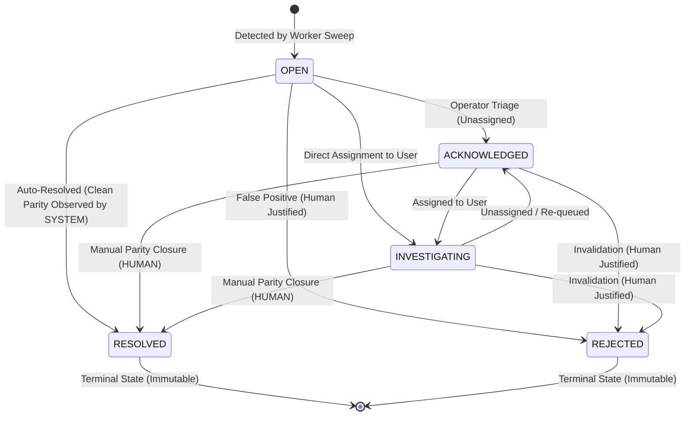
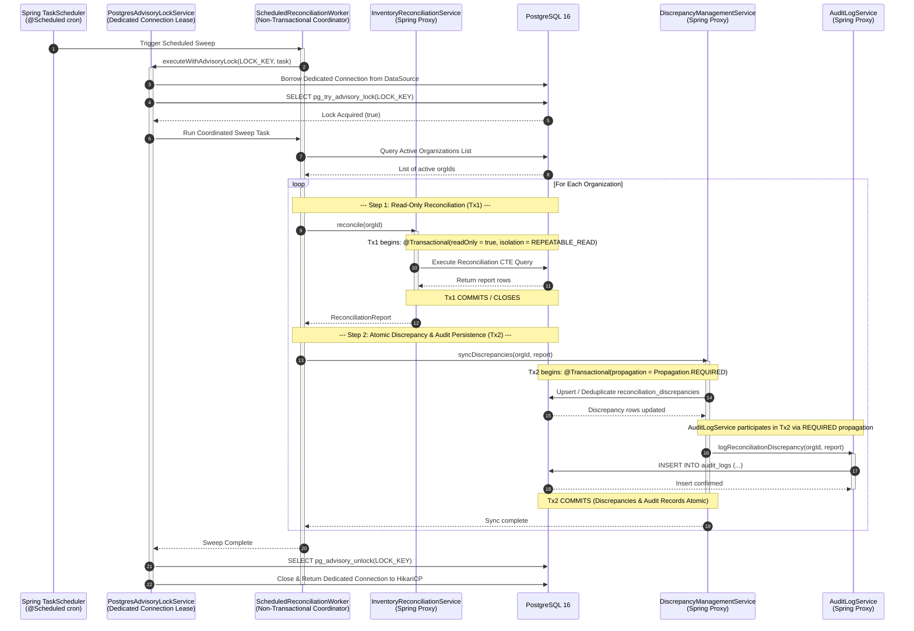

# ADR-012: Periodic Read-Only Inventory Reconciliation & Discrepancy Lifecycle Management

| Field | Value |
|---|---|
| **Status** | Accepted (Final V4 Resolution Integrity Alignment) |
| **Date** | 2026-11-14 |
| **Applies To** | Milestone 6 Phase 2 |
| **Authoritative References** | [ADR-004](ADR-004-inventory-ledger.md), [ADR-008](ADR-008-persistence-strategy.md), [ADR-011](ADR-011-authorization-and-organization-access-control.md), [Milestone 6 Implementation Plan](../../archive/milestone-6-implementation-plan.md), [Phase 2 Specification](../../archive/milestone-6-phase-2-specification.md) |

> [!IMPORTANT]
> This architectural decision record formalizes the snapshot semantics, background coordination, organization-scoped membership integrity, discrepancy persistence model, comprehensive resolution CHECK constraint, complete lifecycle transition matrix, deduplication rules, atomic discrepancy-audit transaction boundaries, and zero-auto-repair policy for StockGuard's inventory reconciliation subsystem.

---

## 1. Context

STOCKGUARD implements a dual-structure inventory engine ([ADR-004](ADR-004-inventory-ledger.md)):
1. `inventory_balances`: A mutable snapshot table recording current `on_hand` and `reserved` stock for high-throughput concurrency checks (`SELECT FOR UPDATE`).
2. `inventory_ledger_entries`: An append-only, immutable financial-grade ledger recording signed physical (`on_hand_delta`) and logical (`reserved_delta`) deltas grouped by `inventory_transactions`.

Mathematically, the ledger is the immutable single source of truth:
$$\text{inventory\_balances.on\_hand} = \sum \text{inventory\_ledger\_entries.on\_hand\_delta}$$
$$\text{inventory\_balances.reserved} = \sum \text{inventory\_ledger\_entries.reserved\_delta}$$
$$\text{available} = \text{inventory\_balances.on\_hand} - \text{inventory\_balances.reserved}$$

While `JdbcInventoryOperations.reconcile(organizationId)` implements an in-memory SQL verification query comparing balances against ledger sums, the platform requires an enterprise-grade operational architecture resolving:
1. **Resolution Consistency & Database CHECK Constraints:** PostgreSQL CHECK constraints treat NULL expressions as satisfied. Overlapping negative conditions (`!= 'SYSTEM'`) fail to prevent invalid state combinations. The database schema must enforce a comprehensive, airtight constraint validating every permitted state while rejecting all others.
2. **Organization-Scoped Assignment & Resolution Integrity:** Discrepancy assignees, resolvers, and rejecters must not simply be global users; they must be verified members of the owning organization (`organization_memberships`). Furthermore, clearing an assignment must not alter or nullify `organization_id`, and system-driven resolutions must cleanly represent a null human actor.
3. **Atomic Discrepancy and Audit Transaction Boundaries:** Read-only reconciliation (Tx1) must commit before discrepancy synchronization (Tx2) begins. Inside Tx2, discrepancy persistence and audit event logging must commit atomically under `REQUIRED` propagation to prevent orphaned audit entries.
4. **Refined Discrepancy Lifecycle & Transition Rules:** Complete transition matrix defining transitions, direct `OPEN -> INVESTIGATING` triage via assignment, mandatory non-blank resolution/rejection reasons (`~ '\S'`), and terminal-state immutability.
5. **Scheduled Multi-Tenant Execution & Fault Isolation:** Reconciliation must run on a configured UTC schedule across all active tenants. A database failure or timeout in Tenant A must never halt or corrupt processing for Tenant B.
6. **Zero Auto-Repair Invariant:** Reconciliation must strictly report and track discrepancies, never automatically modifying `inventory_balances` or synthesizing compensating ledger entries.

---

## 2. Decision

### 2.1 Single-Statement MVCC Snapshot Semantics & Isolation

Reconciliation between `inventory_balances` and `inventory_ledger_entries` must execute against a mathematically consistent snapshot of PostgreSQL:

1. **Statement-Level MVCC Guarantee:**
   The core reconciliation query executes as a single SQL query utilizing a Common Table Expression (CTE) joined against `inventory_balances`:
   ```sql
   WITH ledger_sums AS (
       SELECT
           organization_id,
           product_id,
           warehouse_id,
           COALESCE(SUM(on_hand_delta), 0) AS sum_on_hand,
           COALESCE(SUM(reserved_delta), 0) AS sum_reserved
       FROM inventory_ledger_entries
       WHERE organization_id = :organizationId
       GROUP BY organization_id, product_id, warehouse_id
   )
   SELECT
       COALESCE(b.product_id, l.product_id) AS product_id,
       COALESCE(b.warehouse_id, l.warehouse_id) AS warehouse_id,
       COALESCE(b.on_hand, 0) AS balance_on_hand,
       COALESCE(l.sum_on_hand, 0) AS ledger_on_hand,
       COALESCE(b.reserved, 0) AS balance_reserved,
       COALESCE(l.sum_reserved, 0) AS ledger_reserved,
       CASE
           WHEN b.id IS NULL THEN 'MISSING_BALANCE_ROW'
           WHEN l.product_id IS NULL THEN 'MISSING_LEDGER_ENTRIES'
           WHEN b.on_hand != l.sum_on_hand OR b.reserved != l.sum_reserved THEN 'DELTA_MISMATCH'
           ELSE 'MATCH'
       END AS discrepancy_status
   FROM inventory_balances b
   FULL OUTER JOIN ledger_sums l
     ON b.organization_id = l.organization_id
    AND b.product_id = l.product_id
    AND b.warehouse_id = l.warehouse_id
   WHERE COALESCE(b.organization_id, l.organization_id) = :organizationId;
   ```
   Under PostgreSQL default `READ COMMITTED` isolation, any single statement executes against an MVCC snapshot established at statement start. Both the `inventory_balances` table scan and the `inventory_ledger_entries` CTE scan observe the identical transaction commit boundary.

2. **Impact of Concurrent Business Mutations:**
   Because StockGuard executes all stock mutations (adjustments, receives, order fulfillments, order cancellations, reservation allocations/releases) inside an ACID database transaction updating `inventory_balances` and inserting into `inventory_ledger_entries` simultaneously:
   - Any transaction committed *before* the statement start timestamp is visible in both tables.
   - Any uncommitted (in-flight) transaction is visible in neither table.
   - Any transaction committed *after* the statement start timestamp is visible in neither table.
   - **Conclusion:** Concurrent inventory transactions NEVER produce false-positive reconciliation discrepancies.

3. **Multi-Statement Read-Only Boundary:**
   When reconciliation workflows require reading tenant configuration or inspecting related discrepancy records across multiple queries, the transaction MUST declare:
   ```java
   @Transactional(readOnly = true, isolation = Isolation.REPEATABLE_READ)
   ```
   This guarantees that all SELECT statements in the transaction observe the exact transaction-start snapshot.

---

### 2.2 Zero Auto-Repair Invariant

**Reconciliation is strictly read-only and diagnostic.**

> [!CAUTION]
> The reconciliation subsystem must NEVER automatically overwrite `inventory_balances` or synthesize compensating entries in `inventory_ledger_entries`.

**Rationale:**
1. A delta mismatch between balances and ledger entries is a critical system anomaly indicating a software bug, unhandled concurrent race condition, transaction failure, or unauthorized direct database manipulation.
2. Auto-repairing balances masks bugs, destroys forensic evidence, and bypasses physical warehouse stock verification.
3. Remediation must occur through authorized human intervention via manual stock adjustment (`POST /api/inventory/adjustments`) with audited business justifications (`AuditAction.STOCK_ADJUSTED`), re-establishing parity under human supervision.

---

### 2.3 Organization-Scoped Membership Integrity & V4 Resolution Constraints

Discrepancy assignments, resolutions, and rejections must enforce strict organization boundary integrity:

1. **Composite Foreign Keys:**
   Rather than referencing `users(id)` directly, discrepancy assignments and resolutions reference `organization_memberships(organization_id, user_id)`:
   ```sql
   CONSTRAINT fk_discrepancies_assigned_membership
       FOREIGN KEY (organization_id, assigned_to_user_id)
       REFERENCES organization_memberships(organization_id, user_id)
       ON DELETE RESTRICT,

   CONSTRAINT fk_discrepancies_resolved_membership
       FOREIGN KEY (organization_id, resolved_by_user_id)
       REFERENCES organization_memberships(organization_id, user_id)
       ON DELETE RESTRICT
   ```

2. **Comprehensive Resolution Consistency CHECK Constraint:**
   To eliminate loopholes caused by PostgreSQL's three-valued logic (where NULL evaluates to true in CHECK constraints), all resolution state permutations are validated via a single comprehensive constraint using null-safe comparisons (`IS NOT DISTINCT FROM`, `IS NULL`, `IS NOT NULL`) and regex whitespace validation (`~ '\S'`):
   ```sql
   CONSTRAINT chk_discrepancies_resolution_consistency CHECK (
       -- 1. Active states (OPEN, ACKNOWLEDGED, INVESTIGATING): zero resolution metadata
       (
           status IS NOT NULL
           AND status IN ('OPEN', 'ACKNOWLEDGED', 'INVESTIGATING')
           AND resolution_source IS NULL
           AND resolved_by_user_id IS NULL
           AND resolved_at IS NULL
           AND resolution_reason IS NULL
       )
       OR
       -- 2. System-resolved: source SYSTEM, resolver NULL, timestamp present, nonblank reason
       (
           status IS NOT DISTINCT FROM 'RESOLVED'
           AND resolution_source IS NOT DISTINCT FROM 'SYSTEM'
           AND resolved_by_user_id IS NULL
           AND resolved_at IS NOT NULL
           AND resolution_reason IS NOT NULL
           AND resolution_reason ~ '\S'
       )
       OR
       -- 3. Human-resolved: source HUMAN, resolver present, timestamp present, nonblank reason
       (
           status IS NOT DISTINCT FROM 'RESOLVED'
           AND resolution_source IS NOT DISTINCT FROM 'HUMAN'
           AND resolved_by_user_id IS NOT NULL
           AND resolved_at IS NOT NULL
           AND resolution_reason IS NOT NULL
           AND resolution_reason ~ '\S'
       )
       OR
       -- 4. Human-rejected: source HUMAN, resolver present, timestamp present, nonblank reason
       (
           status IS NOT DISTINCT FROM 'REJECTED'
           AND resolution_source IS NOT DISTINCT FROM 'HUMAN'
           AND resolved_by_user_id IS NOT NULL
           AND resolved_at IS NOT NULL
           AND resolution_reason IS NOT NULL
           AND resolution_reason ~ '\S'
       )
   )
   ```

3. **Null Actor and Clear-Assignment Semantics:**
   - **System Resolutions:** `resolved_by_user_id` is `NULL`, and `resolution_source` is `'SYSTEM'`. Under PostgreSQL `MATCH SIMPLE` foreign key semantics, a composite foreign key with one null column is valid and satisfied. `organization_id` remains intact.
   - **Human Resolutions & Rejections:** `resolved_by_user_id` is `NOT NULL` and `resolution_source` is `'HUMAN'`. The composite foreign key strictly validates that `(organization_id, resolved_by_user_id)` exists in `organization_memberships`.
   - **Clearing an Assignment:** Setting `assigned_to_user_id = NULL` unassigns the ticket without modifying or nullifying `organization_id`.
   - **`ON DELETE RESTRICT`:** Consistent with `V1` actor foreign keys, this prevents hard-deleting a membership row referenced by active or historical discrepancies.

4. **Service-Layer Validation:**
   - When assigning a discrepancy:
     1. Verify membership exists for `(organizationId, assignedToUserId)`.
     2. Verify membership is active (`membership.active == true`).
     3. Verify assigned user holds authority `inventory:reconcile` (Role `ADMIN` or `MANAGER`).
   - When resolving or rejecting a discrepancy manually:
     1. Verify the authenticated acting user is an active member with `inventory:reconcile` authority.
     2. Mandate a non-blank reason (`@NotBlank`) and reject whitespace-only strings (including tabs and newlines) via `resolution_reason ~ '\S'`.

---

### 2.4 Complete Discrepancy Lifecycle & Transition Matrix



#### Authoritative Discrepancy Transition Matrix:

| Current State | Target State | Actor / Trigger | Validation Requirements | Audit Action Emitted | State Consequence |
|---|---|---|---|---|---|
| `OPEN` | `ACKNOWLEDGED` | Human (API) | Caller holds `inventory:reconcile`. `assigned_to_user_id` remains NULL. | `DISCREPANCY_ACKNOWLEDGED` | Triage acknowledged; queued for investigation. |
| `OPEN` | `INVESTIGATING` | Human (API) | Caller holds `inventory:reconcile`. Assignee must be active member with `inventory:reconcile`. | `DISCREPANCY_ASSIGNED` | **Direct triage and assignment combined in one step.** |
| `OPEN` | `RESOLVED` | System (Worker) | Reconciliation sweep observes clean `MATCH`. `resolution_source = 'SYSTEM'`, `resolved_by_user_id = NULL`, `resolution_reason ~ '\S'`. | `RECONCILIATION_COMPLETED` | Discrepancy resolved automatically without operator overhead. |
| `OPEN` | `REJECTED` | Human (API) | Caller holds `inventory:reconcile`. Non-blank `resolution_reason`. `resolution_source = 'HUMAN'`, `resolved_by_user_id` non-null. | `DISCREPANCY_REJECTED` | Terminal rejection retaining rejecting actor attribution. |
| `ACKNOWLEDGED` | `INVESTIGATING` | Human (API) | Assignee must be active member with `inventory:reconcile`. | `DISCREPANCY_ASSIGNED` | Assigned to investigator. |
| `ACKNOWLEDGED` | `RESOLVED` | Human (API) | Caller holds `inventory:reconcile`. Non-blank `resolution_reason` and evidence. `resolution_source = 'HUMAN'`, `resolved_by_user_id` non-null. | `DISCREPANCY_RESOLVED` | Closed by operator after verified parity. |
| `ACKNOWLEDGED` | `REJECTED` | Human (API) | Caller holds `inventory:reconcile`. Non-blank `resolution_reason`. `resolution_source = 'HUMAN'`, `resolved_by_user_id` non-null. | `DISCREPANCY_REJECTED` | Terminal rejection retaining rejecting actor attribution. |
| `INVESTIGATING` | `RESOLVED` | Human (API) | Caller holds `inventory:reconcile`. Non-blank `resolution_reason` and evidence. `resolution_source = 'HUMAN'`, `resolved_by_user_id` non-null. | `DISCREPANCY_RESOLVED` | Closed by investigator after remediation. |
| `INVESTIGATING` | `REJECTED` | Human (API) | Caller holds `inventory:reconcile`. Non-blank `resolution_reason`. `resolution_source = 'HUMAN'`, `resolved_by_user_id` non-null. | `DISCREPANCY_REJECTED` | Terminal rejection retaining rejecting actor attribution. |
| `INVESTIGATING` | `ACKNOWLEDGED` | Human (API) | Caller holds `inventory:reconcile`. `assigned_to_user_id` set to NULL. | `DISCREPANCY_UNASSIGNED` | Re-queued to general unassigned pool. |
| `RESOLVED` | *(any)* | *(any)* | **PROHIBITED.** | None | **Terminal state. Strictly immutable.** |
| `REJECTED` | *(any)* | *(any)* | **PROHIBITED.** | None | **Terminal state. Strictly immutable.** |

#### Detection Count & Parity Observation Semantics:
1. **Clean Parity (`MATCH`) on `OPEN`:** Automatically resolved (`status = 'RESOLVED'`). `consecutive_detection_count` is frozen at its detected value for audit analysis. `last_verified_at = NOW()`.
2. **Clean Parity (`MATCH`) on `ACKNOWLEDGED` or `INVESTIGATING`:**
   - Active investigation state is preserved. State remains `ACKNOWLEDGED` or `INVESTIGATING`.
   - `last_verified_at = NOW()` is updated.
   - `consecutive_detection_count` is **neither incremented nor reset**; it is frozen to preserve the signal of how many sweeps detected the issue before parity returned.
   - Human closure via API is required to transition to `RESOLVED`.
3. **Repeated Mismatch (`DELTA_MISMATCH`, etc.):**
   - For all active states (`OPEN`, `ACKNOWLEDGED`, `INVESTIGATING`):
     - `last_detected_at = NOW()`.
     - `consecutive_detection_count++`.
     - Refresh observed quantities (`observed_balance_on_hand`, `observed_ledger_on_hand`, `observed_balance_reserved`, `observed_ledger_reserved`).
     - Triage notes and assignment are preserved.
4. **Recurrence After Terminal Closure:**
   - If an inventory position previously in `RESOLVED` or `REJECTED` experiences a delta mismatch in a future sweep, the partial unique index allows a **new** discrepancy record to be created with `status = 'OPEN'` and `consecutive_detection_count = 1`.

---

### 2.5 Corrected Worker Transaction Boundaries & Audit Log Service Adjustment



#### Actual AuditLogService Propagation & Implementation Adjustment:
1. **Inspection of Current Baseline (`1491cd9`):**
   In `AuditLogService.java` (line 818), `logReconciliationDiscrepancy` currently delegates to `transactionDelegate.writeInNewTransaction(...)` (`@Transactional(propagation = Propagation.REQUIRES_NEW)`).
   - This violates the atomicity requirement of Tx2: if discrepancy synchronization in `DiscrepancyManagementService` subsequently fails after writing the audit log, the audit log commits in its independent transaction while the discrepancy rows roll back, leaving an orphaned audit log!
2. **Safe Architectural Correction for Batch 2A/2B:**
   - In `AuditLogService.java`, annotate `logReconciliationDiscrepancy` with `@Transactional(propagation = Propagation.REQUIRED)`.
   - Modify its internal implementation to invoke `jdbcAuditLogOperations.insertAuditLog(...)` directly, rather than routing through `AuditLogTransactionDelegate.writeInNewTransaction(...)`.
   - **Preserved `REQUIRES_NEW` Behavior:** `AuditLogTransactionDelegate.writeInNewTransaction` remains completely intact and unchanged. All authenticated security events (`logSessionRevocation`, `logRefreshTokenReplay`, `logOrganizationSwitched`, `logAccessDenied`) continue delegating to `transactionDelegate.writeInNewTransaction(...)`, preserving their required independent transaction semantics.
3. **Runtime Spring Proxy Behavior:**
   - When `DiscrepancyManagementService.syncDiscrepancies` calls `auditLogService.logReconciliationDiscrepancy(...)`, the Spring AOP proxy on `AuditLogService` intercepts the call.
   - Finding `Propagation.REQUIRED`, Spring joins the active transaction `Tx2`.
   - Discrepancy row updates and audit log insertions commit atomically at the completion of `syncDiscrepancies`.
   - If Tx2 fails, both rollback cleanly together, guaranteeing zero orphan audit records.

---

## 3. Consequences

### Positive
- **Airtight Database Invariants:** Single comprehensive CHECK constraint prevents all illegal combinations of status, resolution source, actor attribution, and timestamps.
- **Accurate Actor Attribution on Rejections:** Human rejections permanently record the rejecting user's ID, timestamp, and justification under composite foreign key validation.
- **Atomic Discrepancy Auditing:** Discrepancy synchronization and audit trails commit atomically in Tx2.
- **Intelligent Auto-Resolution:** Newly detected discrepancies resolve automatically on parity restoration, while active human investigations are never overwritten or prematurely closed.
- **Robust Multi-Tenant Isolation:** Background worker failures in one organization cannot cascade or disrupt other organizations.

### Negative / Trade-offs
- **Human Closure Requirement:** When an investigated discrepancy achieves parity, an operator must still perform the final manual closure step. This trade-off is deliberate to ensure root cause is documented.

---

## 4. Acceptance Criteria

1. Composite foreign keys `(organization_id, assigned_to_user_id)` and `(organization_id, resolved_by_user_id)` reference `organization_memberships(organization_id, user_id)` with `ON DELETE RESTRICT`.
2. PostgreSQL constraint `chk_discrepancies_resolution_consistency` rejects all invalid resolution permutations and whitespace-only reasons (`~ '\S'`) using null-safe comparisons.
3. Setting `assigned_to_user_id = NULL` clears assignment while keeping `organization_id` intact.
4. System resolution cleanly supports null `resolved_by_user_id` with `resolution_source = 'SYSTEM'`.
5. Human resolution and human rejection require non-null `resolved_by_user_id` with `resolution_source = 'HUMAN'` and non-blank reasons.
6. Tx2 commits discrepancy rows and audit rows atomically under `REQUIRED` propagation; `logReconciliationDiscrepancy` joins Tx2.
7. Advisory lock acquired and released on exact same dedicated connection; released cleanly on graceful shutdown.
