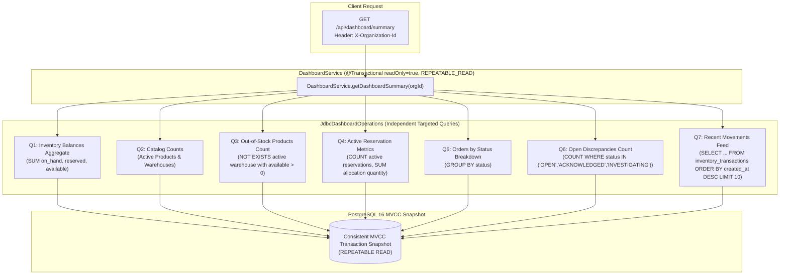

# ADR-013: Operational Dashboard Multi-Query Aggregation Architecture

| Field | Value |
|---|---|
| **Status** | Accepted (Refined for Evidence-Based Performance Validation) |
| **Date** | 2026-11-14 |
| **Applies To** | Milestone 6 Phase 2 |
| **Authoritative References** | [ADR-001](ADR-001-modular-monolith.md), [ADR-002](ADR-002-postgresql-source-of-truth.md), [ADR-008](ADR-008-persistence-strategy.md), [ADR-011](ADR-011-authorization-and-organization-access-control.md), [Milestone 6 Implementation Plan](../../archive/milestone-6-implementation-plan.md), [Phase 2 Specification](../../archive/milestone-6-phase-2-specification.md) |

> [!IMPORTANT]
> This architectural decision record defines the query design, isolation level, anti-Cartesian aggregation principles, and evidence-based performance validation for the Operational Dashboard subsystem (`com.stockguard.dashboard`).

---

## 1. Context

Operations managers, warehouse operators, and auditors require a centralized operational dashboard providing real-time operational posture:
1. **Catalog Overview:** Active products count, active warehouses count.
2. **Stock Totals:** Total on-hand units, total reserved units, and net available units.
3. **Inventory Health:** Total active products currently out-of-stock across all active warehouses.
4. **Reservation Posture:** Active reservation count and total allocated units.
5. **Order Pipeline:** Distribution of orders across lifecycle statuses (`PENDING`, `CONFIRMED`, `FULFILLED`, `CANCELLED`).
6. **Integrity Posture:** Count of unresolved inventory reconciliation discrepancies (`OPEN`, `ACKNOWLEDGED`, `INVESTIGATING`).
7. **Recent Activity:** Feed of recent inventory movements (top 10 latest stock transactions).
8. **Warehouse Drilldown:** Warehouse-specific operational posture for a selected warehouse facility.

### The Multi-Table Cartesian Aggregation Challenge
In relational databases, querying aggregates across multiple distinct one-to-many business relationships within a single SQL statement by joining tables (e.g. `inventory_balances` $\bowtie$ `orders` $\bowtie$ `reservations` $\bowtie$ `order_items`) produces a **Cartesian explosion**:
- An organization with 2,000 balance records, 1,000 orders, and 200 active reservations joined together generates:
  $$2,000 \times 1,000 \times 200 = 400,000,000 \text{ intermediate rows}$$
- Non-distinct aggregations (`SUM(b.on_hand)`) become multiplied by the cardinality of orders and reservations, producing wildly inflated, invalid operational numbers.
- `COUNT(DISTINCT ...)` workarounds require massive memory for hash-tables, causing query timeouts and disk-spill sorting in PostgreSQL.

---

## 2. Decision

### 2.1 Independent Multi-Query Aggregation within a Single Read-Only Transaction

Rather than attempting to force all operational metrics into a single monolithic join or an unwieldy mega-query, StockGuard implements **targeted, independent SQL queries orchestrated within a single read-only transaction**:



#### Snapshot Isolation Guarantee:
By annotating `DashboardService` with `@Transactional(readOnly = true, isolation = Isolation.REPEATABLE_READ)`, PostgreSQL creates a single MVCC transaction snapshot at the first query. All subsequent queries in that service method read from the **exact same immutable database point-in-time**. This guarantees that the order counts, reservation totals, and balance positions are mathematically synchronized without multi-statement drift.

---

### 2.2 Detailed Query Specifications & Plan Appropriateness

#### Query 1: Inventory Balances Totals
```sql
SELECT
    COALESCE(SUM(on_hand), 0) AS total_on_hand,
    COALESCE(SUM(reserved), 0) AS total_reserved,
    COALESCE(SUM(on_hand - reserved), 0) AS total_available
FROM inventory_balances
WHERE organization_id = :orgId;
```
- **Plan Strategy:** Index Scan or Bitmap Index Scan using `uq_inventory_balances_org_product_warehouse` filtering by `organization_id`. For tenants with very large balance distributions, a covering index or bitmap heap scan is appropriate.

#### Query 2: Active Catalog Counts
```sql
SELECT
    (SELECT COUNT(*) FROM products WHERE organization_id = :orgId AND active = TRUE) AS active_products_count,
    (SELECT COUNT(*) FROM warehouses WHERE organization_id = :orgId AND active = TRUE) AS active_warehouses_count;
```
- **Plan Strategy:**
  - `products`: Index Scan on `idx_products_org_active (organization_id, active)` or `uq_products_org_id`.
  - `warehouses`: Sequential Scan is explicitly recognized as appropriate and optimal by the PostgreSQL cost optimizer when the table contains only a small number of facilities (e.g. 5–50 rows), avoiding unnecessary B-Tree page lookups.

#### Query 3: Out-of-Stock Active Products Count
Definition: Products marked `active = true` that have no available inventory ($(\text{on\_hand} - \text{reserved}) \le 0$) across ANY active warehouse (`active = true`). This includes products with zero balance rows.
```sql
SELECT COUNT(*)
FROM products p
WHERE p.organization_id = :orgId
  AND p.active = TRUE
  AND NOT EXISTS (
      SELECT 1
      FROM inventory_balances b
      JOIN warehouses w ON b.warehouse_id = w.id AND b.organization_id = w.organization_id
      WHERE b.organization_id = p.organization_id
        AND b.product_id = p.id
        AND w.active = TRUE
        AND (b.on_hand - b.reserved) > 0
  );
```
- **Plan Strategy:** Subquery Anti-Join (Hash Anti-Join or Nested Loop with Anti-Join) utilizing `uq_inventory_balances_org_product_warehouse (organization_id, product_id, warehouse_id)`.

#### Query 4: Active Reservations & Reserved Units
```sql
SELECT
    COUNT(DISTINCT r.id) AS active_reservations_count,
    COALESCE(SUM(a.quantity), 0) AS total_reserved_units
FROM reservations r
LEFT JOIN reservation_allocations a
  ON r.id = a.reservation_id AND r.organization_id = a.organization_id
WHERE r.organization_id = :orgId
  AND r.status = 'ACTIVE';
```
- **Plan Strategy:** Index Scan on `idx_reservations_org_status (organization_id, status)` joined against `idx_allocations_org_reservation`.

#### Query 5: Order Breakdown by Status
```sql
SELECT status, COUNT(*) AS count
FROM orders
WHERE organization_id = :orgId
GROUP BY status;
```
- **Plan Strategy:** Index Scan on `idx_orders_org_status_date` or Bitmap Index Scan on `organization_id`.

#### Query 6: Open Discrepancy Count
```sql
SELECT COUNT(*) AS open_discrepancies_count
FROM reconciliation_discrepancies
WHERE organization_id = :orgId
  AND status IN ('OPEN', 'ACKNOWLEDGED', 'INVESTIGATING');
```
- **Plan Strategy:** Bitmap Index Scan on `idx_discrepancies_org_status (organization_id, status)` or partial unique index `uq_active_discrepancy_position`.

#### Query 7: Recent Inventory Movements Feed
```sql
SELECT
    t.id,
    t.transaction_type,
    t.reference_type,
    t.reference_id,
    t.created_at,
    u.full_name AS created_by_name
FROM inventory_transactions t
LEFT JOIN users u ON t.created_by_user_id = u.id
WHERE t.organization_id = :orgId
ORDER BY t.created_at DESC
LIMIT :limit;
```
- **Plan Strategy:** Backward Index Scan on `idx_transactions_org_created (organization_id, created_at DESC)` with a quick `LIMIT 10` cutoff, scanning at most 10 heap rows.

---

### 2.3 Warehouse Drilldown Query Strategy (`GET /api/dashboard/warehouses/{id}`)

For warehouse-scoped drilldown, the queries are parameterized with `:warehouseId`:
1. **Warehouse Status Verification:** Asserts that the warehouse exists, is active, and belongs to `:orgId`.
2. **Warehouse Balances:** `SUM(on_hand)`, `SUM(reserved)`, `SUM(on_hand - reserved)` filtered by `warehouse_id = :warehouseId`.
3. **Out-of-Stock for Warehouse:** Active products with zero available balance in this specific warehouse.
4. **Active Allocations:** Sum of `reservation_allocations.quantity` where `warehouse_id = :warehouseId` and parent reservation is `ACTIVE`.
5. **Recent Movements:** Top 10 ledger entries / transactions affecting this specific warehouse.

---

## 3. Evidence-Based Performance Validation Methodology

StockGuard rejects arbitrary, unsupported millisecond claims (such as "must execute in under 10 ms universally") in favor of **empirically grounded performance acceptance criteria**:

### 1. Representative Dataset Sizing:
Performance validation must be executed against a synthetic, representative enterprise dataset:
- `products`: 5,000 active catalog items.
- `warehouses`: 10 facilities (active and inactive).
- `inventory_balances`: 25,000 balance records.
- `inventory_ledger_entries`: 250,000 append-only delta entries.
- `orders`: 10,000 orders across lifecycle states.
- `order_items`: 30,000 line items.
- `reservations`: 1,500 active reservations with 4,500 allocations.
- `reconciliation_discrepancies`: 200 discrepancies across states.

### 2. `EXPLAIN (ANALYZE, BUFFERS)` Acceptance Criteria:
Every dashboard query must be profiled using `EXPLAIN (ANALYZE, BUFFERS)`:
- **Zero Disk Spills:** Buffers must demonstrate zero disk temporary file generation (`temp read: 0, temp written: 0`) and zero external merge sorts on disk.
- **Buffer Page Boundedness:** Queries must demonstrate bounded shared buffer hit counts proportional to result selectivity.
- **Appropriate Access Paths:**
  - High-cardinality tables (`inventory_balances`, `inventory_transactions`, `orders`) must utilize Index Scans or Bitmap Index Scans.
  - Low-cardinality dimension tables (e.g. `warehouses` with $< 50$ rows) where the cost optimizer selects Sequential Scan are explicitly acceptable. Mandating index scans on small tables is prohibited.

### 3. Connection Pool Budgeting:
- Measure HikariCP connection lease time for `DashboardService.getDashboardSummary(orgId)`.
- Under concurrent load (50 concurrent dashboard requests), connection hold duration must remain bounded, with no connection pool exhaustion or request timeouts.

---

## 4. Consequences

### Positive
- **Elimination of Cartesian Explosion:** Zero risk of runaway joins or multiplied aggregation sums.
- **Snapshot Consistency:** `REPEATABLE READ` transaction ensures all metrics represent the identical temporal state.
- **Maintainability & Modularity:** Each metric query is isolated in `JdbcDashboardOperations`, making query optimization, indexing, and debugging straightforward.
- **Realistic Performance Governance:** Acceptance is tied to buffer metrics, execution plans, and representative data volumes rather than arbitrary latency assertions.

### Negative / Trade-offs
- **Connection Holding Duration:** A single connection from HikariCP is held for the duration of the 7 queries. To prevent connection starvation under high concurrency, dashboard queries must be rate-limited or cached on the client side.

---

## 5. Acceptance Criteria

1. Dashboard queries never join multiple 1-to-N tables without subquery/CTE grouping.
2. `DashboardService` executes all component queries within `@Transactional(readOnly = true, isolation = Isolation.REPEATABLE_READ)`.
3. Out-of-stock count accurately includes products with no balance rows and products with zero available stock across active warehouses.
4. Active reservation count reflects distinct reservation headers, while total units reflects the sum of active allocations.
5. Warehouse drilldown enforces strict tenant and warehouse boundary validation.
6. Empirical performance validation with `EXPLAIN (ANALYZE, BUFFERS)` confirms zero disk spills and optimal index/sequential scan selection.
