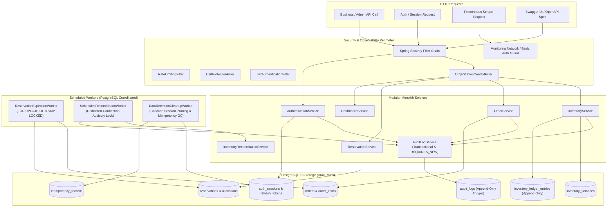
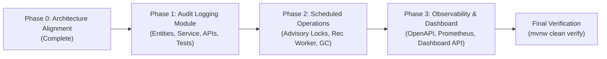
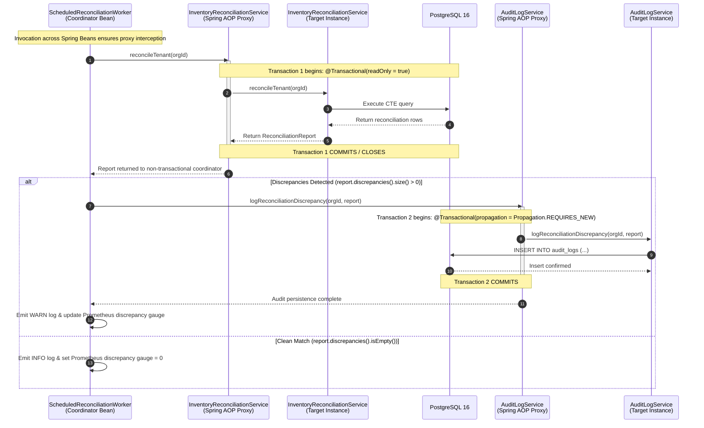

# STOCKGUARD — Milestone 6 Implementation Plan: System Auditing, Automated Operations & Observability

> **Document Status:** ACCEPTED IMPLEMENTATION PLAN (PHASE 0 FINAL ALIGNMENT)
> **Target Release:** Milestone 6
> **Repository Checkpoint:** `f8385a0` (Milestone 5C committed and pushed to main)
> **Authoritative References:** [ADR-004](adr/ADR-004-inventory-ledger.md), [ADR-007](adr/ADR-007-idempotency.md), [ADR-008](adr/ADR-008-persistence-strategy.md), [ADR-009](adr/ADR-009-reservation-expiration.md), [ADR-010](adr/ADR-010-authentication-and-session-management.md), [ADR-011](adr/ADR-011-authorization-and-organization-access-control.md), [Database Schema Specification](../database/DATABASE_SCHEMA_SPECIFICATION.md)

---

## 1. Executive Summary & Architecture Blueprint

Milestone 6 transitions STOCKGUARD from a core transactional engine into an enterprise-ready, auditable, and observable inventory management platform.

### Core Objectives
1. **System Auditing Module (`com.stockguard.audit`):** Populate the existing Flyway `V1` `audit_logs` table under the protection of `V2` append-only database triggers. Enforce transactional atomicity for business mutations and decoupled `REQUIRES_NEW` persistence for security and discrepancy events.
2. **Automated Scheduled Operations:** Implement scheduled multi-tenant inventory reconciliation and automated data retention cleanup (pruning aged idempotency records and expired session families) coordinated across multi-instance deployments via dedicated-connection PostgreSQL session advisory locks.
3. **Observability & Metrics:** Export low-cardinality Prometheus metrics via Micrometer and expose SpringDoc OpenAPI 3.0 documentation (`swagger-ui`) for all authenticated and public endpoints.
4. **Operations Dashboard Summary API:** Deliver `GET /api/dashboard/summary` providing real-time inventory positions, catalog health, active reservations, and order state distributions under strict tenant isolation.



---

## 2. Phase-by-Phase Implementation Plan



### Phase 1: System Auditing Module (`com.stockguard.audit`)
1. **Domain Model & DTOs:**
   - Create `AuditLog` entity mapping to `audit_logs` table (immutable: no setters for state mutation).
   - Create `AuditLogResponse` record for API responses.
   - Create `AuditLogFilterRequest` for query filtering (`entityType`, `action`, `actorUserId`, `dateFrom`, `dateTo`, `limit`, `offset`).
2. **Persistence Layer:**
   - Create `AuditLogRepository` (Spring Data JPA) for read-only queries with pagination and tenant filtering.
   - Create `JdbcAuditLogOperations` (Spring NamedParameterJdbcTemplate) for append-only row insertions.
3. **Service Layer & Domain-Specific Payload Design:**
   - Implement `AuditLogService` with purpose-specific domain methods rather than generic map/object serialization:
     - `logInventoryAdjustment(UUID orgId, UUID actorId, UUID productId, UUID warehouseId, long onHandDelta, String reason)`
     - `logOpeningBalance(UUID orgId, UUID actorId, UUID productId, UUID warehouseId, long onHand)`
     - `logOrderCancellation(UUID orgId, UUID actorId, UUID orderId, String reason)`
     - `logOrderFulfillment(UUID orgId, UUID actorId, UUID orderId)`
     - `logMembershipRoleChange(UUID orgId, UUID actorId, UUID targetUserId, String oldRole, String newRole)`
     - `logMembershipDeactivation(UUID orgId, UUID actorId, UUID targetUserId)`
     - `logReconciliationDiscrepancy(UUID orgId, ReconciliationReport report)`
   - Dual transaction semantics:
     - Purpose-specific business mutation audits execute within caller's existing transaction (`Propagation.REQUIRED`).
     - Purpose-specific authenticated security events execute within an independent transaction (`Propagation.REQUIRES_NEW`).
   - Implement `SensitiveDataMasker` as defense-in-depth sanitization (never as the primary security boundary).
4. **Controller Layer:**
   - Expose `GET /api/audit-logs` requiring `hasAuthority('audit:view')` and mandatory `X-Organization-Id` header.
5. **Integration Points:**
   - Wire explicit domain auditing into `InventoryService.adjustStock()`, `InventoryService.recordOpeningBalance()`, `OrderService.cancelOrder()`, `OrderService.fulfillOrder()`, `OrganizationService.updateMemberRole()`, and `OrganizationService.deactivateMember()`.

### Phase 2: Scheduled Operations & Data Retention Maintenance
1. **PostgreSQL Advisory Lock Coordination:**
   - Implement `PostgresAdvisoryLockService` managing session-level advisory locks via a dedicated `java.sql.Connection` borrowed directly from `DataSource`.
   - Guarantee that lock acquisition (`pg_try_advisory_lock`) and lock release (`pg_advisory_unlock`) execute on the **exact same connection**, returned to HikariCP in a mandatory `finally` block.
2. **Scheduled Reconciliation Worker (`ScheduledReconciliationWorker`):**
   - Configured via `@Scheduled(cron = "${stockguard.reconciliation.scheduled.cron:0 0 2 * * *}")`.
   - Acquires advisory lock, iterates active organizations, invokes `InventoryReconciliationService.reconcileTenant(orgId)`, and logs discrepancy events.
3. **Data Retention Cleanup Worker (`DataRetentionCleanupWorker`):**
   - Configured via `@Scheduled(cron = "${stockguard.retention.cleanup.cron:0 0 3 * * *}")`.
   - Executes bounded batch deletion of expired `idempotency_records` (`expires_at < NOW()`).
   - Executes cascade pruning of expired/revoked `auth_sessions` aged $> 30$ days (`(revoked = TRUE OR expires_at < NOW()) AND updated_at < NOW() - INTERVAL '30 days'`), relying on foreign-key cascade to cleanly delete child `refresh_tokens`.

### Phase 3: Observability, Dashboard Summary API & OpenAPI Documentation
1. **SpringDoc OpenAPI 3.0 Integration:**
   - Add `springdoc-openapi-starter-webmvc-ui:3.2.0` (compatible with Spring Boot 4.1.2 and Spring Framework 7.0.10).
   - Configure `OpenApiConfig`: define `BearerAuth`, `RefreshCookieAuth`, `X-Organization-Id` parameter, `X-StockGuard-CSRF` parameter, and operational `Idempotency-Key` parameter.
   - Whitelist `/swagger-ui/**`, `/v3/api-docs/**` in `SecurityConfig.java`.
2. **Prometheus Metrics:**
   - Add `micrometer-registry-prometheus` (managed version `1.17.2`).
   - Register custom counters and gauges: `stockguard.reconciliation.status`, `stockguard.reconciliation.duration.seconds`, `stockguard.reservations.expired.total`, `stockguard.db.deadlock.retries.total`.
   - Enforce low-cardinality tags. Do not tag with `orgId`, `userId`, `orderId`, or `sku`.
   - Restrict `/actuator/prometheus` to internal management interfaces/networks in production.
3. **Dashboard Summary API (`GET /api/dashboard/summary`):**
   - Implement `DashboardController`, `DashboardService`, and `JdbcDashboardOperations`.
   - Deliver aggregated metrics: on-hand, reserved, and available stock; active product and warehouse counts; out-of-stock product count; active reservation count and reserved quantity; order breakdown by status.
   - Enforce `dashboard:view` authority and `X-Organization-Id` tenant isolation.

---

## 3. Detailed Architecture Specifications & Invariants

### 3.1 Reconciliation Snapshot Consistency & Isolation
1. **Single-Statement Consistency:**
   - The authoritative reconciliation query in `JdbcInventoryOperations.reconcile(organizationId)` executes as a single SQL statement utilizing a Common Table Expression (CTE) joined against `inventory_balances`:
     ```sql
     WITH ledger_sums AS (
         SELECT organization_id, product_id, warehouse_id,
                COALESCE(SUM(on_hand_delta), 0) AS sum_on_hand,
                COALESCE(SUM(reserved_delta), 0) AS sum_reserved
         FROM inventory_ledger_entries
         WHERE organization_id = ?
         GROUP BY organization_id, product_id, warehouse_id
     )
     SELECT COALESCE(b.product_id, l.product_id) AS product_id,
            COALESCE(b.warehouse_id, l.warehouse_id) AS warehouse_id,
            COALESCE(b.on_hand, 0) AS balance_on_hand,
            COALESCE(l.sum_on_hand, 0) AS ledger_on_hand,
            COALESCE(b.reserved, 0) AS balance_reserved,
            COALESCE(l.sum_reserved, 0) AS ledger_reserved,
            CASE
                WHEN b.id IS NULL THEN 'MISSING_BALANCE_ROW'
                WHEN l.product_id IS NULL THEN 'MISSING_LEDGER_ENTRIES'
                WHEN b.on_hand != l.sum_on_hand OR b.reserved != l.sum_reserved THEN 'DELTA_MISMATCH'
                ELSE 'MATCH'
            END AS discrepancy_status
     FROM inventory_balances b
     FULL OUTER JOIN ledger_sums l
       ON b.organization_id = l.organization_id
      AND b.product_id = l.product_id
      AND b.warehouse_id = l.warehouse_id
     WHERE COALESCE(b.organization_id, l.organization_id) = ?;
     ```
   - In PostgreSQL, a single SQL statement executes against a single MVCC snapshot established at statement start time under default `READ COMMITTED` isolation. This ensures internal consistency between the aggregated ledger sums and the balance snapshot without multi-statement skew.
2. **Multi-Statement Fallback Policy:**
   - If future extensions require multiple statements to complete tenant reconciliation, the transaction MUST be configured explicitly with `Isolation.REPEATABLE_READ` and `readOnly = true`:
     ```java
     @Transactional(readOnly = true, isolation = Isolation.REPEATABLE_READ)
     ```
   - This guarantees that all SELECT statements within the transaction see the identical MVCC snapshot taken at transaction start.
3. **Zero Balance Mutation Invariant:**
   - Scheduled reconciliation is strictly read-only. Discrepancies are reported, audited, and alerted.
   - The reconciliation engine **never automatically alters, repairs, or compensates** stored balances. Correcting discrepancies requires authorized human intervention via manual inventory adjustments (`POST /api/inventory/adjustments`).

---

### 3.2 Spring Transaction Ownership & Proxy-Mediated Boundaries

To guarantee that the read-only reconciliation transaction finishes before audit persistence occurs, and that audit logging commits in an independent write transaction:



#### Spring Proxy Requirements:
1. `ScheduledReconciliationWorker` coordinates the workflow but does not declare `@Transactional` on its scheduling method.
2. `InventoryReconciliationService` and `AuditLogService` are distinct Spring beans injected into the worker.
3. Calling `inventoryReconciliationService.reconcile(orgId)` invokes the Spring proxy, establishing and cleanly committing `Transaction 1 (readOnly = true)`.
4. Calling `auditLogService.logReconciliationDiscrepancy(...)` invokes the audit proxy, establishing and cleanly committing `Transaction 2 (Propagation.REQUIRES_NEW)`.
5. Self-invocation (`this.method()`) is prohibited as it bypasses the Spring AOP interceptor chain.

---

### 3.3 Audit Payload Security: Domain-Specific Payloads & Defense-in-Depth

#### 1. Primary Security Boundary: Explicit Domain-Specific Payloads
Audit events must use explicit, purpose-built domain payloads constructed with a strict allowlist of permitted fields:
- **Purpose-Specific Service Signatures:** `AuditLogService` exposes dedicated methods accepting only the exact parameters required for that specific event (e.g. `logInventoryAdjustment`, `logOrderCancellation`, `logMembershipChange`).
- **Allowed Field Example (Inventory Adjustment):**
  An inventory adjustment audit entry records only:
  - `organizationId` (UUID)
  - `actorUserId` (UUID)
  - `productId` (UUID)
  - `warehouseId` (UUID)
  - `onHandDelta` (signed long)
  - `reason` (textual business justification)
  - `entityId` / transaction identifiers
- **Prohibited Anti-Patterns (Never Blindly Serialize):**
  - **HTTP Request Bodies or `HttpServletRequest`:** Blind serialization risks capturing credentials, unvalidated fields, raw cookies, or transport headers.
  - **Controller Response Objects / DTOs:** Responses may contain transient presentation fields or broad data structures unnecessary for auditability.
  - **Security Principals / Authentication Objects:** Serializing `StockGuardPrincipal`, `Authentication`, or session tokens exposes internal identity tokens and claims.
  - **Entire JPA Entities:** Serializing entities risks triggering accidental lazy-loading queries, traversing circular relationships, or persisting internal metadata.
  - **Arbitrary Caller-Supplied Maps:** Generic `Map<String, Object>` signatures permit developers to pass arbitrary untyped objects, bypassing field allowlists.

#### 2. Defense in Depth: `SensitiveDataMasker`
- `SensitiveDataMasker` acts strictly as **defense in depth** (a secondary safety net), not the primary security boundary.
- The primary boundary is the compile-time, domain-specific parameter allowlist on `AuditLogService`.
- If an unexpected sensitive attribute slips through, `SensitiveDataMasker` intercepts and masks:
  - `password`, `rawPassword`, `passwordHash`
  - `token`, `jwt`, `tokenHash`, `accessToken`, `refreshToken`
  - `secret`, `apiKey`, `credentials`
  - All blacklisted values are replaced with `"[PROTECTED]"`.

#### 3. Bounded Discrepancy Metadata Schema:
To prevent JSON payload bloat and unbounded storage growth in `audit_logs.metadata`:
- **Itemized Discrepancy Limit:** Store a maximum of **100 discrepancy items** in the `audit_logs.metadata` JSONB column (hardcoded default; no operational need for external dynamic configuration).
- **Metadata Payload Structure:**
  ```json
  {
    "totalDiscrepancyCount": 142,
    "truncated": true,
    "maxRecordedItems": 100,
    "matchCount": 850,
    "totalInspected": 992,
    "items": [
      {
        "productId": "4b33c035-7ffc-4613-81ce-0348f95c1847",
        "warehouseId": "8f8b89d5-783a-4467-bc22-a169b14ea988",
        "balanceOnHand": 100,
        "ledgerOnHand": 90,
        "balanceReserved": 10,
        "ledgerReserved": 10,
        "discrepancyStatus": "DELTA_MISMATCH"
      }
    ]
  }
  ```

---

### 3.4 Security Transaction Boundary & Unauthenticated Event Handling

#### 1. Security Event Transaction Boundary:
- **Authenticated Security Events:** Events with a valid, authenticated organization context and actor membership (e.g., role updates, membership deactivations, session revocations, organization switching) may be persisted to `audit_logs` using an independent write transaction (`@Transactional(propagation = Propagation.REQUIRES_NEW)`).
- **Commit Guarantee:** Using `REQUIRES_NEW` ensures security audit records commit even if the triggering HTTP request subsequently fails or is aborted.

#### 2. Unauthenticated Events Policy (No Dummy Organizations):
- **Database Schema Constraints:**
  - `audit_logs.organization_id UUID NOT NULL` (references `organizations(id)`).
  - `CONSTRAINT fk_audit_logs_actor FOREIGN KEY (organization_id, actor_user_id) REFERENCES organization_memberships(organization_id, user_id)`.
- **Strict Prohibition:**
  - When an unauthenticated request fails (e.g. `POST /api/auth/login` with bad password, unknown email, or expired token), the system **must not invent a default organization** or attach the failure to an arbitrary organization membership. Doing so corrupts tenant boundaries and violates foreign-key constraints.
- **Telemetry Routing for Unauthenticated Events:**
  - Unauthenticated security events route strictly to **structured application security logs** (`com.stockguard.security.audit` logger at `WARN` level with timestamp, client IP, user agent, and failure reason).
  - Unauthenticated events increment the Prometheus counter `stockguard.auth.failures.total{reason="bad_credentials"}`.
  - The `audit_logs` database table is reserved strictly for operations possessing an authentic, validated `organization_id` context.

---

### 3.5 PostgreSQL Advisory Lock Dedicated Connection Lifecycle

```java
public void executeWithSessionAdvisoryLock(long lockKey, Runnable task) {
    // 1. Borrow dedicated connection directly from DataSource
    try (Connection conn = dataSource.getConnection()) {
        conn.setAutoCommit(true);
        boolean locked = false;

        // 2. Attempt non-blocking session lock on dedicated connection
        try (PreparedStatement ps = conn.prepareStatement("SELECT pg_try_advisory_lock(?)")) {
            ps.setLong(1, lockKey);
            try (ResultSet rs = ps.executeQuery()) {
                if (rs.next()) {
                    locked = rs.getBoolean(1);
                }
            }
        }

        if (!locked) {
            log.info("Scheduled task skipped: advisory lock {} held by another instance", lockKey);
            return;
        }

        // 3. Execute the coordinated task while holding the dedicated connection open
        try {
            task.run();
        } finally {
            // 4. Release advisory lock on the EXACT SAME dedicated connection
            try (PreparedStatement ps = conn.prepareStatement("SELECT pg_advisory_unlock(?)")) {
                ps.setLong(1, lockKey);
                ps.executeQuery();
            } catch (SQLException ex) {
                log.error("Failed to release advisory lock {}", lockKey, ex);
            }
        }
    } catch (SQLException ex) {
        log.error("Database error during advisory lock coordination", ex);
    }
    // 5. Connection is automatically closed and returned to HikariCP by try-with-resources
}
```

#### Lifecycle Guarantees:
- **Dedicated Lease:** The lock is acquired and released on the same physical connection.
- **HikariCP Compatibility:** Consumes exactly 1 pooled connection during the sweep.
- **Fail-Safe Crash Protection:** If the node terminates unexpectedly, PostgreSQL terminates the backend socket, automatically releasing all session locks held by that PID.

---

### 3.6 Dashboard Summary SQL, Definitions & Index Status

#### Aggregation Queries:
```sql
-- 1. Inventory Balances (Total on hand, reserved, available):
SELECT
    COALESCE(SUM(on_hand), 0) AS total_on_hand,
    COALESCE(SUM(reserved), 0) AS total_reserved,
    COALESCE(SUM(on_hand - reserved), 0) AS total_available
FROM inventory_balances
WHERE organization_id = :orgId;

-- 2. Catalog Counts (Active products and active warehouses):
SELECT
    (SELECT COUNT(*) FROM products WHERE organization_id = :orgId AND active = TRUE) AS active_products_count,
    (SELECT COUNT(*) FROM warehouses WHERE organization_id = :orgId AND active = TRUE) AS active_warehouses_count;

-- 3. Out-of-Stock Active Products Count:
-- Definition: Active products having NO available stock in ANY active warehouse.
SELECT COUNT(*)
FROM products p
WHERE p.organization_id = :orgId
  AND p.active = TRUE
  AND NOT EXISTS (
      SELECT 1
      FROM inventory_balances b
      JOIN warehouses w ON b.warehouse_id = w.id AND b.organization_id = w.organization_id
      WHERE b.organization_id = p.organization_id
        AND b.product_id = p.id
        AND w.active = TRUE
        AND (b.on_hand - b.reserved) > 0
  );

-- 4. Active Reservations (Distinct headers count):
SELECT COUNT(*)
FROM reservations
WHERE organization_id = :orgId AND status = 'ACTIVE';

-- 5. Total Reserved Units across Active Reservations:
SELECT COALESCE(SUM(a.quantity), 0)
FROM reservation_allocations a
JOIN reservations r ON a.reservation_id = r.id AND a.organization_id = r.organization_id
WHERE r.organization_id = :orgId AND r.status = 'ACTIVE';

-- 6. Orders Breakdown by Status:
SELECT status, COUNT(*) AS count
FROM orders
WHERE organization_id = :orgId
GROUP BY status;
```

#### Index Verification Status:
The following schema indexes are identified as **potentially supporting** these dashboard queries based on table structures in `V1__create_initial_schema.sql`:
- `uq_inventory_balances_org_product_warehouse (organization_id, product_id, warehouse_id)`
- `uq_products_org_id (organization_id, id)`
- `uq_warehouses_org_id (organization_id, id)`
- `idx_orders_org_status_date (organization_id, status, created_at DESC)`
- `uq_reservations_org_order (organization_id, order_id)`
- `idx_allocations_org_reservation (organization_id, reservation_id, order_id)`

> [!NOTE]
> Index utilization described above is based on structural schema inspection. It does not constitute query-plan or performance validation. The PostgreSQL cost-based optimizer may select sequential scans or bitmap heap scans depending on dataset size and distribution. Formal validation using `EXPLAIN (ANALYZE, BUFFERS)` against representative data volumes will be executed as part of Phase 3 verification.

---

### 3.7 Prometheus and OpenAPI Security Architecture

#### 1. Prometheus Metrics Protection:
- **No Public Access:** `/actuator/prometheus` must **never** be exposed publicly without authorization in production.
- **Separation of Privileges:** Do **not** reuse `audit:view` for metric scraping. `audit:view` is an administrative business role permission granting access to sensitive human audit trails.
- **Production Posture:**
  - In production, metric scraping is restricted to an internal management network/interface (e.g. dedicated Kubernetes scrape subnet or reverse-proxy filter).
  - If secured via application security, a dedicated monitoring identity (e.g. HTTP Basic auth with `ROLE_MONITORING` or authority `monitoring:scrape`) is required.
- **Health Probes Preserved:** `/actuator/health/liveness`, `/actuator/health/readiness`, and `/actuator/info` remain `.permitAll()`.

#### 2. OpenAPI Documentation Specifications:
- **`BearerAuth`:** Documented as an HTTP Bearer JWT scheme applied to `/api/**` endpoints.
- **`RefreshCookieAuth`:** Documented as an API Key in Cookie (`__Secure-stockguard_refresh` in production; `stockguard_refresh` in development) applied exclusively to `POST /api/auth/refresh` and `POST /api/auth/logout`.
- **`X-Organization-Id`:** Documented as a mandatory header parameter on organization-scoped business endpoints.
- **`X-StockGuard-CSRF`:** Documented as a mandatory custom header parameter on state-changing cookie endpoints.
- **`Idempotency-Key`:** Documented as an optional/mandatory **operation request header**, not an authentication scheme.

---

## 4. Summary of Architecture Decisions Table

| Decision Area | Accepted Final Policy | Verified Constraint / Rationale |
|---|---|---|
| **Reservation Expiration Worker** | Initial delay: `10,000 ms`, Fixed delay: `30,000 ms`, Batch size: `50`, TTL: `15 minutes`. | Authoritative configuration verified from `application.yml` and `ReservationProperties.java`. |
| **Reconciliation Consistency** | Single CTE SQL query for ledger vs. balance comparison. Fallback to `REPEATABLE READ` read-only transaction if multiple statements are required. | Guarantees atomic MVCC snapshot. Zero automatic balance repairs. |
| **Advisory Lock Lifecycle** | Dedicated `Connection` from `DataSource` leased for lock, held during task, unlocked in `finally`, and closed. | Prevents session-lock leaks across pooled HikariCP connections. |
| **Dashboard Reservations Count** | Independent query `SELECT COUNT(*) FROM reservations WHERE status = 'ACTIVE'`. | Eliminates inflated counts caused by multiple line allocations. |
| **Out-of-Stock Products** | Active products (`active = true`) with $\text{available} \le 0$ across all active warehouses (`active = true`), properly accounting for unstocked products. | Inactive warehouses and products excluded. Strict tenant scoping. |
| **Index Verification Status** | Identified as *potentially supporting* queries. | Query plans and performance will be empirically validated via `EXPLAIN (ANALYZE, BUFFERS)` in Phase 3. |
| **Prometheus Security** | Restricted to internal network or dedicated monitoring authority (`ROLE_MONITORING`). Public exposure prohibited in prod. Health probes remain public. | Does not reuse `audit:view`. |
| **Audit Payloads & Sanitization** | Explicit domain-specific payloads with compile-time parameter allowlists (primary boundary). `SensitiveDataMasker` serves as defense in depth. Capped at 100 discrepancy items with `truncated: true` flag. Passwords/tokens/secrets strictly blacklisted. Blind serialization of requests/responses/entities prohibited. | Bounded JSON storage; zero credential leakage. |
| **Unauthenticated Security Events** | Routed to application security logs (`com.stockguard.security.audit`) and Prometheus counters. Not stored in `audit_logs`. | Respects `audit_logs.organization_id NOT NULL` without inventing dummy tenants. |
| **Transaction Ownership** | `InventoryReconciliationService` owns read-only transaction; `AuditLogService` owns independent `REQUIRES_NEW` transaction; `ScheduledReconciliationWorker` coordinates across Spring proxies. | Clean AOP proxy boundaries; read-only query commits before audit write begins. |
| **Git Governance** | Milestone 5C committed and pushed as separate checkpoint `f8385a0`. | Clean, reviewable git history separating M5C from M6. |

---

## 5. Phase 1 Readiness & Acceptance Checklist

Before Phase 1 implementation begins, verify:
- [x] Repository clean on `main` at `f8385a0` (0 uncommitted files).
- [x] All 325 tests passing against PostgreSQL 16 Testcontainers.
- [x] Phase 0 architectural alignment, configuration corrections, and transaction boundary specifications finalized.
- [x] Audit logging schema, triggers, and runtime permissions verified.
- [ ] Phase 1 Implementation Authorization (awaiting explicit user approval).
