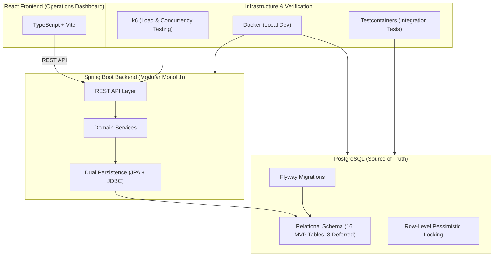
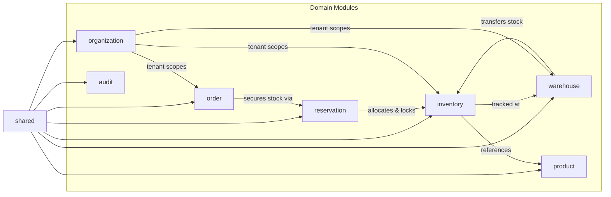

# StockGuard — System Architecture

> [!IMPORTANT]
> This document describes the **preliminary planned architecture** for STOCKGUARD. It is subject to review and approval. No components have been implemented or tested.

## Architecture Style

**Modular Monolith** — see [ADR-001](adr/ADR-001-modular-monolith.md) (Accepted).

---

## High-Level Components (Planned)



### 1. Spring Boot Backend
- **Role:** API-first REST layer, domain business rules, transaction coordination, dual persistence.
- **Persistence Strategy:** Dual persistence — Spring Data JPA for standard entity lifecycle, Spring JDBC for critical high-concurrency locking and batch operations (see [ADR-008](adr/ADR-008-persistence-strategy.md)).
- **Modules:** `inventory`, `order`, `reservation`, `warehouse`, `product`, `organization`, `audit`, `shared`.

### 2. PostgreSQL Database
- Single authoritative source of truth for all inventory state (see [ADR-002](adr/ADR-002-postgresql-source-of-truth.md)).
- Relational schema of 19 baseline tables managed strictly via Flyway migrations.
- Concurrency control via explicit row-level pessimistic locking (`SELECT ... FOR UPDATE`) under `READ COMMITTED` isolation (see [ADR-003](adr/ADR-003-inventory-concurrency.md)).
- Canonical lock order: `product_id ASC, warehouse_id ASC`.

### 3. React Frontend (Operations Dashboard)
- Single-page application built with TypeScript and Vite.
- Consumes backend REST APIs.
- Operational visibility: real-time stock balances, active reservations, warehouse transfers, audit trails, and reconciliation health.

### 4. Infrastructure & Verification
- Docker for reproducible local development environments.
- Testcontainers to execute integration tests against a real PostgreSQL instance.
- k6 load testing scripts to verify transactional throughput, lock contention, and idempotency under load.

---

## Module Boundaries (Proposed)

| Module | Responsibility | Tables Managed |
|---|---|---|
| `inventory` | Stock balances, stock receiving, manual adjustments, opening balances, reconciliation | `inventory_balances`, `inventory_transactions`, `inventory_ledger_entries` |
| `order` | Commercial orders, line item snapshots, fulfillment coordination | `orders`, `order_items` |
| `reservation` | Inventory holds, allocations, reservation lifecycle, expiration background worker | `reservations`, `reservation_allocations` |
| `warehouse` | Warehouse facility definitions, stock transfers | `warehouses`, `transfers`, `transfer_items` |
| `product` | Product catalog with normalized SKUs (no variants in MVP) | `products` |
| `organization` | Organization boundary, memberships, roles | `organizations`, `users`, `organization_memberships` (MVP role column; `membership_roles` and `api_clients` deferred) |
| `audit` | Append-only system and user action tracking | `audit_logs` |
| `shared` | Scoped idempotency, cross-cutting DTOs | `idempotency_records` (MVP; `system_settings` deferred to application configuration) |



---

## Cross-Cutting Concerns

- **Idempotency:** PostgreSQL-backed, strictly scoped by `(organization_id, principal_id, operation_scope, idempotency_key)` with 7-day initial retention, payload hash verification (mismatches return HTTP `409 Conflict`), and concurrent duplicate request wait-and-replay serialization (see [ADR-007](adr/ADR-007-idempotency.md)).
- **Organization Scoping:** Starts with a single organization, but the schema uses organization-aware design (composite foreign keys and `organization_id` on all business tables) to enforce clean boundaries. Full multi-tenant SaaS capabilities (self-service tenant registration, tenant billing, custom domains) are deferred post-MVP.
- **Audit Logging:** Append-only `audit_logs` records state-changing operations with user attribution.
- **Error Handling:** Standardized error envelopes with machine-readable error codes.

---

## Critical Data Flows (Proposed)

### 1. Stock Receiving & Opening Balance
```
Receiving Request
  ├── Verify Idempotency (7d retention, payload hash)
  ├── Lock inventory_balances in canonical order (product_id, warehouse_id)
  ├── Update on_hand (+quantity)
  ├── Insert inventory_transactions (RECEIVE / OPENING_BALANCE)
  ├── Insert inventory_ledger_entries (on_hand_delta = +quantity, reserved_delta = 0)
  └── Insert idempotency_records
```

### 2. Order Creation & Reservation (Deterministic Multi-Warehouse)
```
Order Placement
  ├── Verify Idempotency
  ├── Insert orders (status = 'PENDING')
  ├── Insert order_items (with historical sku_snapshot, name_snapshot, unit_price)
  ├── Compute Allocation Plan (Business Allocation Priority):
  │     1. Prefer single warehouse with complete order line availability
  │     2. Otherwise split line across eligible warehouses in warehouse-priority rank order
  │     3. Use warehouse code in ascending lexicographical order as deterministic tie-breaker
  │     4. All-or-nothing: no partial order reservations
  ├── Acquire DB Locks strictly in Canonical Database Order:
  │     ORDER BY product_id ASC, warehouse_id ASC FOR UPDATE
  ├── Assert availability: (on_hand - reserved) >= allocated_quantity
  ├── Update inventory_balances: reserved = reserved + allocated_quantity
  ├── Insert reservations (status = 'ACTIVE', expires_at = NOW() + TTL)
  ├── Insert reservation_allocations (per-warehouse, per-product breakdown)
  ├── Insert inventory_transactions & inventory_ledger_entries (reserved_delta = +quantity)
  └── Commit Transaction
```

### 3. Order Confirmation
```
Confirmation (Payment Cleared):
  ├── Lock orders (assert status == 'PENDING')
  ├── Transition orders: PENDING → CONFIRMED
  └── Clear reservation expires_at (NULL)
      └── Confirmed orders' active reservations do NOT automatically expire
```

### 4. Order Fulfillment
```
Fulfillment:
  ├── Lock orders (assert status IN ('CONFIRMED', 'FULFILLING'))
  ├── Lock reservations (assert status == 'ACTIVE')
  ├── Lock inventory_balances (canonical order: product_id ASC, warehouse_id ASC)
  ├── Deduct balances: on_hand = on_hand - qty, reserved = reserved - qty
  ├── Insert inventory_transactions & inventory_ledger_entries (on_hand_delta = -qty, reserved_delta = -qty)
  ├── Transition reservations: ACTIVE → CONSUMED (terminal state)
  ├── Transition orders: FULFILLING → FULFILLED (terminal state)
  └── Commit Transaction
```

### 5. Order Cancellation
```
Cancellation:
  ├── Lock orders (assert non-terminal)
  ├── Lock reservations (assert status == 'ACTIVE')
  ├── Lock inventory_balances (canonical order: product_id ASC, warehouse_id ASC)
  ├── Release holds: reserved = reserved - qty (on_hand unchanged)
  ├── Insert inventory_transactions & inventory_ledger_entries (reserved_delta = -qty, on_hand_delta = 0)
  ├── Transition reservations: ACTIVE → RELEASED (terminal state)
  ├── Transition orders: CANCELLED (terminal state)
  └── Commit Transaction
```

### 6. Reservation Expiration
```
Background Scheduled Worker
  ├── Poll expired active reservations belonging strictly to pending orders:
  │     SELECT r.id, r.order_id FROM reservations r
  │     JOIN orders o ON r.order_id = o.id
  │     WHERE r.status = 'ACTIVE' AND o.status = 'PENDING' AND r.expires_at < NOW()
  │     ORDER BY r.expires_at ASC LIMIT :batch_size
  │     FOR UPDATE OF r, o SKIP LOCKED
  ├── For each locked reservation:
  │     ├── Lock inventory_balances (canonical order: product_id ASC, warehouse_id ASC)
  │     ├── Release hold: reserved = reserved - qty (on_hand unchanged)
  │     ├── Insert inventory_transactions & ledger entries (reserved_delta = -qty)
  │     ├── Transition reservations: ACTIVE → EXPIRED (terminal state)
  │     └── Transition orders: PENDING → EXPIRED (terminal state)
  └── Commit Transaction
```

### 7. Warehouse Transfer
```
Transfer Request
  ├── Verify Idempotency
  ├── Lock source & destination balances in canonical order:
  │     Lock (product_id, LEAST(source_wh, dest_wh))
  │     Lock (product_id, GREATEST(source_wh, dest_wh))
  ├── Assert available stock: (source.on_hand - source.reserved) >= quantity
  │     (Reserved inventory cannot be transferred)
  ├── Update source: on_hand = on_hand - quantity
  ├── Update destination: on_hand = on_hand + quantity
  ├── Insert transfers & transfer_items (status = 'COMPLETED')
  ├── Insert inventory_transactions & dual ledger entries (TRANSFER_OUT / TRANSFER_IN)
  └── Commit Transaction
```

---

## Unresolved Architecture Questions

> [!WARNING]
> The following architectural decisions remain genuinely **unresolved** and must be resolved before implementation:

| # | Question | Notes | Status |
|---|---|---|---|
| 1 | **Inter-module communication & event strategy** | In-memory Spring `ApplicationEventPublisher` vs. transactional outbox pattern vs. synchronous domain service calls. | **Unresolved** |
| 2 | **Authentication token/session strategy** | Stateless JWT bearer tokens vs. stateful session cookies vs. OAuth2 provider. | **Unresolved** |
| 3 | **Exact role-permission matrix** | Explicit permission mappings for roles (`ADMIN`, `MANAGER`, `OPERATOR`, `VIEWER`). | **Unresolved** |
| 4 | **Reservation duration before confirmation** | Default TTL duration for `PENDING` order reservations (e.g., 15 min vs. 30 min vs. configurable). | **Unresolved** |
| 5 | **Deadlock retry and backoff configuration** | Exact retry limits, jitter formula, and exponential backoff parameters for PostgreSQL deadlock recovery. | **Unresolved** |
| 6 | **Negative stock adjustment behavior** | Whether an adjustment driving `on_hand < reserved` is rejected with an error or permitted with an audit alert. | **Unresolved** |
| 7 | **Monitoring and observability approach** | Metrics (Micrometer/Prometheus), distributed tracing (OpenTelemetry), structured JSON logging configuration. | **Unresolved** |
| 8 | **API gateway needs** | Whether an API gateway / reverse proxy is required in MVP or if the modular monolith container is sufficient. | **Unresolved** |
