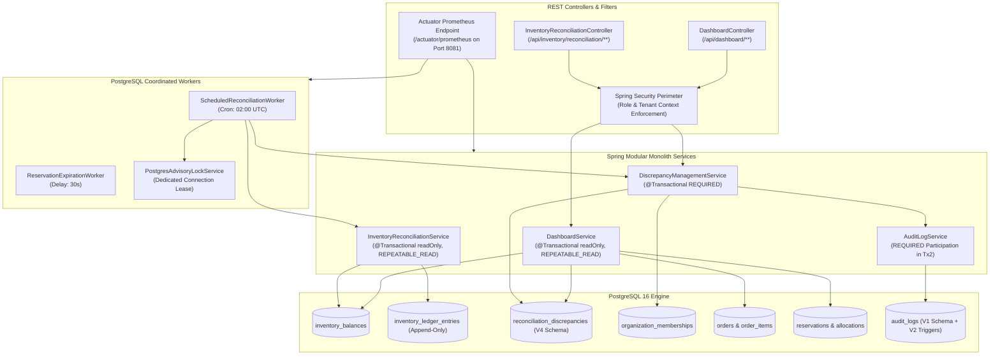
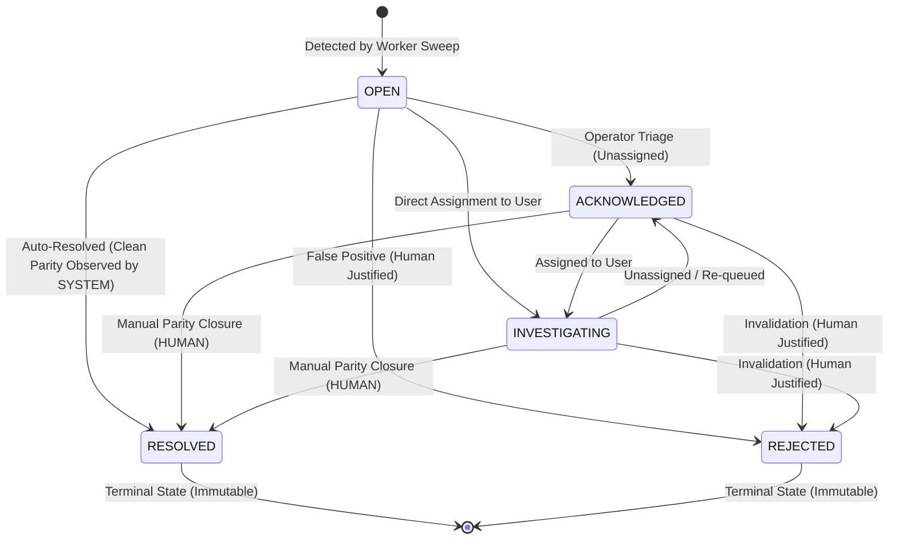
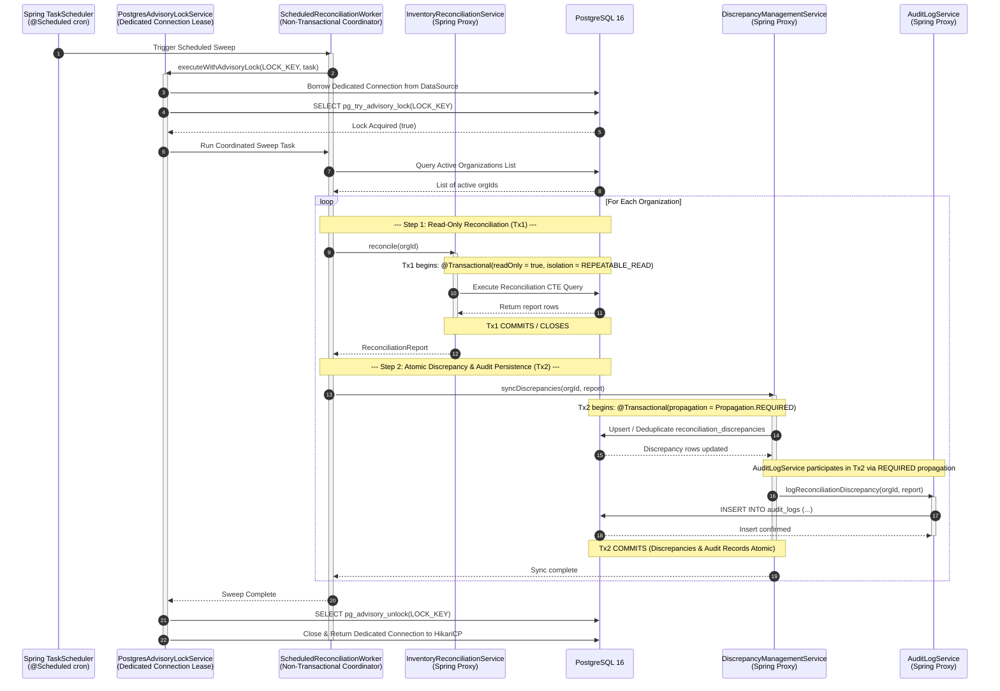
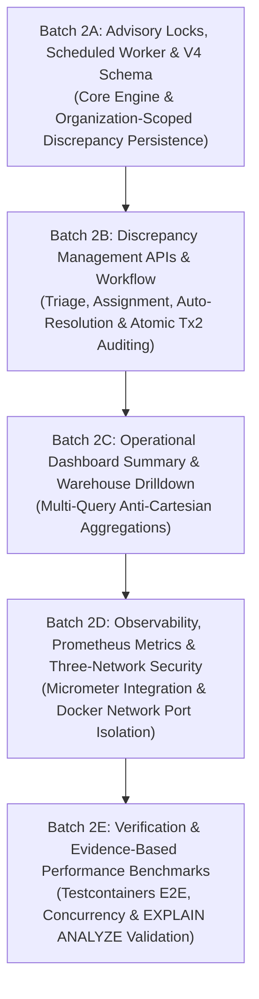

# STOCKGUARD — Milestone 6 Phase 2: Requirements, Architecture & Implementation Specification
## Automated Operations, Discrepancy Lifecycle, Dashboard & Observability

> **Document Status:** AUTHORITATIVE ARCHITECTURE & IMPLEMENTATION SPECIFICATION (FINAL V4 RESOLUTION INTEGRITY ALIGNMENT)
> **Release Target:** Milestone 6 Phase 2
> **Repository Baseline:** Commit `1491cd9` (`feat: implement audit logging, security events and audit retrieval`)
> **Authoritative References:** [ADR-001](../architecture/adr/ADR-001-modular-monolith.md), [ADR-002](../architecture/adr/ADR-002-postgresql-source-of-truth.md), [ADR-004](../architecture/adr/ADR-004-inventory-ledger.md), [ADR-008](../architecture/adr/ADR-008-persistence-strategy.md), [ADR-009](../architecture/adr/ADR-009-reservation-expiration.md), [ADR-010](../architecture/adr/ADR-010-authentication-and-session-management.md), [ADR-011](../architecture/adr/ADR-011-authorization-and-organization-access-control.md), [ADR-012](../architecture/adr/ADR-012-periodic-inventory-reconciliation-and-discrepancy-management.md), [ADR-013](../architecture/adr/ADR-013-operational-dashboard-aggregation-architecture.md), [ADR-014](../architecture/adr/ADR-014-observability-prometheus-metrics-and-security.md), [Milestone 6 Implementation Plan](milestone-6-implementation-plan.md)

---

## 1. Executive Summary & Architectural Scope

Milestone 6 Phase 1 successfully delivered the persistent audit logging foundation, multi-tenant audit retrieval API with deterministic pagination and filtering, and security-event auditing across authentication, session rotation, and role modification workflows.

Milestone 6 Phase 2 completes the operational, discrepancy management, dashboard, and monitoring capabilities of the platform:
1. **Automated Scheduled Inventory Reconciliation:** Transform the existing in-memory reconciliation prototype into a multi-instance scheduled worker coordinated via dedicated-connection PostgreSQL session advisory locks with per-tenant fault isolation and configurable UTC schedules.
2. **Persistent Discrepancy Lifecycle Management:** Deploy table `reconciliation_discrepancies` with organization-scoped membership integrity, comprehensive lifecycle transitions, direct assignment triage, and a single comprehensive CHECK constraint governing resolution consistency.
3. **Atomic Discrepancy & Audit Persistence:** Correct worker transaction boundaries such that read-only reconciliation (Tx1) commits before discrepancy synchronization (Tx2) begins, and inside Tx2, discrepancy persistence and audit records commit atomically under `REQUIRED` propagation.
4. **Operational Dashboard Aggregation APIs:** Deliver real-time tenant-wide and warehouse-level operational summaries (`GET /api/dashboard/summary`, `GET /api/dashboard/warehouses/{id}`) utilizing anti-Cartesian multi-query execution within a strict read-only snapshot.
5. **Three-Network Docker Security Topology:** Deploy a three-network container architecture where Prometheus is isolated on a private monitoring network with zero access to PostgreSQL, and management port 8081 remains unpublished to the host.



---

## 2. Detailed Requirements Specification

### 2.1 Section A: Inventory Reconciliation Requirements

#### A.1 Mathematical Parity Formula
Reconciliation computes the exact mathematical delta between the stored mutable balance table and the append-only ledger history per ADR-004:
$$\text{on\_hand\_discrepancy} = \text{inventory\_balances.on\_hand} - \sum \text{inventory\_ledger\_entries.on\_hand\_delta}$$
$$\text{reserved\_discrepancy} = \text{inventory\_balances.reserved} - \sum \text{inventory\_ledger\_entries.reserved\_delta}$$
$$\text{available\_stock} = \text{inventory\_balances.on\_hand} - \text{inventory\_balances.reserved}$$

#### A.2 Discrepancy Classification Taxonomy
Every examined inventory position is classified into exactly one of four canonical states:
1. `MATCH`: Stored balance `on_hand` equals $\sum \text{on\_hand\_delta}$ AND `reserved` equals $\sum \text{reserved\_delta}$.
2. `DELTA_MISMATCH`: Stored balance exists and ledger entries exist, but either `on_hand` or `reserved` does not equal the corresponding sum of deltas.
3. `MISSING_BALANCE_ROW`: One or more ledger entries exist for a `(product_id, warehouse_id)`, but no corresponding row exists in `inventory_balances`.
4. `MISSING_LEDGER_ENTRIES`: A row exists in `inventory_balances` with non-zero stock or historical existence, but zero ledger entries exist in `inventory_ledger_entries`.

#### A.3 Consistent Statement MVCC Snapshot Semantics
- **Single-Statement Query:** The reconciliation calculation executes as a single Common Table Expression (CTE) SQL query joined via `FULL OUTER JOIN` between `inventory_balances` and grouped `inventory_ledger_entries`.
- **PostgreSQL Statement Isolation:** Under PostgreSQL default `READ COMMITTED`, every SQL query executes against an internal MVCC snapshot established at the precise moment the query begins execution.
- **Multi-Statement Boundary:** In workflows where multi-query reconciliation checks occur, the enclosing service transaction declares:
  ```java
  @Transactional(readOnly = true, isolation = Isolation.REPEATABLE_READ)
  ```
  This guarantees that all queries within the reconciliation transaction observe the identical snapshot without skew.

#### A.4 Concurrency Invariance Under Active Stock Mutations
Because StockGuard's architecture guarantees that all inventory mutations (adjustments, receives, transfers, reservations, cancellations, fulfillments) update `inventory_balances` and append to `inventory_ledger_entries` within the **exact same ACID database transaction**:
- **Committed Before Reconciliation Snapshot:** Both balance and ledger rows are visible $\rightarrow$ sum equals balance $\rightarrow$ reports `MATCH`.
- **In-Flight (Uncommitted) During Snapshot:** Neither balance update nor ledger row is visible $\rightarrow$ old sum equals old balance $\rightarrow$ reports `MATCH`.
- **Committed After Reconciliation Snapshot:** Neither is visible in the snapshot $\rightarrow$ reports `MATCH`.
- **Conclusion:** Concurrent inventory transactions will never produce false-positive discrepancies.

#### A.5 Strict Zero Auto-Repair Invariant
Under no circumstances may the reconciliation engine modify `inventory_balances` or append compensating entries to `inventory_ledger_entries`:
- Any discrepancy is symptomatic of an application defect, database crash during uncommitted write, or manual database tampering.
- Auto-repairing destroys forensic auditability and masks critical software bugs.
- Correcting discrepancies requires authorized human operators to inspect physical stock and record an audited manual inventory adjustment (`POST /api/inventory/adjustments`).

#### A.6 Reconciliation Worker Scheduling & Operational Fault Isolation
1. **Execution Schedule & Timezone:**
   - Configurable cron: `stockguard.reconciliation.scheduled.cron: "0 0 2 * * *"` (Daily at 02:00:00 UTC).
   - Evaluated strictly in UTC (`ZoneOffset.UTC`).
   - Initial delay: Configurable property `stockguard.reconciliation.scheduled.initial-delay-ms: 30000` (30 seconds post-startup to allow pool warmup and Flyway validation).
   - Enablement toggle: `stockguard.reconciliation.scheduled.enabled: true`.
2. **Dedicated-Connection Session Advisory Lock:**
   - 64-bit constant lock key: `0x53544B4752445243L` (`STKGRDRC`).
   - Non-blocking acquisition on a dedicated connection: `SELECT pg_try_advisory_lock(?)`.
   - If lock acquisition fails (held by another node): Log `INFO`, increment `stockguard.reconciliation.lock.skipped.total`, and return immediately.
   - Guaranteed unlock: `SELECT pg_advisory_unlock(?)` executed in a mandatory `finally` block before closing the dedicated connection and returning it to HikariCP.
3. **Maximum Execution Duration & Timeouts:**
   - Maximum execution wall-clock duration: `stockguard.reconciliation.scheduled.max-duration-seconds: 1800` (30 minutes).
   - Per-query timeout: `jdbcTemplate.setQueryTimeout(60)` (60 seconds per tenant query).
4. **Per-Organization Transaction Boundaries & Fault Isolation:**
   - The coordinator method in `ScheduledReconciliationWorker` is **non-transactional**.
   - Active organizations are fetched via a lightweight read query.
   - The worker iterates active organizations sequentially.
   - **Transaction Sequence:**
     - **Tx1 (Read-Only Reconciliation):** `InventoryReconciliationService.reconcile(orgId)` executes in `@Transactional(readOnly = true, isolation = Isolation.REPEATABLE_READ)`. Commits and closes immediately.
     - **Tx2 (Atomic Discrepancy & Audit Persistence):** `DiscrepancyManagementService.syncDiscrepancies(orgId, report)` executes in `@Transactional(propagation = Propagation.REQUIRED)`. Discrepancies are persisted in `reconciliation_discrepancies` and corresponding audit entries are written to `audit_logs` using `REQUIRED` propagation. Both commit together atomically.
   - **Fault Isolation Guarantee:** An unexpected failure in Tenant A (e.g., query timeout or deadlock) rolls back only Tenant A's write transaction (Tx2). The exception is caught, logged with full stack trace, increments `stockguard.reconciliation.org.failures.total`, and the loop continues to Tenant B.
   - **Behavior When Tx1 Succeeds but Tx2 Fails:** Tx1 committed cleanly (read-only, no mutations). Tx2 completely rolls back (zero partial discrepancy mutations, zero orphaned audit records). The tenant failure is logged, retried at most 1 time, and the worker advances safely.
5. **Graceful Shutdown:**
   - Responds to `ContextClosedEvent` by setting `isShuttingDown = true`. Between organizations, the worker checks the flag and terminates early, releasing the advisory lock cleanly in `finally`.

---

### 2.2 Section B: Discrepancy Management Requirements

#### B.1 Persistence Model & Organization-Scoped Membership Integrity
Reconciliation findings are persisted in a dedicated relational table: `reconciliation_discrepancies`.
- **Organization-Scoped Integrity:** Discrepancy assignees, resolvers, and rejecters must be verified members of the owning organization:
  ```sql
  CONSTRAINT fk_discrepancies_assigned_membership
      FOREIGN KEY (organization_id, assigned_to_user_id)
      REFERENCES organization_memberships(organization_id, user_id)
      ON DELETE RESTRICT,

  CONSTRAINT fk_discrepancies_resolved_membership
      FOREIGN KEY (organization_id, resolved_by_user_id)
      REFERENCES organization_memberships(organization_id, user_id)
      ON DELETE RESTRICT
  ```
- **Null Actor & Clear-Assignment Semantics:**
  - **Clearing an Assignment:** Setting `assigned_to_user_id = NULL` unassigns the discrepancy without modifying or nullifying `organization_id`.
  - **System Resolutions:** When auto-resolved by the system, `resolved_by_user_id = NULL` and `resolution_source = 'SYSTEM'`. Under PostgreSQL `MATCH SIMPLE` foreign key semantics, a composite foreign key with one null column is satisfied.
  - **Human Resolutions & Rejections:** `resolved_by_user_id = NOT NULL` and `resolution_source = 'HUMAN'`. The composite foreign key strictly validates that the acting user is an authentic member of the owning organization.
  - **`ON DELETE RESTRICT`:** Consistent with `V1` actor foreign keys, this prevents hard-deleting a membership row referenced by discrepancies.
- **Service-Layer Validation:**
  - Verify membership exists for `(organizationId, assignedToUserId)`.
  - Verify `membership.active == true`. Inactive members are rejected with `400 Bad Request`.
  - Verify assigned user holds authority `inventory:reconcile` (Role `ADMIN` or `MANAGER`).
- **Behavior on Subsequent Member Deactivation:**
  - If an assigned user is deactivated (`active = false`), the historical discrepancy row remains intact.
  - Work queue queries flag inactive assignees (`assignedToUserActive: false`) in DTO responses to prompt managers to reassign open tickets.

#### B.2 Complete Discrepancy Lifecycle & Transition Matrix



#### Authoritative Discrepancy Transition Matrix:

| Current State | Target State | Actor / Trigger | Validation Requirements | Audit Action Emitted | State Consequence |
|---|---|---|---|---|---|
| `OPEN` | `ACKNOWLEDGED` | Human (API) | Caller holds `inventory:reconcile`. `assigned_to_user_id` remains NULL. | `DISCREPANCY_ACKNOWLEDGED` | Triage acknowledged; queued for investigation. |
| `OPEN` | `INVESTIGATING` | Human (API) | Caller holds `inventory:reconcile`. Assignee must be active member with `inventory:reconcile`. | `DISCREPANCY_ASSIGNED` | **Direct triage and assignment combined in one step.** |
| `OPEN` | `RESOLVED` | System (Worker) | Reconciliation sweep observes clean `MATCH`. `resolution_source = 'SYSTEM'`, `resolved_by_user_id = NULL`, `resolution_reason ~ '\S'`. | `RECONCILIATION_COMPLETED` | Discrepancy resolved automatically without operator overhead. |
| `OPEN` | `REJECTED` | Human (API) | Caller holds `inventory:reconcile`. Non-blank `resolution_reason`. `resolution_source = 'HUMAN'`, `resolved_by_user_id` non-null. | `DISCREPANCY_REJECTED` | Terminal rejection retaining rejecting actor attribution. |
| `ACKNOWLEDGED` | `INVESTIGATING` | Human (API) | Assignee must be active member with `inventory:reconcile`. | `DISCREPANCY_ASSIGNED` | Assigned to investigator. |
| `ACKNOWLEDGED` | `RESOLVED` | Human (API) | Caller holds `inventory:reconcile`. Non-blank `resolution_reason` and evidence. `resolution_source = 'HUMAN'`, `resolved_by_user_id` non-null. | `DISCREPANCY_RESOLVED` | Closed by operator after verified parity. |
| `ACKNOWLEDGED` | `REJECTED` | Human (API) | Caller holds `inventory:reconcile`. Non-blank `resolution_reason`. `resolution_source = 'HUMAN'`, `resolved_by_user_id` non-null. | `DISCREPANCY_REJECTED` | Terminal rejection retaining rejecting actor attribution. |
| `INVESTIGATING` | `RESOLVED` | Human (API) | Caller holds `inventory:reconcile`. Non-blank `resolution_reason` and remediation evidence. `resolution_source = 'HUMAN'`, `resolved_by_user_id` non-null. | `DISCREPANCY_RESOLVED` | Closed by investigator after remediation. |
| `INVESTIGATING` | `REJECTED` | Human (API) | Caller holds `inventory:reconcile`. Non-blank `resolution_reason`. `resolution_source = 'HUMAN'`, `resolved_by_user_id` non-null. | `DISCREPANCY_REJECTED` | Terminal rejection retaining rejecting actor attribution. |
| `INVESTIGATING` | `ACKNOWLEDGED` | Human (API) | Caller holds `inventory:reconcile`. `assigned_to_user_id` set to NULL. | `DISCREPANCY_UNASSIGNED` | Re-queued to general unassigned pool. |
| `RESOLVED` | *(any)* | *(any)* | **PROHIBITED.** | None | **Terminal state. Strictly immutable.** |
| `REJECTED` | *(any)* | *(any)* | **PROHIBITED.** | None | **Terminal state. Strictly immutable.** |

#### B.3 Detection Count & Parity Observation Semantics
1. **Clean Parity (`MATCH`) on `OPEN`:** Automatically resolved (`status = 'RESOLVED'`). `consecutive_detection_count` is frozen at its detected value for audit analysis. `last_verified_at = NOW()`.
2. **Clean Parity (`MATCH`) on `ACKNOWLEDGED` or `INVESTIGATING`:**
   - Active investigation state is preserved. State remains `ACKNOWLEDGED` or `INVESTIGATING`.
   - `last_verified_at = NOW()` is updated.
   - `consecutive_detection_count` is **neither incremented nor reset**; it is frozen to preserve the signal of how many sweeps detected the issue before parity returned.
   - Human closure via API is required to transition to `RESOLVED`.
3. **Repeated Mismatch (`DELTA_MISMATCH`, etc.):**
   - For all active states (`OPEN`, `ACKNOWLEDGED`, `INVESTIGATING`):
     - `last_detected_at = NOW()`.
     - `consecutive_detection_count++`.
     - Refresh observed quantities (`observed_balance_on_hand`, `observed_ledger_on_hand`, `observed_balance_reserved`, `observed_ledger_reserved`).
     - Triage notes and assignment are preserved.
4. **Recurrence After Terminal Closure:**
   - If an inventory position previously in `RESOLVED` or `REJECTED` experiences a delta mismatch in a future sweep, the partial unique index allows a **new** discrepancy record to be created with `status = 'OPEN'` and `consecutive_detection_count = 1`.

#### B.4 Concurrency & Audit Invariants
- Optimistic concurrency control via integer `version` column (`UPDATE ... WHERE id = :id AND version = :expectedVersion`).
- Every manual or system transition emits an audit event to `audit_logs` via `AuditLogService`.

---

### 2.3 Section C: Operational Dashboard APIs Requirements

#### C.1 Functional Requirements & Endpoints
The platform exposes two tenant-isolated operational dashboard endpoints:
1. `GET /api/dashboard/summary`: High-level operational metrics for the active organization.
2. `GET /api/dashboard/warehouses/{id}`: Detailed operational drilldown for a specific warehouse facility.

Both endpoints require authority `dashboard:view` and mandatory header `X-Organization-Id`.

#### C.2 Operational Metrics Inventory
The dashboard responses deliver:
- **Active Products Count:** Total products where `organization_id = :orgId AND active = TRUE`.
- **Active Warehouses Count:** Total warehouses where `organization_id = :orgId AND active = TRUE`.
- **Inventory Balances Aggregation:** `totalOnHand`, `totalReserved`, `totalAvailable` ($\text{on\_hand} - \text{reserved}$).
- **Out-of-Stock Products Count:** Active products with zero available stock across all active warehouses (including products with no balance rows).
- **Active Reservation Posture:** `activeReservationsCount` (distinct active reservation headers) and `totalReservedUnits` (sum of active allocations).
- **Order Pipeline Distribution:** Count of orders categorized by lifecycle status (`PENDING`, `CONFIRMED`, `FULFILLED`, `CANCELLED`).
- **Open Discrepancies Count:** Total active reconciliation discrepancies (`status IN ('OPEN', 'ACKNOWLEDGED', 'INVESTIGATING')`).
- **Recent Inventory Movements:** The 10 most recent inventory transactions (`inventory_transactions`), including transaction type, reference info, timestamp, and creator.

#### C.3 Anti-Cartesian Aggregation Principles
Joining multiple one-to-many tables in a single SQL query produces a Cartesian explosion of intermediate rows, leading to multiplied sums and memory exhaustion.
- **Architecture Policy:** The dashboard subsystem executes **7 independent, targeted SQL queries** inside a single read-only transaction:
  ```java
  @Transactional(readOnly = true, isolation = Isolation.REPEATABLE_READ)
  ```
- Each query targets exactly one domain table with optimal index utilization.
- `Isolation.REPEATABLE_READ` guarantees that all metrics observe the identical MVCC snapshot point-in-time.

---

### 2.4 Section D: Observability & Prometheus Metrics Requirements

#### D.1 Three-Network Docker Deployment Security Topology

```mermaid
flowchart TD
    subgraph ExternalIngress["Host & External Ingress"]
        CLIENT["Web Browser / Client API"]
        LB["Reverse Proxy / Load Balancer (Nginx / ALB)"]
    end

    subgraph DockerHost["Docker Host Environment"]
        subgraph NetPublic["Docker Network 1: stockguard-public"]
            APP_PUB["StockGuard App Container<br/>(Port 8080 Published: 8080:8080)"]
            LB_CONTAINER["Reverse Proxy Container"]
        end

        subgraph NetAppDb["Docker Network 2: stockguard-app-db (Private Backend)"]
            APP_DB["StockGuard App Container<br/>(JDBC Connection Pool)"]
            PG["PostgreSQL Database Container<br/>(Port 5432 - NO External Access)"]
        end

        subgraph NetMonitoring["Docker Network 3: stockguard-monitoring (Private Management)"]
            APP_MGMT["StockGuard App Container<br/>(Port 8081 Exposed - UNPUBLISHED)"]
            PROM["Prometheus Scraper Container<br/>(Internal Scraper Agent)"]
        end
    end

    CLIENT --> LB
    LB --> LB_CONTAINER
    LB_CONTAINER -->|HTTP Traffic on Port 8080| APP_PUB

    APP_DB -->|TCP 5432 (stockguard_app / stockguard_owner)| PG
    PROM -->|Internal Scrape on Port 8081<br/>HTTP Basic Auth (ROLE_MONITORING)| APP_MGMT
```

1. **Three Isolated Docker Networks:**
   - **Network 1: `stockguard-public` (Public Ingress Network):**
     - Members: Reverse proxy / load balancer container and the StockGuard application container.
     - Port 8080 is published to the host (`ports: ["8080:8080"]`).
     - Routes client authentication (`/api/auth/login`), business APIs (`/api/**`), and public health probes (`/actuator/health`, `/actuator/info`).
   - **Network 2: `stockguard-app-db` (Private Application/Database Network):**
     - Members: StockGuard application container and PostgreSQL database container.
     - PostgreSQL port 5432 is accessible ONLY on this network.
     - **Prometheus is NOT a member of this network.** Prometheus has zero route or network visibility to the database.
   - **Network 3: `stockguard-monitoring` (Private Monitoring Network):**
     - Members: StockGuard application container and Prometheus scraper container.
     - Dedicated management port 8081 (`management.server.port: 8081`) binds inside the container to `0.0.0.0:8081`.
     - **Port 8081 is NOT published to the host (`ports` directive omitted; declared under `expose: ["8081"]`).**
     - Completely unreachable from the public internet and external host interfaces.
2. **Scraper Reachability & Authentication:**
   - Scraper runs on `stockguard-monitoring` network. Target: `http://stockguard-app:8081/actuator/prometheus`.
   - Authentication via HTTP Basic Auth using service account credentials:
     `STOCKGUARD_MONITORING_SCRAPER_USERNAME: stockguard-prometheus`
     `STOCKGUARD_MONITORING_SCRAPER_PASSWORD: ${PROMETHEUS_SCRAPER_SECRET}`
   - Service account is granted dedicated authority `ROLE_MONITORING`.
3. **Separation from Business Users:**
   - The `stockguard-prometheus` identity has NO JWT token, NO refresh token, and NO organization membership. It cannot access `/api/**`.
   - Business JWT tokens lack `ROLE_MONITORING` and cannot access `/actuator/prometheus`.
4. **Preserved Health Probes Accessibility:**
   - Public health probes (`/actuator/health`, `/actuator/health/liveness`, `/actuator/health/readiness`, `/actuator/info`) remain configured as `.permitAll()` on port 8080. Docker health checks query `http://localhost:8080/actuator/health/liveness` without credentials.
5. **Local Development vs. Production:**
   - In `dev` profile: Colocated on port 8080 with default dev credentials or local access.
   - In `prod` profile: Dedicated internal port 8081 strictly enforced on `stockguard-monitoring`.

#### D.2 Metric Low-Cardinality Governance Invariant
> [!CAUTION]
> **Strict Cardinality Invariant:**
> Metric tags must NEVER contain unbounded values, including UUIDs (`organizationId`, `userId`, `productId`, `warehouseId`, `orderId`), emails, customer names, trace IDs, or free-form strings.

All metric tags must be restricted to finite, compile-time enums:
- `status`: `SUCCESS`, `FAILURE`, `OPEN`, `RESOLVED`, `REJECTED`, `EXPIRED`
- `operation_type`: `RECEIVE`, `ADJUST`, `TRANSFER`, `RESERVE`, `FULFILL`, `CANCEL`
- `discrepancy_type`: `DELTA_MISMATCH`, `MISSING_BALANCE_ROW`, `MISSING_LEDGER_ENTRIES`
- `reason`: `bad_credentials`, `token_expired`, `replay_detected`, `lock_contention`

---

### 2.5 Section E: Performance & Evidence-Based Acceptance Requirements

StockGuard rejects arbitrary, unsupported millisecond claims in favor of **empirically grounded performance acceptance criteria**:

#### E.1 Representative Dataset Sizing for Benchmarks
Performance validation must be profiled against an enterprise dataset:
- `products`: 5,000 active catalog items.
- `warehouses`: 10 facilities (active and inactive).
- `inventory_balances`: 25,000 balance records.
- `inventory_ledger_entries`: 250,000 append-only delta entries.
- `orders`: 10,000 orders across lifecycle states.
- `order_items`: 30,000 line items.
- `reservations`: 1,500 active reservations with 4,500 allocations.
- `reconciliation_discrepancies`: 200 discrepancies across states.

#### E.2 `EXPLAIN (ANALYZE, BUFFERS)` Analysis Criteria
Every reconciliation and dashboard query must be profiled using `EXPLAIN (ANALYZE, BUFFERS)`:
1. **Zero Disk Spills:** Buffers must demonstrate zero disk temporary file generation (`temp read: 0, temp written: 0`) and zero external merge sorts on disk across all dashboard and reconciliation queries.
2. **Buffer Page Boundedness:** Queries must demonstrate bounded shared buffer hit counts proportional to result selectivity.
3. **Appropriate Access Paths:**
   - High-cardinality tables (`inventory_balances`, `inventory_transactions`, `orders`) must utilize Index Scans or Bitmap Index Scans.
   - Low-cardinality dimension tables (e.g. `warehouses` with $< 50$ rows) where the cost optimizer selects Sequential Scan are explicitly acceptable. Mandating index scans on small tables is prohibited.

#### E.3 Concurrent Workload Testing
- Execute reconciliation while concurrent transactions simulate 50 active order reservation allocations and inventory receipts.
- Verify:
  - Zero deadlocks (`stockguard.db.deadlock.retries.total` remains 0).
  - Zero false-positive delta mismatches.
  - Peak connection usage remains strictly within HikariCP limits (`maximum-pool-size: 20`).

#### E.4 Connection Pool Measurements
- Measure HikariCP connection lease time for `getDashboardSummary` and `reconcileTenant`.
- Connection hold duration must remain bounded under load, with zero connection pool starvation or request timeouts.

---

## 3. Architecture & Database Design Proposals

### 3.1 Modular Monolith Architecture Blueprint

StockGuard adheres strictly to the modular monolith pattern ([ADR-001](../architecture/adr/ADR-001-modular-monolith.md)). All reconciliation, discrepancy, dashboard, and observability capabilities reside within clean Spring module packages:
- `com.stockguard.inventory.reconciliation`: Reconciliation engine, CTE queries, advisory lock coordinator, scheduled worker.
- `com.stockguard.inventory.discrepancy`: Discrepancy persistence entity, lifecycle state service, repository, and controller.
- `com.stockguard.dashboard`: Dashboard aggregation service, JDBC operations, DTOs, and controller.
- `com.stockguard.infrastructure.metrics`: Micrometer metric registry configurations and custom meters.

No external distributed infrastructure (such as Kafka, Redis, or Celery) is introduced. All multi-instance coordination, queuing, and atomic states are managed natively by PostgreSQL 16.

---

### 3.2 Corrected Worker Sequence & Atomic Transaction Boundaries



#### Actual AuditLogService Propagation & Implementation Adjustment:
1. **Inspection of Current Baseline (`1491cd9`):**
   In `AuditLogService.java` (line 818), `logReconciliationDiscrepancy` currently delegates to `transactionDelegate.writeInNewTransaction(...)` (`@Transactional(propagation = Propagation.REQUIRES_NEW)`).
   - This violates the atomicity requirement of Tx2: if discrepancy synchronization in `DiscrepancyManagementService` subsequently fails after writing the audit log, the audit log commits in its independent transaction while the discrepancy rows roll back, leaving an orphaned audit log!
2. **Safe Architectural Correction for Batch 2A/2B:**
   - In `AuditLogService.java`, annotate `logReconciliationDiscrepancy` with `@Transactional(propagation = Propagation.REQUIRED)`.
   - Modify its internal implementation to invoke `jdbcAuditLogOperations.insertAuditLog(...)` directly, rather than routing through `AuditLogTransactionDelegate.writeInNewTransaction(...)`.
   - **Preserved `REQUIRES_NEW` Behavior:** `AuditLogTransactionDelegate.writeInNewTransaction` remains completely intact and unchanged. All authenticated security events (`logSessionRevocation`, `logRefreshTokenReplay`, `logOrganizationSwitched`, `logAccessDenied`) continue delegating to `transactionDelegate.writeInNewTransaction(...)`, preserving their required independent transaction semantics.
3. **Runtime Spring Proxy Behavior:**
   - When `DiscrepancyManagementService.syncDiscrepancies` calls `auditLogService.logReconciliationDiscrepancy(...)`, the Spring AOP proxy on `AuditLogService` intercepts the call.
   - Finding `Propagation.REQUIRED`, Spring joins the active transaction `Tx2`.
   - Discrepancy row updates and audit log insertions commit atomically at the completion of `syncDiscrepancies`.
   - If Tx2 fails, both rollback cleanly together, guaranteeing zero orphan audit records.

---

## 4. Proposed Database Migration (Flyway V4 DDL)

The following schema proposal constitutes the planned `V4__create_reconciliation_discrepancies.sql` migration incorporating composite organization membership foreign keys, `resolution_source`, `last_verified_at`, and the comprehensive resolution CHECK constraint.

```sql
-- ============================================================================
-- StockGuard Database Migration V4: Reconciliation Discrepancies
-- ============================================================================
-- Architecture Reference: ADR-012, Milestone 6 Phase 2 Specification
-- Target Database: PostgreSQL 16+
-- ============================================================================

-- ----------------------------------------------------------------------------
-- 1. Table: reconciliation_discrepancies
-- ----------------------------------------------------------------------------
CREATE TABLE reconciliation_discrepancies (
    id UUID PRIMARY KEY DEFAULT gen_random_uuid(),
    organization_id UUID NOT NULL,
    product_id UUID NOT NULL,
    warehouse_id UUID NOT NULL,

    -- Discrepancy Classification & Quantities
    discrepancy_type VARCHAR(30) NOT NULL,
    observed_balance_on_hand BIGINT NOT NULL DEFAULT 0,
    observed_ledger_on_hand BIGINT NOT NULL DEFAULT 0,
    observed_balance_reserved BIGINT NOT NULL DEFAULT 0,
    observed_ledger_reserved BIGINT NOT NULL DEFAULT 0,

    -- Lifecycle State Machine & Tracking
    status VARCHAR(30) NOT NULL DEFAULT 'OPEN',
    consecutive_detection_count INT NOT NULL DEFAULT 1,
    first_detected_at TIMESTAMPTZ NOT NULL DEFAULT NOW(),
    last_detected_at TIMESTAMPTZ NOT NULL DEFAULT NOW(),
    last_verified_at TIMESTAMPTZ,

    -- Investigation & Assignment Metadata (Organization-Scoped)
    assigned_to_user_id UUID,
    investigation_notes TEXT,

    -- Resolution Metadata
    resolution_source VARCHAR(20),
    resolution_reason TEXT,
    resolved_at TIMESTAMPTZ,
    resolved_by_user_id UUID,

    -- Concurrency & Audit Metadata
    version INT NOT NULL DEFAULT 0,
    created_at TIMESTAMPTZ NOT NULL DEFAULT NOW(),
    updated_at TIMESTAMPTZ NOT NULL DEFAULT NOW(),

    -- Constraints & Foreign Keys
    CONSTRAINT fk_discrepancies_org
        FOREIGN KEY (organization_id)
        REFERENCES organizations(id)
        ON DELETE RESTRICT,

    CONSTRAINT fk_discrepancies_product
        FOREIGN KEY (organization_id, product_id)
        REFERENCES products(organization_id, id)
        ON DELETE RESTRICT,

    CONSTRAINT fk_discrepancies_warehouse
        FOREIGN KEY (organization_id, warehouse_id)
        REFERENCES warehouses(organization_id, id)
        ON DELETE RESTRICT,

    CONSTRAINT fk_discrepancies_assigned_membership
        FOREIGN KEY (organization_id, assigned_to_user_id)
        REFERENCES organization_memberships(organization_id, user_id)
        ON DELETE RESTRICT,

    CONSTRAINT fk_discrepancies_resolved_membership
        FOREIGN KEY (organization_id, resolved_by_user_id)
        REFERENCES organization_memberships(organization_id, user_id)
        ON DELETE RESTRICT,

    CONSTRAINT chk_discrepancies_type
        CHECK (discrepancy_type IN ('DELTA_MISMATCH', 'MISSING_BALANCE_ROW', 'MISSING_LEDGER_ENTRIES')),

    CONSTRAINT chk_discrepancies_status
        CHECK (status IN ('OPEN', 'ACKNOWLEDGED', 'INVESTIGATING', 'RESOLVED', 'REJECTED')),

    CONSTRAINT chk_discrepancies_resolution_source
        CHECK (resolution_source IS NULL OR resolution_source IN ('SYSTEM', 'HUMAN')),

    CONSTRAINT chk_discrepancies_detection_count
        CHECK (consecutive_detection_count >= 1),

    -- Comprehensive Resolution Consistency CHECK Constraint:
    -- Validates all permitted resolution permutations and rejects all invalid combinations.
    -- Uses null-safe IS NOT DISTINCT FROM and regex validation (~ '\S') to eliminate three-valued logic loopholes.
    CONSTRAINT chk_discrepancies_resolution_consistency CHECK (
        -- 1. Active states (OPEN, ACKNOWLEDGED, INVESTIGATING): zero resolution metadata
        (
            status IS NOT NULL
            AND status IN ('OPEN', 'ACKNOWLEDGED', 'INVESTIGATING')
            AND resolution_source IS NULL
            AND resolved_by_user_id IS NULL
            AND resolved_at IS NULL
            AND resolution_reason IS NULL
        )
        OR
        -- 2. System-resolved: source SYSTEM, resolver NULL, timestamp present, nonblank reason
        (
            status IS NOT DISTINCT FROM 'RESOLVED'
            AND resolution_source IS NOT DISTINCT FROM 'SYSTEM'
            AND resolved_by_user_id IS NULL
            AND resolved_at IS NOT NULL
            AND resolution_reason IS NOT NULL
            AND resolution_reason ~ '\S'
        )
        OR
        -- 3. Human-resolved: source HUMAN, resolver present, timestamp present, nonblank reason
        (
            status IS NOT DISTINCT FROM 'RESOLVED'
            AND resolution_source IS NOT DISTINCT FROM 'HUMAN'
            AND resolved_by_user_id IS NOT NULL
            AND resolved_at IS NOT NULL
            AND resolution_reason IS NOT NULL
            AND resolution_reason ~ '\S'
        )
        OR
        -- 4. Human-rejected: source HUMAN, resolver present, timestamp present, nonblank reason
        (
            status IS NOT DISTINCT FROM 'REJECTED'
            AND resolution_source IS NOT DISTINCT FROM 'HUMAN'
            AND resolved_by_user_id IS NOT NULL
            AND resolved_at IS NOT NULL
            AND resolution_reason IS NOT NULL
            AND resolution_reason ~ '\S'
        )
    )
);

-- ----------------------------------------------------------------------------
-- 2. Indexes & Constraints
-- ----------------------------------------------------------------------------

-- Deduplication: At most one active discrepancy per (org, product, warehouse) position
CREATE UNIQUE INDEX uq_active_discrepancy_position
ON reconciliation_discrepancies (organization_id, product_id, warehouse_id)
WHERE status IN ('OPEN', 'ACKNOWLEDGED', 'INVESTIGATING');

-- Query index for dashboard counts and filtered discrepancy lists
CREATE INDEX idx_discrepancies_org_status
ON reconciliation_discrepancies (organization_id, status, last_detected_at DESC);

-- Query index for assigned user work queues
CREATE INDEX idx_discrepancies_assigned_user
ON reconciliation_discrepancies (organization_id, assigned_to_user_id, status)
WHERE assigned_to_user_id IS NOT NULL;

-- ----------------------------------------------------------------------------
-- 3. Runtime Application Role Configuration & Grants (Conditional)
-- ----------------------------------------------------------------------------
DO $$
BEGIN
    IF EXISTS (SELECT 1 FROM pg_roles WHERE rolname = 'stockguard_app') THEN
        REVOKE ALL ON reconciliation_discrepancies FROM stockguard_app;
        GRANT SELECT, INSERT, UPDATE ON reconciliation_discrepancies TO stockguard_app;
    END IF;
END;
$$;
```

---

## 5. API Contract Specifications

### 5.1 Endpoint: Trigger Tenant Reconciliation (`POST /api/inventory/reconciliation/trigger`)

- **Method & Path:** `POST /api/inventory/reconciliation/trigger`
- **Required Authority:** `inventory:reconcile` (Role: `ADMIN` or `MANAGER`)
- **Required Headers:**
  - `Authorization: Bearer <JWT>`
  - `X-Organization-Id: <UUID>`
- **Response Status:** `200 OK`
- **Response Schema (`ReconciliationReportResponse`):**
  ```json
  {
    "organizationId": "3fa85f64-5717-4562-b3fc-2c963f66afa6",
    "totalBalancesInspected": 1420,
    "matchingBalances": 1418,
    "discrepantBalances": 2,
    "reconciledAt": "2026-11-14T20:30:00Z",
    "discrepancies": [
      {
        "productId": "4b33c035-7ffc-4613-81ce-0348f95c1847",
        "warehouseId": "8f8b89d5-783a-4467-bc22-a169b14ea988",
        "balanceOnHand": 100,
        "ledgerOnHandSum": 90,
        "balanceReserved": 10,
        "ledgerReservedSum": 10,
        "discrepancyType": "DELTA_MISMATCH"
      }
    ]
  }
  ```

---

### 5.2 Endpoint: List Discrepancies (`GET /api/inventory/reconciliation/discrepancies`)

- **Method & Path:** `GET /api/inventory/reconciliation/discrepancies`
- **Required Authority:** `inventory:reconcile`
- **Required Headers:**
  - `Authorization: Bearer <JWT>`
  - `X-Organization-Id: <UUID>`
- **Query Parameters:**
  - `status` (optional string): `OPEN`, `ACKNOWLEDGED`, `INVESTIGATING`, `RESOLVED`, `REJECTED`
  - `productId` (optional UUID)
  - `warehouseId` (optional UUID)
  - `assignedToUserId` (optional UUID)
  - `limit` (optional integer, default: 50, max: 100)
  - `offset` (optional integer, default: 0)
- **Response Status:** `200 OK`
- **Response Schema (`DiscrepancyPageResponse`):**
  ```json
  {
    "items": [
      {
        "id": "c1f7b029-45d3-4977-9ef1-4bcf428d0e72",
        "organizationId": "3fa85f64-5717-4562-b3fc-2c963f66afa6",
        "productId": "4b33c035-7ffc-4613-81ce-0348f95c1847",
        "warehouseId": "8f8b89d5-783a-4467-bc22-a169b14ea988",
        "discrepancyType": "DELTA_MISMATCH",
        "status": "INVESTIGATING",
        "observedBalanceOnHand": 100,
        "observedLedgerOnHand": 90,
        "observedBalanceReserved": 10,
        "observedLedgerReserved": 10,
        "consecutiveDetectionCount": 4,
        "firstDetectedAt": "2026-11-10T02:00:00Z",
        "lastDetectedAt": "2026-11-14T02:00:00Z",
        "lastVerifiedAt": null,
        "assignedToUserId": "d290f1ee-6c54-4b01-90e6-d701748f0851",
        "assignedToUserActive": true,
        "investigationNotes": "Physical stock count scheduled for warehouse aisle 4B.",
        "resolutionSource": null,
        "resolutionReason": null,
        "resolvedAt": null,
        "resolvedByUserId": null,
        "version": 2
      }
    ],
    "totalCount": 1,
    "limit": 50,
    "offset": 0
  }
  ```

---

### 5.3 Endpoint: Update Discrepancy Status / Assignment (`PATCH /api/inventory/reconciliation/discrepancies/{id}`)

- **Method & Path:** `PATCH /api/inventory/reconciliation/discrepancies/{id}`
- **Required Authority:** `inventory:reconcile`
- **Required Headers:**
  - `Authorization: Bearer <JWT>`
  - `X-Organization-Id: <UUID>`
- **Request Body Schema (`UpdateDiscrepancyRequest`):**
  ```json
  {
    "status": "RESOLVED",
    "assignedToUserId": "d290f1ee-6c54-4b01-90e6-d701748f0851",
    "investigationNotes": "Physical audit confirmed 90 units actual stock. Stock adjustment tx 98b2 recorded.",
    "resolutionReason": "Reconciled with physical count via manual stock adjustment tx 98b2.",
    "version": 2
  }
  ```
- **Validation Rules:**
  - `version` is mandatory. If the database row version does not match, return `409 Conflict`.
  - When transitioning to `RESOLVED` or `REJECTED`, `resolutionReason` must be non-blank (`@NotBlank`). Whitespace-only strings (including spaces, tabs, and newlines) are rejected by API validation and the database regex constraint (`resolution_reason ~ '\S'`).
  - When transitioning to `RESOLVED` or `REJECTED` via API, `resolution_source` is set to `'HUMAN'` and `resolved_by_user_id` is populated with the authenticated user ID.
  - If `assignedToUserId` is provided: verify user is an active member of this organization with `inventory:reconcile` authority.
  - If `assignedToUserId` is explicitly set to `null`, clear the assignment while keeping `organization_id` intact.
  - Cannot transition away from terminal states (`RESOLVED`, `REJECTED`).
- **Response Status:** `200 OK` (returns updated `DiscrepancyResponse`).

---

### 5.4 Endpoint: Dashboard Operational Summary (`GET /api/dashboard/summary`)

- **Method & Path:** `GET /api/dashboard/summary`
- **Required Authority:** `dashboard:view` (Roles: `ADMIN`, `MANAGER`, `OPERATOR`, `VIEWER`)
- **Required Headers:**
  - `Authorization: Bearer <JWT>`
  - `X-Organization-Id: <UUID>`
- **Response Status:** `200 OK`
- **Response Schema (`DashboardSummaryResponse`):**
  ```json
  {
    "organizationId": "3fa85f64-5717-4562-b3fc-2c963f66afa6",
    "generatedAt": "2026-11-14T20:30:15Z",
    "catalog": {
      "activeProductsCount": 450,
      "activeWarehousesCount": 6
    },
    "inventory": {
      "totalOnHand": 84500,
      "totalReserved": 12300,
      "totalAvailable": 72200,
      "outOfStockActiveProductsCount": 18
    },
    "reservations": {
      "activeReservationsCount": 142,
      "totalReservedUnits": 12300
    },
    "orders": {
      "pendingCount": 35,
      "confirmedCount": 107,
      "fulfilledCount": 1820,
      "cancelledCount": 42
    },
    "integrity": {
      "openDiscrepanciesCount": 3
    },
    "recentMovements": [
      {
        "transactionId": "9b1deb4d-3b7d-4bad-9bdd-2b0d7b3dcb6d",
        "transactionType": "STOCK_RECEIVED",
        "referenceType": "PURCHASE_ORDER",
        "referenceId": "PO-2026-991",
        "createdAt": "2026-11-14T20:15:00Z",
        "createdByName": "Alice Warehouse Operator"
      }
    ]
  }
  ```

---

### 5.5 Endpoint: Dashboard Warehouse Drilldown (`GET /api/dashboard/warehouses/{id}`)

- **Method & Path:** `GET /api/dashboard/warehouses/{id}`
- **Required Authority:** `dashboard:view`
- **Required Headers:**
  - `Authorization: Bearer <JWT>`
  - `X-Organization-Id: <UUID>`
- **Response Status:** `200 OK`
- **Response Schema (`WarehouseDashboardResponse`):**
  ```json
  {
    "organizationId": "3fa85f64-5717-4562-b3fc-2c963f66afa6",
    "warehouseId": "8f8b89d5-783a-4467-bc22-a169b14ea988",
    "warehouseCode": "WH-NORTH-01",
    "warehouseName": "Northern Distribution Hub",
    "active": true,
    "generatedAt": "2026-11-14T20:30:15Z",
    "inventory": {
      "totalOnHand": 24000,
      "totalReserved": 3500,
      "totalAvailable": 20500,
      "outOfStockProductsCount": 42
    },
    "reservations": {
      "activeAllocationsCount": 65,
      "totalAllocatedUnits": 3500
    },
    "integrity": {
      "openDiscrepanciesCount": 1
    },
    "recentMovements": [
      {
        "transactionId": "8a3deb4d-3b7d-4bad-9bdd-2b0d7b3dcb6d",
        "transactionType": "TRANSFER_IN",
        "referenceType": "TRANSFER",
        "referenceId": "TR-2026-004",
        "createdAt": "2026-11-14T19:45:00Z",
        "createdByName": "Bob Logistics Lead"
      }
    ]
  }
  ```

---

### 5.6 Endpoint: Prometheus Metrics (`GET /actuator/prometheus`)

- **Method & Path:** `GET /actuator/prometheus` (Bound to internal management port `8081` in production on `stockguard-monitoring`)
- **Required Authority:** `ROLE_MONITORING` via HTTP Basic Auth.
- **Response Status:** `200 OK` (`text/plain; version=0.0.4; charset=utf-8`)

---

## 6. Metrics & Observability Specification

### 6.1 Standardized Metrics Inventory

| Metric Name | Meter Type | Permitted Tags | Description |
|---|---|---|---|
| `stockguard.reconciliation.executions.total` | Counter | `status={"SUCCESS", "FAILURE"}` | Total reconciliation sweeps executed. |
| `stockguard.reconciliation.duration.seconds` | Timer | `status={"SUCCESS", "FAILURE"}` | Execution duration distribution of reconciliation sweeps. |
| `stockguard.reconciliation.org.executions.total` | Counter | `status={"SUCCESS", "FAILURE"}` | Per-organization reconciliation execution count. |
| `stockguard.reconciliation.org.failures.total` | Counter | *(none)* | Total organization-level reconciliation failures. |
| `stockguard.reconciliation.lock.skipped.total` | Counter | *(none)* | Total sweeps skipped due to advisory lock contention. |
| `stockguard.reconciliation.discrepancies.detected` | Counter | `discrepancy_type` | Total discrepancies identified during reconciliation sweeps. |
| `stockguard.reconciliation.discrepancies.active` | Gauge | `status={"OPEN", "ACKNOWLEDGED", "INVESTIGATING"}` | Current count of unresolved discrepancies across all tenants. |
| `stockguard.reservations.created.total` | Counter | *(none)* | Total stock reservations successfully created. |
| `stockguard.reservations.expired.total` | Counter | `status={"SUCCESS", "FAILED"}` | Total reservations cancelled by the expiration worker. |
| `stockguard.reservations.released.total` | Counter | *(none)* | Total reservations released by operators or business cancellations. |
| `stockguard.reservations.consumed.total` | Counter | *(none)* | Total reservations converted into fulfilled orders. |
| `stockguard.inventory.operations.total` | Counter | `operation_type`, `status` | Total inventory transactions processed. |
| `stockguard.auth.failures.total` | Counter | `reason={"bad_credentials", "token_expired", "replay_detected"}` | Total unauthenticated/failed authentication attempts. |
| `stockguard.db.deadlock.retries.total` | Counter | *(none)* | Total database transaction retries triggered by PostgreSQL deadlocks or serialization failures. |

---

## 7. Implementation Sequencing & Ordered Batches



### Batch 2A: Advisory Locks, Scheduled Worker & V4 Schema
- **Objectives:** Deploy Flyway V4 migration (`reconciliation_discrepancies`) with composite FKs and comprehensive resolution CHECK constraint, implement dedicated-connection `PostgresAdvisoryLockService`, and implement `ScheduledReconciliationWorker` with per-tenant fault isolation.
- **Files Affected:**
  - `backend/src/main/resources/db/migration/V4__create_reconciliation_discrepancies.sql`
  - `com.stockguard.infrastructure.lock.PostgresAdvisoryLockService`
  - `com.stockguard.inventory.reconciliation.ScheduledReconciliationWorker`
  - `com.stockguard.inventory.discrepancy.repository.ReconciliationDiscrepancyRepository`
- **Tests:** `PostgresAdvisoryLockServiceTest`, `ScheduledReconciliationWorkerIntegrationTest`.
- **Acceptance Criteria:**
  - Advisory lock acquired and released on exact same dedicated connection.
  - Scheduled worker sweeps active organizations, deduplicates discrepancies, and persists findings in `reconciliation_discrepancies`.
  - A failure in one organization does not prevent subsequent organizations from running.

### Batch 2B: Discrepancy Management APIs & Workflow
- **Objectives:** Implement discrepancy query and update APIs (`GET /api/inventory/reconciliation/discrepancies`, `PATCH /api/inventory/reconciliation/discrepancies/{id}`) with optimistic locking, membership validation, refined auto-resolution, and atomic Tx2 audit logging (`AuditLogService.logReconciliationDiscrepancy` adjusted to `Propagation.REQUIRED`).
- **Files Affected:**
  - `com.stockguard.inventory.discrepancy.controller.DiscrepancyController`
  - `com.stockguard.inventory.discrepancy.service.DiscrepancyManagementService`
  - `com.stockguard.inventory.discrepancy.dto.*`
  - `com.stockguard.audit.service.AuditLogService` (adjust `logReconciliationDiscrepancy` to `REQUIRED` using `jdbcAuditLogOperations.insertAuditLog`)
- **Tests:** `DiscrepancyLifecycleIntegrationTest`, `DiscrepancyApiSecurityTest`.
- **Acceptance Criteria:**
  - Transitions enforce valid state machine progression, optimistic concurrency control (`version`), and CHECK constraint compliance.
  - Assignees must be active organization members with `inventory:reconcile` authority.
  - Auto-resolution applies to `OPEN` discrepancies; `ACKNOWLEDGED` and `INVESTIGATING` record `last_verified_at` while awaiting human sign-off.
  - Terminal states require mandatory resolution reason; all status transitions are audited.

### Batch 2C: Operational Dashboard Summary & Warehouse Drilldown
- **Objectives:** Deliver `GET /api/dashboard/summary` and `GET /api/dashboard/warehouses/{id}` using anti-Cartesian independent queries.
- **Files Affected:**
  - `com.stockguard.dashboard.controller.DashboardController`
  - `com.stockguard.dashboard.service.DashboardService`
  - `com.stockguard.dashboard.repository.JdbcDashboardOperations`
  - `com.stockguard.dashboard.dto.*`
- **Tests:** `DashboardSummaryIntegrationTest`, `DashboardWarehouseDrilldownIntegrationTest`.
- **Acceptance Criteria:**
  - Multi-query aggregation executes within `@Transactional(readOnly = true, isolation = Isolation.REPEATABLE_READ)`.
  - Zero Cartesian multiplication bugs; verified mathematically across multiple line items.
  - Out-of-stock products count accounts for unstocked and zero-available active products.

### Batch 2D: Observability, Prometheus Metrics & Three-Network Security
- **Objectives:** Add `micrometer-registry-prometheus`, register custom meters, configure three Docker networks, management port 8081 isolation, and secure `/actuator/prometheus` with HTTP Basic Auth (`ROLE_MONITORING`).
- **Files Affected:**
  - `backend/pom.xml`
  - `backend/src/main/resources/application.yml` and `application-prod.yml`
  - `com.stockguard.security.config.SecurityConfig`
  - `com.stockguard.infrastructure.metrics.StockGuardMetricsConfig`
- **Tests:** `PrometheusEndpointSecurityTest`, `MicrometerMetricRecordingTest`.
- **Acceptance Criteria:**
  - `/actuator/prometheus` returns HTTP 401/403 to unauthenticated requests.
  - `/actuator/health` remains publicly accessible (`.permitAll()`).
  - Prometheus container has no network route to PostgreSQL.
  - Custom metrics emit with low-cardinality tags.

### Batch 2E: Comprehensive Verification & Evidence-Based Performance Benchmarking
- **Objectives:** Execute full test suite (`mvn clean verify`), verify concurrency guarantees, and validate query plans using `EXPLAIN (ANALYZE, BUFFERS)` on representative datasets.
- **Acceptance Criteria:**
  - 100% of integration and concurrency tests pass against PostgreSQL 16 Testcontainers.
  - `EXPLAIN (ANALYZE, BUFFERS)` confirms zero disk spills (`temp read: 0, temp written: 0`).
  - Index scans used on high-cardinality tables (`inventory_balances`, `inventory_transactions`); sequential scans accepted on low-cardinality dimension tables (`warehouses`).

---

## 8. Risk Register

| ID | Risk Description | Severity | Impact | Mitigation Strategy |
|---|---|---|---|---|
| **R-01** | **HikariCP Connection Pool Starvation:** Background workers (reconciliation, expiration, retention) and dashboard queries could exhaust connections during peak API traffic. | High | Increased latency or HTTP 500 for client requests. | Enforce strictly bounded connection leases. Hold advisory lock on exactly 1 dedicated connection. Set short timeouts (`DB_POOL_TIMEOUT_MS: 30000`). Run reconciliation at off-peak cron intervals (02:00 UTC). |
| **R-02** | **Ledger Table Growth (Monotonic Append-Only):** As transaction volume grows to millions of entries, `inventory_ledger_entries` aggregation CTE latency could degrade. | Medium | Increased reconciliation execution time. | Schema already indexes `(organization_id, product_id, warehouse_id)`. Future milestones can introduce declarative PostgreSQL table partitioning by `organization_id` or date ranges if volume exceeds 10M rows. |
| **R-03** | **Prometheus Metric Public Leakage:** Misconfiguration of reverse proxy could expose `/actuator/prometheus` to the public internet. | High | Information disclosure, system reconnaissance vulnerability. | Three-network Docker topology: bind management server to internal port 8081 on `stockguard-monitoring`, do not publish 8081 to host, and enforce Spring Security HTTP Basic Auth (`ROLE_MONITORING`). |
| **R-04** | **Stale Discrepancy Auto-Resolution Overwriting Investigation:** Automatically closing investigated issues could discard vital human findings. | Medium | Lost operational visibility into how parity was restored. | Refined lifecycle ensures only `OPEN` discrepancies are auto-resolved. `ACKNOWLEDGED` and `INVESTIGATING` update `last_verified_at` but require explicit human closure. |

---

## 9. Review of Resolved Decisions & Still-Unresolved Roadmap Considerations

### 9.1 Resolved Architectural Decisions

| Decision Topic | Final Approved Architecture Policy | Key Rationale & Guarantees |
|---|---|---|
| **Comprehensive Resolution CHECK Constraint** | Single constraint `chk_discrepancies_resolution_consistency` validating all 4 permitted permutations using null-safe `IS NOT DISTINCT FROM` and regex whitespace validation (`resolution_reason ~ '\S'`). | Completely eliminates PostgreSQL three-valued logic vulnerabilities (no branch or combination evaluates to NULL) and rejects all whitespace variants. |
| **Discrepancy Assignment & Resolver Integrity** | Composite foreign keys `(organization_id, assigned_to_user_id)` and `(organization_id, resolved_by_user_id)` referencing `organization_memberships(organization_id, user_id)` with `ON DELETE RESTRICT`. | Guarantees assignees, resolvers, and rejecters belong to the owning tenant. Clearing assignment (`assigned_to_user_id = NULL`) does not alter `organization_id`. |
| **Resolution Source & Attribution on Rejections** | `resolution_source` is `'SYSTEM'` or `'HUMAN'`. Rejections are strictly `HUMAN` and retain the rejecting user's ID, timestamp, and justification. | Prevents corrupted resolution states and guarantees permanent attribution consistency. |
| **Refined Auto-Resolution Policy** | Only `OPEN` discrepancies resolve automatically upon clean parity. `ACKNOWLEDGED` and `INVESTIGATING` record `last_verified_at = NOW()` but mandate human closure. | Protects active investigations from being silently overwritten while cleaning up unreviewed issues. |
| **Atomic Transaction Boundaries & Audit Log Adjustment** | Tx1 executes read-only reconciliation under `REPEATABLE_READ` and commits. Tx2 persists discrepancies and writes audit records under `REQUIRED`, committing atomically. `AuditLogService.logReconciliationDiscrepancy` adjusted to `REQUIRED`. | Eliminates orphan audit records if discrepancy persistence fails, while preserving `REQUIRES_NEW` on `AuditLogTransactionDelegate` for security events. |
| **Reconciliation Scheduling & Fault Isolation** | Daily at 02:00 UTC. Coordinator is non-transactional; each organization executes in isolated transactions. | An error in Tenant A is logged and isolated, allowing subsequent tenants to proceed uninterrupted. |
| **Advisory Lock Lifecycle** | Dedicated `Connection` borrowed from `DataSource`, held during sweep, unlocked in `finally`, closed. | Eliminates connection leaks across pooled HikariCP connections and avoids distributed locking tools (Redis/ZooKeeper). |
| **Three-Network Docker Security** | Three isolated networks: `stockguard-public`, `stockguard-app-db`, and `stockguard-monitoring`. Port 8081 unpublished to host. Prometheus has zero access to PostgreSQL. | Maximum network isolation; prevents reconnaissance and database intrusion. |
| **Dashboard Aggregation Strategy** | 7 independent targeted queries in `@Transactional(readOnly = true, isolation = REPEATABLE_READ)`. | Completely eliminates Cartesian join multiplication bugs while guaranteeing temporal snapshot consistency. |
| **Evidence-Based Performance Validation** | Benchmark against representative datasets (25k balances, 250k ledger entries) using `EXPLAIN (ANALYZE, BUFFERS)` to verify zero disk spills. | Replaces arbitrary millisecond assertions with verifiable buffer and execution plan metrics. Sequential scans accepted on small dimension tables. |

### 9.2 Still-Unresolved Decisions & Future Roadmap Considerations

| Topic | Context | Current Stance for Phase 2 | Deferred Target / Trigger |
|---|---|---|---|
| **Declarative Table Partitioning for Ledger** | High-velocity tenants generating $> 10\text{M}$ ledger rows could slow CTE group-by aggregation over multiple years. | Not needed for Phase 2. Existing composite B-tree indexes provide microsecond index scans for anticipated volumes ($< 1\text{M}$ rows). | Milestone 7 / Data Retention & Partitioning Roadmap. |
| **Out-of-Band Discrepancy Webhooks / PagerDuty** | Critical discrepancies (`MISSING_BALANCE_ROW`) could trigger instant SMS or Slack notifications. | Discrepancies emit structured WARN logs and Prometheus metrics. External webhook alerting is decoupled from the transactional core. | Milestone 7 Observability Integrations. |
| **Historical Discrepancy Snapshot Archival** | High volumes of resolved discrepancies over multiple years could increase `reconciliation_discrepancies` table size. | Active discrepancies are indexed separately via partial unique index. Resolved rows remain in table for audit history. | Post-M6 Data Retention Cleanup Worker. |
