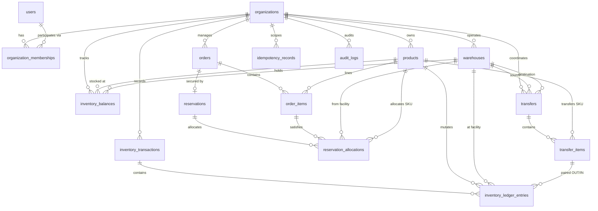

# STOCKGUARD — Database Schema Specification

> **Document Status: READY FOR FINAL REVIEW — PENDING PROJECT OWNER SIGN-OFF**
> **Target Version:** Milestone 2 (Database Migrations)
> **Source of Truth:** Authoritative schema design for all Flyway migrations and backend persistence.

---

## 1. Executive Summary & Architectural Decisions

This document defines the comprehensive, internally consistent relational database schema specification for **STOCKGUARD**, a high-concurrency inventory integrity and order reservation platform.

The schema is architected to eliminate race conditions, prevent stock overallocation, enforce multi-tenant isolation, and provide an immutable, mathematically verifiable audit trail of all physical and logical inventory movements.

### Approved Technology Decisions

| Decision | Specification | Architectural Justification |
| :--- | :--- | :--- |
| **RDBMS Engine** | PostgreSQL 16 | ACID transactions, row-level locking (`FOR UPDATE`, `SKIP LOCKED`), functional indexes, partial unique indexes, native JSONB support. |
| **Backend Stack** | Java 21, Spring Boot 4.1.2 | Modular monolith architecture using Spring Data JPA for standard entity CRUD and Spring JDBC for high-concurrency inventory mutations. |
| **Schema Management** | Flyway | Strict forward-only versioned DDL migrations (`db/migration/V...`). No automatic baselining; migrations manage schema from baseline 0. |
| **JPA / Hibernate Validation** | `ddl-auto: validate` | Hibernate validates runtime entity metadata against the Flyway-migrated schema; Hibernate is never permitted to mutate the schema. |
| **Primary Key Strategy** | UUID (`UUID`) | Globally unique, safe for distributed client-side generation, prevents enumeration attacks, decouples identity from sequence locks. |
| **Inventory Quantities** | `BIGINT` | PostgreSQL `BIGINT` is a signed 64-bit integer (`-9,223,372,036,854,775,808` to `+9,223,372,036,854,775,807`). It provides a substantially larger numeric range than 32-bit integer types for commercial inventory operations, though arithmetic can still overflow if values exceed its representable range. Physical stock balances (`on_hand`, `reserved`) are constrained to non-negative values through database `CHECK` constraints (`on_hand >= 0`, `reserved >= 0`, `reserved <= on_hand`). Business quantity columns (`quantity` on `order_items`, `reservation_allocations`, `transfer_items`) must be strictly positive where required, enforced through `CHECK (quantity > 0)`. Dual ledger movement columns (`on_hand_delta`, `reserved_delta`) leverage signed values to record both positive and negative inventory movements. Note that CHECK constraints enforce domain boundaries on stored values but do not eliminate arithmetic overflow if operations exceed `BIGINT` limits. |
| **Monetary Values** | `NUMERIC(19,4)` | Fixed-precision numeric representation eliminates floating-point rounding discrepancies across currency calculations. |
| **Timestamp Representation** | `TIMESTAMPTZ` | UTC-aligned timestamps with timezone preserve chronological sequencing across distributed systems. |
| **Identifier Casing** | `snake_case` | Standard PostgreSQL convention for table names, column names, constraints, and indexes. |
| **Lifecycle Status Modeling** | `VARCHAR` + `CHECK` | Statuses use explicit `VARCHAR` columns with database `CHECK` constraints instead of PostgreSQL `ENUM` types for maintainable migrations. |
| **Authoritative State** | PostgreSQL | PostgreSQL is the single authoritative source of truth. No Redis, Kafka, or distributed cache acts as inventory truth. |
| **Available Inventory** | Derived / Calculated | $\mathtt{available} = \mathtt{on\_hand} - \mathtt{reserved}$. Available inventory is strictly calculated and is **never** a stored mutable column. |

---

## 2. Table Scope: 16 MVP Tables vs. 3 Deferred Extensions

The database architecture defines exactly **16 MVP tables** that form the migration boundary for Milestone 2. Three specialized tables are formally documented but explicitly deferred to post-MVP releases.



### Planned MVP Tables (Exactly 16 Tables)

1. `organizations` — Root tenant partition boundary.
2. `users` — Global user identity accounts (decoupled from organization boundaries).
3. `organization_memberships` — Join table associating users with organizations; carries direct `role` column (`ADMIN`, `MANAGER`, `OPERATOR`, `VIEWER`).
4. `products` — Product catalog with original and normalized SKU unique within each organization; no separate SKU or variant tables.
5. `warehouses` — Physical storage facilities with allocation priority rank and original/normalized code.
6. `inventory_balances` — Real-time stored stock positions (`on_hand`, `reserved`).
7. `inventory_transactions` — Logical header grouping atomic ledger entries.
8. `inventory_ledger_entries` — Append-only dual-delta ledger (`on_hand_delta`, `reserved_delta`).
9. `orders` — Commercial purchase orders with 6-stage lifecycle.
10. `order_items` — Line items capturing immutable point-in-time product snapshots.
11. `reservations` — Two-phase inventory commitments with 4-stage lifecycle.
12. `reservation_allocations` — Warehouse-level breakdown of stock held for a reservation.
13. `transfers` — Warehouse-to-warehouse stock relocation header (immediate and atomic in MVP).
14. `transfer_items` — Itemized line quantities for stock transfers.
15. `idempotency_records` — Scoped idempotency store with wait-and-replay concurrency and 7-day retention.
16. `audit_logs` — Immutable append-only audit trail for administrative and operational actions.

### Deferred Tables (3 Extensions Deferred Post-MVP)

17. **`membership_roles` (Deferred)**:
    * *Rationale:* The MVP implements RBAC via a direct `role` column on `organization_memberships`. Granular multi-role assignments and custom role permission sets are deferred until customer requirements mandate dynamic permission matrices.
18. **`system_settings` (Deferred)**:
    * *Rationale:* System configuration parameters (reservation TTLs, reconciliation intervals) are managed via Spring Boot configuration profiles (`application.yml` and environment variables). A database settings table introduces premature cache-invalidation complexity.
19. **`api_clients` (Deferred)**:
    * *Rationale:* MVP interactions occur through authenticated user sessions. Machine-to-machine API client credentials (OAuth2 / client credentials) are deferred until third-party automated B2B integrations are introduced.

---

## 3. Relational Conventions & Global Standards

### Organization Isolation & Composite Keys

Every business entity belongs to an organization. To enforce multi-tenant isolation at the physical relational schema level:
1. `organization_id UUID NOT NULL` is present on all business tables.
2. Multi-table relationships enforce organization consistency using **composite foreign keys**:
   $$\mathtt{(organization\_id, referenced\_id) \ REFERENCES \ parent\_table(organization\_id, id)}$$
3. Every parent table participating in a composite foreign key declares the supporting unique constraint:
   $$\mathtt{UNIQUE \ (organization\_id, id)}$$
4. Actor references validate organization membership:
   $$\mathtt{(organization\_id, actor\_user\_id) \ REFERENCES \ organization\_memberships(organization\_id, user_id)}$$
   When an operation is system-generated (e.g. background expiration worker), `actor_user_id` is `NULL`.

### String Normalization Policy

To ensure deterministic equality comparisons, prevent duplicate entries caused by casing/whitespace variations, and provide audit fidelity:
* **Canonical Fields**: The schema maintains both the original user input representation and its canonical normalized representation.
* **Database Enforcement**: A `CHECK` constraint guarantees that the normalized column strictly reflects the canonical normalization algorithm:
  * **Email**: `lower(trim(email))`
  * **Product SKU**: `upper(trim(sku))`
  * **Warehouse Code**: `upper(trim(code))`
* **Application Responsibility**: The application service layer trims and normalizes values before issuing SQL statements. The database `CHECK` constraint acts as a fail-safe invariant guard.

---

## 4. Detailed Table Specifications (16 MVP Tables)

### 1. `organizations`

The root multi-tenant partition boundary. Every business entity in the system belongs to an organization.

#### Columns
| Column | Data Type | Nullable | Default | Description |
| :--- | :--- | :---: | :--- | :--- |
| `id` | `UUID` | No | `gen_random_uuid()` | Primary key |
| `name` | `VARCHAR(255)` | No | — | Organization commercial name |
| `created_at` | `TIMESTAMPTZ` | No | `CURRENT_TIMESTAMP` | Row creation timestamp |
| `updated_at` | `TIMESTAMPTZ` | No | `CURRENT_TIMESTAMP` | Last modification timestamp |

#### Constraints
* `PRIMARY KEY (id)`
* `CONSTRAINT chk_organizations_name_not_empty CHECK (length(trim(name)) > 0)`

---

### 2. `users`

Global user identity accounts. Decoupled from organizations to support multi-organization memberships across distinct tenants.

#### Columns
| Column | Data Type | Nullable | Default | Description |
| :--- | :--- | :---: | :--- | :--- |
| `id` | `UUID` | No | `gen_random_uuid()` | Primary key |
| `email` | `VARCHAR(255)` | No | — | Original user login email address |
| `normalized_email` | `VARCHAR(255)` | No | — | Canonical normalized email (`lower(trim(email))`) |
| `password_hash` | `VARCHAR(255)` | Yes | — | Hashed password credential string (nullable pending final resolution of the authentication architecture) |
| `active` | `BOOLEAN` | No | `TRUE` | Soft-deactivation status flag |
| `created_at` | `TIMESTAMPTZ` | No | `CURRENT_TIMESTAMP` | Account creation timestamp |
| `updated_at` | `TIMESTAMPTZ` | No | `CURRENT_TIMESTAMP` | Last profile update timestamp |

#### Constraints
* `PRIMARY KEY (id)`
* `CONSTRAINT uq_users_normalized_email UNIQUE (normalized_email)`
* `CONSTRAINT chk_users_email_normalized CHECK (normalized_email = lower(trim(email)) AND length(normalized_email) > 0)`

#### Authentication Decision Status & Credential Nullability Policy
The project's authentication architecture remains **explicitly unresolved** (Decision #1: *JWT versus session authentication*, along with external identity providers, OAuth2/OIDC, or local credentials).
* **Do Not Pre-empt Unapproved Decisions**: Local password authentication with specific hashing algorithms (such as Argon2id or bcrypt) has not been formally approved as an MVP requirement. Specifying `password_hash` as `NOT NULL` would prematurely force the architecture into local credential management.
* **Schema Neutrality via Nullability**: `password_hash` is specified as nullable (`VARCHAR(255) NULL`) so the physical database schema accommodates any eventual authentication model without requiring breaking DDL modifications.
* **Implications of the Eventual Authentication Decision**:
  - *External Identity Provider (OAuth2 / OIDC / SSO)*: If authentication delegates to an external provider (e.g., corporate SSO, Google, GitHub, Okta), user identities are federated; `password_hash` remains permanently `NULL` and unused.
  - *Local Username/Password Authentication*: If local password authentication is formally ratified, password hashing algorithms (e.g., Argon2id or bcrypt), salt policies, and application validation constraints (ensuring active accounts have non-empty hashes) will be adopted without altering existing relational structures.
  - *Hybrid Authentication*: If both local passwords and federated SSO are supported, `password_hash` will be populated for password-authenticated users and remain `NULL` for federated SSO users.

---

### 3. `organization_memberships`

Links global users to organizations, assigning their organization-scoped role.

#### Columns
| Column | Data Type | Nullable | Default | Description |
| :--- | :--- | :---: | :--- | :--- |
| `id` | `UUID` | No | `gen_random_uuid()` | Primary key |
| `organization_id` | `UUID` | No | — | Foreign key to `organizations(id)` |
| `user_id` | `UUID` | No | — | Foreign key to `users(id)` |
| `role` | `VARCHAR(50)` | No | — | Assigned RBAC role |
| `active` | `BOOLEAN` | No | `TRUE` | Membership activation status flag |
| `created_at` | `TIMESTAMPTZ` | No | `CURRENT_TIMESTAMP` | Membership creation timestamp |
| `updated_at` | `TIMESTAMPTZ` | No | `CURRENT_TIMESTAMP` | Last role/status update timestamp |

#### Constraints
* `PRIMARY KEY (id)`
* `CONSTRAINT uq_organization_memberships_org_user UNIQUE (organization_id, user_id)` (Target for actor validation FKs)
* `CONSTRAINT chk_organization_memberships_role CHECK (role IN ('ADMIN', 'MANAGER', 'OPERATOR', 'VIEWER'))`
* `CONSTRAINT fk_organization_memberships_org FOREIGN KEY (organization_id) REFERENCES organizations(id) ON DELETE RESTRICT`
* `CONSTRAINT fk_organization_memberships_user FOREIGN KEY (user_id) REFERENCES users(id) ON DELETE RESTRICT`

#### Supporting Indexes
* `CREATE INDEX idx_memberships_user ON organization_memberships (user_id);` (Child-side foreign key supporting index on `users(id)` and user login membership lookup)

---

### 4. `products`

Catalog item entity. Each product represents a single stockable item with an organization-unique normalized SKU. Product variants and separate SKU tables are excluded from the MVP.

#### Columns
| Column | Data Type | Nullable | Default | Description |
| :--- | :--- | :---: | :--- | :--- |
| `id` | `UUID` | No | `gen_random_uuid()` | Primary key |
| `organization_id` | `UUID` | No | — | Owning organization |
| `sku` | `VARCHAR(100)` | No | — | Original SKU as entered |
| `normalized_sku` | `VARCHAR(100)` | No | — | Canonical normalized SKU (`upper(trim(sku))`) |
| `name` | `VARCHAR(255)` | No | — | Product display name |
| `description` | `TEXT` | Yes | — | Optional catalog description |
| `active` | `BOOLEAN` | No | `TRUE` | Catalog active flag |
| `created_at` | `TIMESTAMPTZ` | No | `CURRENT_TIMESTAMP` | Row creation timestamp |
| `updated_at` | `TIMESTAMPTZ` | No | `CURRENT_TIMESTAMP` | Last catalog update timestamp |

#### Constraints
* `PRIMARY KEY (id)`
* `CONSTRAINT uq_products_org_normalized_sku UNIQUE (organization_id, normalized_sku)`
* `CONSTRAINT uq_products_org_id UNIQUE (organization_id, id)` (Target for composite FKs referencing products)
* `CONSTRAINT chk_products_sku_normalized CHECK (normalized_sku = upper(trim(sku)) AND length(normalized_sku) > 0)`
* `CONSTRAINT chk_products_name_not_empty CHECK (length(trim(name)) > 0)`
* `CONSTRAINT fk_products_organization FOREIGN KEY (organization_id) REFERENCES organizations(id) ON DELETE RESTRICT`

#### Supporting Indexes
* `CREATE INDEX idx_products_org_name ON products (organization_id, name);` (Supports catalog search by product name within an organization)

---

### 5. `warehouses`

Physical storage facilities. Configured with an allocation priority rank and normalized warehouse code.

#### Columns
| Column | Data Type | Nullable | Default | Description |
| :--- | :--- | :---: | :--- | :--- |
| `id` | `UUID` | No | `gen_random_uuid()` | Primary key |
| `organization_id` | `UUID` | No | — | Owning organization |
| `code` | `VARCHAR(50)` | No | — | Original warehouse code |
| `normalized_code` | `VARCHAR(50)` | No | — | Canonical warehouse code (`upper(trim(code))`) |
| `name` | `VARCHAR(255)` | No | — | Warehouse display name |
| `location` | `VARCHAR(255)` | Yes | — | Physical address or region description |
| `priority` | `INTEGER` | No | — | Allocation priority rank (lower integer = higher priority) |
| `active` | `BOOLEAN` | No | `TRUE` | Facility active flag |
| `created_at` | `TIMESTAMPTZ` | No | `CURRENT_TIMESTAMP` | Row creation timestamp |
| `updated_at` | `TIMESTAMPTZ` | No | `CURRENT_TIMESTAMP` | Last modification timestamp |

#### Constraints
* `PRIMARY KEY (id)`
* `CONSTRAINT uq_warehouses_org_normalized_code UNIQUE (organization_id, normalized_code)`
* `CONSTRAINT uq_warehouses_org_id UNIQUE (organization_id, id)` (Target for composite FKs referencing warehouses)
* `CONSTRAINT chk_warehouses_code_normalized CHECK (normalized_code = upper(trim(code)) AND length(normalized_code) > 0)`
* `CONSTRAINT chk_warehouses_name_not_empty CHECK (length(trim(name)) > 0)`
* `CONSTRAINT fk_warehouses_organization FOREIGN KEY (organization_id) REFERENCES organizations(id) ON DELETE RESTRICT`

---

### 6. `inventory_balances`

Current inventory position per product per warehouse. The sole authoritative stored quantities are `on_hand` and `reserved`. `available` is strictly derived.

#### Columns
| Column | Data Type | Nullable | Default | Description |
| :--- | :--- | :---: | :--- | :--- |
| `id` | `UUID` | No | `gen_random_uuid()` | Primary key |
| `organization_id` | `UUID` | No | — | Owning organization |
| `product_id` | `UUID` | No | — | Tracked product |
| `warehouse_id` | `UUID` | No | — | Storage warehouse facility |
| `on_hand` | `BIGINT` | No | `0` | Physical stock count |
| `reserved` | `BIGINT` | No | `0` | Stock committed to active reservations |
| `updated_at` | `TIMESTAMPTZ` | No | `CURRENT_TIMESTAMP` | Last balance modification timestamp |

#### Constraints
* `PRIMARY KEY (id)`
* `CONSTRAINT uq_inventory_balances_org_product_warehouse UNIQUE (organization_id, product_id, warehouse_id)`
* `CONSTRAINT chk_inventory_balances_on_hand_non_negative CHECK (on_hand >= 0)`
* `CONSTRAINT chk_inventory_balances_reserved_non_negative CHECK (reserved >= 0)`
* `CONSTRAINT chk_inventory_balances_reserved_le_on_hand CHECK (reserved <= on_hand)`
* `CONSTRAINT fk_inventory_balances_organization FOREIGN KEY (organization_id) REFERENCES organizations(id) ON DELETE RESTRICT`
* `CONSTRAINT fk_inventory_balances_product FOREIGN KEY (organization_id, product_id) REFERENCES products(organization_id, id) ON DELETE RESTRICT`
* `CONSTRAINT fk_inventory_balances_warehouse FOREIGN KEY (organization_id, warehouse_id) REFERENCES warehouses(organization_id, id) ON DELETE RESTRICT`

#### Operational Invariants
* **Derived Availability**: $\mathtt{available} = \mathtt{on\_hand} - \mathtt{reserved}$. Because $\mathtt{reserved \le on\_hand}$, available stock is mathematically guaranteed to be non-negative ($\mathtt{available \ge 0}$).
* **Negative Stock Adjustment Decision (Approved)**:
  The authoritative invariant is:
  - $\mathtt{on\_hand \ge 0}$
  - $\mathtt{reserved \ge 0}$
  - $\mathtt{reserved \le on\_hand}$
  An adjustment that would reduce `on_hand` below `reserved` **must be rejected**.
  *Enforcement:*
  1. *Database CHECK constraints*: `chk_inventory_balances_reserved_le_on_hand (reserved <= on_hand)` and `chk_inventory_balances_on_hand_non_negative (on_hand >= 0)` guarantee that invalid physical deductions cannot be committed.
  2. *Application transaction validation*: Validated in application code while holding the relevant row lock (`SELECT ... FOR UPDATE` in canonical lock order).
  3. *Zero balance or ledger commit*: When an adjustment is rejected, no balance row is modified and no ledger entry is committed; the transaction is aborted and rolled back with an appropriate error.
* **Canonical Balance Uniqueness vs. Lock Acquisition vs. Query Patterns**:
  1. *Canonical Unique Constraint*: `uq_inventory_balances_org_product_warehouse UNIQUE (organization_id, product_id, warehouse_id)` is the single authoritative constraint preventing duplicate balances per product and facility within an organization.
  2. *Canonical Lock Ordering*: Database row locks on `inventory_balances` are acquired strictly by `product_id ASC, warehouse_id ASC` in canonical UUID order (`SELECT ... FROM inventory_balances WHERE organization_id = :org_id AND (product_id, warehouse_id) IN (...) ORDER BY product_id ASC, warehouse_id ASC FOR UPDATE`). Within an organization, the B-tree index supporting the unique constraint `(organization_id, product_id, warehouse_id)` directly services this access and sort pattern without requiring a duplicate un-scoped index.
  3. *Operational Query Index*: Facility-level queries filtering across all products (`WHERE organization_id = :org_id AND warehouse_id = :warehouse_id`) are serviced by the dedicated non-redundant index `idx_balances_warehouse (organization_id, warehouse_id)`.
* **Deletion Policy**: Balance rows are never physically deleted.

---

### 7. `inventory_transactions`

Logical transaction header grouping atomic inventory ledger entries (e.g., receipts, adjustments, reservations, releases, fulfillments, transfers).

#### Columns
| Column | Data Type | Nullable | Default | Description |
| :--- | :--- | :---: | :--- | :--- |
| `id` | `UUID` | No | `gen_random_uuid()` | Primary key |
| `organization_id` | `UUID` | No | — | Owning organization |
| `transaction_type` | `VARCHAR(50)` | No | — | Business transaction category |
| `reference_type` | `VARCHAR(50)` | Yes | — | Originating entity category (`ORDER`, `TRANSFER`, `MANUAL`; NULL for standalone receipts/opening balances) |
| `reference_id` | `UUID` | Yes | — | Primary key of the originating entity (`orders.id`, `transfers.id`, or external supporting document UUID such as a stock-count sheet or discrepancy ticket; NULL when reference_type is NULL) |
| `notes` | `TEXT` | Yes | — | Operational notes or audit description |
| `actor_user_id` | `UUID` | Yes | — | User ID executing action (NULL for system worker) |
| `created_at` | `TIMESTAMPTZ` | No | `CURRENT_TIMESTAMP` | Transaction creation timestamp |

#### Constraints
* `PRIMARY KEY (id)`
* `CONSTRAINT uq_inventory_transactions_org_id UNIQUE (organization_id, id)` (Target for composite FK from ledger entries)
* `CONSTRAINT chk_inventory_transactions_type CHECK (transaction_type IN ('OPENING_BALANCE', 'RECEIPT', 'ADJUSTMENT', 'RESERVATION', 'RELEASE', 'FULFILLMENT', 'TRANSFER'))`
* `CONSTRAINT chk_inventory_transactions_reference_pair CHECK ((reference_type IS NULL AND reference_id IS NULL) OR (reference_type IS NOT NULL AND reference_id IS NOT NULL AND reference_type IN ('ORDER', 'TRANSFER', 'MANUAL')))`
* `CONSTRAINT fk_inventory_transactions_organization FOREIGN KEY (organization_id) REFERENCES organizations(id) ON DELETE RESTRICT`
* `CONSTRAINT fk_inventory_transactions_actor FOREIGN KEY (organization_id, actor_user_id) REFERENCES organization_memberships(organization_id, user_id) ON DELETE RESTRICT`

#### Reference Semantics & Manual Adjustment Target
* `reference_type` categorizes the originating business entity:
  * `'ORDER'`: Commercial order operations (reservations, fulfillments, cancellations, expirations); `reference_id` references `orders.id`.
  * `'TRANSFER'`: Warehouse stock relocations; `reference_id` references `transfers.id`.
  * `'MANUAL'`: Manual inventory adjustments (`POST /api/inventory/adjust`) supported by an external document. In this case, `reference_id` stores the UUID of that external supporting document (such as a physical stock-count sheet or discrepancy ticket). Note that `reference_id` does not declare a database foreign key, as external documents reside outside the database schema. If no external supporting document exists, both `reference_type` and `reference_id` must be `NULL`, with operator attribution captured in `actor_user_id` and the business justification recorded in `notes`. Audit records remain independently recorded in `audit_logs`.
* Standalone stock receipts (`RECEIPT`) and opening balances (`OPENING_BALANCE`) have no external purchasing entity table in the MVP and store `(NULL, NULL)` for the reference pair.

#### Supporting Indexes
* `CREATE INDEX idx_transactions_org_actor ON inventory_transactions (organization_id, actor_user_id);` (Child-side foreign key supporting index on `organization_memberships` and actor transaction history queries)
* `CREATE INDEX idx_transactions_ref ON inventory_transactions (organization_id, reference_type, reference_id);` (Supports lookup by originating entity)
* `CREATE INDEX idx_transactions_created ON inventory_transactions (organization_id, created_at DESC);` (Supports audit timeline pagination)

---

### 8. `inventory_ledger_entries`

Immutable, append-only dual-delta ledger recording every balance modification.

#### Columns
| Column | Data Type | Nullable | Default | Description |
| :--- | :--- | :---: | :--- | :--- |
| `id` | `UUID` | No | `gen_random_uuid()` | Primary key |
| `organization_id` | `UUID` | No | — | Owning organization |
| `transaction_id` | `UUID` | No | — | Parent transaction header |
| `entry_number` | `INTEGER` | No | — | Sequential line index within transaction ($1, 2, \dots$) |
| `product_id` | `UUID` | No | — | Affected product |
| `warehouse_id` | `UUID` | No | — | Affected warehouse |
| `on_hand_delta` | `BIGINT` | No | — | Signed change in physical on-hand stock |
| `reserved_delta` | `BIGINT` | No | — | Signed change in logically held reserved stock |
| `transfer_item_id` | `UUID` | Yes | — | Associated transfer item (populated only on transfers) |
| `transfer_direction`| `VARCHAR(10)` | Yes | — | Transfer direction (`OUT` or `IN`) |
| `created_at` | `TIMESTAMPTZ` | No | `CURRENT_TIMESTAMP` | Immutable entry timestamp |

#### Constraints
* `PRIMARY KEY (id)`
* `CONSTRAINT uq_inventory_ledger_entries_tx_line UNIQUE (organization_id, transaction_id, entry_number)`
* `CONSTRAINT chk_inventory_ledger_entries_entry_number CHECK (entry_number > 0)`
* `CONSTRAINT chk_inventory_ledger_entries_non_zero_delta CHECK (on_hand_delta != 0 OR reserved_delta != 0)`
* `CONSTRAINT chk_inventory_ledger_entries_transfer_pair CHECK ((transfer_item_id IS NULL AND transfer_direction IS NULL) OR (transfer_item_id IS NOT NULL AND transfer_direction IS NOT NULL))`
* `CONSTRAINT chk_inventory_ledger_entries_transfer_direction CHECK (transfer_direction IS NULL OR transfer_direction IN ('OUT', 'IN'))`
* `CONSTRAINT chk_inventory_ledger_entries_transfer_out CHECK (transfer_direction != 'OUT' OR (on_hand_delta < 0 AND reserved_delta = 0))`
* `CONSTRAINT chk_inventory_ledger_entries_transfer_in CHECK (transfer_direction != 'IN' OR (on_hand_delta > 0 AND reserved_delta = 0))`
* `CONSTRAINT fk_inventory_ledger_entries_organization FOREIGN KEY (organization_id) REFERENCES organizations(id) ON DELETE RESTRICT`
* `CONSTRAINT fk_inventory_ledger_entries_tx FOREIGN KEY (organization_id, transaction_id) REFERENCES inventory_transactions(organization_id, id) ON DELETE RESTRICT`
* `CONSTRAINT fk_inventory_ledger_entries_product FOREIGN KEY (organization_id, product_id) REFERENCES products(organization_id, id) ON DELETE RESTRICT`
* `CONSTRAINT fk_inventory_ledger_entries_warehouse FOREIGN KEY (organization_id, warehouse_id) REFERENCES warehouses(organization_id, id) ON DELETE RESTRICT`
* `CONSTRAINT fk_inventory_ledger_entries_transfer_item FOREIGN KEY (organization_id, transfer_item_id, product_id) REFERENCES transfer_items(organization_id, id, product_id) ON DELETE RESTRICT`

#### Migration Dependency & Creation-Order Clarification
`inventory_ledger_entries` defines a composite foreign key referencing `transfer_items`:
$$\mathtt{(organization\_id, transfer\_item\_id, product\_id) \ REFERENCES \ transfer\_items(organization\_id, id, product\_id)}$$
Because `transfer_items` (Table 14) is logically described after `inventory_ledger_entries` (Table 8) in the domain hierarchy:
* **Flyway Migration Execution Pattern**: When creating the schema via Flyway migrations, either:
  1. *Dependency-Ordered Table Creation*: Create `transfers` and `transfer_items` prior to `inventory_ledger_entries`, OR
  2. *(Recommended Pattern)* Create all tables first with primary keys and unique constraints, and then add cross-table forward-referencing foreign keys—specifically `fk_inventory_ledger_entries_transfer_item`—via a subsequent `ALTER TABLE inventory_ledger_entries ADD CONSTRAINT fk_inventory_ledger_entries_transfer_item ...` statement once `transfer_items` exists.
* **Target Unique Constraint Verification**: Verified that `transfer_items` explicitly declares `CONSTRAINT uq_transfer_items_ledger_target UNIQUE (organization_id, id, product_id)`, satisfying the PostgreSQL relational requirement for composite foreign key reference targets.

#### Supporting Indexes
* `CREATE UNIQUE INDEX idx_ledger_transfer_out ON inventory_ledger_entries (organization_id, transfer_item_id) WHERE transfer_direction = 'OUT';` (Enforces at most one transfer OUT line per item)
* `CREATE UNIQUE INDEX idx_ledger_transfer_in ON inventory_ledger_entries (organization_id, transfer_item_id) WHERE transfer_direction = 'IN';` (Enforces at most one transfer IN line per item)
* `CREATE INDEX idx_ledger_org_transfer_item ON inventory_ledger_entries (organization_id, transfer_item_id, product_id) WHERE transfer_item_id IS NOT NULL;` (Child-side foreign key supporting index on `transfer_items(organization_id, id, product_id)`)
* `CREATE INDEX idx_ledger_reconciliation ON inventory_ledger_entries (organization_id, product_id, warehouse_id, created_at);` (Supports mathematical reconciliation queries)
* `CREATE INDEX idx_ledger_org_warehouse ON inventory_ledger_entries (organization_id, warehouse_id);` (Supports facility ledger audit queries and FK validation on `warehouses`)

#### Transfer Ledger Guarantees & Transactional Verification
* **Scope of Database Schema Constraints**:
  - `chk_ledger_transfer_pair` guarantees that `transfer_item_id` and `transfer_direction` are either both populated or both NULL.
  - `chk_ledger_transfer_direction` restricts directions to `'OUT'` and `'IN'`.
  - `chk_ledger_transfer_out` and `chk_ledger_transfer_in` guarantee that `'OUT'` entries have negative on-hand delta with zero reserved delta, while `'IN'` entries have positive on-hand delta with zero reserved delta.
  - The partial unique indexes (`idx_ledger_transfer_out` and `idx_ledger_transfer_in`) enforce **AT MOST one `OUT` entry and AT MOST one `IN` entry** per transfer item at the database layer.
  - *Critical Distinction:* Database partial unique indexes prevent duplicate directions, but they do **not** independently guarantee that both entries exist or that they are balanced.
* **Mandatory Application Transaction Verification (Before Commit)**:
  Before committing a stock transfer, the application transaction service logic must explicitly verify:
  1. Exactly one `OUT` ledger entry is created for the transfer item.
  2. Exactly one `IN` ledger entry is created for the transfer item.
  3. Both entries reference the identical `transfer_item_id`.
  4. The `OUT` entry specifies `warehouse_id = transfers.source_warehouse_id`.
  5. The `IN` entry specifies `warehouse_id = transfers.destination_warehouse_id`.
  6. Both entries specify the identical `product_id` matching `transfer_items.product_id`.
  7. Quantities have equal magnitude and opposite signs (`on_hand_delta = -transfer_items.quantity` for `OUT`, `on_hand_delta = +transfer_items.quantity` for `IN`).
  8. Reserved deltas are strictly zero (`reserved_delta = 0`) on both entries.
  9. The associated inventory transaction header has `transaction_type = 'TRANSFER'`.
  10. The transaction header's reference type and reference ID correctly identify the corresponding transfer header (`reference_type = 'TRANSFER'`, `reference_id = transfers.id`).
  11. The transfer item belongs to that transfer header (`transfer_items.transfer_id = transfers.id`).
  12. The ledger entries, transfer header, transfer line item, and inventory transaction all belong to the identical `organization_id`.
  13. Source warehouse has sufficient available stock ($\mathtt{on\_hand - reserved \ge quantity}$) prior to deduction.
  14. All verification steps, ledger inserts, and balance mutations succeed atomically within the same database transaction before commit.

---

### 9. `orders`

Commercial purchase orders representing customer commitments across an independent 6-stage lifecycle.

#### Columns
| Column | Data Type | Nullable | Default | Description |
| :--- | :--- | :---: | :--- | :--- |
| `id` | `UUID` | No | `gen_random_uuid()` | Primary key |
| `organization_id` | `UUID` | No | — | Owning organization |
| `order_number` | `VARCHAR(100)` | No | — | Human-readable order number (unique within org) |
| `customer_reference`| `VARCHAR(255)` | Yes | — | Customer identifier or reference |
| `external_order_reference` | `VARCHAR(255)` | Yes | — | External PO or ERP order reference |
| `status` | `VARCHAR(50)` | No | — | Order lifecycle status |
| `currency` | `VARCHAR(3)` | No | `'USD'` | ISO 4217 three-letter currency code |
| `total_amount` | `NUMERIC(19,4)` | No | `0.0000` | Total order monetary amount |
| `actor_user_id` | `UUID` | Yes | — | User ID creating or placing order (NULL for system/import) |
| `created_at` | `TIMESTAMPTZ` | No | `CURRENT_TIMESTAMP` | Order creation timestamp |
| `updated_at` | `TIMESTAMPTZ` | No | `CURRENT_TIMESTAMP` | Last status modification timestamp |

#### Constraints
* `PRIMARY KEY (id)`
* `CONSTRAINT uq_orders_org_order_number UNIQUE (organization_id, order_number)`
* `CONSTRAINT uq_orders_org_id UNIQUE (organization_id, id)` (Target for composite FKs referencing orders)
* `CONSTRAINT chk_orders_status CHECK (status IN ('PENDING', 'CONFIRMED', 'FULFILLING', 'FULFILLED', 'CANCELLED', 'EXPIRED'))`
* `CONSTRAINT chk_orders_currency CHECK (length(currency) = 3 AND currency = upper(currency))`
* `CONSTRAINT chk_orders_total_amount CHECK (total_amount >= 0)`
* `CONSTRAINT fk_orders_organization FOREIGN KEY (organization_id) REFERENCES organizations(id) ON DELETE RESTRICT`
* `CONSTRAINT fk_orders_actor FOREIGN KEY (organization_id, actor_user_id) REFERENCES organization_memberships(organization_id, user_id) ON DELETE RESTRICT`

#### Supporting Indexes
* `CREATE INDEX idx_orders_org_actor ON orders (organization_id, actor_user_id);` (Child-side foreign key supporting index on `organization_memberships` and actor order history queries)
* `CREATE INDEX idx_orders_org_status_date ON orders (organization_id, status, created_at DESC);` (Supports order dashboard filtering by status and date)

---

### 10. `order_items`

Line items for an order, capturing immutable point-in-time product and pricing snapshots.

#### Columns
| Column | Data Type | Nullable | Default | Description |
| :--- | :--- | :---: | :--- | :--- |
| `id` | `UUID` | No | `gen_random_uuid()` | Primary key |
| `organization_id` | `UUID` | No | — | Owning organization |
| `order_id` | `UUID` | No | — | Parent order |
| `line_number` | `INTEGER` | No | — | Item line position ($1, 2, \dots$) |
| `product_id` | `UUID` | No | — | Product ordered |
| `sku_snapshot` | `VARCHAR(100)` | No | — | Immutable normalized SKU at placement time |
| `name_snapshot` | `VARCHAR(255)` | No | — | Immutable product name at placement time |
| `quantity` | `BIGINT` | No | — | Ordered quantity |
| `unit_price` | `NUMERIC(19,4)` | No | — | Fixed-precision unit price at placement time |
| `created_at` | `TIMESTAMPTZ` | No | `CURRENT_TIMESTAMP` | Row creation timestamp |

#### Constraints
* `PRIMARY KEY (id)`
* `CONSTRAINT uq_order_items_org_order_line UNIQUE (organization_id, order_id, line_number)`
* `CONSTRAINT uq_order_items_allocation_target UNIQUE (organization_id, order_id, id, product_id)` (Target for composite FK from allocations)
* `CONSTRAINT uq_order_items_org_id UNIQUE (organization_id, id)`
* `CONSTRAINT chk_order_items_line_number CHECK (line_number > 0)`
* `CONSTRAINT chk_order_items_quantity CHECK (quantity > 0)`
* `CONSTRAINT chk_order_items_unit_price CHECK (unit_price >= 0)`
* `CONSTRAINT fk_order_items_organization FOREIGN KEY (organization_id) REFERENCES organizations(id) ON DELETE RESTRICT`
* `CONSTRAINT fk_order_items_order FOREIGN KEY (organization_id, order_id) REFERENCES orders(organization_id, id) ON DELETE RESTRICT`
* `CONSTRAINT fk_order_items_product FOREIGN KEY (organization_id, product_id) REFERENCES products(organization_id, id) ON DELETE RESTRICT`

#### Supporting Indexes
* `CREATE INDEX idx_order_items_org_product ON order_items (organization_id, product_id);` (Child-side foreign key supporting index on `products` and product-level catalog demand queries)

#### Operational Invariant
* **Order Items Frozen After Reservation**: Once an order has an `ACTIVE` reservation, its line items are completely immutable. Quantities and products cannot be edited.

---

### 11. `reservations`

Tracks temporary inventory commitments. Operates on an independent 4-stage lifecycle (`ACTIVE`, `CONSUMED`, `RELEASED`, `EXPIRED`).

#### Columns
| Column | Data Type | Nullable | Default | Description |
| :--- | :--- | :---: | :--- | :--- |
| `id` | `UUID` | No | `gen_random_uuid()` | Primary key |
| `organization_id` | `UUID` | No | — | Owning organization |
| `order_id` | `UUID` | No | — | Associated order |
| `status` | `VARCHAR(50)` | No | — | Reservation lifecycle status |
| `expires_at` | `TIMESTAMPTZ` | Yes | — | Expiration deadline (populated only when order is PENDING) |
| `created_at` | `TIMESTAMPTZ` | No | `CURRENT_TIMESTAMP` | Reservation creation timestamp |
| `updated_at` | `TIMESTAMPTZ` | No | `CURRENT_TIMESTAMP` | Last status update timestamp |

#### Constraints
* `PRIMARY KEY (id)`
* `CONSTRAINT uq_reservations_org_order UNIQUE (organization_id, order_id)` (One successful reservation per order in MVP)
* `CONSTRAINT uq_reservations_allocation_target UNIQUE (organization_id, id, order_id)` (Target for composite FK from allocations)
* `CONSTRAINT uq_reservations_org_id UNIQUE (organization_id, id)`
* `CONSTRAINT chk_reservations_status CHECK (status IN ('ACTIVE', 'CONSUMED', 'RELEASED', 'EXPIRED'))`
* `CONSTRAINT fk_reservations_organization FOREIGN KEY (organization_id) REFERENCES organizations(id) ON DELETE RESTRICT`
* `CONSTRAINT fk_reservations_order FOREIGN KEY (organization_id, order_id) REFERENCES orders(organization_id, id) ON DELETE RESTRICT`

---

### 12. `reservation_allocations`

Warehouse-level breakdown of stock allocated to satisfy order items under an active reservation.

#### Columns
| Column | Data Type | Nullable | Default | Description |
| :--- | :--- | :---: | :--- | :--- |
| `id` | `UUID` | No | `gen_random_uuid()` | Primary key |
| `organization_id` | `UUID` | No | — | Owning organization |
| `reservation_id` | `UUID` | No | — | Associated reservation |
| `order_id` | `UUID` | No | — | Associated order |
| `order_item_id` | `UUID` | No | — | Associated order item |
| `product_id` | `UUID` | No | — | Product allocated |
| `warehouse_id` | `UUID` | No | — | Fulfilling warehouse facility |
| `quantity` | `BIGINT` | No | — | Allocated quantity from warehouse |
| `created_at` | `TIMESTAMPTZ` | No | `CURRENT_TIMESTAMP` | Allocation creation timestamp |

#### Constraints
* `PRIMARY KEY (id)`
* `CONSTRAINT uq_reservation_allocations_unique_assignment UNIQUE (organization_id, reservation_id, order_item_id, warehouse_id)`
* `CONSTRAINT chk_reservation_allocations_quantity CHECK (quantity > 0)`
* `CONSTRAINT fk_reservation_allocations_organization FOREIGN KEY (organization_id) REFERENCES organizations(id) ON DELETE RESTRICT`
* `CONSTRAINT fk_reservation_allocations_reservation FOREIGN KEY (organization_id, reservation_id, order_id) REFERENCES reservations(organization_id, id, order_id) ON DELETE RESTRICT`
* `CONSTRAINT fk_reservation_allocations_order_item FOREIGN KEY (organization_id, order_id, order_item_id, product_id) REFERENCES order_items(organization_id, order_id, id, product_id) ON DELETE RESTRICT`
* `CONSTRAINT fk_reservation_allocations_warehouse FOREIGN KEY (organization_id, warehouse_id) REFERENCES warehouses(organization_id, id) ON DELETE RESTRICT`
* `CONSTRAINT fk_reservation_allocations_product FOREIGN KEY (organization_id, product_id) REFERENCES products(organization_id, id) ON DELETE RESTRICT`

#### Supporting Indexes
* `CREATE INDEX idx_allocations_org_reservation ON reservation_allocations (organization_id, reservation_id, order_id);` (Child-side foreign key supporting index on `reservations(organization_id, id, order_id)` and reservation-scoped allocation lookups)
* `CREATE INDEX idx_allocations_org_order_item ON reservation_allocations (organization_id, order_id, order_item_id, product_id);` (Child-side foreign key supporting index on `order_items(organization_id, order_id, id, product_id)` and order-item allocation rollups)
* `CREATE INDEX idx_allocations_wh_prod ON reservation_allocations (organization_id, warehouse_id, product_id);` (Child-side foreign key supporting index on `warehouses(organization_id, id)` and warehouse inventory commitment queries)

#### Product Foreign-Key Indexing Policy (Deliberate Trade-off)
The foreign key `CONSTRAINT fk_allocations_product FOREIGN KEY (organization_id, product_id) REFERENCES products(organization_id, id) ON DELETE RESTRICT` is **intentionally not backed by a dedicated child-side index**:
* Existing composite indexes that contain `product_id` as a later column (such as `idx_allocations_wh_prod` on `(organization_id, warehouse_id, product_id)` and `idx_allocations_org_order_item` on `(organization_id, order_id, order_item_id, product_id)`) contain `product_id` only as a suffix and do **not** provide leading-column coverage for this foreign key. They must not be described as supporting this foreign key.
* Under the approved data-retention policy, product rows are never physically deleted (`DELETE FROM products`), and the referenced key columns `(organization_id, id)` are never updated.
* Non-key product attributes may be updated through ordinary catalog operations, including soft-deactivation through `active = FALSE` and modifications to catalog descriptions or metadata. In PostgreSQL, updates to non-referenced columns do not require or trigger child-side foreign-key delete/update verification.
* The foreign-key indexing trade-off is specifically based on the strict prohibition of physical deletion and referenced-key updates, rather than on complete row immutability.
* This represents a deliberate write-performance trade-off, not complete index coverage, designed to avoid index bloat and write amplification on a high-concurrency reservation line table.
* If physical product deletion or updates to referenced key columns `(organization_id, id)` are ever introduced in future phases, the corresponding child-side index `(organization_id, product_id)` must be created prior to enabling those operations.

#### Operational Invariants
* **Total Line Quantity Invariant**: For each order item, the application transactionally guarantees:
  $$\sum \mathtt{reservation\_allocations.quantity} = \mathtt{order\_items.quantity}$$
* **Historical Traceability**: Allocation rows are never deleted when a reservation transitions to `CONSUMED`, `RELEASED`, or `EXPIRED`. Active stock holds are governed exclusively by `reservations.status = 'ACTIVE'`.

---

### 13. `transfers`

Warehouse-to-warehouse stock relocation headers. In the MVP, transfers are immediate and atomic.

#### Columns
| Column | Data Type | Nullable | Default | Description |
| :--- | :--- | :---: | :--- | :--- |
| `id` | `UUID` | No | `gen_random_uuid()` | Primary key |
| `organization_id` | `UUID` | No | — | Owning organization |
| `source_warehouse_id` | `UUID` | No | — | Originating warehouse facility |
| `destination_warehouse_id` | `UUID` | No | — | Destination warehouse facility |
| `notes` | `TEXT` | Yes | — | Operational notes or transfer justification |
| `actor_user_id` | `UUID` | Yes | — | User initiating transfer (NULL for system) |
| `completed_at` | `TIMESTAMPTZ` | No | `CURRENT_TIMESTAMP` | Completion timestamp (immediate in MVP) |
| `created_at` | `TIMESTAMPTZ` | No | `CURRENT_TIMESTAMP` | Row creation timestamp |

#### Constraints
* `PRIMARY KEY (id)`
* `CONSTRAINT uq_transfers_org_id UNIQUE (organization_id, id)` (Target for composite FK from transfer items)
* `CONSTRAINT chk_transfers_distinct_warehouses CHECK (source_warehouse_id != destination_warehouse_id)`
* `CONSTRAINT fk_transfers_organization FOREIGN KEY (organization_id) REFERENCES organizations(id) ON DELETE RESTRICT`
* `CONSTRAINT fk_transfers_source_wh FOREIGN KEY (organization_id, source_warehouse_id) REFERENCES warehouses(organization_id, id) ON DELETE RESTRICT`
* `CONSTRAINT fk_transfers_dest_wh FOREIGN KEY (organization_id, destination_warehouse_id) REFERENCES warehouses(organization_id, id) ON DELETE RESTRICT`
* `CONSTRAINT fk_transfers_actor FOREIGN KEY (organization_id, actor_user_id) REFERENCES organization_memberships(organization_id, user_id) ON DELETE RESTRICT`

#### Supporting Indexes
* `CREATE INDEX idx_transfers_org_actor ON transfers (organization_id, actor_user_id);` (Child-side foreign key supporting index on `organization_memberships` and actor transfer history queries)
* `CREATE INDEX idx_transfers_org_source_wh ON transfers (organization_id, source_warehouse_id);` (Child-side foreign key supporting index on `warehouses(organization_id, id)` for origin facility)
* `CREATE INDEX idx_transfers_org_dest_wh ON transfers (organization_id, destination_warehouse_id);` (Child-side foreign key supporting index on `warehouses(organization_id, id)` for destination facility)
* `CREATE INDEX idx_transfers_org_created ON transfers (organization_id, created_at DESC);` (Supports transfer audit history pagination)
* `CREATE INDEX idx_transfers_org_completed ON transfers (organization_id, completed_at DESC);` (Supports completed transfer sorting)

---

### 14. `transfer_items`

Line items for stock transfers detailing product and quantity.

#### Columns
| Column | Data Type | Nullable | Default | Description |
| :--- | :--- | :---: | :--- | :--- |
| `id` | `UUID` | No | `gen_random_uuid()` | Primary key |
| `organization_id` | `UUID` | No | — | Owning organization |
| `transfer_id` | `UUID` | No | — | Parent transfer header |
| `product_id` | `UUID` | No | — | Product transferred |
| `quantity` | `BIGINT` | No | — | Quantity transferred |
| `created_at` | `TIMESTAMPTZ` | No | `CURRENT_TIMESTAMP` | Row creation timestamp |

#### Constraints
* `PRIMARY KEY (id)`
* `CONSTRAINT uq_transfer_items_org_transfer_product UNIQUE (organization_id, transfer_id, product_id)` (One line per product per transfer)
* `CONSTRAINT uq_transfer_items_ledger_target UNIQUE (organization_id, id, product_id)` (Target for composite FK from ledger entries)
* `CONSTRAINT chk_transfer_items_quantity CHECK (quantity > 0)`
* `CONSTRAINT fk_transfer_items_organization FOREIGN KEY (organization_id) REFERENCES organizations(id) ON DELETE RESTRICT`
* `CONSTRAINT fk_transfer_items_transfer FOREIGN KEY (organization_id, transfer_id) REFERENCES transfers(organization_id, id) ON DELETE RESTRICT`
* `CONSTRAINT fk_transfer_items_product FOREIGN KEY (organization_id, product_id) REFERENCES products(organization_id, id) ON DELETE RESTRICT`

#### Product Foreign-Key Indexing Policy (Deliberate Trade-off)
The foreign key `CONSTRAINT fk_transfer_items_product FOREIGN KEY (organization_id, product_id) REFERENCES products(organization_id, id) ON DELETE RESTRICT` is **intentionally not backed by a dedicated child-side index**:
* Existing composite unique constraints on `transfer_items` that include `product_id` as a later column (such as `uq_transfer_items_org_transfer_product (organization_id, transfer_id, product_id)` and `uq_transfer_items_ledger_target (organization_id, id, product_id)`) contain `product_id` only as a suffix and do **not** provide leading-column coverage for this foreign key. They must not be described as supporting this foreign key.
* Under the approved data-retention policy, product rows are never physically deleted (`DELETE FROM products`), and the referenced key columns `(organization_id, id)` are never updated.
* Non-key product attributes may be updated through ordinary catalog operations, including soft-deactivation through `active = FALSE` and modifications to catalog descriptions or metadata. In PostgreSQL, updates to non-referenced columns do not require or trigger child-side foreign-key delete/update verification.
* The foreign-key indexing trade-off is specifically based on the strict prohibition of physical deletion and referenced-key updates, rather than on complete row immutability.
* This represents a deliberate write-performance trade-off, not complete index coverage, avoiding redundant indexing on point-in-time stock relocation line items.
* If physical product deletion or updates to referenced key columns `(organization_id, id)` are ever introduced in future phases, the corresponding child-side index `(organization_id, product_id)` must be created prior to allowing such operations.

#### Multi-Item Transfer Concurrency & Global Canonical Lock Ordering
* A single transfer supports multiple items (`transfer_items`) between a source and destination warehouse within the same organization.
* **Pre-Creation of Missing Destination Balances**: Prior to acquiring row locks, missing destination balance rows for all transfer products are inserted with `on_hand = 0, reserved = 0` via `INSERT ... ON CONFLICT (organization_id, product_id, warehouse_id) DO NOTHING` to guarantee that all rows exist for locking.
* **Global Canonical Lock Order**: To prevent deadlocks, all affected balance rows (both source and destination across all transfer line items) are locked in **one global canonical order**: `product_id ASC, warehouse_id ASC`. Locks are never acquired product-by-product in arbitrary request order.
* **Availability & Ledger Pairing**: The source warehouse must have sufficient available stock ($\mathtt{on\_hand - reserved \ge quantity}$) for every line item prior to deduction; reserved stock cannot be transferred. For every line item, exactly one `OUT` entry and one `IN` entry are appended atomically to `inventory_ledger_entries`.

---

### 15. `idempotency_records`

PostgreSQL-backed store ensuring strict at-most-once execution for mutating API operations.

#### Columns
| Column | Data Type | Nullable | Default | Description |
| :--- | :--- | :---: | :--- | :--- |
| `id` | `UUID` | No | `gen_random_uuid()` | Primary key |
| `organization_id` | `UUID` | No | — | Owning organization |
| `principal_type` | `VARCHAR(50)` | No | — | Identity type (`USER`) |
| `principal_id` | `UUID` | No | — | User ID of the caller |
| `operation_scope` | `VARCHAR(100)` | No | — | Endpoint/action scope (e.g. `POST:/api/reservations`) |
| `idempotency_key` | `VARCHAR(255)` | No | — | Client-supplied uniqueness key |
| `request_hash` | `VARCHAR(64)` | No | — | SHA-256 hash of all semantically relevant inputs (method, path, body, query parameters, relevant headers) |
| `response_status` | `INTEGER` | Yes | — | Committed HTTP response status code |
| `response_body` | `JSONB` | Yes | — | Committed JSON response body payload |
| `created_at` | `TIMESTAMPTZ` | No | `CURRENT_TIMESTAMP` | Record creation timestamp |
| `expires_at` | `TIMESTAMPTZ` | No | — | Retention cutoff timestamp (default: 7 days) |

#### Constraints
* `PRIMARY KEY (id)`
* `CONSTRAINT uq_idempotency_records_scope UNIQUE (organization_id, principal_type, principal_id, operation_scope, idempotency_key)`
* `CONSTRAINT chk_idempotency_records_response_pair CHECK ((response_status IS NULL AND response_body IS NULL) OR (response_status IS NOT NULL AND response_body IS NOT NULL))`
* `CONSTRAINT chk_idempotency_records_status_code CHECK (response_status IS NULL OR (response_status >= 100 AND response_status <= 599))`
* `CONSTRAINT fk_idempotency_records_organization FOREIGN KEY (organization_id) REFERENCES organizations(id) ON DELETE RESTRICT`

#### Supporting Indexes
* `CREATE INDEX idx_idempotency_cleanup ON idempotency_records (expires_at);` (Supports asynchronous cleanup worker for expired records)

#### Concurrency & Lifecycle Guarantees
* **Initial Ownership & Result-Set Consumption**: Mutating transactions begin with `INSERT INTO idempotency_records (...) VALUES (...) ON CONFLICT (...) DO NOTHING RETURNING id;`. This statement produces a result set and must be consumed via a query/`ResultSet` API rather than an update count.
* **Concurrent Unique-Index Conflict Waiting**: When Request 2 executes the initial insert while Request 1 is actively executing with the same scoped key, Request 2 encounters a unique index conflict on `(organization_id, principal_type, principal_id, operation_scope, idempotency_key)` and **waits** on the index conflict until Request 1's transaction terminates.
* **Reading/Locking Committed Record After Commit**: If Request 1 successfully commits, Request 2's insert produces 0 rows (`DO NOTHING` handles the conflict). Request 2 unblocks, reads and locks the committed record with `SELECT ... FOR UPDATE`, and compares `request_hash`:
  * If `request_hash` matches and `response_status IS NOT NULL`: Request 2 replays the cached response immediately and rolls back without re-executing business mutations.
  * If `request_hash` differs: Request 2 immediately returns HTTP `409 Conflict` and rolls back.
* **Becoming Key Owner Through Waiting Insert Upon Rollback**: If Request 1 encounters an error or timeout and rolls back, PostgreSQL's MVCC transaction rollback eliminates Request 1's speculative row and releases its unique index lock. Request 2's waiting insert immediately unblocks and **successfully inserts its own row**, returning 1 row (`RETURNING id` yields its ID). Request 2 becomes the primary key owner directly through its waiting insert without needing a second insert statement, and proceeds to execute business logic.
* **Transactional Consistency & Tenant-Scoped Update**: Idempotency record creation, business operations, and response persistence occur within the same atomic database transaction. Response persistence updates `WHERE id = :idemp_id AND organization_id = :org_id`.
* **Client Disconnect Post-Commit Safety**: If a client disconnects or times out after the database transaction has committed, the business operation has already executed and the response is safely stored in `idempotency_records`. A subsequent retry with the same key and payload replays the committed response without duplicate execution.
* **7-Day Retention & Pruning**: Completed records are retained for 7 days. Expired records are pruned by an asynchronous background cleanup job before keys can be reused.

---

### 16. `audit_logs`

Immutable append-only record tracking administrative, operational, and lifecycle events for regulatory compliance.

#### Columns
| Column | Data Type | Nullable | Default | Description |
| :--- | :--- | :---: | :--- | :--- |
| `id` | `UUID` | No | `gen_random_uuid()` | Primary key |
| `organization_id` | `UUID` | No | — | Owning organization |
| `actor_user_id` | `UUID` | Yes | — | User initiating action (NULL for background worker) |
| `action` | `VARCHAR(100)` | No | — | Action verb code (e.g., `RECEIVE_STOCK`, `RESERVE`) |
| `entity_type` | `VARCHAR(100)` | No | — | Entity domain type (e.g., `order`, `balance`) |
| `entity_id` | `UUID` | Yes | — | Primary key of the affected entity |
| `before_state` | `JSONB` | Yes | — | Point-in-time snapshot before mutation |
| `after_state` | `JSONB` | Yes | — | Point-in-time snapshot after mutation |
| `metadata` | `JSONB` | Yes | — | Request metadata (IP, user agent, transaction ID) |
| `created_at` | `TIMESTAMPTZ` | No | `CURRENT_TIMESTAMP` | Immutable event timestamp |

#### Constraints
* `PRIMARY KEY (id)`
* `CONSTRAINT fk_audit_logs_organization FOREIGN KEY (organization_id) REFERENCES organizations(id) ON DELETE RESTRICT`
* `CONSTRAINT fk_audit_logs_actor FOREIGN KEY (organization_id, actor_user_id) REFERENCES organization_memberships(organization_id, user_id) ON DELETE RESTRICT`

#### Supporting Indexes
* `CREATE INDEX idx_audit_logs_org_date ON audit_logs (organization_id, created_at DESC);` (Compliance audit log pagination)
* `CREATE INDEX idx_audit_logs_entity ON audit_logs (organization_id, entity_type, entity_id);` (Entity-specific audit history lookup)
* `CREATE INDEX idx_audit_logs_actor ON audit_logs (organization_id, actor_user_id);` (User-specific operational audit trail)

#### Operational Policies
* **Credential Sanitization**: Passwords, hashes, authorization tokens, and API secrets are strictly scrubbed prior to JSONB serialization.
* **Scope Boundary**: Audit logs record tenant-scoped actions. Global platform events (e.g. organization provisioning) are outside tenant audit logs in the MVP.
* **Immutability**: Audit logs contain no `updated_at` column and reject `UPDATE` and `DELETE` commands.

---

## 5. Deferred Extension Schemas (3 Tables)

The following tables are documented for future architectural phases and will not be created in the Milestone 2 Flyway migrations.

### 17. `membership_roles` (Deferred)
* **Purpose**: Join table supporting granular custom permissions and multi-role assignments per membership.
* **Columns**: `id UUID PK`, `membership_id UUID NOT NULL FK`, `role VARCHAR(50) NOT NULL`, `created_at TIMESTAMPTZ NOT NULL`.
* **Constraint**: `UNIQUE (membership_id, role)`.

### 18. `system_settings` (Deferred)
* **Purpose**: Database key-value store for tenant-customizable operational parameters.
* **Columns**: `id UUID PK`, `organization_id UUID NULL`, `setting_key VARCHAR(100) NOT NULL`, `setting_value VARCHAR(255) NOT NULL`, `created_at TIMESTAMPTZ NOT NULL`, `updated_at TIMESTAMPTZ NOT NULL`.
* **Constraint**: `UNIQUE (organization_id, setting_key)`.

### 19. `api_clients` (Deferred)
* **Purpose**: Machine-to-machine authentication credentials for external automated integrations.
* **Columns**: `id UUID PK`, `organization_id UUID NOT NULL FK`, `name VARCHAR(255) NOT NULL`, `client_id VARCHAR(100) NOT NULL UNIQUE`, `client_secret_hash VARCHAR(255) NOT NULL`, `active BOOLEAN NOT NULL`, `created_at TIMESTAMPTZ NOT NULL`, `updated_at TIMESTAMPTZ NOT NULL`.

---

## 6. Multi-Tenant Organization Boundaries & Relational Integrity Model

The STOCKGUARD relational model guarantees multi-tenant isolation at three architectural levels:

```
[Level 1: PostgreSQL Relational Schema Layer]
   Composite Foreign Keys enforce that child entities cannot reference parent entities of another tenant:
   (organization_id, referenced_id) REFERENCES parent_table(organization_id, id)

[Level 2: Query & Persistence Layer]
   All JPA criteria, JDBC templates, and row-level locks strictly filter by:
   WHERE organization_id = :authenticated_tenant_id

[Level 3: Security & Session Context Layer]
   Authentication resolves tenant membership from organization_memberships;
   organization_id is injected into Spring Security context and validated on every request.
```

### Relational Integrity Guarantees for Allocations
The composite foreign keys on `reservation_allocations` enforce end-to-end consistency without cross-tenant or cross-order data leaks:
1. `(organization_id, reservation_id, order_id) REFERENCES reservations(organization_id, id, order_id)` guarantees the allocation belongs to the same organization and order as the reservation.
2. `(organization_id, order_id, order_item_id, product_id) REFERENCES order_items(organization_id, order_id, id, product_id)` guarantees the allocation belongs to the same order and that the allocated product strictly matches the order line product.
3. `(organization_id, warehouse_id) REFERENCES warehouses(organization_id, id)` guarantees the warehouse belongs to the same organization.

---

## 7. Dual-Delta Ledger Architecture & Transfer Integrity

### Ledger Delta Patterns

Every inventory transaction generates append-only ledger entries that record explicit dual signed deltas:

| Operation | `on_hand_delta` | `reserved_delta` | Net Available Impact ($\Delta \text{available}$) | Accounting Description |
| :--- | :---: | :---: | :---: | :--- |
| **Opening Balance** | `+20` | `0` | `+20` | Initial stock setup at warehouse |
| **Stock Receipt** | `+10` | `0` | `+10` | Inbound vendor receiving |
| **Physical Adjustment (+)** | `+2` | `0` | `+2` | Cycle count discrepancy gain |
| **Physical Adjustment (-)** | `-2` | `0` | `-2` | Cycle count discrepancy loss / damage |
| **Stock Reservation** | `0` | `+5` | `-5` | Temporary hold for pending/confirmed order |
| **Reservation Release** | `0` | `-5` | `+5` | Cancellation or expiration hold release |
| **Order Fulfillment** | `-5` | `-5` | `0` | Physical dispatch consuming active reservation |
| **Transfer Out** | `-5` | `0` | `-5` | Paired stock deduction at source warehouse |
| **Transfer In** | `+5` | `0` | `+5` | Paired stock addition at destination warehouse |

### Transfer Ledger Pairing Invariant & Application Guarantees
Stock transfers between warehouses execute in a single atomic transaction. For each item in `transfer_items`:
1. **Scope of Database Constraints**:
   - `chk_ledger_transfer_pair` ensures `transfer_item_id` and `transfer_direction` are paired.
   - `chk_ledger_transfer_out` and `chk_ledger_transfer_in` validate delta signs and zero reservation delta per direction.
   - The partial unique indexes (`idx_ledger_transfer_out` and `idx_ledger_transfer_in`) enforce **AT MOST one `OUT` entry and AT MOST one `IN` entry** per transfer item at the database layer. They do **not** independently guarantee that both entries exist or that they are balanced.
   - Composite foreign key `(organization_id, transfer_item_id, product_id) REFERENCES transfer_items(organization_id, id, product_id)` guarantees product and tenant consistency.
2. **Mandatory Application Transaction Verification (Before Commit)**:
   Before the transfer transaction commits, the application service logic must explicitly verify:
   - Exactly one `OUT` entry is created for the transfer item.
   - Exactly one `IN` entry is created for the transfer item.
   - Both entries reference the exact same transfer item (`transfer_item_id`).
   - The `OUT` entry specifies `warehouse_id = transfers.source_warehouse_id`.
   - The `IN` entry specifies `warehouse_id = transfers.destination_warehouse_id`.
   - Both entries specify the identical `product_id` matching `transfer_items.product_id`.
   - The quantities have equal magnitude and opposite signs (`on_hand_delta = -transfer_items.quantity` for `OUT`, `on_hand_delta = +transfer_items.quantity` for `IN`).
   - Reserved deltas are strictly zero (`reserved_delta = 0`) on both entries.
   - The associated inventory transaction header has `transaction_type = 'TRANSFER'`.
   - The transaction header's reference type and reference ID correctly identify the corresponding transfer header (`reference_type = 'TRANSFER'`, `reference_id = transfers.id`).
   - The transfer item belongs to that transfer header (`transfer_items.transfer_id = transfers.id`).
   - The ledger entries, transfer header, transfer item, and inventory transaction all belong to the identical `organization_id`.
   - Source warehouse has sufficient available stock ($\mathtt{on\_hand - reserved \ge quantity}$) prior to deduction.
   - All balance updates, ledger entries, and transaction headers succeed atomically within the same database transaction before commit.

### Mathematical Reconciliation Invariant
Reconciliation validates balance integrity through summation of ledger deltas:
$$\mathtt{inventory\_balances.on\_hand} = \sum \mathtt{inventory\_ledger\_entries.on\_hand\_delta}$$
$$\mathtt{inventory\_balances.reserved} = \sum \mathtt{inventory\_ledger\_entries.reserved\_delta}$$

---

## 8. Lifecycle State Machines & Transactional Synchronization

Order and reservation lifecycles are independent state machines that synchronize across business events:

```
ORDER LIFECYCLE:
  [*] --> PENDING
  PENDING --> CONFIRMED: Payment Authorized
  PENDING --> EXPIRED: Hold TTL Elapsed
  PENDING --> CANCELLED: Buyer/Admin Cancel
  CONFIRMED --> FULFILLING: Pick/Pack Started
  CONFIRMED --> CANCELLED: Post-Confirm Cancel
  FULFILLING --> FULFILLED: Shipped / Dispatched
  FULFILLING --> CANCELLED: Processing Aborted
  FULFILLED --> [*]
  CANCELLED --> [*]
  EXPIRED --> [*]

RESERVATION LIFECYCLE:
  [*] --> ACTIVE: Order Created
  ACTIVE --> CONSUMED: Order Fulfilled
  ACTIVE --> RELEASED: Order Cancelled
  ACTIVE --> EXPIRED: Pending Order Hold Timed Out
  CONSUMED --> [*]
  RELEASED --> [*]
  EXPIRED --> [*]
```

### Lifecycle Interplay Rules
1. **Hold Duration & Confirmation**: While an order is `PENDING`, its active reservation carries `expires_at = NOW() + TTL`. When the order transitions to `CONFIRMED`, `expires_at` is cleared to `NULL` so it never expires automatically.
2. **Fulfillment Protection**: An order in `FULFILLING` cannot expire. Dispatching the order transitions reservation `ACTIVE → CONSUMED`, deducting `on_hand` and `reserved` together.
3. **Cancellation Release**: Cancelling an order transitions reservation `ACTIVE → RELEASED`, restoring `reserved` stock back to `available` without modifying `on_hand`.
4. **Terminal States**: `CONSUMED`, `RELEASED`, and `EXPIRED` are strictly terminal. A terminal reservation cannot return to `ACTIVE`.

---

## 9. Database Constraints vs. Application Responsibilities Matrix

| Invariant / Rule | Enforced by PostgreSQL Database | Enforced by Application Transaction Logic |
| :--- | :--- | :--- |
| **Non-negative stock (`on_hand >= 0`)** | **CHECK constraint** on `inventory_balances` | Checked prior to deducting stock |
| **Reserved does not exceed on-hand** | **CHECK constraint** (`reserved <= on_hand`) | Checked during reservation calculation |
| **Negative stock adjustment (`on_hand < reserved`)** | **CHECK constraints** (`reserved <= on_hand`, `on_hand >= 0`) | **Application validation** while holding row lock rejects adjustment; zero balance or ledger commits |
| **Multi-tenant organization boundary** | **Composite Foreign Keys** (`organization_id, id`) | Injected from authenticated security context |
| **Actor organization membership integrity** | **Composite FK** to `organization_memberships(organization_id, user_id)` | Validates active member identity in tenant context |
| **SKU & warehouse code uniqueness** | **UNIQUE constraints** on normalized columns | Verified before issuing insert commands |
| **Allocation total equals order line** | Not possible via single-row CHECK | **Application transaction** aggregates allocations |
| **Transfer ledger OUT/IN pairing & transaction link** | **Partial UNIQUE indexes** (enforces AT MOST one OUT and AT MOST one IN) + directional check constraints + composite FKs | **Application transaction** explicitly verifies: exactly one OUT and IN, matching transfer item, correct source/destination warehouses, equal/opposite deltas, zero reserved deltas, `transaction_type = 'TRANSFER'`, `reference_type`/`reference_id` link to transfer header, transfer item header ownership, and identical `organization_id` across all records before commit |
| **Atomic balance & ledger commit** | **PostgreSQL ACID transaction** | Unit of work managed via Spring `@Transactional` |
| **Idempotency duplicate prevention** | **UNIQUE constraint** on idempotency scope | **Pessimistic lock & wait-and-replay logic** |
| **Order items frozen after reservation**| Not enforced by database (foreign keys preserve relational integrity but do not freeze child row attributes) | **Application lifecycle guard** rejects item updates once an active reservation exists |
| **Terminal reservation cannot reactivate**| **CHECK constraint** restricts status to allowed enum values; does not enforce transition history | **Application state machine** enforces transition DAG and prevents reactivation from terminal states |
| **Expiration vs Confirmation race** | `SELECT ... FOR UPDATE` row locks | **Deterministic lock ordering (order then reservation) & status revalidation** |
| **Deadlock risk reduction on balances** | Unique constraint index `(organization_id, product_id, warehouse_id)` supports unique lookup & locking access patterns | **Canonical lock ordering** (`product_id ASC, warehouse_id ASC` in SQL) reduces balance row deadlock risk; does not eliminate deadlocks across other tables |

---

## 10. Comprehensive Index Specification

### Operational Indexes

| Table | Index Name | Columns / Expressions | Type / Condition | Access Pattern Served |
| :--- | :--- | :--- | :---: | :--- |
| `organization_memberships`| `idx_memberships_user` | `(user_id)` | B-Tree | User login membership lookup |
| `products` | `idx_products_org_name` | `(organization_id, name)` | B-Tree | Catalog search by product name |
| `inventory_balances` | `idx_balances_warehouse` | `(organization_id, warehouse_id)` | B-Tree | Facility-level inventory rollups and warehouse FK support |
| `inventory_transactions` | `idx_transactions_org_actor` | `(organization_id, actor_user_id)` | B-Tree | Child-side actor FK support and operator transaction history |
| `inventory_transactions` | `idx_transactions_ref` | `(organization_id, reference_type, reference_id)` | B-Tree | Lookup transactions by order/transfer |
| `inventory_transactions` | `idx_transactions_created`| `(organization_id, created_at DESC)` | B-Tree | Transaction audit history pagination |
| `inventory_ledger_entries`| `idx_ledger_reconciliation` | `(organization_id, product_id, warehouse_id, created_at)` | B-Tree | Mathematical ledger reconciliation |
| `inventory_ledger_entries`| `idx_ledger_org_warehouse` | `(organization_id, warehouse_id)` | B-Tree | Facility ledger movements and warehouse FK support |
| `inventory_ledger_entries`| `idx_ledger_transfer_out` | `(organization_id, transfer_item_id)` | Unique Partial (`WHERE transfer_direction = 'OUT'`) | Enforces at most one transfer OUT ledger line |
| `inventory_ledger_entries`| `idx_ledger_transfer_in` | `(organization_id, transfer_item_id)` | Unique Partial (`WHERE transfer_direction = 'IN'`) | Enforces at most one transfer IN ledger line |
| `inventory_ledger_entries`| `idx_ledger_org_transfer_item` | `(organization_id, transfer_item_id, product_id)` | Partial B-Tree (`WHERE transfer_item_id IS NOT NULL`) | Child-side FK support for `transfer_items(organization_id, id, product_id)` |
| `orders` | `idx_orders_org_status_date`| `(organization_id, status, created_at DESC)` | B-Tree | Order dashboard filtering by status and date |
| `orders` | `idx_orders_org_actor` | `(organization_id, actor_user_id)` | B-Tree | Order attribution filtering and actor FK support |
| `order_items` | `idx_order_items_org_product` | `(organization_id, product_id)` | B-Tree | Product demand lookup and product FK support |
| `reservations` | `idx_reservations_active_expires` | `(expires_at)` | Partial B-Tree (`WHERE status = 'ACTIVE' AND expires_at IS NOT NULL`) | Fast polling for background expiration worker |
| `reservation_allocations` | `idx_allocations_org_reservation`| `(organization_id, reservation_id, order_id)` | B-Tree | Child-side FK support for `reservations(organization_id, id, order_id)` |
| `reservation_allocations` | `idx_allocations_org_order_item` | `(organization_id, order_id, order_item_id, product_id)` | B-Tree | Child-side FK support for `order_items(organization_id, order_id, id, product_id)` |
| `reservation_allocations` | `idx_allocations_wh_prod`| `(organization_id, warehouse_id, product_id)` | B-Tree | Warehouse allocation audit queries and warehouse FK support |
| `transfers` | `idx_transfers_org_source_wh` | `(organization_id, source_warehouse_id)` | B-Tree | Child-side FK support for `warehouses(organization_id, id)` (source) |
| `transfers` | `idx_transfers_org_dest_wh` | `(organization_id, destination_warehouse_id)` | B-Tree | Child-side FK support for `warehouses(organization_id, id)` (destination) |
| `transfers` | `idx_transfers_org_completed` | `(organization_id, completed_at DESC)` | B-Tree | Transfer history and completion sorting |
| `transfers` | `idx_transfers_org_created` | `(organization_id, created_at DESC)` | B-Tree | Transfer audit history pagination |
| `transfers` | `idx_transfers_org_actor` | `(organization_id, actor_user_id)` | B-Tree | Transfer initiator filtering and actor FK support |
| `idempotency_records` | `idx_idempotency_cleanup`| `(expires_at)` | B-Tree | Asynchronous cleanup worker for expired keys |
| `audit_logs` | `idx_audit_logs_org_date` | `(organization_id, created_at DESC)` | B-Tree | Compliance audit log pagination |
| `audit_logs` | `idx_audit_logs_entity` | `(organization_id, entity_type, entity_id)` | B-Tree | Entity-specific audit history lookup |
| `audit_logs` | `idx_audit_logs_actor` | `(organization_id, actor_user_id)` | B-Tree | User-specific operational audit trail |

> [!NOTE]
> **Inventory Balance Index Note:** The unique constraint `uq_inventory_balances_org_product_warehouse UNIQUE (organization_id, product_id, warehouse_id)` already creates a supporting B-Tree index on `(organization_id, product_id, warehouse_id)`. Under the mandatory tenant filter `WHERE organization_id = :org_id`, this index directly services both product lookups and canonical lock acquisition (`ORDER BY product_id ASC, warehouse_id ASC FOR UPDATE`), eliminating any need for a duplicate or un-scoped `(product_id, warehouse_id)` index. Note that while canonical ordering on balance rows reduces circular wait risk among those specific rows, it does not guarantee system-wide deadlock freedom across other tables (e.g., orders, reservations, idempotency records), for which application-level deadlock retry and backoff handling remain necessary.

> [!IMPORTANT]
> **Deliberate Omission of Dedicated Product Foreign-Key Indexes:**
> Two child-side foreign keys are intentionally **not backed by dedicated child-side indexes**:
> 1. `reservation_allocations (organization_id, product_id) REFERENCES products (organization_id, id)`
> 2. `transfer_items (organization_id, product_id) REFERENCES products (organization_id, id)`
>
> * **No Suffix Coverage Claim:** Existing composite indexes and unique constraints that contain `product_id` only as a later column (e.g., `idx_allocations_wh_prod (organization_id, warehouse_id, product_id)`, `idx_allocations_org_order_item (organization_id, order_id, order_item_id, product_id)`, `uq_transfer_items_org_transfer_product (organization_id, transfer_id, product_id)`, and `uq_transfer_items_ledger_target (organization_id, id, product_id)`) do **not** provide leading-column coverage for these foreign keys. They must not be described as supporting these foreign keys.
> * **Deliberate Write-Performance Trade-off:** Omitting dedicated `(organization_id, product_id)` indexes on these high-frequency line tables is a deliberate write-performance trade-off, not complete index coverage. This minimizes index maintenance overhead, write amplification, and insert locks during rapid concurrent reservation creation and stock relocations.
> * **Prohibition of Deletions and Referenced-Key Updates:** Under the approved data-retention policy, product rows are never physically deleted (`DELETE FROM products`), and referenced key columns `(organization_id, id)` are never updated. Non-key product attributes (such as `name`, descriptions, or `active`) may be updated through ordinary catalog operations; in PostgreSQL, updates to non-referenced columns do not require or trigger child-side foreign-key delete/update verification. The trade-off is specifically based on the prohibition of physical deletion and referenced-key updates, not on complete row immutability.
> * **Schema Evolution Invariant:** If physical product deletion or updates to referenced key columns `(organization_id, id)` are ever introduced into the platform, corresponding dedicated child-side indexes on `(organization_id, product_id)` must be added prior to enabling those operations.

---

## 11. Data Retention & Deletion Policy

* **Zero Physical Deletion**: Business entities (`organizations`, `users`, `products`, `warehouses`, `orders`, `reservations`, `transfers`) are never physically deleted (`DELETE FROM`). Deactivations use `active = FALSE` or terminal lifecycle states (`CANCELLED`, `EXPIRED`, `CONSUMED`, `RELEASED`).
* **Restrictive Foreign Keys**: All foreign key relationships specify `ON DELETE RESTRICT`. Cascading deletions (`ON DELETE CASCADE`) are strictly prohibited across the entire schema.
* **Immutable Ledgers**: `inventory_ledger_entries` and `audit_logs` have no `updated_at` column and reject all `UPDATE` and `DELETE` commands. Compensating adjustments must be applied as new ledger transactions.
* **Idempotency Cleanup**: `idempotency_records` are retained for an initial duration of 7 days, after which an asynchronous maintenance worker purges expired records.

---

## 12. Explicitly Unresolved Design Decisions

The following six architectural and implementation decisions remain **explicitly unresolved** and are not pre-empted by this schema specification:

1. **JWT versus session authentication**: Stateless JWT bearer tokens vs. stateful session cookies vs. OAuth2 authorization server.
2. **Role-to-permission mapping**: Explicit granular permission strings and HTTP endpoint action mappings for `ADMIN`, `MANAGER`, `OPERATOR`, and `VIEWER`.
3. **Reservation TTL configuration and default duration**: Exact default duration (e.g. 15 vs. 30 minutes) and per-organization/per-order configuration before an unconfirmed reservation on a `PENDING` order expires.
4. **Deadlock retry and backoff policy**: Concrete retry counts, jitter distribution, and backoff curve for JDBC deadlock resolution (`40P01`).
5. **Inter-module communication strategy**: Spring in-memory domain events (`ApplicationEventPublisher` / `@TransactionalEventListener`) vs. transactional outbox table vs. direct synchronous domain service invocations.
6. **Handling an HTTP timeout while an idempotency transaction is executing**: Client retry handling when an HTTP client times out while the server transaction is actively executing; because atomic transactions eliminate uncommitted rows on abort and release locks, client retries wait on the unique index or row lock for the initial transaction to commit or roll back. The exact client timeout recovery, wait threshold, and client disconnect reconciliation policy remain deferred.

### Future Implementation Considerations (Operational Tuning)

The following operational questions are recognized as secondary tuning considerations for implementation and deployment phases, but do not replace the six approved unresolved decisions above:
- *Session lock timeout duration*: Exact parameter value for `SET LOCAL lock_timeout` (e.g. 3s vs. 5s) under peak contention.
- *Background expiration worker cadence*: Exact polling frequency (e.g. 15s vs. 60s) and batch size for `FOR UPDATE SKIP LOCKED`.
- *Ledger and audit log table partitioning*: Concrete volume threshold and calendar cadence for monthly/quarterly range partitioning on `created_at`.
