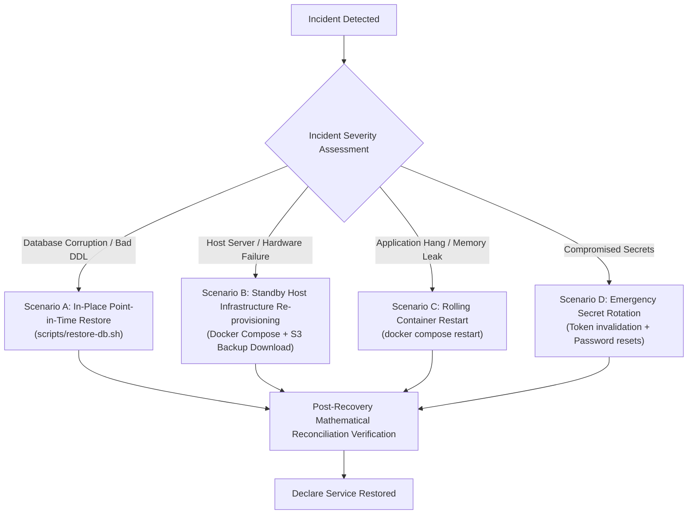

# STOCKGUARD — Disaster Recovery & Business Continuity Plan

**Document Version:** 1.0.0  
**Status:** Authoritative  
**Target RPO:** <= 1 Hour | **Target RTO:** <= 15 Minutes  

---

## 1. Disaster Classification & Response Protocols



---

## 2. Recovery Procedures by Scenario

### Scenario A: Logical Database Corruption / Human Error
- **Symptom:** Unintended data modification, invalid batch transaction, or database inconsistency.
- **RTO Target:** 10 minutes.
- **Action:**
  1. Immediately stop the application: `docker compose -f docker-compose.prod.yml stop stockguard-app`.
  2. Locate the most recent valid backup in `./backups/` or offsite storage.
  3. Restore database:
     ```bash
     ./scripts/restore-db.sh ./backups/stockguard_backup_VALID_TIMESTAMP.dump stockguard
     ```
  4. Start application: `docker compose -f docker-compose.prod.yml start stockguard-app`.
  5. Run mathematical verification query to ensure 100% balance-to-ledger equality.

### Scenario B: Total Host Infrastructure Failure
- **Symptom:** Physical server death, cloud instance termination, or data center outage.
- **RTO Target:** 15 minutes.
- **Action:**
  1. Provision a fresh Ubuntu 22.04 LTS instance.
  2. Install Docker and Docker Compose.
  3. Clone the STOCKGUARD repository: `git clone https://github.com/stockguard/stockguard.git /opt/stockguard`.
  4. Download the latest encrypted backup archive from offsite S3 bucket:
     ```bash
     aws s3 cp s3://stockguard-offsite-backups/latest.dump ./backups/latest.dump
     ```
  5. Restore `.env` from secure secrets vault (e.g. AWS Secrets Manager, 1Password).
  6. Launch stack: `docker compose -f docker-compose.prod.yml up -d`.
  7. Restore data: `./scripts/restore-db.sh ./backups/latest.dump stockguard`.
  8. Update public DNS `A` records to point to the new host IP.

### Scenario C: Secret Compromise
- **Symptom:** Exposed `.env` file, compromised database credentials, or leaked JWT secret.
- **RTO Target:** 5 minutes.
- **Action:**
  1. Generate new credentials immediately:
     ```bash
     openssl rand -base64 64 # New JWT secret
     openssl rand -base64 32 # New DB passwords
     ```
  2. Update database user passwords in PostgreSQL:
     ```bash
     docker exec stockguard-postgres psql -U stockguard -d postgres -c "
     ALTER USER stockguard_app WITH PASSWORD 'NEW_APP_PASSWORD';
     ALTER USER stockguard_owner WITH PASSWORD 'NEW_OWNER_PASSWORD';
     "
     ```
  3. Update `.env` with new secrets.
  4. Restart `stockguard-app`:
     ```bash
     docker compose -f docker-compose.prod.yml restart stockguard-app
     ```
  5. Changing `STOCKGUARD_JWT_ACTIVE_SECRET` immediately invalidates all existing issued access tokens, forcing all active sessions to re-authenticate or refresh.

---

## 3. Scheduled Disaster Recovery Drills

To guarantee the reliability of backup archives and restoration runbooks:
- **Frequency:** Quarterly disaster recovery simulation.
- **Procedure:** Restoring the latest production backup into `stockguard_restore_test` on a staging server and executing the automated double-entry ledger reconciliation verification script.
- **Success Criteria:** 100% balance-to-ledger equality, zero constraint violations, restoration completion time under 5 minutes.
