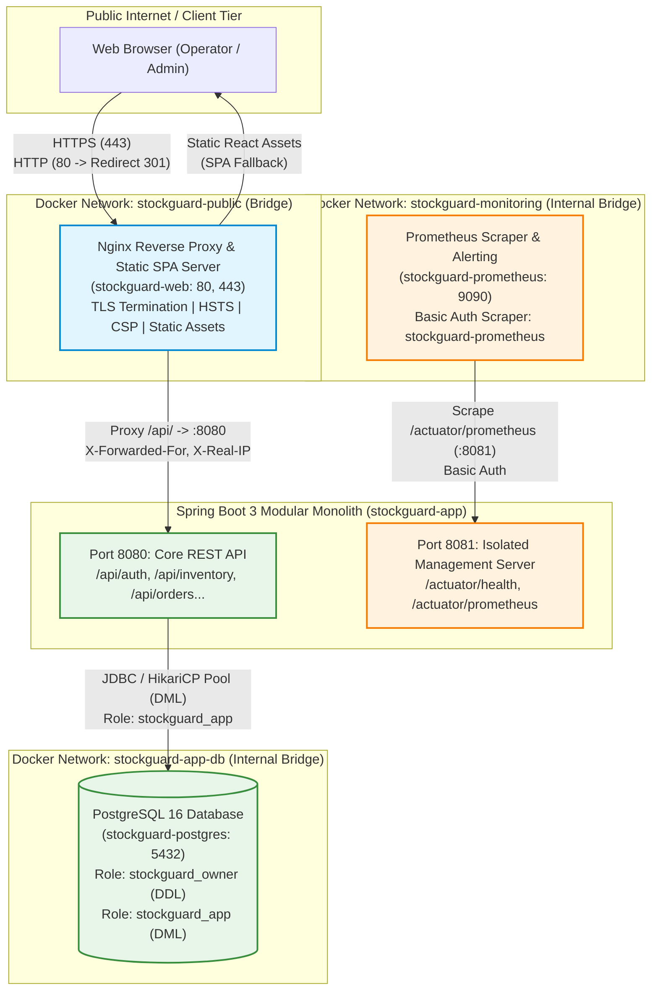
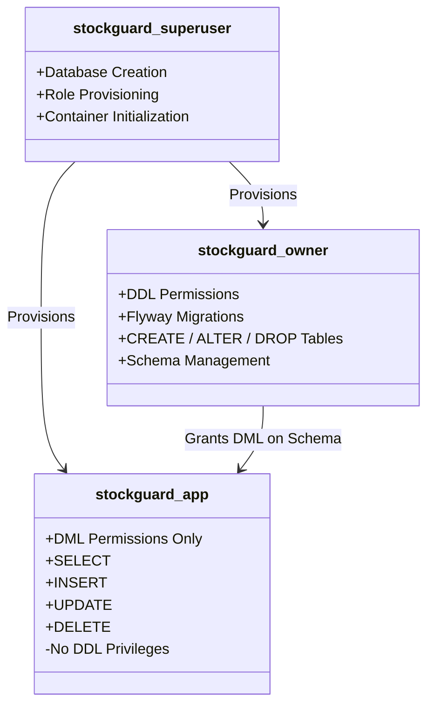

# STOCKGUARD — Production Architecture Specification

**Document Version:** 1.0.0  
**Status:** Authoritative  
**Target Platform:** Linux / Docker Compose / PostgreSQL 16 / Java 21 / React 18  

---

## 1. Architectural Overview

STOCKGUARD is designed as a **hardened modular monolith** following the **Mineral & Signal** operational design language. The system avoids unnecessary microservice complexity, distributed caching layers, and asynchronous event buses in favor of PostgreSQL 16 ACID transactions, row-level locking (`SELECT ... FOR UPDATE`), serializable snapshot isolation where required, and deterministic double-entry ledger bookkeeping.

---

## 2. Network Isolation Architecture (ADR-014)

Production containers are segmented across three isolated Docker bridge networks:

| Network Name | Scope | Internal Only | Members | Traffic Allowed |
| :--- | :--- | :--- | :--- | :--- |
| `stockguard-public` | Public ingress | No | `nginx`, `stockguard-app` | Ports 80 & 443 inbound to Nginx; HTTP proxy to `stockguard-app:8080`. |
| `stockguard-app-db` | Core Data Tier | **Yes** (`internal: true`) | `stockguard-app`, `postgres` | Port 5432 database communication only. Zero external routability. |
| `stockguard-monitoring` | Observability | **Yes** (`internal: true`) | `stockguard-app`, `prometheus` | Port 8081 scraping only. Zero public internet or database routability. |

### Ingress & Port Exposure Rules
- **Host Ports Published:** `80` (HTTP) and `443` (HTTPS) via Nginx only.
- **Backend Application (`stockguard-app`):** Port `8080` is reachable exclusively within `stockguard-public`; port `8081` is reachable exclusively within `stockguard-monitoring`. Neither port is published to host interfaces.
- **Database (`postgres`):** Port `5432` has no published host port in production and is physically isolated to `stockguard-app-db`.
- **Metrics (`prometheus`):** Operates on `stockguard-monitoring`; not published publicly.

---

## 3. Principle of Least Privilege: Dual-Role Database Model (ADR-002)

The PostgreSQL database enforces strict role segregation:

1. **Migration Owner (`stockguard_owner`):**
   - Executed exclusively by Flyway during container boot.
   - Holds DDL privileges (`ALL PRIVILEGES ON DATABASE`, schema modifications).
   - Does not handle runtime API traffic.
2. **Runtime Application (`stockguard_app`):**
   - Executed by Spring Boot HikariCP connection pool for runtime transactions.
   - Strictly restricted to DML privileges (`SELECT`, `INSERT`, `UPDATE`, `DELETE`) on public schema tables.
   - Denied schema mutation, table drops, or permission grants.

---

## 4. Container Resource Allocation & Limits

| Container Name | Base Image | Memory Limit | CPU Limit | Health Probe |
| :--- | :--- | :--- | :--- | :--- |
| `stockguard-web` | `nginx:1.27-alpine` | `256MB` | `0.50` | `GET /healthz` (15s) |
| `stockguard-app` | `eclipse-temurin:21-jre-alpine` | `1536MB` | `2.00` | `GET :8081/actuator/health/liveness` (15s) |
| `stockguard-postgres` | `postgres:16-alpine` | `1024MB` | `1.00` | `pg_isready -U postgres` (10s) |
| `stockguard-prometheus` | `prom/prometheus:v2.51.0` | `512MB` | `0.50` | Internal prometheus daemon |
