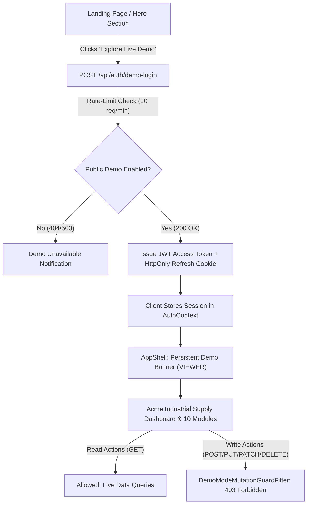

# STOCKGUARD — Public Demonstration Architecture & Experience Specification

**Document Version:** 1.0.0  
**Status:** Authoritative  
**Milestone:** 10 — Public Demo Experience & Final Release Hardening  

---

## 1. Executive Summary & Objective

STOCKGUARD is designed not only as an enterprise-grade inventory integrity platform, but also as a self-guided portfolio demonstration product. The **Public Demonstration Experience** enables recruiters, engineering leads, partners, and prospective clients to experience the entire system end-to-end without requiring administrative onboarding, credential issuance, or manual registration.

Visitors navigate directly from the marketing landing page into the fully seeded, realistic distribution environment of **Acme Industrial Supply Pvt. Ltd.**, with full read-only visibility into all 10 operational modules, the Living Warehouse 3D digital twin, the double-entry transactional ledger, discrepancy reconciliations, and immutable audit trails.

---

## 2. Visitor Journey Architecture



### Key Journey Touchpoints:
1. **Public Marketing Landing Page:** Prominent "Explore Live Demo" CTAs in both the sticky navigation header and the interactive hero section.
2. **Login Page Fallback:** Dedicated "Public Demonstration" card on `/login` offering one-click entry, with query parameter support (`/login?demo=true`) for automated entry.
3. **Session Minting:** Calling `POST /api/auth/demo-login` establishes a standard authenticated session without client-supplied credentials.
4. **Acme Industrial Context:** The session defaults directly into the Acme Industrial Supply Pvt. Ltd. tenant (`Acme Industrial Supply Pvt. Ltd.`).
5. **AppShell Banner:** A persistent, high-contrast banner at the top of the interface alerts the visitor that they are in **Public Demo Mode (Read-Only) — VIEWER ROLE**.
6. **10 Operational Modules:**
   - **Dashboard:** Real-time stock valuation, turnover metrics, recent orders, and inventory velocity.
   - **Inventory:** Multi-warehouse balances, reorder points, safety stock, and bin locations.
   - **Warehouses:** Pune Central, Sanand Depot, and Sriperumbudur facility configurations and zones.
   - **Products:** Complete SKU catalog with categories, dimensions, and weights.
   - **Orders:** Inbound purchase orders and outbound sales order lifecycle.
   - **Reservations:** Two-phase stock allocations and pending reservation timers.
   - **Reconciliation:** Real-time MVCC physical vs. ledger variance detection and triage inspection.
   - **Audit Trail:** Immutable append-only audit event logs.
   - **Warehouse 3D:** Interactive spatial Three.js/GSAP digital twin with rack inspection HUD.
   - **Settings:** Organization profile, facility management, and team directory (read-only).

---

## 3. Synthetic Demo Identity Specification

The demo session is powered by a dedicated synthetic user identity created specifically for public evaluation:

| Attribute | Value / Specification |
| :--- | :--- |
| **Email** | `demo.visitor@stockguard.dev` |
| **Full Name** | `Demo Visitor` |
| **Organization** | `Acme Industrial Supply Pvt. Ltd.` |
| **Assigned Role** | `Role.VIEWER` |
| **Password Credential** | Cryptographically unguessable random UUID salted with BCrypt (cost 12). |
| **Direct Form Login** | Strictly impossible; credentials are not shared and cannot be brute-forced. |
| **Provisioning Lifecycle** | Idempotent startup runner (`DemoVisitorProvisioner`) or demo environment seeder (`DemoEnvironmentSeeder`). |

---

## 4. Role Permissions Matrix & VIEWER Expansion

To provide an authentic operational experience, the `VIEWER` role has been enhanced to grant comprehensive read-only visibility across every module in the platform, while denying all mutation privileges:

| Module / Resource | Read Permission (`VIEWER`) | Mutation Permission (Denied to `VIEWER`) |
| :--- | :--- | :--- |
| **Inventory Balances** | `inventory:view` | `inventory:adjust` |
| **Warehouses & Zones** | `warehouse:view` | `warehouse:manage` |
| **Product Catalog** | `product:view` | `product:manage` |
| **Orders & Shipments** | `order:view` | `order:create`, `order:cancel` |
| **Stock Reservations** | `reservation:view` | `reservation:release` |
| **Reconciliation Discrepancies** | `inventory:discrepancy:view` | `inventory:reconcile` |
| **Immutable Audit Logs** | `audit:view` | None (Ledger is append-only for all roles) |
| **Organization & Team** | `organization:read` | `organization:manage`, `user:manage` |

> [!NOTE]
> Previously, discrepancy viewing was bound to `inventory:reconcile`, preventing non-managers from seeing discrepancies. In Milestone 10, viewing and triaging were decoupled: `inventory:discrepancy:view` allows safe read-only inspection, while `inventory:reconcile` remains strictly protected for administrative actions.

---

## 5. Defense-in-Depth Mutation Guards

Demo visitors are untrusted public actors. STOCKGUARD applies a multi-layered security model to guarantee data integrity:

### 1. Server-Side Filter Enforcement (`DemoModeMutationGuardFilter`)
The `DemoModeMutationGuardFilter` is registered in Spring Security's filter chain immediately following tenant resolution:
- **Scope:** Evaluated for all requests authenticated as `demo.visitor@stockguard.dev`.
- **Blocked Methods:** `POST`, `PUT`, `PATCH`, `DELETE`.
- **Exemptions:** Essential session lifecycle endpoints:
  - `POST /api/auth/refresh` (cookie-bound session rotation)
  - `POST /api/auth/logout` (session termination)
- **Error Response:**
  ```json
  {
    "timestamp": "2026-11-17T13:30:00Z",
    "status": 403,
    "error": "Forbidden",
    "code": "DEMO_MODE_MUTATION_PROHIBITED",
    "message": "Demo visitor sessions are strictly read-only. State mutations are prohibited.",
    "path": "/api/orders"
  }
  ```

### 2. Rate Limiting Protection
To prevent denial-of-service or session exhaustion attacks, `POST /api/auth/demo-login` is protected by `RateLimitingFilter`:
- **Default Limit:** 10 demo session requests per minute per client IP.
- **Header Tracking:** `X-RateLimit-Limit`, `X-RateLimit-Remaining`, and `Retry-After` headers returned on `429 Too Many Requests`.

### 3. Frontend UI Disabling & Non-Destructive Modals
- All action buttons (e.g. "Create Order", "Adjust Stock", "Add Warehouse") are either hidden or visually disabled for `VIEWER` roles.
- Reconciliation triage modals for demo visitors render in **Read-Only Inspection Mode**, displaying full discrepancy telemetry and ledger states without exposing resolution action buttons.

---

## 6. Deployment & Environment Configuration

Public Demo mode is controlled via Spring Boot environment properties:

```yaml
stockguard:
  security:
    public-demo:
      enabled: ${STOCKGUARD_PUBLIC_DEMO_ENABLED:false}
      demo-email: ${STOCKGUARD_PUBLIC_DEMO_EMAIL:demo.visitor@stockguard.dev}
      demo-org-name: ${STOCKGUARD_PUBLIC_DEMO_ORG_NAME:Acme Industrial Supply Pvt. Ltd.}
      demo-user-full-name: ${STOCKGUARD_PUBLIC_DEMO_USER_FULL_NAME:Demo Visitor}
```

### Profile Defaults:
- **`dev` Profile:** Enabled by default (`true`). Demo visitor provisioned automatically on launch.
- **`prod` Profile:** Disabled by default (`false`). Must be explicitly enabled in `.env` or container environment for public showcase deployments.
