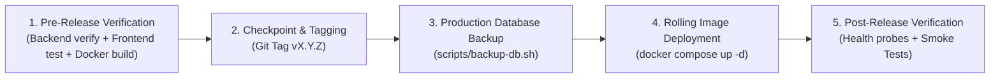

# STOCKGUARD — Production Release Runbook

**Document Version:** 1.0.0  
**Status:** Authoritative Operational Procedure  

---

## 1. Release Lifecycle Stages



---

## 2. Pre-Release Engineering Gate

Before triggering any production release, execute local verification checks:

1. **Backend Verification:**
   ```bash
   ./mvnw clean verify -DDB_PORT=5433
   ```
   *Requirement: 0 failures, 0 errors across complete test suite.*

2. **Frontend Verification:**
   ```bash
   cd frontend
   npm ci
   npx oxlint
   npm test
   npm run build
   cd ..
   ```
   *Requirement: 0 lint errors, 100% tests passing, clean Vite production bundle.*

3. **Docker Compose Validation:**
   ```bash
   docker compose -f docker-compose.prod.yml config --quiet
   ```

---

## 3. Deployment Execution Steps

1. **Create Pre-Release Database Snapshot:**
   ```bash
   ./scripts/backup-db.sh
   # Verify backup non-empty and note timestamp
   ```

2. **Pull Tagged Release on Target Production Host:**
   ```bash
   git fetch origin --tags
   git checkout tags/v1.0.0
   ```

3. **Build & Deploy Production Stack:**
   ```bash
   # Rebuild images without cache
   docker compose -f docker-compose.prod.yml build --no-cache

   # Launch containers
   docker compose -f docker-compose.prod.yml up -d
   ```

4. **Monitor Startup & Flyway Migrations:**
   ```bash
   docker compose -f docker-compose.prod.yml logs -f stockguard-app
   ```
   *Verify line: "Flyway Community Edition ... Successfully applied X migrations".*

---

## 4. Post-Release Smoke Verification

1. **Check Container Health Status:**
   ```bash
   docker compose -f docker-compose.prod.yml ps
   ```
   *All 4 containers (`stockguard-postgres`, `stockguard-app`, `stockguard-web`, `stockguard-prometheus`) must report `healthy` or `running`.*

2. **Verify Public Nginx Health Probe:**
   ```bash
   curl -k -I https://localhost/healthz
   # Expect: HTTP/2 200
   ```

3. **Verify Actuator Public Blocking:**
   ```bash
   curl -k -I https://localhost/actuator/prometheus
   # Expect: HTTP/2 404
   ```

4. **Verify Frontend Application Ingress:**
   Navigate to `https://app.stockguard.com/` in a browser. Confirm login page renders, authenticates, and displays the Mineral & Signal operations console.

---

## 5. Immediate Rollback Procedure

If critical regressions or health check failures occur:

1. **Revert to Previous Git Tag:**
   ```bash
   git checkout tags/v_PREVIOUS_VERSION
   ```
2. **Re-deploy Previous Images:**
   ```bash
   docker compose -f docker-compose.prod.yml up -d --build
   ```
3. **If Database Rollback is Required:**
   Execute [scripts/restore-db.sh](../../scripts/restore-db.sh) with the pre-release snapshot:
   ```bash
   ./scripts/restore-db.sh ./backups/stockguard_backup_PRE_RELEASE.dump stockguard
   docker compose -f docker-compose.prod.yml restart stockguard-app
   ```
