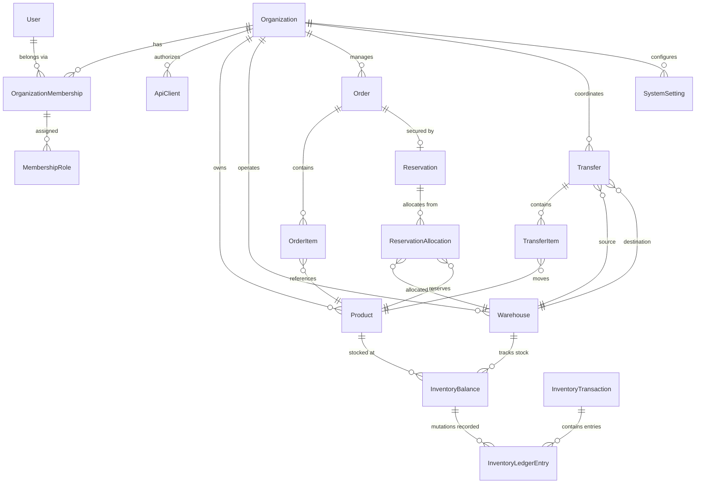

# STOCKGUARD — Domain Model and Invariants

> [!IMPORTANT]
> All entities and invariants described here represent the preliminary domain design for STOCKGUARD. Items are marked as **Accepted Decision**, **Proposed Design**, or **Unresolved**. Nothing has been implemented or tested.

---

## Core Entities (19 Baseline Entities)

### Entity Relationship Diagram (Proposed)



### Entity Descriptions

| Entity | Description | Status |
|---|---|---|
| **Organization** | Tenant boundary. All domain data is partitioned by organization. Initial launch operates with a single organization. | **Accepted Decision** |
| **User** | System identity account decoupled from organizations. | **Accepted Decision** |
| **OrganizationMembership** | Associates a user identity with an organization, carrying a direct `role` column (`ADMIN`, `MANAGER`, `OPERATOR`, `VIEWER`). | **Accepted Decision** |
| **Product** | Catalog entity with a normalized SKU unique within the organization. (No separate variants table in MVP). | **Accepted Decision** |
| **Warehouse** | Physical or logical inventory facility with configured priority rank and code tie-breaker. | **Accepted Decision** |
| **InventoryBalance** | Real-time stored stock positions (`on_hand` and `reserved`); `available = on_hand - reserved` is strictly derived. | **Accepted Decision** |
| **InventoryTransaction** | Logical grouping header for one or more atomic inventory ledger entries. | **Accepted Decision** |
| **InventoryLedgerEntry** | Append-only ledger recording explicit signed `on_hand_delta` and `reserved_delta` changes. | **Accepted Decision** |
| **Order** | Commercial order representing customer purchase intent with 6-stage lifecycle. | **Accepted Decision** |
| **OrderItem** | Specific product line item retaining historical SKU/name/price snapshots. | **Accepted Decision** |
| **Reservation** | Inventory commitment linking an order to warehouse allocations with 4-stage lifecycle. | **Accepted Decision** |
| **ReservationAllocation** | Per-warehouse, per-product quantity breakdown supporting an active reservation. | **Accepted Decision** |
| **Transfer** | Warehouse-to-warehouse stock relocation record (immediate and atomic in MVP). | **Accepted Decision** |
| **TransferItem** | Product and quantity line item within a warehouse transfer. | **Accepted Decision** |
| **IdempotencyRecord** | Scoped store guaranteeing at-most-once execution with wait-and-replay concurrency and 7-day retention. | **Accepted Decision** |
| **AuditLog** | Append-only record tracking administrative and operational user actions. | **Accepted Decision** |
| **MembershipRole** | Join table for multiple custom roles per membership. Deferred post-MVP; MVP uses role column on membership. | **Deferred Extension** |
| **ApiClient** | Programmatic machine-to-machine credentials. Deferred unless external automated API clients are a launch requirement. | **Deferred Extension** |
| **SystemSetting** | Database key-value configuration store. Deferred post-MVP; MVP utilizes application configuration files. | **Deferred Extension** |

---

## Inventory Invariants — Accepted Decisions

### 1. Balance Calculation & Boundaries
- **Authoritative Stored State:** `on_hand` (physical inventory) and `reserved` (logically held stock) are the **sole authoritative stored columns** in `inventory_balances`.
- **Derived Availability:** Available inventory is strictly derived at query time:
  $$\text{available} = \text{on\_hand} - \text{reserved}$$
  `available` is **never** an independently mutable stored column.
- **Convenience Views / Generated Columns:** If a generated column or convenience database view is deployed, it is strictly read-only and non-authoritative.
- **Invariants:**
  - `on_hand >= 0`
  - `reserved >= 0`
  - `reserved <= on_hand`
  - Consequently, `available >= 0` holds at all times.

### 2. SKU Normalization & Uniqueness Policy
- Each product represents a single stockable item with a unique SKU per organization. (Product variants are deferred to future releases).
- **Whitespace Trimming:** Leading and trailing whitespace is stripped (`TRIM(sku)`).
- **Case Normalization:** SKUs are converted to uppercase (`UPPER(TRIM(sku))`).
- **Equivalent Values:** Values differing only in case or whitespace (e.g. `" widget-01 "` vs `"WIDGET-01"`) map to identical canonical values (`"WIDGET-01"`).
- **Database Enforcement:** Guaranteed at the schema layer via functional unique index `UNIQUE(organization_id, UPPER(TRIM(sku)))` and check constraint `CHECK (sku = UPPER(TRIM(sku)) AND length(sku) > 0)`.

### 3. Dual-Delta Ledger Recording
Every inventory mutation records two signed deltas in `inventory_ledger_entries`:
- `on_hand_delta`: Physical stock change (+ on receipt/transfer-in, - on fulfillment/transfer-out, 0 on reservation).
- `reserved_delta`: Logical commitment change (+ on reservation, - on release/fulfillment/expiration, 0 on physical adjustment).

### 3. Opening Balance
When a product is first stocked at a warehouse, an `OPENING_BALANCE` transaction and ledger entry must be recorded. Balances can never be initialized without an originating ledger entry.

### 4. Transactional Atomicity
- Modifications to `inventory_balances` and corresponding inserts to `inventory_ledger_entries` (under `inventory_transactions`) **must commit in the exact same database transaction**.
- A balance change without an accompanying ledger entry is an illegal state.

### 5. Ledger Immutability
- Ledger entries are strictly **append-only**.
- Once committed, ledger entries are never updated or deleted. Corrections must be applied as new compensating transactions.

### 6. Mathematical Reconciliation Invariant
Reconciliation validates balance integrity through summation of ledger deltas:
$$\text{inventory\_balances.on\_hand} = \sum \text{inventory\_ledger\_entries.on\_hand\_delta}$$
$$\text{inventory\_balances.reserved} = \sum \text{inventory\_ledger\_entries.reserved\_delta}$$

### 7. Warehouse Transfer Invariants
- Transfers are immediate and atomic in MVP.
- **Reserved inventory cannot be transferred:** Source warehouse must have `available >= quantity` (`on_hand - reserved >= quantity`).

### 8. Order Item Historical Snapshots
- `order_items` must capture `sku_snapshot`, `name_snapshot`, and `unit_price` at the moment of order placement to protect historical audit integrity against product catalog updates.

---

## Separate Order & Reservation Lifecycles — Accepted Decisions

Order and reservation lifecycles are strictly separate and independently documented:

### Order Lifecycle
- **`PENDING`**: Order placed, awaiting payment authorization or confirmation.
- **`CONFIRMED`**: Order confirmed. Active reservations for confirmed orders do not automatically expire.
- **`FULFILLING`**: Warehouse picking and packing actively underway.
- **`FULFILLED`**: Order shipped and complete. (Terminal state)
- **`CANCELLED`**: Order cancelled. (Terminal state)
- **`EXPIRED`**: Pending order expired due to unconfirmed reservation hold timeout. (Terminal state)

### Reservation Lifecycle
- **`ACTIVE`**: Reservation is actively holding stock across warehouse allocations.
- **`CONSUMED`**: Reservation converted into physical fulfillment deduction. (Terminal state)
- **`RELEASED`**: Reservation released due to order cancellation; stock restored to available. (Terminal state)
- **`EXPIRED`**: Reservation timed out while order was pending; stock restored to available. (Terminal state)

> [!CAUTION]
> **Do not use `PENDING`, `CONFIRMED`, `FULFILLED`, or `CANCELLED` as reservation states.** Reservations possess strictly four states: `ACTIVE`, `CONSUMED`, `RELEASED`, and `EXPIRED`.

```
ORDER LIFECYCLE:
  [*] --> PENDING
  PENDING --> CONFIRMED: Payment Cleared
  PENDING --> EXPIRED: Hold TTL Elapsed
  PENDING --> CANCELLED: User/Admin Cancellation
  CONFIRMED --> FULFILLING: Warehouse Processing
  CONFIRMED --> CANCELLED: Post-Confirmation Cancellation
  FULFILLING --> FULFILLED: Dispatch Completed
  FULFILLING --> CANCELLED: Processing Aborted
  FULFILLED --> [*]
  CANCELLED --> [*]
  EXPIRED --> [*]

RESERVATION LIFECYCLE:
  [*] --> ACTIVE: Hold Created
  ACTIVE --> CONSUMED: Order Fulfilled
  ACTIVE --> RELEASED: Order Cancelled
  ACTIVE --> EXPIRED: Pending Order Hold Timed Out
  CONSUMED --> [*]
  RELEASED --> [*]
  EXPIRED --> [*]
```

### Lifecycle Interplay Rules
1. **Active State Semantics:** A reservation is `ACTIVE` while and only while it holds inventory.
2. **Pending Order Expiration:** A pending order's active reservation carries an `expires_at` timestamp and may expire via the background worker.
3. **Confirmed Order Protection:** When an order transitions `PENDING → CONFIRMED`, its active reservation **does not automatically expire** (`expires_at` is cleared to `NULL`).
4. **Fulfillment Consumes Reservation:** Fulfilling an order transitions the reservation `ACTIVE → CONSUMED`, deducting `on_hand` and `reserved` together.
5. **Cancellation Releases Reservation:** Cancelling an order transitions its active reservation `ACTIVE → RELEASED`, restoring `reserved` stock back to `available` without modifying `on_hand`.
6. **Expiration Releases Held Inventory:** When an unconfirmed reservation reaches expiration, it transitions `ACTIVE → EXPIRED`, restoring `reserved` stock back to `available`.
7. **Terminal State Invariant:** `CONSUMED`, `RELEASED`, and `EXPIRED` are strictly **terminal states**. A reservation in a terminal state **cannot return to `ACTIVE`**.
8. **Single Active Reservation Per Order:** In the MVP, an order may have at most one active reservation.
9. **No Partial Reservations:** Either all line items in an order are fully allocated and reserved, or the reservation fails and rolls back completely (all-or-nothing).
10. **Historical Allocation Preservation & Hold Semantics:** `reservation_allocations` records remain permanently available after a reservation transitions to `CONSUMED`, `RELEASED`, or `EXPIRED`. Allocation rows are never deleted upon state transition. The parent `reservations.status` is the sole determinant of whether stock is actively held (`status = 'ACTIVE'`). Preserving allocation rows ensures full historical traceability of which warehouses allocated stock to the order.

---

## Multi-Warehouse Allocation & Lock Ordering — Accepted Decisions

### 1. Canonical Database Lock Ordering
To completely prevent deadlocks during concurrent multi-item, multi-warehouse mutations, database locks on `inventory_balances` are acquired strictly in canonical UUID order:
1. `product_id ASC`
2. `warehouse_id ASC`

### 2. Business Allocation Priority
Independent of database lock order, the business allocation strategy evaluates warehouses as follows:
1. **Complete Line Preference:** Prefer a single warehouse that can satisfy the complete line item quantity. If multiple warehouses can fulfill the line completely, select the one with highest priority rank (lowest `priority` integer).
2. **Split Across Eligible Warehouses:** If no single warehouse has sufficient available stock, split the line across eligible warehouses in configured warehouse-priority rank order until satisfied.
3. **Deterministic Tie-Breaker:** When warehouses share the same priority rank, the normalized warehouse `code` in ascending lexicographical order acts as the deterministic tie-breaker.
4. **All-or-Nothing:** Do not partially reserve an order. If any line cannot be fully allocated, the entire transaction rolls back.

---

## Idempotency Guarantees — Accepted Decisions

- **Multi-Tenant Scoping:** Idempotency is strictly scoped by `(organization_id, principal_id, operation_scope, idempotency_key)`.
- **Payload Verification:** Computes SHA-256 `request_hash` across method, path, and normalized payload.
- **Same Key, Same Payload:** Replays original stored response status and body without re-executing business logic.
- **Same Key, Different Payload:** Rejects request with HTTP `409 Conflict`.
- **Concurrent Duplicate Requests (Wait-and-Replay):**
  - Second concurrent request with identical key and payload waits on row/index lock for the first transaction to complete.
  - When the first transaction commits, the second request unblocks and replays the stored response.
  - Concurrent duplicates do **not** automatically return 409; they execute at most once and return the cached result.
- **Rollback & Safe Retry:** If the first transaction fails and rolls back, the uncommitted in-progress record is removed, allowing subsequent requests to safely execute.
- **Transactional Consistency:** Record creation, business mutations, and response persistence commit atomically.
- **Retention Period:** Proposed initial design retention period is **7 days**. Expired records are cleaned up asynchronously.

---

## Unresolved Domain Questions

> [!WARNING]
> The following decisions remain genuinely **unresolved** and must not be pre-empted without explicit direction:

| # | Question | Status |
|---|---|---|
| 1 | **Authentication token/session strategy** — stateless JWT bearer tokens vs. session cookies vs. OAuth2 provider. | **Unresolved** |
| 2 | **Exact role-permission matrix** — fine-grained endpoint and action permissions for roles (`ADMIN`, `MANAGER`, `OPERATOR`, `VIEWER`). | **Unresolved** |
| 3 | **Reservation duration before confirmation** — default TTL duration for unconfirmed reservations on `PENDING` orders (e.g., 15 min, 30 min, or per-org setting). | **Unresolved** |
| 4 | **Deadlock retry and backoff configuration** — retry limits, jitter formula, and exponential backoff parameters for PostgreSQL deadlock recovery. | **Unresolved** |
| 5 | **Negative stock adjustment behavior** — whether an adjustment reducing `on_hand` below `reserved` is rejected with an error or permitted with an audit alert. | **Unresolved** |
| 6 | **Inter-module event strategy** — Spring in-memory domain events (`ApplicationEventPublisher`) vs. transactional outbox pattern vs. synchronous domain service calls. | **Unresolved** |
