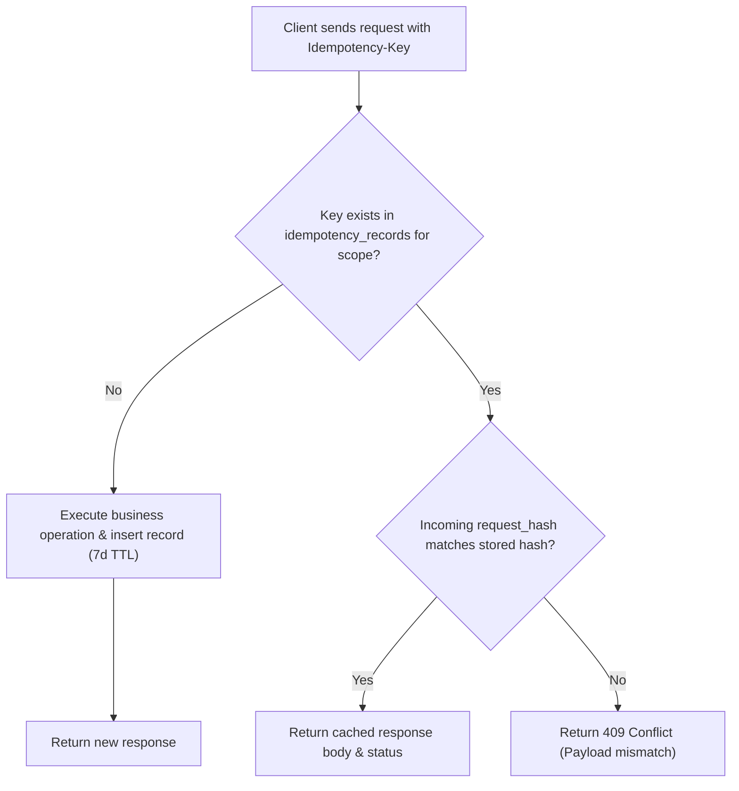

# STOCKGUARD — Engineering Principles and Standards

> [!IMPORTANT]
> This document describes architectural decisions and engineering standards for STOCKGUARD. Items are marked as **Accepted Decision**, **Proposed Design**, or **Unresolved**. Nothing described here has been implemented or tested.

---

## Concurrency Strategy — Accepted Decision

| Principle | Detail |
|---|---|
| Locking approach | Explicit row-level **pessimistic locking** (`SELECT ... FOR UPDATE`) for critical inventory operations |
| Isolation level | `READ COMMITTED` with explicit row-level locking |
| Deadlock prevention | Strict canonical lock acquisition order (`product_id ASC, warehouse_id ASC` in UUID order) |
| Allocation separation | Business allocation priority (complete line preference, warehouse priority, code tie-breaker) is completely decoupled from database lock sequence |
| Reservation expiration | Background worker using `FOR UPDATE SKIP LOCKED` on expired `ACTIVE` reservations for `PENDING` orders to avoid contention |

**Rationale:** Pessimistic locking with `READ COMMITTED` is the simplest, most reliable approach for high-contention inventory operations. Optimistic locking (`@Version`) introduces retry storms when contention is concentrated on hot products.

---

## Data Integrity & Ledger Architecture — Accepted Decision

| Principle | Detail |
|---|---|
| Source of truth | PostgreSQL is the **single authoritative source** for all inventory state |
| Product model | Single `products` table with normalized `sku` unique within organization; variants deferred |
| Dual-delta ledger | `inventory_ledger_entries` records explicit `on_hand_delta` and `reserved_delta` for every mutation |
| Opening balance | First receipt of any product at a warehouse is established via an explicit `OPENING_BALANCE` transaction |
| Atomicity | Balance modifications and ledger entries commit within the **same database transaction** |
| Ledger immutability | Ledger rows are append-only; updates and deletes are prohibited |
| Balance invariants | Schema check constraints enforce `on_hand >= 0`, `reserved >= 0`, and `reserved <= on_hand`. Available inventory is strictly derived (`available = on_hand - reserved >= 0`) and is never an independently mutable stored balance |
| Mathematical reconciliation | Invariant: $\text{on\_hand} = \sum \text{on\_hand\_delta}$ and $\text{reserved} = \sum \text{reserved\_delta}$ |
| Primary keys | UUID for all entity primary keys |
| Quantity type | `BIGINT` for all quantity columns (`on_hand`, `reserved`, deltas, allocations) |
| Monetary type | `NUMERIC(19,4)` for all currency fields |

> [!CAUTION]
> No caching tier (e.g., Redis) or message broker is ever authoritative for inventory balances. PostgreSQL is the sole source of truth.

---

## Persistence Strategy — Accepted Decision

| Layer | Technology | Usage |
|---|---|---|
| Ordinary CRUD | Spring Data JPA (Hibernate) | Standard entity lifecycle operations for 16 planned MVP tables (`organizations`, `users`, `organization_memberships`, `products`, `warehouses`, `orders`, `order_items`, `transfers`, `transfer_items`, `audit_logs`) and deferred tables (`membership_roles`, `api_clients`, `system_settings`) |
| Critical inventory operations | Spring JDBC (`JdbcTemplate` / `NamedParameterJdbcTemplate`) | High-concurrency paths requiring explicit `SELECT ... FOR UPDATE` in canonical `product_id ASC, warehouse_id ASC` order, `SKIP LOCKED`, batch ledger appends, reconciliation queries, and idempotency checks |

---

## Idempotency — Accepted Decision

| Principle | Detail |
|---|---|
| Mechanism | PostgreSQL-backed `idempotency_records` table |
| Scope | Scoped by `(organization_id, principal_id, operation_scope, idempotency_key)` |
| Payload verification | Computes SHA-256 `request_hash` across method, path, and request body |
| Same key, same payload | Returns original cached response status code and response body without re-execution |
| Same key, different payload | Rejects request immediately with HTTP `409 Conflict` |
| Concurrent duplicate requests | Second request waits on database lock for first transaction; upon commit, replays cached response (does not automatically return 409) |
| Rollback & retry safety | Rollback of an in-flight transaction eliminates the uncommitted record, allowing a subsequent retry to safely execute |
| Transactional consistency | Idempotency record creation, business operation mutations, and response persistence commit in the same transaction |
| Retention period | **7-day retention period**; expired records purged by asynchronous background task (initial design decision) |

---

## Schema Management — Accepted Decision

| Principle | Detail |
|---|---|
| Tool | Flyway |
| Migration types | Versioned migrations (`V1__`, `V2__`, ...) checked into version control |
| Execution | Migrations run automatically on application startup |
| Policy | Zero manual DDL modifications against managed database environments |

---

## Multi-Tenancy & Security Boundaries — Accepted Decision

| Principle | Detail |
|---|---|
| Isolation model | Organization-scoped data with **composite foreign keys** across all domain tables |
| Membership mapping | User accounts linked to tenants via `organization_memberships` and `membership_roles` |
| Query scoping | Every repository and JDBC query strictly filters by `organization_id` |

---

## Testing Strategy — Proposed Design

| Layer | Tool | Purpose | Status |
|---|---|---|---|
| Unit tests | JUnit 5 | Core business invariants, allocation rules, domain validation | **Proposed Design** |
| Integration tests | JUnit 5 + Testcontainers | Real PostgreSQL testing of locking, constraints, and transactions | **Proposed Design** |
| Concurrency tests | JUnit 5 + `ExecutorService` | Multi-threaded verification of canonical lock ordering, deadlocks, and idempotency | **Proposed Design** |
| Performance / load tests | k6 | High-throughput concurrent reservation and order fulfillment benchmarks | **Proposed Design** |

---

## Unresolved Engineering Questions

> [!WARNING]
> The following decisions remain genuinely **unresolved** and must not be pre-empted without explicit direction:

| # | Question | Notes | Status |
|---|---|---|---|
| 1 | **Authentication token/session strategy** | Stateless JWT bearer tokens vs. stateful session cookies vs. OAuth2 provider. | **Unresolved** |
| 2 | **Exact role-permission matrix** | Fine-grained endpoint and action mappings for roles (`ADMIN`, `MANAGER`, `OPERATOR`, `VIEWER`). | **Unresolved** |
| 3 | **Reservation duration before confirmation** | Default TTL duration for unconfirmed active reservations on `PENDING` orders (e.g., 15 min, 30 min, or configurable). | **Unresolved** |
| 4 | **Deadlock retry and backoff configuration** | Exact retry counts, jitter formula, and exponential backoff parameters for PostgreSQL deadlock recovery. | **Unresolved** |
| 5 | **Negative stock adjustment behavior** | Whether an adjustment reducing `on_hand` below `reserved` is rejected with an error or permitted with an audit alert. | **Unresolved** |
| 6 | **Inter-module event strategy** | In-memory Spring `ApplicationEventPublisher` vs. transactional outbox pattern vs. synchronous domain service calls. | **Unresolved** |
| 7 | **Caching strategy** | Whether a read-through cache should eventually be introduced for non-authoritative product data or dashboard metrics. | **Unresolved** |
| 8 | **API versioning approach** | URL path prefixing (`/api/v1/...`) vs. header-based content negotiation. | **Unresolved** |
| 9 | **Database connection pool tuning** | HikariCP pool sizing relative to expected worker threads and concurrent API transactions. | **Unresolved** |
