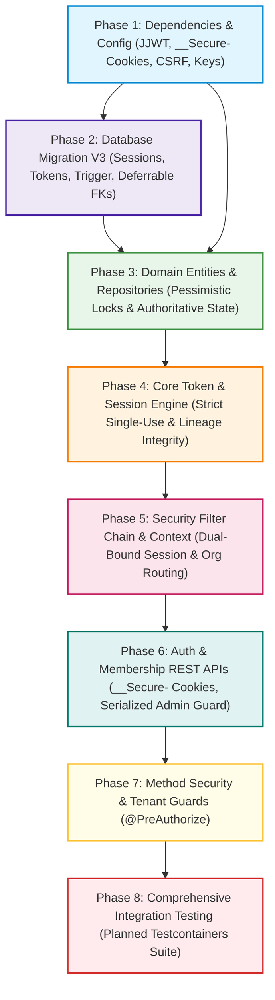

# STOCKGUARD — Milestone 3 Implementation Plan: Identity, Authentication & Tenant Access

> **Document Status:** PROPOSED IMPLEMENTATION PLAN (FINAL TECHNICAL SIGN-OFF REVISIONS)
> **Target Release:** Milestone 3 (Identity, Authentication & Organization Access Foundation)
> **Authoritative References:** [ADR-010](../architecture/adr/ADR-010-authentication-and-session-management.md), [ADR-011](../architecture/adr/ADR-011-authorization-and-organization-access-control.md), [Security Architecture](security-architecture.md), [V3 Schema Proposal](v3-auth-schema-proposal.md)

---

## 1. Executive Summary & Scope Definition

This document defines the actionable, phased implementation roadmap for **Milestone 3: Identity, Authentication and Organization Access Foundation** of the STOCKGUARD platform, incorporating all final technical sign-off corrections.

Milestone 3 establishes the security perimeter, credential management, token issuance, multi-tenant isolation, request-time active session validation, and role-based access control (RBAC) foundation that protects all subsequent business operations.



### Strict Scope Boundaries

| In Scope (Milestone 3) | Explicitly Out of Scope |
|---|---|
| Security dependencies (`spring-boot-starter-security`, JJWT 0.12.6) | Frontend React UI authentication screens (Milestone 8) |
| Flyway `V3__create_auth_and_session_tables.sql` with trigger & deferrable FKs | Business domain services (inventory reservations, orders) |
| Identity entities, repositories, and row-level pessimistic locks | Redis, Kafka, or external caching infrastructure |
| BCrypt password hashing (work factor 12, benchmarked) | OAuth2, OpenID Connect, or social login providers |
| Stateless JWT generation and verification (15-min HS256 with `kid`) | Public user self-registration |
| JWT signing key lifecycle (active and retiring keys, startup validation) | Distributed multi-region session synchronization |
| Browser cookie transport (`__Secure-` in prod, `stockguard_refresh` in dev) | Asymmetric key infrastructure (RS256/ES256) |
| Same-site (`SameSite=Strict`) and cross-site (`SameSite=None; Secure`) guidance | SMS / Email 2FA (MFA reserved for future milestone) |
| Explicit CSRF strategy for cookie endpoints (`X-StockGuard-CSRF`) | Modification of existing `V1__create_initial_schema.sql` or `V2__enforce_append_only_ledgers.sql` migrations |
| Strict single-use refresh token rotation (NO backend grace period) | Distributed rate limiting (in-memory MVP only) |
| Immediate session-family revocation upon token reuse detection | |
| Complete token lineage deletion protection (trigger + deferrable FK) | |
| Dual-bound session validation (`s.id = :sid AND s.user_id = :uid`) | |
| Mandatory explicit organization context (`X-Organization-Id`) | |
| Concurrency-safe last-admin protection via `organizations` row lock | |
| Auth REST endpoints (`/login`, `/refresh`, `/logout`, `/switch-org`, `/me`) | |
| Organization Membership REST endpoints (`/api/organizations/current/memberships`) | |
| Method-level authorization (`@PreAuthorize`) across domain controllers | |
| Initial administrator bootstrap seeding runner | |
| Exhaustive unit, slice, and Testcontainers PostgreSQL 16 integration tests | |

---

## 2. Work Breakdown Structure (WBS) & Implementation Phases

### Phase 1: Security Dependencies & Configuration Baseline

**Goal:** Integrate Spring Security and JJWT dependencies into Maven, establish configuration properties for tokens, cookies, CSRF, and signing keys, and enforce startup validation.

#### Tasks:
1. **Maven Dependencies Update (`backend/pom.xml`):**
   - Add `org.springframework.boot:spring-boot-starter-security`.
   - Add `org.springframework.security:spring-security-test` (scope `test`).
   - Add Java JWT (JJWT) dependencies (version `0.12.6`):
     - `io.jsonwebtoken:jjwt-api`
     - `io.jsonwebtoken:jjwt-impl` (scope `runtime`)
     - `io.jsonwebtoken:jjwt-jackson` (scope `runtime`).
2. **Configuration Property Declaration (`com.stockguard.security.config.SecurityProperties`):**
   - Define type-safe `@ConfigurationProperties(prefix = "stockguard.security")` class.
   - Bind properties:
     - `jwt.active-key.id`: Key identifier (e.g. `"sg-2026-v1"`).
     - `jwt.active-key.secret`: Base64-encoded secret key (minimum 256 bits / 32 bytes).
     - `jwt.retiring-keys`: Map of previous key IDs to Base64 secrets for verification.
     - `jwt.access-token-expiration-minutes`: Default 15.
     - `jwt.issuer`: Expected issuer (e.g. `"stockguard-platform"`).
     - `jwt.audience`: Expected audience (e.g. `"stockguard-api"`).
     - `cookie.name`: Cookie name (`__Secure-stockguard_refresh` in prod, `stockguard_refresh` in dev).
     - `cookie.domain`: Domain or empty for host-only (omitted in production for `__Secure-`).
     - `cookie.secure`: Boolean (true in prod).
     - `cookie.same-site`: `"Strict"` for same-site topology; configurable to `"None"` with `Secure=true` for cross-site topology.
     - `cookie.path`: `"/api/auth"`.
     - `session.refresh-token-expiration-days`: Default 7.
     - `session.absolute-session-lifetime-days`: Default 30.
     - `rate-limit.login-permits-per-minute`: Default 5.
3. **Startup Secret Validation:**
   - Implement `@PostConstruct` or `ApplicationRunner` validating that the active secret decodes to $\ge 32$ bytes and does not equal test defaults. Abort startup immediately if invalid.

---

### Phase 2: Database Migration V3 (Auth & Session Schema)

**Goal:** Implement the database migration script supporting refresh-token family rotation, reuse detection, deletion-prevention trigger, and composite same-session lineage integrity.

#### Tasks:
1. **Flyway Migration Creation:**
   - Create `backend/src/main/resources/db/migration/V3__create_auth_and_session_tables.sql`.
   - Implement table `auth_sessions`:
     - Columns: `id` (UUID PK), `user_id` (FK to `users`), `user_agent`, `ip_address`, `revoked`, `revoked_at`, `revocation_reason`, `expires_at`, `created_at`, `updated_at`.
     - Constraints: `chk_auth_sessions_revocation_pair`, `chk_auth_sessions_expires_after_created`.
     - Indexes: `idx_auth_sessions_user`, `idx_auth_sessions_expires`.
   - Implement table `refresh_tokens`:
     - Columns: `id` (UUID PK), `session_id` (FK to `auth_sessions`), `token_hash` (CHAR(64) UNIQUE), `sequence_number`, `consumed_at`, `replaced_by_token_id`, `expires_at`, `created_at`.
     - Constraints:
       - `uq_refresh_tokens_hash UNIQUE (token_hash)`
       - `uq_refresh_tokens_session_seq UNIQUE (session_id, sequence_number)`
       - `uq_refresh_tokens_session_token UNIQUE (session_id, id)`
       - `chk_refresh_tokens_hash_format CHECK (token_hash ~ '^[0-9a-f]{64}$')`
       - `chk_refresh_tokens_seq CHECK (sequence_number > 0)`
       - `chk_refresh_tokens_consumed_replacement CHECK ((consumed_at IS NULL AND replaced_by_token_id IS NULL) OR (consumed_at IS NOT NULL AND replaced_by_token_id IS NOT NULL))`
       - `fk_refresh_tokens_session FOREIGN KEY (session_id) REFERENCES auth_sessions(id) ON DELETE CASCADE`
       - `fk_refresh_tokens_same_session_replacement FOREIGN KEY (session_id, replaced_by_token_id) REFERENCES refresh_tokens(session_id, id) ON DELETE NO ACTION DEFERRABLE INITIALLY DEFERRED`
     - Indexes:
       - `uq_refresh_tokens_one_active_per_session UNIQUE INDEX ON refresh_tokens (session_id) WHERE consumed_at IS NULL` (guarantees at most one active token per session).
       - `idx_refresh_tokens_session`, `idx_refresh_tokens_active`, `idx_refresh_tokens_expires`.
   - Implement trigger function `enforce_refresh_token_update_rules()` and trigger `trg_refresh_tokens_enforce_one_way_transition` enforcing one-way transition and immutable columns (`id`, `session_id`, `token_hash`, `sequence_number`, `created_at`, `expires_at`).
   - Implement trigger function `prevent_direct_refresh_token_delete()` and trigger `trg_refresh_tokens_prevent_direct_delete`.
   - Configure runtime privileges separating `stockguard_owner` (migration owner) from `stockguard_app` (runtime non-owner):
     ```sql
     -- Non-owner role with no DDL, no trigger bypass, no owner inheritance
     -- CREATE ROLE stockguard_app WITH LOGIN NOSUPERUSER NOCREATEDB NOCREATEROLE NOINHERIT;
     -- REVOKE stockguard_owner FROM stockguard_app;
     REVOKE ALL ON refresh_tokens FROM stockguard_app;
     GRANT SELECT, INSERT ON refresh_tokens TO stockguard_app;
     GRANT UPDATE (consumed_at, replaced_by_token_id) ON refresh_tokens TO stockguard_app;
     GRANT SELECT, INSERT, UPDATE, DELETE ON auth_sessions TO stockguard_app;
     ```
2. **Migration Verification:**
   - Test on PostgreSQL 16 Testcontainers in `FlywayMigrationAndSchemaValidationTest`.
   - Assert `V1__create_initial_schema.sql`, `V2__enforce_append_only_ledgers.sql`, and `V3__create_auth_and_session_tables.sql` apply cleanly in sequence on a pristine database.

---

### Phase 3: Domain Entities, Repositories & Authoritative State Queries

**Goal:** Establish JPA entity mappings and transactional Spring Data / JDBC repositories for user identity, memberships, and session lifecycles with row-level locking.

#### Tasks:
1. **JPA Entity Definitions:**
   - `UserEntity`: Map existing `users` table (`id`, `email`, `normalized_email`, `password_hash`, `active`, timestamps).
   - `OrganizationMembershipEntity`: Map existing `organization_memberships` table (`id`, `user_id`, `organization_id`, `role`, `active`, timestamps).
   - `AuthSessionEntity`: Map `auth_sessions` table (`id`, `user_id`, `revoked`, `revoked_at`, `revocation_reason`, `expires_at`, timestamps).
   - `RefreshTokenEntity`: Map `refresh_tokens` table with composite same-session reference.
2. **Repository Layer & Locking Queries:**
   - `UserRepository`:
     - `Optional<UserEntity> findByNormalizedEmail(String normalizedEmail);`
   - `OrganizationMembershipRepository`:
     - `Optional<OrganizationMembershipEntity> findByUserIdAndOrganizationId(UUID userId, UUID organizationId);`
     - `List<OrganizationMembershipEntity> findAllByUserIdAndActiveTrue(UUID userId);`
     - `long countByOrganizationIdAndRoleAndActiveTrue(UUID organizationId, Role role);`
   - `OrganizationRepository`:
     - Lock query: `@Query("SELECT o.id FROM OrganizationEntity o WHERE o.id = :id") @Lock(LockModeType.PESSIMISTIC_WRITE) Optional<UUID> lockOrganization(@Param("id") UUID id);`
   - `AuthSessionRepository`:
     - `@Lock(LockModeType.PESSIMISTIC_WRITE) @Query("SELECT s FROM AuthSessionEntity s WHERE s.id = :id") Optional<AuthSessionEntity> findByIdForUpdate(@Param("id") UUID id);`
   - `RefreshTokenRepository`:
     - `@Lock(LockModeType.PESSIMISTIC_WRITE) @Query("SELECT rt FROM RefreshTokenEntity rt WHERE rt.tokenHash = :tokenHash") Optional<RefreshTokenEntity> findByTokenHashForUpdate(@Param("tokenHash") String tokenHash);`
3. **Authoritative Membership Service (`OrganizationMembershipService`):**
   - Implement `findActiveMembership(UUID userId, UUID orgId)`: performs fast indexed lookup against PostgreSQL, verifying `user.active == TRUE` and `membership.active == TRUE`.
   - Implement concurrency-safe `updateMemberRole(UUID orgId, UUID targetUserId, Role newRole)`:
     1. Lock organization row via `lockOrganization(orgId)`.
     2. Count active administrators.
     3. If target is an `ADMIN`, newRole is not `ADMIN`, and activeAdminCount $\le 1$, abort with `CANNOT_DEMOTE_SOLE_ADMIN`.
     4. Update role and save within the same transaction.

---

### Phase 4: Core Token & Session Engine

**Goal:** Implement the cryptographic token generator, stateless JWT service, strict single-use refresh token rotation engine, and background cleanup worker.

#### Tasks:
1. **Stateless JWT Service (`com.stockguard.security.service.JwtService`):**
   - Initialize HMAC-SHA256 `SecretKey` instances for active key and retiring keys.
   - Implement `generateAccessToken(UUID userId, String email, UUID sessionId)`:
     - Header: `alg = HS256`, `typ = JWT`, `kid = activeKeyId`.
     - Claims: `sub`, `email`, `session_id`, `iss`, `aud`, `iat`, `exp` (15 min), `jti`.
     - Cryptographically sign with active secret key.
   - Implement `parseAndValidateToken(String token)`:
     - Inspect `kid` from unverified header.
     - Select matching secret key from active or retiring keys.
     - Validate signature, expiration, issuer, audience.
     - Return validated `Claims` containing `userId` and `sessionId`.
2. **Refresh Token Engine (`com.stockguard.security.service.RefreshTokenService`):**
   - Cryptographic token generation: `SecureRandom` 32-byte opaque tokens, Base64URL-encoded (256-bit entropy).
   - Cryptographic hashing: SHA-256 via `MessageDigest` returning 64-character lowercase hexadecimal string. Tokens are never stored raw and cannot be reconstructed from hashes.
   - Implement `createSession(UUID userId, String ipAddress, String userAgent)`:
     - Persist `AuthSessionEntity` (30-day absolute expiration).
     - Generate initial `RefreshTokenEntity` (sequence 1, expires in 7 days).
     - Return raw unhashed token string to controller for `__Secure-` cookie placement.
   - Implement atomic `rotateRefreshToken(String rawRefreshToken, String ipAddress, String userAgent)`:
     - Compute SHA-256 hash.
     - **Step 1:** Lock parent session (`AuthSessionRepository.findByIdForUpdate`).
     - **Step 2:** Lock token row (`RefreshTokenRepository.findByTokenHashForUpdate`).
     - **Step 3 (Validation):**
       - If session revoked or expired: abort with HTTP 401.
       - If token expired: abort with HTTP 401.
     - **Step 4 (Reuse Detection):**
       - If `token.consumed_at IS NOT NULL`:
         **TOKEN REUSE DETECTED (NO BACKEND GRACE PERIOD).**
         - Update session: `revoked = true`, `revoked_at = NOW()`, `revocation_reason = 'REUSE_DETECTED'`.
         - Write high-severity alert to `audit_logs`.
         - Commit transaction and throw `TokenReuseException` (HTTP 401).
     - **Step 5 (Normal Rotation):**
       - Generate new opaque token $T_{\text{new}}$ and compute $H_{\text{new}}$.
       - Calculate expiration: `LEAST(NOW() + INTERVAL '7 days', session.expires_at)`.
       - Insert child token with `sequence_number = parent.sequence_number + 1`.
       - Atomically update parent token via column-level transition: `consumed_at = NOW()`, `replaced_by_token_id = child.id` (dropping predecessor from `uq_refresh_tokens_one_active_per_session`).
       - Atomically insert child token (`consumed_at = NULL`), taking its place as the single active token in the partial unique index.
       - Update session `updated_at = NOW()`.
       - Return new JWT access token and new raw refresh token for cookie update.
   - Implement `revokeSession(String rawRefreshToken, String reason)`:
     - Locate session by token hash and execute immediate revocation.
3. **Session Cleanup Scheduled Task (`com.stockguard.security.service.SessionCleanupWorker`):**
   - Daily cron (`0 0 3 * * *`).
   - Hard-delete sessions where `expires_at < (now - 7 days)` or `revoked = true AND revoked_at < (now - 7 days)`.
   - Cascades automatically to `refresh_tokens` via deferred foreign key constraint and trigger exemption.

---

### Phase 5: Security Filter Chain & Context Propagation

**Goal:** Configure the Spring Security filter pipeline, CSRF header defense, JWT identity validation, dual-bound session validation, and endpoint-routed membership validation.

#### Tasks:
1. **Thread-Local Organization Context (`com.stockguard.security.context.OrganizationContextHolder`):**
   - Define immutable record `TenantContext(UUID organizationId, Role role, Set<Permission> permissions)`.
   - Implement `OrganizationContextHolder` wrapping `ThreadLocal<TenantContext>`.
   - Expose `setContext()`, `getContext()`, and `clear()`.
2. **Stateless JWT Authentication Filter (`com.stockguard.security.filter.JwtAuthenticationFilter`):**
   - Extract `Authorization: Bearer <token>` header. If absent, pass to next filter.
   - Validate token via `JwtService`.
   - Construct `StockGuardPrincipal(UUID userId, UUID sessionId, String email)`.
   - Populate `SecurityContextHolder.getContext().setAuthentication(...)`.
3. **Dual-Bound Session Validation Filter (`com.stockguard.security.filter.SessionValidationFilter`):**
   - Executes after `JwtAuthenticationFilter`.
   - Queries `auth_sessions` and `users`:
     `SELECT s.revoked, s.expires_at, u.active FROM auth_sessions s JOIN users u ON s.user_id = u.id WHERE s.id = :sessionId AND s.user_id = :userId;`
   - Rejects revoked/expired sessions and inactive users with HTTP 401.
   - Fails closed on database errors (HTTP 500 / 503).
4. **Organization Context Filter (`com.stockguard.security.filter.OrganizationContextFilter`):**
   - Intercepts organization-scoped endpoints.
   - Requires explicit `X-Organization-Id` header (or route param). Missing header returns HTTP 400 Bad Request (`MISSING_ORGANIZATION_CONTEXT`).
   - Queries `organization_memberships`:
     `SELECT role, active FROM organization_memberships WHERE user_id = :userId AND organization_id = :requestedOrgId AND active = TRUE;`
   - Binds authoritative role and permissions to `OrganizationContextHolder`.
   - Guarantees cleanup in `finally` block: `OrganizationContextHolder.clear()`.
5. **CSRF Protection Filter for Cookie Endpoints (`com.stockguard.security.filter.CsrfProtectionFilter`):**
   - Intercepts mutating requests to cookie-authenticated endpoints (`/api/auth/refresh`, `/api/auth/logout`).
   - Asserts the presence and validity of the custom header `X-StockGuard-CSRF: 1` (or anti-CSRF token).
   - Rejects missing or invalid headers with HTTP 403 Forbidden.
6. **Spring Security Configuration (`com.stockguard.security.config.SecurityConfig`):**
   - Annotate with `@Configuration`, `@EnableWebSecurity`, `@EnableMethodSecurity(prePostEnabled = true)`.
   - Configure `SecurityFilterChain`:
     - Session management: `SessionCreationPolicy.STATELESS`.
     - CSRF: Disabled globally for Bearer-authenticated endpoints; handled by `CsrfProtectionFilter` for cookie endpoints.
     - CORS: Explicit origin whitelist (`http://localhost:5173`), `allowCredentials = true`, allowed headers (`Authorization`, `Content-Type`, `X-StockGuard-CSRF`, `X-Organization-Id`).
     - PermitAll: `POST /api/auth/login`, `POST /api/auth/refresh`, `/actuator/health`, `/actuator/info`.
     - Authenticated: `/api/**`.
     - Register filters: `CorsFilter` $\rightarrow$ `RateLimitingFilter` $\rightarrow$ `CsrfProtectionFilter` $\rightarrow$ `JwtAuthenticationFilter` $\rightarrow$ `SessionValidationFilter` $\rightarrow$ `OrganizationContextFilter` $\rightarrow$ `AuthorizationFilter`.
     - Custom `AuthenticationEntryPoint` (401 JSON) and `AccessDeniedHandler` (403 JSON).
7. **In-Memory Rate Limiting Filter (`com.stockguard.security.filter.RateLimitingFilter`):**
   - Single-instance sliding window token bucket cache.
   - Enforce 5 permits/min for `/login` and 20 permits/min for `/refresh`. Return 429 on breach.

---

### Phase 6: REST API Layer (Controllers & DTOs)

**Goal:** Implement REST endpoints for authentication, cookie management, session lifecycle, and administrative organization membership management.

#### Tasks:
1. **Data Transfer Objects (DTOs):**
   - `LoginRequest`: `@NotBlank @Email String email`, `@NotBlank @Size(min = 8, max = 128) String password`.
   - `LoginResponse`: `String accessToken`, `long expiresIn`, `String tokenType`, `UserInfoResponse user`, `List<OrganizationSummaryResponse> availableOrganizations`. *(Refresh token is delivered strictly via cookie)*.
   - `SwitchOrgRequest`: `@NotNull UUID targetOrganizationId`.
   - `SwitchOrgResponse`: `UUID organizationId`, `Role role`, `Set<String> permissions`.
   - `UserInfoResponse`: `UUID id`, `String email`.
   - `MembershipCreateRequest`: `@NotNull UUID userId`, `@NotNull Role role`.
   - `MembershipUpdateRequest`: `@NotNull Role role`, `@NotNull Boolean active`.
   - `MembershipResponse`: `UUID id`, `UUID userId`, `String email`, `Role role`, `boolean active`, `Instant createdAt`.
2. **Authentication Controller (`com.stockguard.security.web.AuthController`):**
   - `POST /api/auth/login`: Authenticate credentials, create user-scoped session, issue JWT in body, set refresh token in `__Secure-stockguard_refresh` cookie (`Path=/api/auth`, `HttpOnly`, `Secure`).
   - `POST /api/auth/refresh`: Read refresh token from cookie, verify CSRF header, rotate token, return new JWT in body, update cookie with new refresh token.
   - `POST /api/auth/logout`: Revoke session in database, clear refresh cookie (`Max-Age=0`).
   - `POST /api/auth/switch-org`: Verify user has active membership in target organization, return target tenant details. (Client attaches `X-Organization-Id` on subsequent requests).
   - `GET /api/auth/me`: Return current user profile.
3. **Organization Membership Controller (`com.stockguard.organization.web.OrganizationMembershipController`):**
   - Map to `/api/organizations/current/memberships` and `/api/organizations/current/members`.
   - Class-level: `@PreAuthorize("hasAuthority('membership:manage')")` (strictly `ADMIN`).
   - Enforce concurrency-safe last-admin protection during member demotion or deactivation.

---

### Phase 7: Cross-Cutting Method Security & Tenant Isolation Validation

**Goal:** Annotate domain controllers and services with method-level authorization and establish reusable tenant boundary evaluators.

#### Tasks:
1. **Method-Level Authorization Coverage:**
   - Verify every REST endpoint across all existing and planned domain controllers enforces `@PreAuthorize`:
     - Catalog: `@PreAuthorize("hasAuthority('product:view')")`, `@PreAuthorize("hasAuthority('product:manage')")`.
     - Warehouses: `@PreAuthorize("hasAuthority('warehouse:view')")`, `@PreAuthorize("hasAuthority('warehouse:manage')")`.
     - Inventory: `@PreAuthorize("hasAuthority('inventory:view')")`, `@PreAuthorize("hasAuthority('inventory:receive')")`, `@PreAuthorize("hasAuthority('inventory:adjust')")`, `@PreAuthorize("hasAuthority('inventory:reconcile')")`.
     - Orders: `@PreAuthorize("hasAuthority('order:view')")`, `@PreAuthorize("hasAuthority('order:create')")`, `@PreAuthorize("hasAuthority('order:confirm')")`, `@PreAuthorize("hasAuthority('order:fulfill')")`, `@PreAuthorize("hasAuthority('order:cancel')")`.
     - Transfers: `@PreAuthorize("hasAuthority('transfer:view')")`, `@PreAuthorize("hasAuthority('transfer:execute')")`.
     - Audit: `@PreAuthorize("hasAuthority('audit:view')")`.
2. **Repository Multi-Tenant Query Validation:**
   - Architectural standard requiring all domain entity queries to include `WHERE organization_id = :orgId`.

---

### Phase 8: Planned Testcontainers PostgreSQL 16 Verification Suite

**Goal:** Execute unit tests, WebMvc slice tests, and Testcontainers PostgreSQL 16 integration tests verifying every security invariant.

> [!IMPORTANT]
> The following integration tests represent the **planned verification suite** to be authored and executed during Milestone 3 implementation. They have not yet been executed in the repository during this documentation-only design pass.

#### Planned Integration Test Matrix:
1. **`RefreshTokenLineageIntegrityTest` (PostgreSQL 16 Testcontainers — 19 Cases Across 4 Groups):**
   * **Part A: Active Token Uniqueness & Atomic Rotation Tests (6 Cases):**
     - Case 1: Insert one active token for a session $\rightarrow$ succeeds.
     - Case 2: Insert duplicate active token in same session $\rightarrow$ rejected with `SQLSTATE 23505` (`uq_refresh_tokens_one_active_per_session`).
     - Case 3: Insert active token for distinct session $\rightarrow$ succeeds.
     - Case 4: Atomic rotation (consume predecessor, insert successor in same transaction) $\rightarrow$ succeeds.
     - Case 5: Concurrent successor issuance race condition $\rightarrow$ at most one transaction succeeds, competing fails with `SQLSTATE 23505`.
     - Case 6: Zero duplicate active tokens audit verification $\rightarrow$ asserts 0 rows with $>1$ active token per session.
   * **Part B: Runtime-Role Privilege Boundary Tests (Role: `stockguard_app`, 5 Cases):**
     - Table-level `DELETE` privilege revocation $\rightarrow$ rejected with `SQLSTATE 42501` (trigger not evaluated).
     - Column-level `UPDATE` restriction on immutable columns (`token_hash`, `session_id`, `sequence_number`) $\rightarrow$ rejected with `SQLSTATE 42501`.
     - Permitted column-level one-way transition $\rightarrow$ succeeds.
   * **Part C: Database Trigger & Constraint Integrity Tests (Role: `stockguard_test_privileged`, 6 Cases):**
     - Direct root token deletion rejection while session exists $\rightarrow$ rejected with `SQLSTATE 55000` via trigger `prevent_direct_refresh_token_delete()`.
     - Direct intermediate token deletion rejection while session exists $\rightarrow$ rejected with `SQLSTATE 55000` via trigger `prevent_direct_refresh_token_delete()`.
     - Immutable column update rejection (including NULL mutations) $\rightarrow$ rejected with `SQLSTATE 55000` via trigger `enforce_refresh_token_update_rules()`.
     - Consumed token reactivation rejection $\rightarrow$ rejected with `SQLSTATE 55000` via trigger.
     - Replacement pointer modification rejection $\rightarrow$ rejected with `SQLSTATE 55000` via trigger.
     - Direct deletion of active child in multi-generation lineage (Case 16b) $\rightarrow$ rejected with `SQLSTATE 55000` via trigger `prevent_direct_refresh_token_delete()` (and cross-session replacement linkage rejected with `SQLSTATE 23503` via `fk_refresh_tokens_same_session_replacement`).
   * **Part D: Cascading Complete Session Cleanup Tests (Role: `stockguard_test_privileged`, 2 Cases):**
     - Cascade deletion of entire session family via `DELETE FROM auth_sessions WHERE id = S1.id` $\rightarrow$ succeeds cleanly with 0 orphaned tokens.
2. **`AuthFlowIntegrationTest`:**
   - Full flow: `/login` $\rightarrow$ JWT + `__Secure-` cookie $\rightarrow$ `/api/inventory` $\rightarrow$ `/refresh` $\rightarrow$ `/logout`.
3. **`StrictRefreshTokenReuseIntegrationTest`:**
   - Rotate Token 1 $\rightarrow$ Token 2. Replay Token 1.
   - Assert immediate session-family revocation (`REUSE_DETECTED`) and HTTP 401.
4. **`ActiveSessionRevocationIntegrationTest`:**
   - Revoke session in `auth_sessions`.
   - Assert protected operation with unexpired JWT fails immediately with HTTP 401.
5. **`ExplicitOrganizationContextIntegrationTest`:**
   - Calling organization-scoped endpoint without `X-Organization-Id` returns 400 Bad Request.
   - Calling with invalid/inactive membership returns 403 Forbidden.
   - User-scoped endpoint succeeds without `X-Organization-Id`.
6. **`ConcurrentLastAdminProtectionIntegrationTest`:**
   - Concurrent demotion attempts on last administrators serialize on `organizations` row lock; exactly one succeeds and second is rejected.

---

## 3. Initial Administrator Bootstrap & Seeding Strategy

### The Cold-Start Problem
In a closed system with no public registration, a freshly deployed database has zero users and zero organizations, preventing anyone from authenticating or managing memberships.

### Bootstrap Solution: `AdminBootstrapRunner`
STOCKGUARD implements a deterministic, idempotent Spring Boot `ApplicationRunner` that executes on application startup.

#### Invariants & Rules:
1. **Environment Flag Gated:**
   - The bootstrap runner only activates if `STOCKGUARD_BOOTSTRAP_ADMIN_ENABLED=true` (or when running in `dev` / `test` profiles).
   - In production environments, credentials must be supplied via secure environment variables:
     - `STOCKGUARD_BOOTSTRAP_ADMIN_EMAIL`
     - `STOCKGUARD_BOOTSTRAP_ADMIN_PASSWORD`
     - `STOCKGUARD_BOOTSTRAP_ORG_NAME`
2. **Strict Idempotency:**
   - Before seeding, the runner checks `userRepository.count()`.
   - If any active user exists, the runner logs an informational audit message and immediately terminates without modifying the database.
3. **Deterministic Seeding Sequence:**
   - Creates initial `OrganizationEntity` (e.g., `"Primary Organization"`).
   - Hashes `STOCKGUARD_BOOTSTRAP_ADMIN_PASSWORD` using `BCryptPasswordEncoder(12)`.
   - Creates initial `UserEntity` with global identity.
   - Creates initial `OrganizationMembershipEntity` binding user to organization as active `ADMIN`.
   - Writes record to `audit_logs` documenting system bootstrap.

---

## 4. Definition of Done (Acceptance Criteria)

Milestone 3 is complete and ready for Milestone 4 (Inventory Core) when all of the following verifiable conditions are met:

- [ ] **Dependencies:** Spring Boot Security, Spring Security Test, and JJWT 0.12.6 declared and resolved without version conflicts.
- [ ] **Database Migration:** `V3__create_auth_and_session_tables.sql` successfully applies on PostgreSQL 16 via Flyway alongside `V1__create_initial_schema.sql` and `V2__enforce_append_only_ledgers.sql`, including composite same-session foreign key with deferred deletion and the individual deletion prevention trigger.
- [ ] **Password Security:** Passwords hashed with BCrypt (cost factor 12, benchmarked); raw passwords never logged, serialized, or stored.
- [ ] **Token Transport:** Access JWTs held in memory; refresh tokens delivered strictly in `__Secure-stockguard_refresh` cookies with `Path=/api/auth`, `HttpOnly`, `Secure`. No `localStorage` used.
- [ ] **Cookie Deployment Policy:** Configured for `SameSite=Strict` on same-site deployments; `SameSite=None; Secure` with strict origin/CORS validation on cross-site deployments.
- [ ] **CSRF Defense:** Cookie endpoints enforce explicit custom header validation (`X-StockGuard-CSRF`).
- [ ] **Strict Rotation:** `POST /api/auth/refresh` rotates refresh token single-use in an atomic transaction; NO backend grace period.
- [ ] **Reuse Detection:** Replaying a consumed refresh token immediately revokes the entire session family (`REUSE_DETECTED`) and logs a security alert.
- [ ] **Dual-Bound Session Validation:** Protected requests validate active session state in `auth_sessions` (`s.id = :sid AND s.user_id = :uid`), enforcing revocation on the next authorization check after transaction commit.
- [ ] **Explicit Organization Context:** Organization-scoped operations mandate `X-Organization-Id`, validated against `organization_memberships`. Missing context returns 400; inactive membership returns 403.
- [ ] **Signing-Key Lifecycle:** HS256 key configuration with startup validation (min 256-bit); support for `kid` and active/retiring keys for zero-downtime rotation.
- [ ] **Concurrent Last-Admin Protection:** Row-level lock on `organizations` serializes administrative operations and prevents leaving an organization without an active administrator.
- [ ] **One-Way Token Transition & Immutability:** PostgreSQL `BEFORE UPDATE` trigger and column-level privileges enforce that `refresh_tokens` transition strictly from `ACTIVE` to `CONSUMED`; immutable fields (`id`, `session_id`, `token_hash`, `sequence_number`, `created_at`, `expires_at`) cannot be modified; consumed tokens cannot be reactivated or re-pointed.
- [ ] **Runtime Database Role Boundaries:** Runtime user `stockguard_app` is a non-owner role (`NOSUPERUSER`, `NOINHERIT`) with no DDL rights, cannot bypass triggers, table-level `UPDATE` and `DELETE` revoked on `refresh_tokens`, and column-level `UPDATE` granted strictly on `(consumed_at, replaced_by_token_id)`.
- [ ] **One Active Token Uniqueness:** Partial unique index `uq_refresh_tokens_one_active_per_session` ensures that every session has at most one active refresh token (`WHERE consumed_at IS NULL`); atomic rotation updates predecessor and inserts successor in a single transaction.
- [ ] **Independent Privilege and Trigger Verification:** PostgreSQL 16 Testcontainers integration tests explicitly bifurcate runtime-role privilege testing (`stockguard_app`, asserting `SQLSTATE 42501`) from database-trigger/constraint testing (privileged test role, asserting `SQLSTATE 55000` and `23505`).
- [ ] **Lineage & Transition Integrity Tests:** PostgreSQL 16 Testcontainers integration test (`RefreshTokenLineageIntegrityTest.java`) verifies all 19 planned test cases across active token uniqueness, privilege boundaries, trigger protections, and cascading session cleanup.
- [ ] **Test Coverage:** All unit tests, slice tests, and Testcontainers integration tests execute cleanly with 100% pass rate in Maven (`./mvnw clean verify`).
