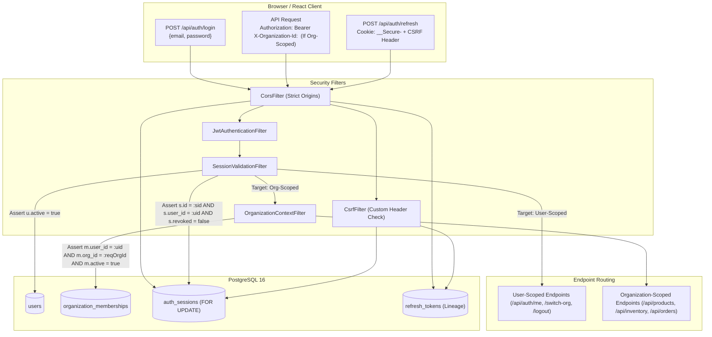
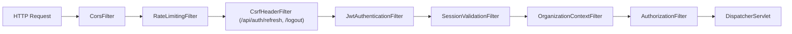

# STOCKGUARD — Security Architecture & Authentication Design

> **Document Status:** PROPOSED ARCHITECTURE FOR MILESTONE 3 (FINAL TECHNICAL SIGN-OFF REVISIONS)
> **Target Release:** Milestone 3 (Identity, Authentication & Organization Access Foundation)
> **Authoritative References:** [ADR-001](../architecture/adr/ADR-001-modular-monolith.md), [ADR-002](../architecture/adr/ADR-002-postgresql-source-of-truth.md), [ADR-010](../architecture/adr/ADR-010-authentication-and-session-management.md), [ADR-011](../architecture/adr/ADR-011-authorization-and-organization-access-control.md)

---

## 1. Executive Summary & Security Objectives

STOCKGUARD is a modular monolith powering high-concurrency inventory integrity and order reservations. This document defines the revised end-to-end security architecture, authentication lifecycle, multi-tenant isolation model, and Spring Security configuration.

### Core Security Objectives

1. **High-Concurrency Performance & Authoritative Verification:** Cryptographic access-token validation eliminates unnecessary signature lookup queries, while dynamic database queries validate that the underlying session, user, and tenant membership remain active in PostgreSQL.
2. **Immediate Revocation Latency:** Authorization revocation is effective on the next authorization check after the relevant database transaction commits. If an administrator deactivates a user, revokes an organization membership, or terminates a session, the very next request reflects this change immediately.
3. **Resilience to Token Theft & Complete Lineage Protection:** Refresh tokens are single-use, opaque credentials stored exclusively as SHA-256 hashes. Replaying an already-consumed token triggers immediate session-family revocation with zero backend grace period. Token lineage is protected against individual deletion (including unreferenced root tokens) via a dedicated database trigger, runtime privilege restrictions, and deferrable integrity constraints.
4. **Explicit Multi-Tenant Context:** Organization-scoped operations mandate an explicit tenant header (`X-Organization-Id`). Silent session fallbacks are prohibited, enabling seamless concurrent multi-organization operation across multiple browser tabs.
5. **Browser Security & Transport Protection:** Refresh tokens are transported via `__Secure-` cookies with `Path=/api/auth`, `HttpOnly`, and `Secure` attributes, completely inaccessible to JavaScript. Cookie-authenticated endpoints enforce explicit CSRF protection. Access JWTs reside in frontend memory.
6. **No External Infrastructure Dependencies:** No Redis, Kafka, or distributed caches. PostgreSQL 16 ACID transactions provide all persistence, row-level locking, and stateful security invariants.

---

## 2. Threat Modeling & Countermeasures

| Threat (STRIDE) | Attack Vector | Countermeasure & Architectural Defense |
|---|---|---|
| **Spoofing** | Forged JWT access token | HMAC-SHA256 signature verification using a minimum 256-bit secret key; validated `kid`, `iss`, and `aud`. |
| **Tampering** | Parameter tampering of `org_id` in request | Organization context is verified against PostgreSQL `organization_memberships`. Client cannot impersonate an organization without active membership. |
| **Repudiation** | Denying an inventory adjustment or order fulfillment | Immutable, append-only `audit_logs` record every security event, login, session revocation, and mutation. |
| **Information Disclosure** | Token leakage via client script (XSS) | Refresh tokens stored in `HttpOnly`, `__Secure-` cookies inaccessible to JavaScript. Access tokens reside solely in React memory (never `localStorage`). |
| **Denial of Service** | Credential stuffing & brute-force login | Single-instance in-memory token bucket rate limiting (5 attempts/min per IP/email); BCrypt cost factor 12 calibrated to $\approx 200 - 300$ ms. |
| **Elevation of Privilege** | Stale role elevation / concurrent sole-admin demotion | Dynamic PostgreSQL membership lookup on every organization request; serialized last-admin protection via `SELECT ... FOR UPDATE` on `organizations`. |

---

## 3. Identity and Credential Model

### Global Identity vs. Tenant Membership
* **`users` (Global Identity):** Represents an authenticated human or service identity across the entire platform. Contains `id` (PK), `email`, `normalized_email`, `password_hash`, and global `active` boolean flag.
* **`organization_memberships` (Tenant Role & Scope):** Represents the relationship between a global user and a specific organization. Declares `id` (PK), `user_id`, `organization_id`, `role` (`ADMIN`, `MANAGER`, `OPERATOR`, `VIEWER`), and membership `active` boolean status.

### Credential Normalization & Password Hashing
* **Email Normalization:** All emails are normalized using `lower(trim(email))` prior to database lookup or creation to prevent duplicate account spoofing.
* **BCrypt Hashing:**
  * Initial cost factor: **12**.
  * The cost factor must be benchmarked on target deployment hardware to achieve $\approx 200 - 300$ ms computation time.
  * Hashing duration is hardware-dependent and never assumed to be a fixed duration.

---

## 4. Authentication Architecture & Token Lifecycle



### 1. Login Flow (`POST /api/auth/login`)
1. **Client Submission:** Client submits JSON `{ "email": "user@example.com", "password": "..." }`.
2. **Credential Verification:**
   * Server normalizes email and retrieves `users` row.
   * Validates `users.active == TRUE`.
   * Evaluates `BCryptPasswordEncoder.matches(rawPassword, passwordHash)`.
3. **Membership Discovery:**
   * Queries `organization_memberships` for active memberships: `WHERE user_id = :userId AND active = TRUE`.
   * If zero active memberships exist: returns HTTP 403 Forbidden (`NO_ACTIVE_MEMBERSHIPS`).
4. **Session & Token Generation:**
   * Creates `auth_sessions` record anchored to the user (`user_id`), with absolute expiration of **30 days** (`NOW() + INTERVAL '30 days'`).
   * Generates a 256-bit cryptographically secure opaque refresh token $T_1$ via `SecureRandom` (Base64URL-encoded).
   * Persists SHA-256 hash of $T_1$ in `refresh_tokens` (`sequence_number = 1`, `expires_at = NOW() + INTERVAL '7 days'`).
   * Issues signed 15-minute JWT access token.
5. **Response Delivery:**
   * Response JSON contains: `{ "accessToken": "...", "tokenType": "Bearer", "expiresIn": 900, "user": {...}, "availableOrganizations": [...] }`.
   * Refresh token set in `HttpOnly`, `Secure` cookie (`__Secure-stockguard_refresh`) scoped to `/api/auth`.

---

### 2. Access Token (JWT) Structure & Request Validation

#### Header
```json
{
  "alg": "HS256",
  "typ": "JWT",
  "kid": "sg-2026-v1"
}
```

#### Payload (Claims)
```json
{
  "sub": "8a3d11b2-4521-4f12-a1b2-c3d4e5f6a7b8",
  "iss": "stockguard-platform",
  "aud": "stockguard-api",
  "iat": 1794500000,
  "exp": 1794500900,
  "jti": "d3b07384-d113-462c-a521-729906d34199",
  "email": "user@example.com",
  "session_id": "c1f2e3d4-b5a6-4789-9012-3456789abcde"
}
```

#### Request-Time Sequential Validation Pipeline
For all protected requests, authorization does not rely on static claims. The security filter chain executes:
1. **Cryptographic Validation (`JwtAuthenticationFilter`):**
   * Verifies HMAC-SHA256 signature against the active or retiring key matching `kid`.
   * Validates `exp > NOW()`, `iss == "stockguard-platform"`, `aud == "stockguard-api"`.
   * Establishes `StockGuardPrincipal(userId, sessionId, email)`.
2. **Dual-Bound Session & User Validation (`SessionValidationFilter`):**
   * Queries `auth_sessions` and `users`:
     ```sql
     SELECT s.revoked, s.expires_at, u.active AS user_active
     FROM auth_sessions s
     JOIN users u ON s.user_id = u.id
     WHERE s.id = :sessionId
       AND s.user_id = :userId;
     ```
   * Asserts `s.id = :sessionId` and `s.user_id = :userId` (verifies token subject matches session owner).
   * Asserts `s.revoked == FALSE` and `s.expires_at > CURRENT_TIMESTAMP`. If revoked or expired, aborts immediately with HTTP 401 Unauthorized (`SESSION_REVOKED` / `SESSION_EXPIRED`).
   * Asserts `u.user_active == TRUE`. If inactive, aborts with HTTP 401 Unauthorized (`USER_INACTIVE`).
3. **Endpoint Routing & Authoritative Membership Validation:**
   * **User-Scoped Endpoints:** (`GET /api/auth/me`, `POST /api/auth/switch-org`, `POST /api/auth/logout`): Proceed directly to controller.
   * **Organization-Scoped Endpoints:** (`/api/products/**`, `/api/inventory/**`, etc.):
     - **Mandatory Explicit Context:** Extracted explicitly from header `X-Organization-Id` (or route param). **No silent session fallbacks.** If missing, aborts immediately with HTTP `400 Bad Request` (`MISSING_ORGANIZATION_CONTEXT`).
     - **Assert Membership in PostgreSQL (`OrganizationContextFilter`):**
       ```sql
       SELECT m.role, m.active AS membership_active
       FROM organization_memberships m
       WHERE m.user_id = :userId
         AND m.organization_id = :requestedOrgId
         AND m.active = TRUE;
       ```
     - If no matching active row exists: aborts with HTTP 403 Forbidden (`INSUFFICIENT_TENANT_MEMBERSHIP`).
     - Dynamically binds current `role` and derived permissions to `OrganizationContextHolder`.
4. **Fail-Closed Security:**
   * Any database connection error or query failure aborts the request immediately with HTTP 500/503. Protected operations never fail open.
5. **Performance Target & Revocation Timing:**
   * An indexed join on `(s.id, u.id, m.organization_id)` targets $< 1$ ms execution time on typical production PostgreSQL 16 database infrastructure. This is an engineering performance target, not a verified benchmark.
   * Authorization revocation is effective on the next authorization check after the relevant database transaction commits.

---

### 3. Refresh Token Family, One-Way State Transition & Complete Integrity Architecture

#### Vulnerability of Unrestricted UPDATE, Foreign Keys Alone, and Multiple Active Tokens
In a three-generation lineage $T_1 \rightarrow T_2 \rightarrow T_3$, $T_1$ is replaced by $T_2$, and $T_2$ is replaced by $T_3$.
1. **Root-Token Deletion Risk:** No token references $T_1$. Therefore, relying on the self-referencing foreign key alone fails to prevent `DELETE FROM refresh_tokens WHERE id = T1.id`, which would destroy the root token and erase replay-detection history.
2. **Unrestricted UPDATE Tampering Risk:** Unrestricted table-level `UPDATE` allows rogue queries or compromised application code to rewrite historical records, reset consumed tokens to active, alter cryptographic token hashes, or rewrite lineage pointers, defeating replay protection.
3. **Multiple Active Tokens per Session Risk:** Without an explicit partial uniqueness constraint, concurrency races or transaction retries could insert multiple unconsumed tokens (`consumed_at IS NULL`) for a single session, subverting single-use rotation guarantees.

#### Active Refresh-Token Uniqueness: Partial Unique Index
```sql
CREATE UNIQUE INDEX uq_refresh_tokens_one_active_per_session
ON refresh_tokens (session_id)
WHERE consumed_at IS NULL;
```
* **Why Application Checks Alone Are Insufficient:** Concurrent HTTP requests executing in parallel can both observe zero unconsumed successor tokens and race to insert duplicate active tokens. A partial unique index guarantees that PostgreSQL's B-tree engine rejects competing active tokens with `SQLSTATE 23505`.
* **Atomic Rotation Semantics:** In a rotation transaction, the predecessor is updated (`consumed_at = NOW()`), dropping it from the partial index filter (`WHERE consumed_at IS NULL`). The successor is then inserted (`consumed_at = NULL`), taking its place as the sole active token for the session.

#### One-Way Token State Transition & Immutable Fields
* **One-Way State Transition:**
  * **`ACTIVE`:** `consumed_at IS NULL AND replaced_by_token_id IS NULL`
  * **`CONSUMED`:** `consumed_at IS NOT NULL AND replaced_by_token_id IS NOT NULL`
  * A consumed token is terminal and can never return to `ACTIVE`.
* **Immutable Fields:**
  * `id`, `session_id`, `token_hash`, `sequence_number`, `created_at`, `expires_at`.
  * These fields are immutable after insertion.
* **Replacement Pointer Integrity:**
  * Once `replaced_by_token_id` and `consumed_at` are set, they can never be modified or reset to `NULL`.

#### Complete Multi-Layered Protection Strategy
1. **PostgreSQL UPDATE Trigger (One-Way Transition Enforcement):**
   ```sql
   CREATE OR REPLACE FUNCTION enforce_refresh_token_update_rules()
   RETURNS TRIGGER AS $$
   BEGIN
       -- 1. Immutable Columns Protection
       IF NEW.id <> OLD.id OR
          NEW.session_id <> OLD.session_id OR
          NEW.token_hash <> OLD.token_hash OR
          NEW.sequence_number <> OLD.sequence_number OR
          NEW.created_at <> OLD.created_at OR
          NEW.expires_at <> OLD.expires_at THEN
           RAISE EXCEPTION 'Updates to immutable columns of refresh_tokens (id, session_id, token_hash, sequence_number, created_at, expires_at) are prohibited.'
           USING ERRCODE = '55000';
       END IF;

       -- 2. Consumed Tokens are Terminal and Immutable
       IF OLD.consumed_at IS NOT NULL OR OLD.replaced_by_token_id IS NOT NULL THEN
           RAISE EXCEPTION 'Consumed refresh tokens are terminal and cannot be modified, reactivated, or re-pointed (token id: %).', OLD.id
           USING ERRCODE = '55000';
       END IF;

       -- 3. One-Way State Transition: ACTIVE -> CONSUMED
       IF NEW.consumed_at IS NULL OR NEW.replaced_by_token_id IS NULL THEN
           RAISE EXCEPTION 'Invalid transition: refresh tokens can only transition from ACTIVE to CONSUMED by setting both consumed_at and replaced_by_token_id.'
           USING ERRCODE = '55000';
       END IF;

       RETURN NEW;
   END;
   $$ LANGUAGE plpgsql;

   CREATE TRIGGER trg_refresh_tokens_enforce_one_way_transition
   BEFORE UPDATE ON refresh_tokens
   FOR EACH ROW
   EXECUTE FUNCTION enforce_refresh_token_update_rules();
   ```

2. **PostgreSQL Deletion-Prevention Trigger (Root and Lineage Protection):**
   ```sql
   CREATE OR REPLACE FUNCTION prevent_direct_refresh_token_delete()
   RETURNS TRIGGER AS $$
   BEGIN
       IF EXISTS (SELECT 1 FROM auth_sessions WHERE id = OLD.session_id) THEN
           RAISE EXCEPTION 'Direct deletion of refresh_token (id: %) is prohibited. Tokens are append-only and may only be purged via auth_sessions cleanup.', OLD.id
           USING ERRCODE = '55000';
       END IF;
       RETURN OLD;
   END;
   $$ LANGUAGE plpgsql;

   CREATE TRIGGER trg_refresh_tokens_prevent_direct_delete
   BEFORE DELETE ON refresh_tokens
   FOR EACH ROW
   EXECUTE FUNCTION prevent_direct_refresh_token_delete();
   ```

3. **Check Constraint Integrity:**
   ```sql
   CONSTRAINT chk_refresh_tokens_consumed_replacement CHECK (
       (consumed_at IS NULL AND replaced_by_token_id IS NULL) OR
       (consumed_at IS NOT NULL AND replaced_by_token_id IS NOT NULL)
   )
   ```

4. **Deferrable Replacement Integrity Constraint:**
   ```sql
   CONSTRAINT fk_refresh_tokens_same_session_replacement
       FOREIGN KEY (session_id, replaced_by_token_id)
       REFERENCES refresh_tokens(session_id, id)
       ON DELETE NO ACTION DEFERRABLE INITIALLY DEFERRED
   ```

5. **Runtime vs. Migration Role Boundaries & Column-Level Privilege Restrictions:**
   * **`stockguard_owner` (Migration / Schema Owner):** Possesses full DDL rights. Used strictly for Flyway migrations.
   * **`stockguard_app` (Runtime Application Role):** Dedicated non-owner role for the Spring Boot application:
     * `WITH LOGIN NOSUPERUSER NOCREATEDB NOCREATEROLE NOINHERIT;`.
     * Does not inherit `stockguard_owner`; cannot `SET ROLE stockguard_owner`.
     * Cannot disable or bypass triggers; no DDL privileges.
     * Permissions:
       ```sql
       REVOKE ALL ON refresh_tokens FROM stockguard_app;
       GRANT SELECT, INSERT ON refresh_tokens TO stockguard_app;
       GRANT UPDATE (consumed_at, replaced_by_token_id) ON refresh_tokens TO stockguard_app;
       GRANT SELECT, INSERT, UPDATE, DELETE ON auth_sessions TO stockguard_app;
       ```

---

### 4. Browser Token Transport & CSRF Protection

#### Cookie Specification & Cross-Site Guidance
* **Production Cookie (`__Secure-`):**
  * **Name:** `__Secure-stockguard_refresh`
  * **Path:** `/api/auth`
  * **Secure:** `true` (enforced via HTTPS)
  * **HttpOnly:** `true` (prohibits JavaScript access)
  * **Domain:** Omitted (host-only)
* **Deployment Topology & SameSite Policy:**
  * **Unified Same-Site Deployment (Strongly Preferred):** Where practical, host the frontend SPA and backend API under a shared registrable domain (e.g., `app.stockguard.com` and `api.stockguard.com`, or via a reverse proxy under `/api`). In this topology, set **`SameSite=Strict`**.
  * **Cross-Site Deployment (Distinct Registrar Domains):** If deployed across distinct registrar domains (e.g. `app.frontend.com` and `api.backend.com`), `SameSite=Lax` is **insufficient** because browsers withhold `SameSite=Lax` cookies on cross-site fetch/XHR `POST` requests. In cross-site environments, the cookie **must** declare **`SameSite=None; Secure`**, paired with:
    1. Mandatory Origin header validation against a strict whitelist;
    2. Strict CORS policy with `allowCredentials=true`; and
    3. Explicit anti-CSRF custom request header validation (`X-StockGuard-CSRF: 1`).
* **Local-Development Cookie:**
  * **Name:** `stockguard_refresh`
  * **Path:** `/api/auth`
  * **Secure:** `false` (permits local HTTP testing on localhost)
  * **HttpOnly:** `true`
  * **SameSite:** `Lax`

---

### 5. Organization Switching Semantics

In a multi-tenant platform where users belong to multiple organizations:
1. **Target Membership Validation:**
   When a user selects a different organization in the frontend, the client calls `POST /api/auth/switch-org` with body `{ "targetOrganizationId": "<UUID>" }`. The server validates that `organization_memberships` contains an active row where `user_id = :userId AND organization_id = :targetOrgId AND active = TRUE`.
2. **Session Persistence vs. Stateless Scope:**
   The persisted `auth_sessions` record represents the user's login session on that device. It is **not** mutated during organization switching. The session remains valid for the global user. The endpoint returns the validated tenant details: `{ "organizationId": "<UUID>", "role": "<role>", "permissions": [...] }`.
3. **Concurrent Tabs Handling:**
   Because tenant context is passed explicitly via the `X-Organization-Id` request header on each API call, **multiple browser tabs can operate concurrently in different organizations under the same login session without state collision** (e.g. Tab 1 manages Warehouse A with `X-Organization-Id: <OrgA>`, while Tab 2 monitors Audits in Org B with `X-Organization-Id: <OrgB>`). No server-side session variable is overwritten.
4. **Immediate Invalidation of Previous Context:**
   Because the server dynamically evaluates `organization_memberships` on every organization-scoped request, if an administrator deactivates a user's membership in Organization A, any subsequent request passing `X-Organization-Id: <OrgA>` is rejected with HTTP 403 Forbidden on the next authorization check after the transaction commits, regardless of active tab state.
5. **Rejection Semantics:**
   - Missing header on org-scoped endpoint: HTTP `400 Bad Request` (`MISSING_ORGANIZATION_CONTEXT`).
   - Malformed UUID: HTTP `400 Bad Request` (`INVALID_ORGANIZATION_CONTEXT`).
   - Inactive or non-member: HTTP `403 Forbidden` (`INSUFFICIENT_TENANT_MEMBERSHIP`).

---

### 6. Planned PostgreSQL 16 Testcontainers Verification Specification

To ensure rigorous validation of relational integrity, the planned test suite in `RefreshTokenLineageIntegrityTest.java` comprises **19 integration test cases** architecturally separated into **four independent test groups**, isolating runtime-role privilege checks from database trigger and constraint evaluations.

> [!IMPORTANT]
> **Independent Testing Principle:**
> PostgreSQL evaluates SQL statement permissions (Layer 1) before executing triggers (Layer 2). If a query executed as `stockguard_app` attempts `DELETE FROM refresh_tokens`, PostgreSQL rejects it at Layer 1 with `SQLSTATE 42501` (`insufficient_privilege`). Execution never reaches the trigger.
> Therefore:
> - Privilege tests must run under `stockguard_app` to verify that unauthorized operations are blocked at the SQL privilege boundary (`SQLSTATE 42501`).
> - Trigger tests must run under a separate privileged test role (`stockguard_test_privileged`) with table-level permissions to verify that trigger logic fires and rejects violations (`SQLSTATE 55000`).
> Under no circumstances may a test suite claim a trigger was verified if a runtime privilege error prevented execution from reaching it.
>
> All test cases below represent the **planned verification suite** for Milestone 3 Phase 8; none have been executed during this design phase.

#### Part A: Active Refresh-Token Uniqueness & Atomic Rotation Tests (6 Cases)
1. **Insert One Active Token per Session (Succeeds):**
   - Seed session $S_1$. Insert token $T_1$ with `consumed_at = NULL`.
   - Assert: Row exists in `ACTIVE` state.
2. **Insert Duplicate Active Token in Same Session (Rejection):**
   - Attempt: Insert token $T_2$ for $S_1$ with `consumed_at = NULL`.
   - Assert: Rejected with `SQLSTATE 23505` (`unique_violation` targeting index `uq_refresh_tokens_one_active_per_session`).
3. **Insert Active Token for Distinct Session (Succeeds):**
   - Seed session $S_2$. Insert token $T_{s2}$ for $S_2$ with `consumed_at = NULL`.
   - Assert: Succeeds cleanly; index is partitioned per `session_id`.
4. **Atomic Token Rotation (Succeeds):**
   - In a single transaction: `UPDATE refresh_tokens SET consumed_at = NOW(), replaced_by_token_id = T2.id WHERE id = T1.id` followed by `INSERT INTO refresh_tokens (session_id, token_hash, sequence_number, consumed_at, replaced_by_token_id, ...) VALUES (S1.id, ..., NULL, NULL, ...)`.
   - Assert: Transaction commits cleanly; $T_1$ is `CONSUMED`, $T_2$ is `ACTIVE`.
5. **Concurrent Successor Issuance Race Condition (At Most One Succeeds):**
   - Two concurrent threads attempt rotation for $S_1$.
   - Assert: Exactly one transaction commits successor token; competing transaction fails with `SQLSTATE 23505` (or serialization failure), guaranteeing no duplicate active tokens.
6. **Zero Duplicate Active Tokens Invariant:**
   - Query: `SELECT session_id, COUNT(*) FROM refresh_tokens WHERE consumed_at IS NULL GROUP BY session_id HAVING COUNT(*) > 1;`
   - Assert: Returns exactly `0` rows.

#### Part B: Runtime Role Privilege Boundary Tests (Role: `stockguard_app`, 5 Cases)
1. **Table-Level DELETE Privilege Revocation:**
   - Connect as `stockguard_app`. Attempt: `DELETE FROM refresh_tokens WHERE id = T1.id`.
   - Assert: Rejected with `SQLSTATE 42501` (permission denied for table `refresh_tokens`). Trigger is not evaluated.
2. **Column-Level UPDATE Restriction on Immutable Columns:**
   - Connect as `stockguard_app`. Attempt: `UPDATE refresh_tokens SET token_hash = '00...00' WHERE id = T1.id`.
   - Assert: Rejected with `SQLSTATE 42501` (permission denied for column `token_hash`).
   - Repeat for `session_id` and `sequence_number`; assert `SQLSTATE 42501`.
3. **Permitted One-Way Transition:**
   - Connect as `stockguard_app`. Execute: `UPDATE refresh_tokens SET consumed_at = NOW(), replaced_by_token_id = T2.id WHERE id = T1.id`.
   - Assert: Succeeds cleanly (column-level UPDATE granted on `consumed_at` and `replaced_by_token_id`).

#### Part C: Database Trigger & Constraint Integrity Tests (Role: `stockguard_test_privileged`, 6 Cases)
Connect as privileged test role possessing table-level permissions to directly test trigger logic:
1. **Direct Deletion of Root Token Rejection:**
   - Attempt: `DELETE FROM refresh_tokens WHERE id = T1.id` (while session $S_1$ exists).
   - Assert: Rejected with `SQLSTATE 55000` via trigger `prevent_direct_refresh_token_delete()`.
2. **Direct Deletion of Intermediate Token Rejection:**
   - Attempt: `DELETE FROM refresh_tokens WHERE id = T2.id` (while session $S_1$ exists).
   - Assert: Rejected with `SQLSTATE 55000` via trigger `prevent_direct_refresh_token_delete()`.
3. **Immutable Column UPDATE Rejection:**
   - Attempt: `UPDATE refresh_tokens SET token_hash = '00...00' WHERE id = T1.id`.
   - Assert: Rejected with `SQLSTATE 55000` via trigger `enforce_refresh_token_update_rules()`.
4. **Consumed Token Reactivation Rejection:**
   - Attempt: `UPDATE refresh_tokens SET consumed_at = NULL, replaced_by_token_id = NULL WHERE id = T1.id`.
   - Assert: Rejected with `SQLSTATE 55000` via trigger `enforce_refresh_token_update_rules()` (or `SQLSTATE 23514` via check constraint).
5. **Replacement Pointer Modification Rejection:**
   - Attempt: `UPDATE refresh_tokens SET replaced_by_token_id = T3.id WHERE id = T1.id`.
   - Assert: Rejected with `SQLSTATE 55000` via trigger `enforce_refresh_token_update_rules()`.
6. **Direct Deletion of Active Child in Multi-Generation Lineage (Case 16b):**
   - Attempt: `DELETE FROM refresh_tokens WHERE id = T3.id` in lineage $T_1 \rightarrow T_2 \rightarrow T_3$ (while session $S_1$ exists).
   - Assert: Rejected with `SQLSTATE 55000` via trigger `prevent_direct_refresh_token_delete()` (and cross-session replacement linkage rejected with `SQLSTATE 23503` via `fk_refresh_tokens_same_session_replacement`).

#### Part D: Cascading Complete Session Cleanup Tests (Role: `stockguard_test_privileged`, 2 Cases)
1. **Cascade Deletion of Entire Session Family:**
   - Execute: `DELETE FROM auth_sessions WHERE id = S1.id`.
   - Assert: Transaction commits cleanly; $S_1$ and all descendant tokens ($T_1, T_2, T_3$) are deleted cleanly.
2. **Zero-Orphan Verification:**
   - Query: `SELECT COUNT(*) FROM refresh_tokens WHERE session_id = S1.id`.
   - Assert: Exactly `0` rows remain.

---

## 7. Multi-Tenant Organization Boundary Enforcement & Last-Admin Protection

Isolation is enforced across four defense layers:

```
[Layer 1: Filter Layer — Cryptographic Identity & Context Injection]
   JwtAuthenticationFilter validates token; SessionValidationFilter & OrganizationContextFilter validate DB state.

[Layer 2: Controller Layer — Endpoint Authorization]
   Spring Security @PreAuthorize checks active organization role and permissions.

[Layer 3: Service Layer — Domain Authorization & Concurrency Locks]
   Service methods retrieve active orgId from OrganizationContextHolder; serialize admin changes.

[Layer 4: Data Layer — SQL Filtering & Composite Database Keys]
   All SQL queries include WHERE organization_id = :orgId; PostgreSQL composite FKs abort cross-tenant joins.
```

### Concurrency-Safe Last-Admin Protection
To ensure an organization is never left without an active administrator:
```java
@Transactional
public void updateMemberRole(UUID orgId, UUID targetUserId, Role newRole) {
    // 1. Acquire exclusive row lock on the organization
    jdbcTemplate.queryForObject(
        "SELECT id FROM organizations WHERE id = ? FOR UPDATE",
        UUID.class, orgId
    );

    // 2. Count active administrators within the locked transaction
    Long adminCount = jdbcTemplate.queryForObject(
        "SELECT COUNT(*) FROM organization_memberships WHERE organization_id = ? AND role = 'ADMIN' AND active = TRUE",
        Long.class, orgId
    );

    // 3. Prevent demotion or deactivation of sole remaining admin
    OrganizationMembership member = membershipRepository.findByOrgAndUser(orgId, targetUserId);
    if (member.getRole() == Role.ADMIN && newRole != Role.ADMIN && adminCount <= 1) {
        throw new IllegalStateException("Cannot demote the sole remaining administrator for the organization");
    }

    // 4. Execute update
    member.setRole(newRole);
    membershipRepository.save(member);
}
```

---

## 8. Spring Security Filter Chain Configuration



* **Session Management:** `SessionCreationPolicy.STATELESS`.
* **CSRF Configuration:** Disabled globally for Bearer-authenticated endpoints; custom header verification enforced for cookie endpoints (`/api/auth/refresh`, `/api/auth/logout`).
* **CORS Policy:** Explicit allowed origins (e.g. `http://localhost:5173`), `allowCredentials = true`, allowed headers (`Authorization`, `Content-Type`, `X-StockGuard-CSRF`, `X-Organization-Id`).

---

## 9. Rate Limiting & Sensitive Data Handling

* **In-Memory Rate Limiting:**
  * Single-instance MVP protection via thread-safe sliding window token bucket.
  * Thresholds: `/api/auth/login` (5/min per IP/email), `/api/auth/refresh` (20/min per IP).
  * Limitations: Counters are per-instance and reset on restart. Reverse proxy or edge gateway recommended for multi-instance production.
* **Sensitive Data Redaction:**
  * Raw passwords and raw refresh tokens are never written to logs or audit records.
  * All DTOs suppress credential fields in `toString()`.
  * Security events logged to append-only `audit_logs`.
