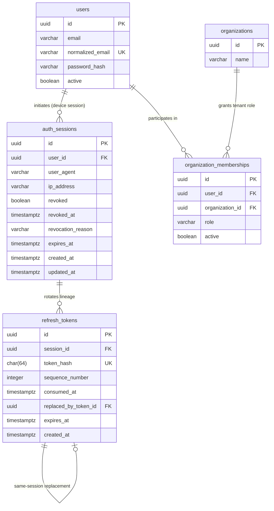

# STOCKGUARD — V3 Auth Database Schema Proposal

> **Document Status:** PROPOSED DATABASE SPECIFICATION FOR MILESTONE 3 (FINAL TECHNICAL SIGN-OFF REVISIONS)
> **Target Version:** Milestone 3 (`V3__create_auth_and_session_tables.sql`)
> **Authoritative References:** [DATABASE_SCHEMA_SPECIFICATION.md](../database/DATABASE_SCHEMA_SPECIFICATION.md), [ADR-010](../architecture/adr/ADR-010-authentication-and-session-management.md), [Security Architecture](security-architecture.md)

---

## 1. Executive Summary & Context

Milestone 2 finalized the 16 core MVP tables in `V1__create_initial_schema.sql` and established append-only ledger and audit protections in `V2__enforce_append_only_ledgers.sql`.

In `DATABASE_SCHEMA_SPECIFICATION.md`, the `users.password_hash` column was declared nullable (`VARCHAR(255) NULL`) to preserve architectural neutrality pending the resolution of authentication and session management design.

Following the owner's final technical sign-off review:
1. **JWT access tokens** (15-minute lifespan, held in client memory);
2. **Database-backed refresh sessions** (sliding 7-day token expiration, 30-day absolute session ceiling), anchored cleanly to the global user (`user_id`);
3. **Explicit organization context** (mandated via `X-Organization-Id` for all tenant-scoped operations, eliminating ambiguous session fallbacks);
4. **Cryptographically secure, opaque refresh tokens stored only as SHA-256 hashes**;
5. **Strict single-use rotation with immediate reuse detection and family revocation (zero backend grace period)**;
6. **Browser cookie transport (`__Secure-` cookie with `Path=/api/auth`) with explicit CSRF protection**;
7. **Complete token deletion protection** combining a PostgreSQL trigger (prohibiting individual deletions including root tokens), deferred foreign keys (`ON DELETE NO ACTION DEFERRABLE INITIALLY DEFERRED`), and database privilege restrictions; and
8. **Spring Security BCrypt password hashing (cost factor 12)**;

this document specifies the exact relational schema additions for the upcoming **V3 Flyway Migration** (`V3__create_auth_and_session_tables.sql`).

> [!IMPORTANT]
> **Zero Changes to Existing Migrations:**
> `V1__create_initial_schema.sql` and `V2__enforce_append_only_ledgers.sql` remain strictly **untouched**. The tables, constraints, and triggers specified below will be introduced in a new, forward-only V3 migration script during Milestone 3 implementation.

---

## 2. Relational Schema Architecture (Session Family Model)



---

## 3. Detailed Table Specifications

### 1. `auth_sessions` (Session Family Root)
Represents an active client login session on a user's device/browser. Serves as the parent anchor for token rotation lineage and enables instantaneous session revocation. Anchored cleanly to the global user (`user_id`), avoiding redundant or ambiguous tenant context.

#### Columns
| Column | Data Type | Nullable | Default | Description |
|---|---|:---:|---|---|
| `id` | `UUID` | No | `gen_random_uuid()` | Primary key |
| `user_id` | `UUID` | No | — | Owning global user (`users.id`) |
| `user_agent` | `VARCHAR(500)` | Yes | — | Client device / browser user-agent string |
| `ip_address` | `VARCHAR(45)` | Yes | — | Client IP address at session creation (IPv4/IPv6) |
| `revoked` | `BOOLEAN` | No | `FALSE` | Session-family revocation status flag |
| `revoked_at` | `TIMESTAMPTZ` | Yes | — | Timestamp of session revocation |
| `revocation_reason` | `VARCHAR(100)` | Yes | — | Reason code (`LOGOUT`, `REUSE_DETECTED`, `USER_DEACTIVATED`, `ADMIN_REVOKED`, `EMERGENCY_KEY_ROTATION`) |
| `expires_at` | `TIMESTAMPTZ` | No | — | Absolute maximum session lifespan (default: 30 days) |
| `created_at` | `TIMESTAMPTZ` | No | `CURRENT_TIMESTAMP` | Session creation timestamp |
| `updated_at` | `TIMESTAMPTZ` | No | `CURRENT_TIMESTAMP` | Last activity / token rotation timestamp |

#### Constraints
* `PRIMARY KEY (id)`
* `CONSTRAINT fk_auth_sessions_user FOREIGN KEY (user_id) REFERENCES users(id) ON DELETE CASCADE`
* `CONSTRAINT chk_auth_sessions_revocation_pair CHECK ((revoked = FALSE AND revoked_at IS NULL AND revocation_reason IS NULL) OR (revoked = TRUE AND revoked_at IS NOT NULL AND revocation_reason IS NOT NULL))`
* `CONSTRAINT chk_auth_sessions_expires_after_created CHECK (expires_at > created_at)`

#### Indexes
* `CREATE INDEX idx_auth_sessions_user ON auth_sessions (user_id);` (Supports user active-session queries and bulk user-revocation)
* `CREATE INDEX idx_auth_sessions_expires ON auth_sessions (expires_at) WHERE revoked = FALSE;` (Supports background cleanup worker)

---

### 2. `refresh_tokens` (Token Rotation Lineage & Deletion Integrity)
Stores every refresh token ever issued in a session family. Enables strict single-use tracking, rotation history, same-session lineage integrity, and cryptographic token reuse detection.

#### Columns
| Column | Data Type | Nullable | Default | Description |
|---|---|:---:|---|---|
| `id` | `UUID` | No | `gen_random_uuid()` | Primary key |
| `session_id` | `UUID` | No | — | Parent session (`auth_sessions.id`) |
| `token_hash` | `CHAR(64)` | No | — | Hex-encoded SHA-256 hash of the raw opaque token string |
| `sequence_number` | `INTEGER` | No | — | Monotonically increasing rotation counter ($1, 2, 3, \dots$) |
| `consumed_at` | `TIMESTAMPTZ` | Yes | — | Timestamp when the token was exchanged for a successor (NULL while active) |
| `replaced_by_token_id`| `UUID` | Yes | — | Pointer to the successor token issued during rotation |
| `expires_at` | `TIMESTAMPTZ` | No | — | Sliding token rotation deadline (default: 7 days, capped by session expiration) |
| `created_at` | `TIMESTAMPTZ` | No | `CURRENT_TIMESTAMP` | Token generation timestamp |

#### Constraints & Foreign Keys
* `PRIMARY KEY (id)`
* `CONSTRAINT uq_refresh_tokens_hash UNIQUE (token_hash)` (Guarantees no two tokens share a hash)
* `CONSTRAINT uq_refresh_tokens_session_seq UNIQUE (session_id, sequence_number)` (Strict monotonic ordering per session)
* `CONSTRAINT uq_refresh_tokens_session_token UNIQUE (session_id, id)` (Enables composite foreign key reference)
* `CONSTRAINT chk_refresh_tokens_hash_format CHECK (token_hash ~ '^[0-9a-f]{64}$')` (Strict lowercase SHA-256 hexadecimal check)
* `CONSTRAINT chk_refresh_tokens_seq CHECK (sequence_number > 0)`
* `CONSTRAINT chk_refresh_tokens_consumed_replacement CHECK ((consumed_at IS NULL AND replaced_by_token_id IS NULL) OR (consumed_at IS NOT NULL AND replaced_by_token_id IS NOT NULL))`
* `CONSTRAINT fk_refresh_tokens_session FOREIGN KEY (session_id) REFERENCES auth_sessions(id) ON DELETE CASCADE`
* **Same-Session Replacement Enforcement with Deferrable Cleanup:**
  ```sql
  CONSTRAINT fk_refresh_tokens_same_session_replacement
      FOREIGN KEY (session_id, replaced_by_token_id)
      REFERENCES refresh_tokens(session_id, id)
      ON DELETE NO ACTION DEFERRABLE INITIALLY DEFERRED
  ```

#### Complete Token State Transition & Deletion-Protection Architecture
* **The Root-Token Deletion Vulnerability:** In a lineage $T_1 \rightarrow T_2 \rightarrow T_3$, no token in the table references root token $T_1$. Therefore, relying on foreign keys alone cannot prevent `DELETE FROM refresh_tokens WHERE id = T1.id`.
* **The Unrestricted UPDATE Tampering Vulnerability:** Unrestricted table-level `UPDATE` allows application code or rogue SQL queries to rewrite token hashes, sequence numbers, session associations, or reset consumed tokens back to active, destroying replay detection.
* **The Multiple Active Tokens Vulnerability:** Without a partial unique index, concurrent rotation requests or transaction races could commit multiple unconsumed tokens (`consumed_at IS NULL`) for the same session.
* **Active Refresh-Token Uniqueness Index:**
  ```sql
  CREATE UNIQUE INDEX uq_refresh_tokens_one_active_per_session
  ON refresh_tokens (session_id)
  WHERE consumed_at IS NULL;
  ```
  *Guarantees at the database engine level that at most one active refresh token exists per session family.*
* **Atomic Rotation Behavior:** Predecessor is updated (`consumed_at = NOW(), replaced_by_token_id = :childId`), dropping it from the partial index filter (`WHERE consumed_at IS NULL`). Successor is then inserted (`consumed_at = NULL`), taking its place as the sole active token in the same transaction.
* **One-Way State Transition:**
  * **`ACTIVE`:** `consumed_at IS NULL AND replaced_by_token_id IS NULL`
  * **`CONSUMED`:** `consumed_at IS NOT NULL AND replaced_by_token_id IS NOT NULL`
  * Tokens transition from `ACTIVE` to `CONSUMED` exactly once during valid single-use rotation. Consumed tokens are terminal and immutable.
* **Immutable Fields:** `id`, `session_id`, `token_hash`, `sequence_number`, `created_at`, `expires_at`. Once set, `consumed_at` and `replaced_by_token_id` cannot be modified or cleared.

* **PostgreSQL UPDATE Trigger (One-Way Transition Enforcement):**
  ```sql
  CREATE OR REPLACE FUNCTION enforce_refresh_token_update_rules()
  RETURNS TRIGGER AS $$
  BEGIN
      -- 1. Immutable Columns Protection
      IF NEW.id <> OLD.id OR
         NEW.session_id <> OLD.session_id OR
         NEW.token_hash <> OLD.token_hash OR
         NEW.sequence_number <> OLD.sequence_number OR
         NEW.created_at <> OLD.created_at OR
         NEW.expires_at <> OLD.expires_at THEN
          RAISE EXCEPTION 'Updates to immutable columns of refresh_tokens (id, session_id, token_hash, sequence_number, created_at, expires_at) are prohibited.'
          USING ERRCODE = '55000';
      END IF;

      -- 2. Consumed Tokens are Terminal and Immutable
      IF OLD.consumed_at IS NOT NULL OR OLD.replaced_by_token_id IS NOT NULL THEN
          RAISE EXCEPTION 'Consumed refresh tokens are terminal and cannot be modified, reactivated, or re-pointed (token id: %).', OLD.id
          USING ERRCODE = '55000';
      END IF;

      -- 3. One-Way State Transition: ACTIVE -> CONSUMED
      IF NEW.consumed_at IS NULL OR NEW.replaced_by_token_id IS NULL THEN
          RAISE EXCEPTION 'Invalid transition: refresh tokens can only transition from ACTIVE to CONSUMED by setting both consumed_at and replaced_by_token_id.'
          USING ERRCODE = '55000';
      END IF;

      RETURN NEW;
  END;
  $$ LANGUAGE plpgsql;

  CREATE TRIGGER trg_refresh_tokens_enforce_one_way_transition
  BEFORE UPDATE ON refresh_tokens
  FOR EACH ROW
  EXECUTE FUNCTION enforce_refresh_token_update_rules();
  ```

* **PostgreSQL Deletion-Prevention Trigger (Lineage Protection):**
  ```sql
  CREATE OR REPLACE FUNCTION prevent_direct_refresh_token_delete()
  RETURNS TRIGGER AS $$
  BEGIN
      IF EXISTS (SELECT 1 FROM auth_sessions WHERE id = OLD.session_id) THEN
          RAISE EXCEPTION 'Direct deletion of refresh_token (id: %) is prohibited. Tokens are append-only and may only be purged via auth_sessions cleanup.', OLD.id
          USING ERRCODE = '55000';
      END IF;
      RETURN OLD;
  END;
  $$ LANGUAGE plpgsql;

  CREATE TRIGGER trg_refresh_tokens_prevent_direct_delete
  BEFORE DELETE ON refresh_tokens
  FOR EACH ROW
  EXECUTE FUNCTION prevent_direct_refresh_token_delete();
  ```

* **Runtime Database Role Boundary vs. Migration Owner Role:**
  * **`stockguard_owner` (Migration / Schema Owner):** Holds full DDL privileges (`CREATE`, `ALTER`, `DROP`) and owns all schema objects. Used strictly by Flyway migration runners.
  * **`stockguard_app` (Runtime Application Role):** Dedicated non-owner runtime database user for the Spring Boot application connection pool:
    * Declared `WITH LOGIN NOSUPERUSER NOCREATEDB NOCREATEROLE NOINHERIT;`.
    * Does not inherit `stockguard_owner`; cannot `SET ROLE stockguard_owner`.
    * Cannot disable or bypass triggers; no DDL privileges on schema `public`.
    * Permissions:
      ```sql
      REVOKE ALL ON refresh_tokens FROM stockguard_app;
      GRANT SELECT, INSERT ON refresh_tokens TO stockguard_app;
      GRANT UPDATE (consumed_at, replaced_by_token_id) ON refresh_tokens TO stockguard_app;
      GRANT SELECT, INSERT, UPDATE, DELETE ON auth_sessions TO stockguard_app;
      ```

#### Indexes
* `CREATE UNIQUE INDEX uq_refresh_tokens_one_active_per_session ON refresh_tokens (session_id) WHERE consumed_at IS NULL;` (Guarantees at most one active token per session)
* `CREATE INDEX idx_refresh_tokens_session ON refresh_tokens (session_id);` (Supports family traversal)
* `CREATE INDEX idx_refresh_tokens_active ON refresh_tokens (token_hash) WHERE consumed_at IS NULL;` (Ultra-fast active token lookup)
* `CREATE INDEX idx_refresh_tokens_expires ON refresh_tokens (expires_at);` (Supports cleanup worker)

---

## 4. Planned PostgreSQL 16 Testcontainers Verification Specification

To ensure rigorous validation of relational integrity, the planned test suite in `RefreshTokenLineageIntegrityTest.java` comprises **19 integration test cases** architecturally separated into **four independent test groups**, isolating runtime-role privilege checks from database trigger and constraint evaluations.

> [!IMPORTANT]
> **Independent Testing Principle:**
> PostgreSQL evaluates SQL statement permissions (Layer 1) before executing triggers (Layer 2). If a query executed as `stockguard_app` attempts `DELETE FROM refresh_tokens`, PostgreSQL rejects it at Layer 1 with `SQLSTATE 42501` (`insufficient_privilege`). Execution never reaches the trigger.
> Therefore:
> - Privilege tests must run under `stockguard_app` to verify that unauthorized operations are blocked at the SQL privilege boundary (`SQLSTATE 42501`).
> - Trigger tests must run under a separate privileged test role (`stockguard_test_privileged`) with table-level permissions to verify that trigger logic fires and rejects violations (`SQLSTATE 55000`).
> Under no circumstances may a test suite claim a trigger was verified if a runtime privilege error prevented execution from reaching it.
>
> All test cases below represent the **planned verification suite** for Milestone 3 Phase 8; none have been executed during this design phase.

#### Part A: Active Refresh-Token Uniqueness & Atomic Rotation Tests (6 Cases)
1. **Insert One Active Token per Session (Succeeds):**
   - Seed session $S_1$. Insert token $T_1$ with `consumed_at = NULL`.
   - Assert: Row exists in `ACTIVE` state.
2. **Insert Duplicate Active Token in Same Session (Rejection):**
   - Attempt: Insert token $T_2$ for $S_1$ with `consumed_at = NULL`.
   - Assert: Rejected with `SQLSTATE 23505` (`unique_violation` targeting index `uq_refresh_tokens_one_active_per_session`).
3. **Insert Active Token for Distinct Session (Succeeds):**
   - Seed session $S_2$. Insert token $T_{s2}$ for $S_2$ with `consumed_at = NULL`.
   - Assert: Succeeds cleanly; index is partitioned per `session_id`.
4. **Atomic Token Rotation (Succeeds):**
   - In a single transaction: `UPDATE refresh_tokens SET consumed_at = NOW(), replaced_by_token_id = T2.id WHERE id = T1.id` followed by `INSERT INTO refresh_tokens (session_id, token_hash, sequence_number, consumed_at, replaced_by_token_id, ...) VALUES (S1.id, ..., NULL, NULL, ...)`.
   - Assert: Transaction commits cleanly; $T_1$ is `CONSUMED`, $T_2$ is `ACTIVE`.
5. **Concurrent Successor Issuance Race Condition (At Most One Succeeds):**
   - Two concurrent threads attempt rotation for $S_1$.
   - Assert: Exactly one transaction commits successor token; competing transaction fails with `SQLSTATE 23505` (or serialization failure), guaranteeing no duplicate active tokens.
6. **Zero Duplicate Active Tokens Invariant:**
   - Query: `SELECT session_id, COUNT(*) FROM refresh_tokens WHERE consumed_at IS NULL GROUP BY session_id HAVING COUNT(*) > 1;`
   - Assert: Returns exactly `0` rows.

#### Part B: Runtime Role Privilege Boundary Tests (Role: `stockguard_app`, 5 Cases)
1. **Table-Level DELETE Privilege Revocation:**
   - Connect as `stockguard_app`. Attempt: `DELETE FROM refresh_tokens WHERE id = T1.id`.
   - Assert: Rejected with `SQLSTATE 42501` (permission denied for table `refresh_tokens`). Trigger is not evaluated.
2. **Column-Level UPDATE Restriction on Immutable Columns:**
   - Connect as `stockguard_app`. Attempt: `UPDATE refresh_tokens SET token_hash = '00...00' WHERE id = T1.id`.
   - Assert: Rejected with `SQLSTATE 42501` (permission denied for column `token_hash`).
   - Repeat for `session_id` and `sequence_number`; assert `SQLSTATE 42501`.
3. **Permitted One-Way Transition:**
   - Connect as `stockguard_app`. Execute: `UPDATE refresh_tokens SET consumed_at = NOW(), replaced_by_token_id = T2.id WHERE id = T1.id`.
   - Assert: Succeeds cleanly (column-level UPDATE granted on `consumed_at` and `replaced_by_token_id`).

#### Part C: Database Trigger & Constraint Integrity Tests (Role: `stockguard_test_privileged`, 6 Cases)
Connect as privileged test role possessing table-level permissions to directly test trigger logic:
1. **Direct Deletion of Root Token Rejection:**
   - Attempt: `DELETE FROM refresh_tokens WHERE id = T1.id` (while session $S_1$ exists).
   - Assert: Rejected with `SQLSTATE 55000` via trigger `prevent_direct_refresh_token_delete()`.
2. **Direct Deletion of Intermediate Token Rejection:**
   - Attempt: `DELETE FROM refresh_tokens WHERE id = T2.id` (while session $S_1$ exists).
   - Assert: Rejected with `SQLSTATE 55000` via trigger `prevent_direct_refresh_token_delete()`.
3. **Immutable Column UPDATE Rejection:**
   - Attempt: `UPDATE refresh_tokens SET token_hash = '00...00' WHERE id = T1.id`.
   - Assert: Rejected with `SQLSTATE 55000` via trigger `enforce_refresh_token_update_rules()`.
4. **Consumed Token Reactivation Rejection:**
   - Attempt: `UPDATE refresh_tokens SET consumed_at = NULL, replaced_by_token_id = NULL WHERE id = T1.id`.
   - Assert: Rejected with `SQLSTATE 55000` via trigger `enforce_refresh_token_update_rules()` (or `SQLSTATE 23514` via check constraint).
5. **Replacement Pointer Modification Rejection:**
   - Attempt: `UPDATE refresh_tokens SET replaced_by_token_id = T3.id WHERE id = T1.id`.
   - Assert: Rejected with `SQLSTATE 55000` via trigger `enforce_refresh_token_update_rules()`.
6. **Direct Deletion of Active Child in Multi-Generation Lineage (Case 16b):**
   - Attempt: `DELETE FROM refresh_tokens WHERE id = T3.id` in lineage $T_1 \rightarrow T_2 \rightarrow T_3$ (while session $S_1$ exists).
   - Assert: Rejected with `SQLSTATE 55000` via trigger `prevent_direct_refresh_token_delete()` (and cross-session replacement linkage rejected with `SQLSTATE 23503` via `fk_refresh_tokens_same_session_replacement`).

#### Part D: Cascading Complete Session Cleanup Tests (Role: `stockguard_test_privileged`, 2 Cases)
1. **Cascade Deletion of Entire Session Family:**
   - Execute: `DELETE FROM auth_sessions WHERE id = S1.id`.
   - Assert: Transaction commits cleanly; $S_1$ and all descendant tokens ($T_1, T_2, T_3$) are deleted cleanly.
2. **Zero-Orphan Verification:**
   - Query: `SELECT COUNT(*) FROM refresh_tokens WHERE session_id = S1.id`.
   - Assert: Exactly `0` rows remain.

---

## 5. Draft Flyway Script (`V3__create_auth_and_session_tables.sql`)

The following SQL script represents the exact DDL proposed for the Milestone 3 implementation phase:

```sql
-- ============================================================================
-- STOCKGUARD — V3 Auth & Session Management Schema
-- Authoritative Source: Security Architecture & V3 Schema Proposal
-- Engine: PostgreSQL 16
-- Scope: auth_sessions, refresh_tokens, constraints, and lineage protection trigger
-- ============================================================================

-- ----------------------------------------------------------------------------
-- 1. auth_sessions
-- ----------------------------------------------------------------------------
CREATE TABLE auth_sessions (
    id UUID PRIMARY KEY DEFAULT gen_random_uuid(),
    user_id UUID NOT NULL,
    user_agent VARCHAR(500),
    ip_address VARCHAR(45),
    revoked BOOLEAN NOT NULL DEFAULT FALSE,
    revoked_at TIMESTAMPTZ,
    revocation_reason VARCHAR(100),
    expires_at TIMESTAMPTZ NOT NULL,
    created_at TIMESTAMPTZ NOT NULL DEFAULT CURRENT_TIMESTAMP,
    updated_at TIMESTAMPTZ NOT NULL DEFAULT CURRENT_TIMESTAMP,
    CONSTRAINT fk_auth_sessions_user FOREIGN KEY (user_id) REFERENCES users(id) ON DELETE CASCADE,
    CONSTRAINT chk_auth_sessions_revocation_pair CHECK (
        (revoked = FALSE AND revoked_at IS NULL AND revocation_reason IS NULL) OR
        (revoked = TRUE AND revoked_at IS NOT NULL AND revocation_reason IS NOT NULL)
    ),
    CONSTRAINT chk_auth_sessions_expires_after_created CHECK (expires_at > created_at)
);

CREATE INDEX idx_auth_sessions_user ON auth_sessions (user_id);
CREATE INDEX idx_auth_sessions_expires ON auth_sessions (expires_at) WHERE revoked = FALSE;

-- ----------------------------------------------------------------------------
-- 2. refresh_tokens
-- ----------------------------------------------------------------------------
CREATE TABLE refresh_tokens (
    id UUID PRIMARY KEY DEFAULT gen_random_uuid(),
    session_id UUID NOT NULL,
    token_hash CHAR(64) NOT NULL,
    sequence_number INTEGER NOT NULL,
    consumed_at TIMESTAMPTZ,
    replaced_by_token_id UUID,
    expires_at TIMESTAMPTZ NOT NULL,
    created_at TIMESTAMPTZ NOT NULL DEFAULT CURRENT_TIMESTAMP,
    CONSTRAINT uq_refresh_tokens_hash UNIQUE (token_hash),
    CONSTRAINT uq_refresh_tokens_session_seq UNIQUE (session_id, sequence_number),
    CONSTRAINT uq_refresh_tokens_session_token UNIQUE (session_id, id),
    CONSTRAINT chk_refresh_tokens_hash_format CHECK (token_hash ~ '^[0-9a-f]{64}$'),
    CONSTRAINT chk_refresh_tokens_seq CHECK (sequence_number > 0),
    CONSTRAINT chk_refresh_tokens_consumed_replacement CHECK (
        (consumed_at IS NULL AND replaced_by_token_id IS NULL) OR
        (consumed_at IS NOT NULL AND replaced_by_token_id IS NOT NULL)
    ),
    CONSTRAINT fk_refresh_tokens_session FOREIGN KEY (session_id) REFERENCES auth_sessions(id) ON DELETE CASCADE,
    CONSTRAINT fk_refresh_tokens_same_session_replacement FOREIGN KEY (session_id, replaced_by_token_id)
        REFERENCES refresh_tokens(session_id, id)
        ON DELETE NO ACTION DEFERRABLE INITIALLY DEFERRED
);

-- Active refresh-token uniqueness: at most one active refresh token per session
CREATE UNIQUE INDEX uq_refresh_tokens_one_active_per_session
    ON refresh_tokens (session_id)
    WHERE consumed_at IS NULL;

-- Supporting traversal and cleanup indexes
CREATE INDEX idx_refresh_tokens_session ON refresh_tokens (session_id);
CREATE INDEX idx_refresh_tokens_active ON refresh_tokens (token_hash) WHERE consumed_at IS NULL;
CREATE INDEX idx_refresh_tokens_expires ON refresh_tokens (expires_at);

-- ----------------------------------------------------------------------------
-- 3. One-Way Transition & Column Immutability Trigger
-- ----------------------------------------------------------------------------
CREATE OR REPLACE FUNCTION enforce_refresh_token_update_rules()
RETURNS TRIGGER AS $$
BEGIN
    -- 1. Immutable Columns Protection
    IF NEW.id IS DISTINCT FROM OLD.id OR
       NEW.session_id IS DISTINCT FROM OLD.session_id OR
       NEW.token_hash IS DISTINCT FROM OLD.token_hash OR
       NEW.sequence_number IS DISTINCT FROM OLD.sequence_number OR
       NEW.created_at IS DISTINCT FROM OLD.created_at OR
       NEW.expires_at IS DISTINCT FROM OLD.expires_at THEN
        RAISE EXCEPTION 'Updates to immutable columns of refresh_tokens (id, session_id, token_hash, sequence_number, created_at, expires_at) are prohibited.'
        USING ERRCODE = '55000';
    END IF;

    -- 2. Consumed Tokens are Terminal and Immutable
    IF OLD.consumed_at IS NOT NULL OR OLD.replaced_by_token_id IS NOT NULL THEN
        RAISE EXCEPTION 'Consumed refresh tokens are terminal and cannot be modified, reactivated, or re-pointed (token id: %).', OLD.id
        USING ERRCODE = '55000';
    END IF;

    -- 3. One-Way State Transition: ACTIVE -> CONSUMED
    IF NEW.consumed_at IS NULL OR NEW.replaced_by_token_id IS NULL THEN
        RAISE EXCEPTION 'Invalid transition: refresh tokens can only transition from ACTIVE to CONSUMED by setting both consumed_at and replaced_by_token_id.'
        USING ERRCODE = '55000';
    END IF;

    RETURN NEW;
END;
$$ LANGUAGE plpgsql;

CREATE TRIGGER trg_refresh_tokens_enforce_one_way_transition
BEFORE UPDATE ON refresh_tokens
FOR EACH ROW
EXECUTE FUNCTION enforce_refresh_token_update_rules();

-- ----------------------------------------------------------------------------
-- 4. Individual Deletion Protection Trigger
-- ----------------------------------------------------------------------------
CREATE OR REPLACE FUNCTION prevent_direct_refresh_token_delete()
RETURNS TRIGGER AS $$
BEGIN
    IF EXISTS (SELECT 1 FROM auth_sessions WHERE id = OLD.session_id) THEN
        RAISE EXCEPTION 'Direct deletion of refresh_token (id: %) is prohibited. Tokens are append-only and may only be purged via auth_sessions cleanup.', OLD.id
        USING ERRCODE = '55000';
    END IF;
    RETURN OLD;
END;
$$ LANGUAGE plpgsql;

CREATE TRIGGER trg_refresh_tokens_prevent_direct_delete
BEFORE DELETE ON refresh_tokens
FOR EACH ROW
EXECUTE FUNCTION prevent_direct_refresh_token_delete();

-- ----------------------------------------------------------------------------
-- 5. Truncate Protection Trigger
-- ----------------------------------------------------------------------------
CREATE OR REPLACE FUNCTION prevent_refresh_tokens_truncate()
RETURNS TRIGGER AS $$
BEGIN
    RAISE EXCEPTION 'TRUNCATE operation is prohibited on table refresh_tokens.'
        USING ERRCODE = '55000';
END;
$$ LANGUAGE plpgsql;

CREATE TRIGGER trg_refresh_tokens_prevent_truncate
BEFORE TRUNCATE ON refresh_tokens
FOR EACH STATEMENT
EXECUTE FUNCTION prevent_refresh_tokens_truncate();

-- ----------------------------------------------------------------------------
-- 6. Runtime Application Role Configuration & Grants
-- ----------------------------------------------------------------------------
-- Ensure stockguard_app is non-owner with no DDL and no trigger bypass capabilities
DO $$
BEGIN
    IF EXISTS (SELECT 1 FROM pg_roles WHERE rolname = 'stockguard_app') THEN
        REVOKE ALL ON refresh_tokens FROM stockguard_app;
        GRANT SELECT, INSERT ON refresh_tokens TO stockguard_app;
        GRANT UPDATE (consumed_at, replaced_by_token_id) ON refresh_tokens TO stockguard_app;
        GRANT SELECT, INSERT, UPDATE, DELETE ON auth_sessions TO stockguard_app;
    END IF;
END;
$$;
```

---

## 6. Retention and Cleanup Strategy

* **Daily Cleanup Job:**
  A scheduled Spring `@Scheduled` background worker runs daily at `03:00 UTC` to purge expired and revoked sessions older than 7 days:
  ```sql
  DELETE FROM auth_sessions
  WHERE (expires_at < CURRENT_TIMESTAMP - INTERVAL '7 days')
     OR (revoked = TRUE AND revoked_at < CURRENT_TIMESTAMP - INTERVAL '7 days');
  ```
* **Cascading Delete:**
  Because `refresh_tokens.session_id` declares `ON DELETE CASCADE` and the self-referencing foreign key is `DEFERRABLE INITIALLY DEFERRED`, deleting parent sessions automatically purges historical tokens cleanly without constraint violations.
* **Integrity of Replay Detection History:**
  Active sessions retain their complete historical token lineage for the entire life of the session family. Individual tokens cannot be pruned or deleted while the session exists.
